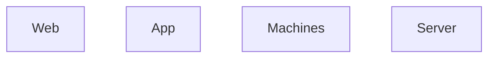

# Architecture

## Decided

### Server

A single-deployment, multi-tenant cloud SaaS, headless first: every capability is an API (OpenAPI) and an MCP tool before it is any screen, with the same permission checks behind both.

- **Language and framework:** Python 3.12+, FastAPI, Pydantic v2, async throughout.
- **Shape:** one deployment for every tenant, run as two or more stateless processes behind a load balancer.

### Data

- **Database:** one Postgres for every tenant, without pgvector.
- **Tenant isolation:** row-level security keyed on the org, enforced by the database.
- **Access:** SQLAlchemy 2 (async) over asyncpg.
- **Schema:** one schema file until relaunch, then Alembic migrations.
- **Background jobs:** a Postgres-backed queue.
- **Files:** object storage (R2 or S3), with references in Postgres.

### Operations

- OpenTelemetry tracing and metrics, logs tagged by tenant.
- Managed Postgres with point-in-time recovery, and connection pooling.

### Not at the start

- No single sign-on, SCIM, enterprise roles or audit log.
