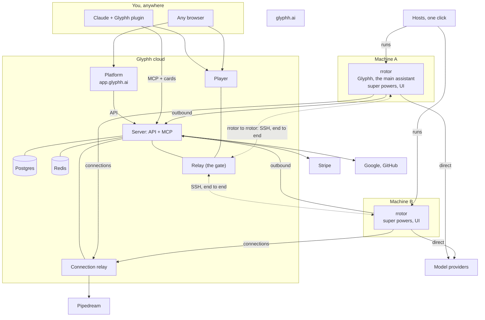

# Glyphh

The one doc for the relaunch: the [architecture](#architecture), the [data model](#data-model) and the [plan](#plan) (done, now, phases, open). The design lives in `glyphh-ai/glyphh`, `design/DESIGN.md`.

## Architecture




### How everything is built

- **Every capability is built in this order: the database (drawn in the data model first), then the API, then the SDK.** MCP exposes the same service function the API serves, so one function sits behind every surface.
- **100% test coverage is the target**, enforced in CI.
- **Builds and deploys are automatic:** every merge to main is tested, built and deployed, and clients update themselves.
- **Everything runs in Docker**, locally and in production.
- **Built to be run by agents:** agents write and operate this code, so every failure is explicit and traceable:
    - **Errors have codes.** Every refusal is a `GlyphhError` with a stable code (`E_INVALID`, `E_UNAUTHORIZED`, `E_FORBIDDEN`, `E_NOT_FOUND`, `E_CONFLICT`, `E_UNAVAILABLE`), answered in one shape: `{"error": {"code", "message", "trace_id"}}`, and as an MCP tool error carrying the same code and trace id.
    - **Crashes fail closed.** Anything else is caught at the edge (the request's outermost layer, and the guard around every MCP tool), logged with its traceback, and answered only `E_INTERNAL` with the trace id: never the crash's own message, never a half-done success.
    - **Everything is traceable.** Every request and tool call has a trace id (a caller's own `x-request-id` when it is safe, else a new one), echoed on the response, and every log line is one JSON object carrying it, the user and the org.
    - **Nothing is large.** CI fails a source file over 200 lines, a function over 40 or a class over 120 (`tests/test_code_shape.py`).

### Server

A single-deployment, multi-tenant cloud SaaS, headless first: every capability is an API (OpenAPI) and an MCP tool before it is any screen, with the same permission checks behind both.

- **API:** REST with OpenAPI over one service layer; Server-Sent Events where results stream (model output, long jobs, live updates).
- **MCP:** the Streamable HTTP transport on one `/mcp` endpoint, in stateless mode. Its tools are generated from the same service layer and curated to task-sized tools, not one per endpoint.
    - **Stateless:** every call stands alone and carries its own auth and tenant, so any process behind the load balancer answers it and a deploy or a crash drops nothing. A call still streams its progress and result.
    - **What stateless gives up:** pushes outside a call (resource subscriptions, tool-list change notices, the server asking the client something mid-session).
    - **If those are needed later:** keep the session state in Postgres, not in process memory, so the server stays scalable and needs no sticky sessions.

- **Language and framework:** Python 3.12+, FastAPI, Pydantic v2, async throughout.
- **Shape:** one deployment for every tenant, run as two or more stateless processes behind a load balancer.

### Paths

- **rrotor → CLI or model → provider:** the thinking goes straight to the provider, on the member's own subscription (Claude Code, Codex) or key (the Glyphh loop). Glyphh never sees it and never prices it.
- **rrotor → connector → server:** every connection call goes through the server, which relays it to Pipedream and counts it, because each one is a cost Glyphh pays.
- **Jev is a model, on the first path:** the member adds TypeSafe's Jev with their own key, and rrotor calls TypeSafe directly. It is never on Glyphh's key, never through the server, and never charged.

### Models

Glyphh is a model runtime, not a gateway. The one thing it governs is which models and connections an org's users may add, set by the org and narrowed by its teams. Spend, rate limits and every other rule belong to an AI gateway the customer puts in front of their models (a model's base URL can point at it). A model is a person's own: they add it with their own key (a provider, the provider's model id and an API key), and a super power is granted as many of theirs as it needs; when it runs, rrotor calls the provider directly with that key. Glyphh stores the model's setup and never routes, meters, limits or pays for a model call. The key is encrypted on the server and handed only to a member's own runtime.

Adding a model happens on the platform or in a card in Claude: picking a model for a super power opens the full catalog, the way connections opens Pipedream's, searchable by provider, name and type, each entry with its provider's logo, name, description and type. Picking one asks for the key right there; the page or card posts it straight to the server's API, and the server saves the model as the member's power, encrypted, and grants it to the super power being edited (Glyphh needs no grant). When that super power runs, rrotor asks the server for what it was granted and gets its models with their keys, over its own machine connection, and hands them to the loop and to the slots of its tasks. An agent never takes a key: a tool that needs one answers with a card (or a link to the page) where the member types it, and only hears back that it was saved and the key's last four characters.

### Connections

Connections are the moat: about 3,500 services (Gmail, Slack, Salesforce, ...) through Pipedream. A connection is always one person's own account; Pipedream holds the account and its sign-in, and Glyphh stores no secret for it. A super power is granted the connections it may use, and whichever loop runs it (Claude Code, Codex or rrotor's own), rrotor hands it exactly those and nothing of the loop's own (for Claude Code, `--mcp-config` with `--strict-mcp-config`). Every call goes through the server, which checks the tool's permission and the org's credits, relays it to Pipedream with a short-lived token minted for the run, and counts it.

### Glyphh and the super powers under it

- **Glyphh, the super agent, has everything:** every power, every super power and every machine the member has. There is one per member: the member's main assistant, the orchestrator.
- **Every other super power sits under Glyphh and has only what it is granted:** its folders (read or write), connections, models, skills, tasks, plugins, the machines it may run on and the other super powers it may call. Its loop is picked, not granted: every super power has exactly one. Nothing else of the member's, whether or not anyone is watching.

- **Who is driving decides what can be asked.** In a run the member drives, a tool set to `ask` asks them. In a run nobody is watching (autonomous: on a clock, or started by an agent), `ask` means refused, so it uses only tools that are allowed, by the member or by the super power's own override.

### The main assistant: Glyphh, on the loop the member picks

Decided 2026-10-11. Glyphh, the orchestrator, lives in the member's rrotor and is always on: a closed laptop changes nothing. Setting it up is choosing its loop, one of three, and none of them is priced in Glyphh tokens:

1. **Claude Code, on the member's Claude subscription.** It is already installed in rrotor; the member only signs in, through Anthropic's own login, in the CLI's own terminal.
2. **Codex, on the member's ChatGPT subscription.** The same: installed, the member signs in through OpenAI's own login (device code on a headless machine).
3. **The Glyphh loop, on a model the member configured with their own key** (any of the catalog's models, Jev included).

The same three are the loops a super power can run on, so a CLI is used like a model wherever a loop is picked.

- **A CLI's sign-in stays in the CLI.** rrotor runs the unmodified program and shows its own login; the credentials stay in that program's files on that machine. Glyphh never collects, stores or passes them, and the server never sees them. rrotor reports only which CLIs are signed in. (Anthropic allows hosting Claude Code this way under its Commercial Terms, which Glyphh accepts; OpenAI's terms for Codex are to be confirmed.)
- **rrotor's MCP surface powers the orchestration.** Whichever loop it runs on, the main assistant works through rrotor's own MCP tools: super powers and their grants, runs, schedules, connections, folders, the browser and the other machines. The same tools are what Claude reaches through the plugin, so the member's Claude on a desktop is one more window onto Glyphh, never what it depends on.
- **Seeing and hearing the swarm:** the main assistant and its super powers run in the same rrotor (and with voice on, the main assistant says it out loud, below), so its UI shows every running super power, its step, its log and its screens live, and the main assistant hears when one finishes, fails or needs an answer. When the member is away, the server sends a push or an email.

### Voice

rrotor talks and listens, and every super power has a voice of its own, set on its edit screen beside its avatar and name: one of the member's own speech models and one of that model's voices, with a sample to hear first (as the old app's super power editor had it). The member turns voice on for their rrotor, picks the speech-to-text model Glyphh hears them with, and presses the talk button in rrotor's UI, wherever it is open: inside Claude, or in any browser.

- **The audio streams between the browser and rrotor,** over the same encrypted channel as the UI: what the member says is transcribed in rrotor by their speech-to-text model, the main assistant answers on its loop, and the answer is spoken back in Glyphh's voice.
- **Hearing the swarm, literally:** the main assistant says what its super powers are doing as it happens (one finished, one failed, one needs an answer), and a super power that speaks for itself does so in its own voice, so the member can tell who is talking. The member can answer by voice.
- **Never priced by Glyphh, never through Glyphh's servers in the clear:** the speech models are called directly on the member's keys, and the relay passes only what it cannot read.

Glyphh has the super power editor: the skills and tools to create a super power, grant and take back its powers, machines and super powers, and test-run it. Only Glyphh edits super powers; a super power under it cannot change its own grants or another's. Every editor step is a server operation, so it is an API call and an MCP tool too: a member edits a super power by talking to Glyphh, or in rrotor's UI. Ported from the old app's super power and power builders.

### Tasks, the heart of rrotor

A task is a program rrotor runs, by hand, from a super power or on a clock, and it reaches the world only through its context. **In the UI a task is a power** (decided 2026-10-11): "task" stays as the power's kind, and people see "power" everywhere:

- `ctx.decide`: Jev, a model the member added with their own key, called directly;
- `ctx.agents.<slot>`: the model filling each of its slots;
- `ctx.connections.<service>`: its connections, through the server, counted;
- `ctx.rpa`: the browser, on a machine that has one;
- `ctx.checkpoint` and `ctx.log`: resume where it stopped, and its run's log.

**Dependencies.** A power declares what it needs: a task that needs Gmail and Slack, a chat model for its writing step and Jev says so. Adding it to a super power grants all of it at once; whatever the member does not have yet is asked for right there (connect Gmail, add a key), and it cannot run until everything is in place, naming what is missing. Jev is a dependency like any model.

**Discover.** Glyphh and orgs publish powers (skills, tasks, ...) and super powers to a catalog, each a bundle with its type and its dependencies; an org's listings are visible to its own members. Installing one copies it into the member's own powers, linked to the listing and its version so updates can be offered, and brings its dependencies with it as above. The tables for requirements and listings: see [Open](#open).

### Not in Glyphh, for now

- **Memory:** Glyphh has none of its own. A member who wants memory adds it as a power or a super power of their own.
- **Ada** comes later; the basics first.
- **A super power using the loop's own connectors** (the member's Claude or ChatGPT connectors beside Glyphh's): not now (2026-10-11). Connections stay Glyphh's, governed and counted.

### What a super power can be

- **Workflows and data pipelines:** what the power types (tasks and the rest) are today. They run on their own, by hand or on a schedule.
- **Screens:** a super power can have a UI of its own, not only a chat.

### What rrotor carries

Everything a super power needs to run, on the member's own machine:

- **The CLIs, already installed:** Claude Code and Codex, ready to be the main assistant's or a super power's loop once the member signs in.
- **Postgres with pgvector:** a super power's own data and its vectors. The server's Postgres has no pgvector; vectors live only in rrotor.
- **Neo4j:** a super power's graph.
- **Redis and cron:** queues, caches and the machine's own clock.
- **A Next.js server:** serves Glyphh's own UI (below) and each super power's screens.
- **The loop:** the CLI or rrotor's own, with the super power's models and powers.

It is the agent runtime: from it, a super power reaches about 3,900 models across about 125 providers directly, never through Glyphh's servers, and about 3,500 connections, which go through the server and are counted against the member's subscription.

**One rrotor, the full one, everywhere.** Every machine runs the same image, with everything above. There is no Glyphh app on anyone's desktop: the member already has Claude, Cursor or a CLI there, and opens Glyphh's UI from it. A laptop can run rrotor too, as just another host, through Docker (Docker Desktop, OrbStack, or WSL on Windows), when a member wants super powers on its local folders or its own internet address; Glyphh ships nothing desktop-specific for it.

A super power's data and screens live in its member's rrotor, never on the server: the server holds the super power's definition and its grants, not what it stores.

How a super power's data is kept apart from another's in that Postgres, and how its screens are laid out inside Glyphh's UI: see [Open](#open).

### rrotor is a Linux VM, and everything Glyphh runs is inside it

Decided 2026-10-11:

- **rrotor is a Linux machine of its own.** On a host it is a VM; on a laptop, Docker runs it inside a Linux VM of Docker's own, and only the folders mounted into it exist for it. Inside rrotor, each run is sandboxed again (namespaces and Landlock) to only the folders its super power was granted, so no shell, Bash tool or program can reach past them.
- **There is no Glyphh app on the desktop.** What the member drives on their own machine is their own Claude, Cursor or CLI, as it already is; everything Glyphh runs is inside rrotor.
- **Everything reaches a machine only through its rrotor, and only by grants:** another machine, Claude, a browser, or a super power running unattended. A super power is fenced whether or not anyone is watching it.
- **The old app's tools that touch files, shells, processes or a browser live in rrotor.**

### Runtime hosting

Glyphh does not host runtimes. Members run rrotor on their own compute: a server on any infrastructure, usually by one click, or their own laptop through Docker.

- rrotor ships as one Linux image, the same everywhere.
- It connects out to the server, never in, so a remote server needs no public address, ports or firewall rules.
- **One-click hosting:** a real VM, not a platform container (per-run sandboxes and the virtual screen need a whole machine): Fly Machines, AWS (a CloudFormation quick-create link), Azure (Deploy to Azure), GCP, DigitalOcean and Hetzner (a first-boot script), and a one-line install for any other VPS.
- **A new host registers itself:** the button carries a one-time code the server mints already approved, for minutes and one use; on first boot the machine trades it for its own token and SSH key. The member never copies a token, and no code is minted when the plan has no machine left.
- The server knows which machines a member has registered, what each is (where it runs, its platform and rrotor version), and whether each is online.

### Browsers and RPA on rrotor

Every rrotor runs a virtual screen (a display with no monitor) and a real Chromium in it, so a super power can work websites on a headless server: Glyphh drives the browser through Chromium's own control protocol (click, type, read, go to a page) and screenshots when it needs to see. The old app's RPA tools move here, and the old browser workers already ran this way.

- **Watching:** the screen streams to the member's app or the web over WebRTC, whose video is encrypted end to end by design: the server only passes the call setup over the relay, and a TURN relay used when no direct path exists cannot decrypt it. If WebRTC cannot connect, screen frames go over the SSH channel instead. The server never sees the screen.
- **Signing into a website:** the member takes control. The bot pauses, the member's taps and keystrokes go straight into the remote browser over the encrypted channel, they type the password and do the 2FA themselves, and hand control back. While they hold it no screenshot goes to the model, so a password or a code never reaches the model or a chat. The run's log records when control changed hands.
- **Sessions stay on the machine:** each browser profile (a `browsers` power) lives on one rrotor and is granted like a folder, so one super power's signed-in sites are never another's. Cookies never leave that machine.
- **Later:** a password manager (1Password) can fill sign-ins without the model seeing them. Passkeys are tied to the member's own device and cannot be used remotely; such sites need a password and 2FA through take-over.

### Machine to machine: SSH over the relay

A member's machines reach each other, so from machine A they can watch machine B work, drive it, or open a terminal on it. Neither machine needs a public address or an open port, and the server cannot read what passes between them.

- **Every machine connects out to the server** over one WebSocket, signed in with its own machine token (in a header, never in the URL). The server is the relay: it joins two of the member's machine connections and passes bytes between them.
- **The two machines speak SSH to each other** through that relay, so the encryption is end to end: the server forwards only ciphertext. The server is a jump host that cannot see in.
- **Keys:** each machine makes its own SSH key pair when it signs in. The private key never leaves it; the public key and its fingerprint are registered on the machine's row. A machine accepts only its member's own machines' keys, and remembers every key it has seen: a key that changes is refused, never trusted quietly, so even a compromised server cannot slip in a key of its own.
- **rrotor runs its own SSH server,** not the machine's system SSH, offering only rrotor's own channels:
    - **watch:** a run's events as they happen, with what came before it first, from rrotor's own Postgres;
    - **drive:** send a prompt, answer a question, stop a run;
    - **files:** inside the folders the member granted;
    - **shell:** off until the member turns it on for that machine (`shell_enabled`), because a shell is the whole machine.
- **Who:** for now only the machine's owner, from their own machines, from Claude, or from a browser through the player. The server checks it before joining two connections.
- **When B drops:** A is told at once, and can join again when B is back.

**The relay is the gate; rrotor is the fence.** The relay cannot read the stream, and an escape attempt never crosses it anyway (`cd /` happens inside B's VM), so the folders are enforced in B's rrotor, where what was not granted is not mounted. The relay guards the door in front: before it joins two machines it checks who is asking, which machine, which super power and which channel (watch, drive, files, shell) against the grants, and refuses anything else before SSH starts; B's rrotor checks the same again when the channel opens. When a grant is revoked, a machine removed or a power disabled, the relay cuts the live sessions at once and the server tells rrotor to unmount. When something inside a run reaches past its fence, rrotor reports it to the server (`fence_events`), and rrotor's UI shows it. Neither depends on the other being honest.

Ported from the old relay (`/ws/attach`), which kept the outbound sockets, the fixed list of methods and the folder grants, but let the server read every frame, put the user's sign-in token in the URL, and had no machine identity of its own.

### Platform and rrotor: what is in the system, and the work itself

Decided 2026-10-11. Two UIs, split by isolation:

| | **Platform** (app.glyphh.ai, and the same views as cards) | **rrotor's UI** (served by the app server on each rrotor) |
|---|---|---|
| Shows | What is in the system for you: powers, super powers and their grants, machines, catalogs, usage, billing, members | Super powers in action: the swarm, runs, logs, a super power's screens, voice |
| Data | Metadata, read through the API | What super powers make; it lives on the machine and never leaves it |
| Reached | A browser, or as cards in Claude and ChatGPT | Through the relay: a browser tab, or a live card in Claude |

**Why Glyphh is the same on every loop and every platform.** Powers are agnostic: a member combines them with their own subscription (Claude Code, Codex) or their own models, in any way they want (a super power that turns YouTube content into videos), and a super power sent to anyone works the same way every time. That holds because Glyphh controls the machine and the execution of the parts that matter, the actual work: tasks run on rrotor. Swap the orchestrator (Claude, Codex, the Glyphh loop) and a super power works as it was built.

**Doing is asking.** Creating and changing things (a skill, a task, a super power and its grants) is done by asking Glyphh in Claude, Codex or ChatGPT; the plugin's tools are the server's operations. The platform shows the result, takes quick fixes, and does what a chat cannot.

**The platform** is its own repo (`glyphh-ai/platform`) and its own Fly app: a static Vite + React site, a client of the API like the plugin, with no server or database of its own, so a UI change never redeploys the API. It also holds the ui component library (`@glyphh-ai/ui`). Every view is one component shown two ways: a page on app.glyphh.ai, and a card the MCP server serves to Claude and ChatGPT (MCP Apps), built from the same components. Clients without cards (Codex, CLIs) get the same answer as text with a link to the page.

- **The sign-in screens** (sign in, allow an AI host, approve a machine's code, join an org) are platform pages. The server keeps the OAuth endpoints and the Google and GitHub callbacks, and sends the browser to the platform for each screen; the screen's buttons send it back to the server, which still binds every flow to that browser.
- **My machines** (home), **deploy a machine** and its live status, **add Glyphh to your AI** (Claude, ChatGPT, Codex).
- **Connections:** the catalog, which account each is, reconnect, each tool's permission. **Connecting** sends the member to Pipedream's own sign-in, and three ways reach it, one link: a card's Connect button (the host opens it), the link in the answer, and the host's own prompt where it supports MCP's URL elicitation (Claude Code does; the Claude app does not yet, tested 2026-10-11). Glyphh's MCP server also serves the member's connected accounts as tools, through Pipedream, to any host, so a connection made once reaches Claude, Codex and every loop on rrotor.
- **Models:** the catalog with provider logos, add a model with its key, whether the key works. A key is typed into a card or a page and posted straight from it to the API with a short-lived ticket; it never passes through a chat. Tested 2026-10-11 in Claude: the card's ticket rides in the tool result's `_meta`, which the model never sees, and the card posts from its own origin (`*.claudemcpcontent.com`).
- **Billing** (org admins): the plan and changing it (preview, confirm, wait), the card on file (Stripe's own form), adding funds (one-off, $5 to $10,000), auto top-up, invoices (Stripe's portal).
- **Members and invites** (org admins).
- **Navigation** (decided 2026-10-11): the top nav is Machines, Super powers, Powers and Marketplace; **Org** for org admins (Members, Teams, Models, Connections, Review, Billing); **Glyphh admin** for super admins (Orgs, Models, Marketplace, Plans: each plan's versions and the billing settings).

**rrotor's UI** stays on the machine: its app server serves Glyphh's live view and each super power's screens.

**Each machine has its own address** (decided 2026-10-11): `<machine-id>.glyphh.ai`, an opaque id, never the machine's name. rrotor's UI and every super power's screens and streams hang off it. `*.glyphh.ai` points at the relay, which reaches the machine over its outbound connection. Still to decide: Decided with it (2026-10-11): **TLS is passed through by name** (SNI) to rrotor, which holds its own certificate got through the server, so the relay forwards only ciphertext, as it does for SSH; **a super power's own screens get their own origin** (`<power>.<machine-id>.glyphh.ai`), so an app a member installed can never read rrotor's session; **a machine's session lasts about an hour** and is refreshed while in use, and the server tells the machine at once, over its connection, when a member is removed or a token revoked.
 The platform and the cards reach it through the relay. A live card in Claude draws its own view from a stream off the machine rather than framing rrotor's page (a page framed inside a card came up blank, tested 2026-10-11), or opens rrotor's UI in a tab.

**Usage and billing** read the server's usage events and credit ledger through the API, scoped as the data model says (a user their own, an org admin the org, a super admin every org):

- **Usage:** the period's credit used and left, in dollars, then the same calls grouped by user, by connector, by super power, by machine and by day, and the call log under it: time, user, super power, machine, connector, tool, duration, credits and status, filtered by any of them and exported as CSV. Each row opens to its full detail.
- **Billing** (org admins): the plan, seats, included and extra machines, the period's dates, the included usage credit, the balance and its ledger in dollars, upgrading, adding funds, and Stripe's own pages for checkout, invoices and payment methods.

The API behind them is three operations, also MCP tools so an agent can answer "what did we spend on Gmail this month": a summary grouped by one dimension over a time range, the call log (filtered, newest first, paged by cursor), and the balance with its ledger.

**What the old app arranged goes:** workspaces, tabs, layouts and the dock were the desktop app's way of arranging its windows. With no app, Claude or the browser is the frame; where the member works is a machine and its folders, which are already powers.

### Sign-in screens

Small platform pages with no data of their own; the server owns every flow behind them:

1. **Sign in:** choose Google or GitHub; their page does the rest.
2. **Allow:** "Claude wants to use your Glyphh": allow or deny, for an agent host's OAuth.
3. **Approve a code:** "Is this code on your new machine or CLI?", for a machine's or a CLI's sign-in.
4. **Join:** an invite lands here, then goes to sign in.

API keys stay for scripts, CI and CLIs that would rather send a key.

### Interfaces

Two ways in, one per surface, both in the `glyphh-ai/glyphh` repo (private for now, public later), and the platform in its own repo. None carries logic of its own: same accounts, permission checks and tenant rules as the server.

- **SDK (on the API):** a typed client generated from the server's OpenAPI spec; handles sign-in and tokens, streaming over Server-Sent Events, retries and pagination. TypeScript first (the platform, rrotor's UI, the player and the plugin), Python second.
- **Plugin (on MCP):** one install for agent hosts (Claude Code and Claude Desktop, Cursor, ChatGPT apps): the `/mcp` connection signed in with OAuth, skills that teach the agent to use Glyphh's tools, and the native machine list that opens rrotor's UI.

### Access

- **Sign-in:** Google and GitHub. Their screens are the sign-in; the server takes the callback and returns to Claude, the platform, the player or rrotor's UI; the screens around it are platform pages. No magic links: mail scanners use them up, they break across devices, and they train people to click sign-in links in email. Microsoft can follow, the same way, when business users need it.
- **People are found by the provider's own id** for them, never by email alone, so a changed email or a hidden GitHub email still finds the same person.
- **Tokens:** after a Google or GitHub sign-in the server issues its own tokens to the platform, the player and rrotor's UI; every token carries its org. A machine's UI is opened with a launch ticket, never a token in a URL.
- **Machines** sign in with a code the member approves in the browser, and get a machine token of their own, sent in a header, never in a URL.
- **Agent hosts** (the plugin in Claude Code, Cursor, ChatGPT) sign in with OAuth: the member approves each host, and can revoke one without the others.

### Data

- **Database:** one Postgres for every tenant, without pgvector: the durable truth.
- **Live state:** Redis, managed with a standby, for what is only true right now: which server process holds each machine's connection, machine heartbeats (keys that expire on their own when a machine goes quiet), and messages between server processes (cut this session, unmount this folder, this grant was revoked); later rate counters and short-lived caches. Losing it loses nothing: machines reconnect and register again in seconds.
- **Joining two machines** happens on the process that already holds B's connection: A's request is sent there, so SSH bytes flow through one process and never cross between servers. Redis carries only the lookup and the control messages, never the bytes.
- **Tenant isolation:** row-level security keyed on the org, enforced by the database.
- **Access:** SQLAlchemy 2 (async) over asyncpg.
- **Schema:** one schema file until relaunch, then Alembic migrations.
- **Background work:** Postgres, with no queue table of its own: the clock reads `schedules.next_run_at`, and each job is its own table's state (a Stripe event not yet processed, a machine to unmount), taken with `FOR UPDATE SKIP LOCKED` so two processes never take the same one.
- **Files:** object storage (R2 or S3), with references in Postgres: power and super power bundles, run logs, provider logos.
- **What lives where:** the server's Postgres holds accounts, powers, grants, machines, schedules, runs, usage and billing ([data model](#data-model)). A member's rrotor holds what their super powers make: their data, vectors and graphs, and their screens. Nothing a super power stores ever lives on the server. **Conversations** (decided 2026-10-11): the server keeps each conversation's record (title, super power, machine, run, status, times), rrotor keeps the messages, and rrotor's UI opens them through the relay.

### Operations

- OpenTelemetry tracing and metrics, logs tagged by tenant.
- Managed Postgres with point-in-time recovery, and connection pooling.
- **Status page:** Better Stack, hosted, at `status.glyphh.ai` (decided 2026-10-11), checking the API, the platform and `/mcp` every minute from several regions. Never on Fly, so it stays up when we're down.

### Not at the start

- No single sign-on, SCIM, enterprise roles or audit log.

## Data model

The rule: the data model is drawn here first, then built. Database `glyphh`. Every table's id is a GUID (`uuid`).

```mermaid
erDiagram
    plans ||--o{ orgs : "limits"
    orgs ||--o{ orgs : "parent of"
    orgs ||--o{ users : "has"
    orgs ||--o{ teams : "has"
    teams ||--o{ team_members : "has"
    users ||--o{ team_members : "is in"
    orgs ||--o{ allowed_models : "limits to"
    teams ||--o{ allowed_models : "limits further to"
    catalog_models ||--o{ allowed_models : "allowed as"
    orgs ||--o{ allowed_connections : "limits to"
    teams ||--o{ allowed_connections : "limits further to"
    powers ||--o{ tool_permissions : "sets"
    super_powers ||--o{ tool_permissions : "overrides"
    users ||--o{ tokens : "signs in with"
    users ||--|| user_settings : "sets"
    users ||--o{ sign_in_identities : "signs in as"
    oauth_clients ||--o{ oauth_codes : "asks for"
    users ||--o{ oauth_codes : "approves"
    oauth_clients |o--o{ tokens : "issued to"
    users ||--o{ launch_tickets : "opens with"
    machines ||--o{ launch_tickets : "opened by"
    machines ||--o{ folders : "holds"
    machines ||--o{ fence_events : "reports"
    super_powers ||--o{ fence_events : "tried"
    runs ||--o{ fence_events : "during"
    users ||--o{ tool_permissions : "sets"
    orgs ||--o{ powers : "holds"
    users ||--o{ powers : "owns"
    users ||--o{ super_powers : "owns"
    orgs ||--o{ super_powers : "has"
    super_powers ||--o{ grants : "is granted"
    powers ||--o{ grants : "granted as"
    machines ||--o{ grants : "granted as"
    powers ||--o{ super_powers : "is the loop of"
    powers |o--o{ loops : "thinks with"
    powers ||--o{ slots : "declares"
    powers ||--o{ slots : "fills"
    super_powers ||--o{ schedules : "on a clock"
    powers ||--o{ schedules : "on a clock"
    machines ||--o{ schedules : "runs on"
    schedules ||--o{ runs : "fires"
    super_powers ||--o{ runs : "runs"
    machines ||--o{ runs : "ran on"
    runs ||--o{ usage_events : "spends"
    powers ||--o| models : "is a"
    providers ||--o{ catalog_models : "offers"
    providers ||--o{ models : "serves"
    catalog_models |o--o{ models : "picked from"
    powers ||--o| connections : "is a"
    powers ||--o| folders : "is a"
    powers ||--o| skills : "is a"
    powers ||--o| tasks : "is a"
    powers ||--o| plugins : "is a"
    powers ||--o| loops : "is a"
    powers ||--o| browsers : "is a"
    machines ||--o{ browsers : "holds"
    orgs ||--o{ api_keys : "issues"
    orgs ||--o| subscriptions : "pays through"
    plans ||--o{ subscriptions : "sold as"
    orgs ||--o{ credit_ledger : "earns and spends"
    orgs ||--o{ payments : "pays"
    payments ||--o| credit_ledger : "becomes"
    plans ||--o{ subscriptions : "is waiting to become"
    orgs ||--o{ usage_events : "uses"
    users ||--o{ usage_events : "makes"
    powers ||--o{ usage_events : "called through"
    super_powers ||--o{ usage_events : "called from"
    machines ||--o{ usage_events : "called on"
    usage_events ||--o| credit_ledger : "spends"
    runs ||--o{ power_events : "uses"
    powers ||--o{ power_events : "used as"
    super_powers ||--o{ power_events : "used by"
    machines ||--o{ power_events : "reported by"
    users ||--o{ machines : "registers"
    machine_sign_ins |o--o| machines : "registers"
    orgs ||--o{ invites : "invites"
    users ||--o{ invites : "sends"

    plans {
        uuid id PK
        text family "Free, Solo, Basic, Pro, Enterprise: what a person sees"
        int version "1, 2, ...: a change to a plan is a new version"
        text name UK "the family and version: Solo v2"
        int price_cents "per seat, per month"
        text stripe_price_id UK "null for Free and Enterprise"
        int max_seats "the most seats an org may have; null = no limit"
        int monthly_credit_cents "usage credit included each billing period, per seat, in dollars (cents)"
        int included_machines "null = no limit"
        int extra_machine_cents "per extra machine per month; null = no extras on this plan"
        text stripe_machine_price_id UK "the Stripe price extras are billed on"
        bool active
        int sort
        timestamptz created_at
        timestamptz updated_at
    }

    orgs {
        uuid id PK
        uuid parent_id FK "null only for Glyphh, the parent org"
        uuid plan_id FK
        text name
        bool limit_models "true = only the org's allowed models"
        bool limit_connections "true = only the org's allowed connections"
        text image_key "the org's picture, in object storage"
        bool member_api_keys "members may make their own API keys"
        timestamptz disabled_at "disabled by a super admin: no sign-in, machines cut off, schedules stopped, billing paused, data kept"
        text disabled_reason "why, as the super admin wrote it"
        timestamptz created_at
    }

    team_members {
        uuid team_id PK, FK
        uuid user_id PK, FK "a person can be in many teams"
        timestamptz created_at
    }

    teams {
        uuid id PK
        uuid org_id FK
        text name "unique in its org"
        bool limit_models "true = only the team's allowed models"
        bool limit_connections "true = only the team's allowed connections"
        timestamptz created_at
        timestamptz updated_at
    }

    allowed_models {
        uuid id PK
        uuid org_id FK
        uuid team_id FK "null = the org's list"
        uuid catalog_model_id FK "unique per list"
        timestamptz created_at
    }

    allowed_connections {
        uuid id PK
        uuid org_id FK
        uuid team_id FK "null = the org's list"
        text service "gmail, slack, ...; unique per list"
        timestamptz created_at
    }

    users {
        uuid id PK
        uuid org_id FK
        text role "super_admin | org_admin | user"
        text email UK
        text first_name
        text last_name
        text image_url
        text time_zone "every schedule reads its cron in it"
        timestamptz disabled_at "an org admin disabled the member"
        timestamptz created_at
        timestamptz updated_at
    }

    user_settings {
        uuid user_id PK, FK
        text theme "dark, light, system, ..."
        text notifications "on, off, ask"
        text permission_mode "ask, plan, accept_edits, auto: how new sessions start"
        text voice_mode "off, push_to_talk, continuous"
        bool voice_autoplay
        bool voice_brief "spoken replies kept short"
        bool sandbox_strict "runs reach only the allowed hosts"
        text[] allowed_hosts "hosts every sandboxed run may reach"
        timestamptz updated_at
    }

    powers {
        uuid id PK
        uuid org_id FK
        uuid user_id FK "whose it is: every power is one user's, for now"
        text kind "model, connection, folder, browser, skill, task, plugin, loop"
        text name "unique for its owner"
        timestamptz disabled_at "set while a limit leaves it out: it stops working and can only be deleted; cleared when allowed again"
        text disabled_reason "which limit left it out"
        uuid listing_version_id FK "the listing version it was installed from; null = made by its owner"
        uuid current_version_id FK "the version in use now; null until its first version"
        timestamptz created_at
        timestamptz updated_at
    }

    tool_permissions {
        uuid id PK
        uuid user_id FK "whose setting it is"
        uuid power_id FK "the power whose tool it is: a connection, a plugin, ...; null = one of rrotor's own built-in tools"
        text tool "the tool's name; unique per user, power (or built-in), tool and super power"
        uuid super_power_id FK "null = the user's own setting; set = that super power's override, for its autonomous runs"
        text permission "allow, ask, deny (an override is allow or deny)"
        timestamptz created_at
        timestamptz updated_at
    }

    models {
        uuid power_id PK, FK
        uuid provider_id FK
        uuid catalog_model_id FK "null = not in the catalog: a fine-tune, a private model"
        text model "the provider's own model id"
        text base_url "null = the provider's own"
        bytea api_key "encrypted; never returned"
        text api_key_last4
        timestamptz key_added_at
        timestamptz key_checked_at "the last time the key was tried against its provider"
        text key_error "the provider's last refusal of the key; null = it worked"
    }

    providers {
        uuid id PK
        text slug UK "anthropic, openai, google, fireworks, ..."
        text name "Anthropic"
        text logo_key "its logo, in object storage"
        text logo_dark_key "a copy for dark grounds, for a black mark; null = the logo serves both"
        text base_url "the provider's endpoint"
        bool active "false = turned off by a super admin, for now"
        timestamptz removed_at "removed by a super admin, for good; the row stays for the powers that point at it"
        int sort
        timestamptz created_at
        timestamptz updated_at
    }

    catalog_models {
        uuid id PK
        uuid provider_id FK
        text model "the provider's own model id; unique per provider"
        text name "Claude Sonnet, GPT-5, ..."
        text description "one or two lines on what it is good for"
        text type "chat, embedding, image, audio, video"
        text logo_key "null = the provider's logo; set when the maker differs (Llama on Fireworks)"
        bool active "false = turned off by a super admin, for now"
        timestamptz removed_at "removed by a super admin, for good"
        timestamptz created_at
        timestamptz updated_at
    }

    connections {
        uuid power_id PK, FK
        text service "what it connects to: gmail, slack, ... (Pipedream calls it the app slug)"
        text account_id "the Pipedream account, once the user has connected it"
        text account_label "which account, as shown: the Gmail address, the Slack workspace"
        timestamptz connected_at
        timestamptz needs_reconnect_at "Pipedream reports the sign-in expired or was revoked"
    }

    folders {
        uuid power_id PK, FK
        uuid machine_id FK "the machine the folder is on: the same path on two machines is two folders"
        text path "unique per machine for its owner"
    }

    browsers {
        uuid power_id PK, FK
        uuid machine_id FK "the rrotor its profile lives on"
        text profile "the profile's name in rrotor; its cookies and sessions never leave that machine"
    }

    skills {
        uuid power_id PK, FK
        text bundle_key "its files, in object storage"
    }

    tasks {
        uuid power_id PK, FK
        text bundle_key "its program, in object storage"
    }

    plugins {
        uuid power_id PK, FK
        text bundle_key "its files, in object storage"
    }

    loops {
        uuid power_id PK, FK
        text engine "claude_code (the member's Claude subscription), codex (their ChatGPT subscription) or glyphh (the Glyphh loop)"
        uuid model_id FK "for glyphh: the model it thinks with, one of the member's; null for a CLI, which signs in on the machine"
    }

    super_powers {
        uuid id PK
        text data_schema "its own schema in rrotor's Postgres: its data, vectors and graph"
        text data_role "the database role that reaches that schema and nothing else"
        uuid org_id FK
        uuid user_id FK "whose it is: every super power is one user's"
        text name "unique for its owner"
        text description "when to use it: the main assistant reads it to hand work over"
        text instructions "its standing brief, at the head of every turn"
        int avatar_variant "1..16, the face it wears"
        text avatar_color "a CSS colour"
        text avatar_key "a picture instead of the face, in object storage"
        int personality "1..5: serious to playful; 3 = as it comes"
        int directness "1..5: gentle to blunt"
        int temperament "1..5: kind to spicy"
        text effort "low, medium, high, xhigh, max; null = the session's own"
        text role "orchestrator or worker"
        bool live "false = paused: its schedules hold, nothing deleted"
        jsonb map_layout "where its power map's cards sit, as the member left them"
        bool glyphh "true = the member's Glyphh, the super agent: one per member, granted everything"
        uuid loop_id FK "the loop that runs it: one of its owner's loops; every super power has one"
        uuid voice_model_id FK "its voice: the speech model it speaks with, one of the owner's; null = it does not speak"
        text voice_id "which of that model's voices it speaks in"
        text voice_name "that voice's name, as shown"
        uuid listen_model_id FK "the speech-to-text model it hears the member with; set on the member's Glyphh"
        jsonb definition "the rrotor definition, still to be drawn; its data lives in rrotor"
        text bundle_key "its files (workflows, pipelines, screens), in object storage"
        timestamptz created_at
        timestamptz updated_at
    }

    grants {
        uuid id PK
        uuid super_power_id FK "the super power granted it"
        uuid power_id FK "a power: folder, connection, model, skill, task, plugin (the loop is picked, not granted); or"
        uuid machine_id FK "a machine it may run on; or"
        uuid granted_super_power_id FK "a super power it may call (exactly one of the three)"
        text access "for a folder: read or write; null for anything else"
        bool denied "on the member's Glyphh only: taken away from what it otherwise has"
        timestamptz created_at
    }

    slots {
        uuid id PK
        uuid power_id FK "the task (or other power) that declares it"
        text name "what its program calls it: writer, reviewer, ..."
        uuid model_id FK "the model that fills it, one of the owner's; null = not filled yet"
        timestamptz created_at
        timestamptz updated_at
    }

    schedules {
        uuid id PK
        uuid org_id FK
        uuid user_id FK "whose schedule it is"
        uuid super_power_id FK "what it runs: a super power; or"
        uuid power_id FK "a task (exactly one of the two)"
        uuid machine_id FK "where it runs"
        text name
        text cron "five fields"
        text time_zone "the zone the cron reads in: America/New_York, ..."
        jsonb input "what each run is handed"
        bool enabled
        timestamptz next_run_at
        timestamptz created_at
        timestamptz updated_at
    }

    runs {
        uuid id PK
        uuid org_id FK
        uuid user_id FK "who it ran for"
        uuid super_power_id FK "what ran: a super power; or"
        uuid power_id FK "a task (exactly one of the two)"
        uuid schedule_id FK "null = started by hand, or by an agent"
        uuid machine_id FK "where it ran"
        text trigger "schedule, manual, agent"
        text mode "driven (the member is at it: ask asks) or autonomous (nobody is: ask is refused)"
        text status "queued, running, succeeded, failed, canceled, missed"
        text error "the reason, when it did not succeed"
        jsonb result "what it returned, kept small"
        text log_key "its full log, in object storage"
        timestamptz scheduled_for "the time the clock meant; null when not scheduled"
        timestamptz started_at
        timestamptz finished_at
        timestamptz created_at
    }

    subscriptions {
        uuid id PK
        uuid org_id FK, UK
        uuid plan_id FK
        text stripe_customer_id UK
        text stripe_subscription_id UK "null on Free"
        text status "none, active, past_due, canceled, comped (set by a super admin, no charge)"
        int seats "the seats Stripe bills for"
        int extra_machines "bought on top of the plan's included machines"
        uuid pending_plan_id FK "a downgrade waiting for the period's end"
        timestamptz pending_plan_at "when it applies: the period's end"
        text card_brand "the card on file, for display only; Stripe holds the card"
        text card_last4
        int card_exp_month
        int card_exp_year
        text billing_email
        bool auto_top_up "charge the card on file when the balance runs low"
        int auto_top_up_below_cents "the balance that triggers it"
        int auto_top_up_to_cents "the balance it reloads to (it charges the difference, $5 to $10,000)"
        timestamptz auto_top_up_last_at "the last attempt: one attempt per 10 minutes, taken under the org's lock"
        timestamptz auto_top_up_failed_at "the card was refused: auto top-up is off until an org admin turns it on again"
        text auto_top_up_failure "why, as Stripe said it"
        int auto_top_up_monthly_cap_cents "the most auto top-up may charge in a period; null = no cap (the default)"
        timestamptz current_period_start
        timestamptz current_period_end
        timestamptz created_at
        timestamptz updated_at
    }

    credit_ledger {
        uuid id PK
        uuid org_id FK
        uuid user_id FK "who spent it; null for allowances and purchases"
        text entry "allowance, top_up, auto_top_up, grant, usage"
        int cents "credit, in dollars (cents): plus for allowance, top-ups and grants, minus for usage"
        uuid payment_id FK, UK "the payment a top-up came from; at most one entry per payment"
        text note "a grant's reason, from the super admin"
        uuid usage_event_id FK, UK "the call a usage entry pays for"
        timestamptz expires_at "the period's end for an allowance; a year after purchase for a top-up, as Anthropic's"
        timestamptz created_at
    }

    usage_events {
        uuid id PK
        uuid org_id FK
        uuid user_id FK "whose call it was"
        uuid power_id FK "the connection power"
        text service "a connection's service (gmail, slack, ...); kept as called"
        text tool "the tool called: gmail-send-email, ..."
        uuid super_power_id FK "the super power that called it"
        uuid machine_id FK "the machine it ran on"
        uuid run_id FK "the run it was part of"
        text status "ok, error, refused"
        text error "the reason, for error and refused"
        int duration_ms "the time the call took, timed by the server"
        int cost_cents "call_cents for each started seconds_per_charge (2¢ per started 30 s); 0 when refused"
        int request_bytes
        int response_bytes
        timestamptz started_at
        timestamptz created_at
    }

    billing_settings {
        uuid id PK
        int call_cents "what each started stretch of a connection call costs: 2 = $0.02"
        int seconds_per_charge "the stretch: 30 seconds, as Pipedream counts it"
        int top_up_min_cents "500"
        int top_up_max_cents "1000000"
        timestamptz effective_from "the row in force is the newest one already started"
        uuid set_by FK "the super admin who set it"
        timestamptz created_at
    }

    power_events {
        uuid id PK
        uuid org_id FK
        uuid user_id FK
        uuid machine_id FK "the machine that reported it"
        text event_id "rrotor's own id for it; unique per machine, so a batch sent twice counts once"
        uuid run_id FK
        uuid super_power_id FK
        uuid power_id FK "the power used; null for one of rrotor's own tools"
        text kind "model_call, tool_call, skill, task_step, folder_read, folder_write, browser"
        text tool "the tool's name, for a tool call"
        text model "the provider's model id, for a model call"
        int input_tokens "as the provider reported them"
        int output_tokens
        int cached_tokens
        text status "ok, error"
        text error_code "the provider's or the tool's code, never its message"
        int duration_ms
        timestamptz started_at
        timestamptz created_at "when the server took it"
    }

    usage_daily {
        date day PK
        uuid org_id PK, FK
        uuid user_id PK, FK
        uuid super_power_id PK, FK "the nil id when none"
        uuid power_id PK, FK "the nil id for rrotor's own tools"
        int uses
        int errors
        bigint duration_ms
        bigint input_tokens
        bigint output_tokens
        int connection_calls
        int cost_cents
    }

    payments {
        uuid id PK
        uuid org_id FK
        uuid user_id FK "who started it; null for an auto top-up"
        text kind "top_up, auto_top_up"
        int amount_cents "what was charged, in US dollars: $5 to $10,000"
        text stripe_ref UK "the Checkout session or PaymentIntent: one payment per Stripe charge"
        text status "pending, succeeded, failed, refunded"
        text failure "why it failed, as Stripe said it"
        timestamptz settled_at "when Stripe confirmed it: only then does the ledger get its credits"
        timestamptz created_at
    }

    invites {
        uuid id PK
        uuid org_id FK
        text email "who is invited"
        text role "org_admin or user"
        uuid invited_by FK
        text token_hash UK "the invite link's token; only the hash is kept"
        timestamptz expires_at
        timestamptz accepted_at
        timestamptz revoked_at
        timestamptz created_at
    }

    machine_sign_ins {
        uuid id PK
        text code_hash UK "the code the machine holds; only the hash is kept"
        text user_code UK "the short code the member types or sees"
        text machine_name "what the machine calls itself"
        text source "approve (the machine shows a code, the member approves it) or one_click (minted approved, for a new host)"
        text host "for one_click: fly, aws, azure, gcp, digitalocean, hetzner, vps"
        text status "pending, approved, denied, used"
        uuid user_id FK "who approved or minted it"
        uuid machine_id FK "the machine it registered"
        int interval_seconds "how often the machine may ask"
        timestamptz last_polled_at
        timestamptz expires_at
        timestamptz created_at
    }

    machines {
        uuid id PK
        uuid org_id FK
        uuid user_id FK "whose machine it is"
        text name "unique for its owner"
        text host "where it runs: fly, aws, azure, gcp, digitalocean, hetzner, vps, docker on a laptop; shown, never a limit"
        text platform "macos, windows, linux"
        text version "the rrotor build it runs"
        text token_hash UK "what it connects with; only the hash is kept"
        text ssh_public_key UK "the machine's SSH key; its private key never leaves the machine"
        text ssh_fingerprint "shown when the machine is registered, to check by eye"
        bool shell_enabled "false until the member turns it on: a shell on this machine over SSH"
        int[] local_ports "ports on this machine its runs may reach"
        timestamptz last_seen_at "null = never connected"
        timestamptz revoked_at
        timestamptz created_at
        timestamptz updated_at
    }

    api_keys {
        uuid id PK
        uuid org_id FK
        uuid user_id FK "who made it"
        text name
        text key_hash UK
        text prefix "shown, to tell keys apart"
        timestamptz expires_at
        timestamptz last_used_at
        timestamptz revoked_at
        timestamptz created_at
    }

    sign_in_identities {
        uuid id PK
        uuid user_id FK
        text provider "google or github"
        text subject "the provider's own id for the person; unique per provider"
        text email "the email the provider gave, at the last sign-in"
        timestamptz last_used_at
        timestamptz created_at
    }

    oauth_clients {
        uuid id PK
        text client_id UK "what the agent host sends"
        text name "Claude Code, Cursor, ChatGPT, ..."
        text[] redirect_uris
        timestamptz created_at
    }

    oauth_codes {
        uuid id PK
        uuid oauth_client_id FK
        uuid user_id FK "who approved it"
        text code_hash UK "only the hash is kept"
        text redirect_uri
        text code_challenge "PKCE"
        timestamptz expires_at "a minute or so"
        timestamptz used_at "a code works once"
        timestamptz created_at
    }

    launch_tickets {
        uuid id PK
        uuid user_id FK "the only member it opens for"
        uuid machine_id FK "the only machine it opens"
        text page "where in rrotor's UI it lands: home, a super power, a model's key, ..."
        text token_hash UK "only the hash is kept"
        timestamptz expires_at "a minute"
        timestamptz used_at "a ticket works once"
        timestamptz created_at
    }

    fence_events {
        uuid id PK
        uuid org_id FK
        uuid user_id FK
        uuid machine_id FK "where it happened"
        uuid super_power_id FK "what tried"
        uuid run_id FK "in which run"
        text kind "path, network, channel"
        text detail "what it reached for: a path, a host, a channel"
        timestamptz created_at
    }

    stripe_events {
        uuid id PK
        text stripe_event_id UK "Stripe's own id: an event is handled once"
        text type
        timestamptz received_at
        timestamptz processed_at
        text error "the last failure handling it; retried until processed"
    }

    tokens {
        uuid id PK
        uuid user_id FK
        uuid oauth_client_id FK "the agent host it was issued to; null = the player or rrotor's UI"
        text access_hash UK
        text refresh_hash UK
        timestamptz access_expires_at
        timestamptz refresh_expires_at
        timestamptz revoked_at
        timestamptz created_at
    }
    users ||--o{ listings : "publishes"
    orgs ||--o{ listings : "reviews and owns"
    powers |o--o{ listings : "listed as"
    super_powers |o--o{ listings : "listed as"
    categories ||--o{ listings : "groups"
    listings ||--o{ listing_versions : "has"
    powers ||--o{ power_versions : "is released as"
    super_powers ||--o{ super_power_versions : "is released as"
    power_versions ||--o{ listing_versions : "submitted as"
    super_power_versions ||--o{ listing_versions : "submitted as"
    listing_versions ||--o{ listing_screenshots : "shows"
    listing_versions ||--o{ listing_requirements : "needs"
    listing_versions ||--o{ reviews : "reviewed in"
    listings ||--o{ listing_comments : "discussed in"
    listing_versions |o--o{ powers : "installed as"

    categories {
        uuid id PK
        text slug UK
        text name
        int sort "the order a super admin sets"
    }

    listings {
        uuid id PK
        text kind "power or super_power"
        uuid power_id FK "the power it was made from (kind power)"
        uuid super_power_id FK "the super power it was made from (kind super_power)"
        uuid user_id FK "who made it"
        uuid org_id FK "the org that reviews it, and owns it when it is listed for the org"
        text reach "org (its org's members) or marketplace (everyone)"
        uuid category_id FK
        text name
        text summary "one line"
        text description
        text icon_key "a power's square icon, in object storage; a super power's icon is its cat"
        uuid published_version_id FK "the version people add; null = not published"
        bool featured "set by a super admin"
        int featured_sort
        timestamptz unpublished_at "taken down: installed copies keep working, nobody can add it again"
        timestamptz created_at
        timestamptz updated_at
    }

    power_versions {
        uuid id PK
        uuid power_id FK
        text version "from the manifest: semver (1.0.0, 1.1.0, ...), higher than the last; unique per power, never reused"
        text release_notes "from the manifest, required: what changed, up to 2,000 characters"
        jsonb manifest "the manifest as it was, frozen"
        text bundle_key "the bundle as it was, frozen, in object storage"
        uuid created_by FK "who made the version"
        timestamptz created_at
    }

    super_power_versions {
        uuid id PK
        uuid super_power_id FK
        text version "semver, higher than the last; unique per super power, never reused"
        text release_notes "required: what changed, up to 2,000 characters"
        jsonb configuration "its configuration and grants as they were, frozen"
        text bundle_key "its files as they were, frozen"
        uuid created_by FK
        timestamptz created_at
    }

    listing_versions {
        uuid id PK
        uuid listing_id FK
        uuid power_version_id FK "the power version submitted (kind power)"
        uuid super_power_version_id FK "the super power version submitted (kind super_power)"
        text state "draft, org_review, changes_requested, org_approved, glyphh_review, published, rejected"
        timestamptz submitted_at
        timestamptz published_at
        timestamptz created_at
    }

    listing_screenshots {
        uuid id PK
        uuid listing_version_id FK
        text image_key "re-encoded by the server, in object storage"
        int width
        int height
        int sort "up to six per version"
    }

    listing_requirements {
        uuid id PK
        uuid listing_version_id FK
        text kind "connection, model, skill, task, plugin, folder, browser"
        text need "what: the service (gmail), the model type (chat), the power's listing"
        bool optional
    }

    reviews {
        uuid id PK
        uuid listing_version_id FK
        text step "org (its org admin) or glyphh (for the marketplace)"
        uuid reviewer_id FK "the person who decided; null while only the reviewer agent has reported"
        text decision "approved, changes_requested, rejected; null = still open"
        text notes "what the reviewer said"
        jsonb agent_report "Glyphh's reviewer's report: permissions asked vs used, dependencies, screenshots, description, secrets found, the test run"
        timestamptz decided_at
        timestamptz created_at
    }

    listing_comments {
        uuid id PK
        uuid listing_id FK
        uuid user_id FK
        text body
        timestamptz created_at
    }

```


### orgs

Glyphh is the parent org: the one org with no parent. Every customer org's parent is Glyphh. Every org is on a plan: Glyphh itself is on Enterprise, and a new org starts on Free.

**For now an org is for billing and for limiting models and connections:** its plan, subscription, seats, machines and credits, who is in it (members and invites), and which models and connections its users may add (below). It owns no powers or super powers; those are each user's. Rows still carry `org_id` so the database keeps every org's data apart and counts its limits.

**A super admin can disable an org** (`disabled_at`, with a reason): its members can't sign in to it, its machines are cut off, its schedules stop, its billing pauses and its data is kept. Enable undoes all of it.

### plans

What an org pays per seat each month, and how many seats it may have (`max_seats`).

Seats are billed as the old server billed them (his rule, 2026-09-18):

- **A seat is an active user.** The subscription's `seats` is what Stripe bills for.
- **Adding a seat mid-cycle** raises `seats` at once, and the part-month is billed on the next invoice, never charged on the spot.
- **Removing a seat never lowers `seats` mid-cycle.** It drops only when the next invoice is created, with nothing refunded for a month already billed.
- **The billing date never moves:** it is set when the subscription starts.
- **At `max_seats`, an org upgrades to add more people.**

`stripe_price_id` is the Stripe price an org subscribes to; Free and Enterprise have none (Free needs no checkout, Enterprise is arranged with us).

**Plans are versioned, so a change never touches an org already on the plan** (his rule, 2026-10-11). A plan is a family (Free, Solo, Basic, Pro, Enterprise) and each row is one version of it, with its own price, seats, credits, machines and Stripe prices. A super admin changes a plan by making its next version: the new version is the one sold (one `active` version per family, enforced by the database), and the old one stops being sold but is never edited or deleted. An org stays on the version it signed up to, at that version's price and terms, until it changes plan itself (it then gets the version on sale) or a super admin moves it, with **30 days' notice** by email and a banner on Billing (2026-10-12). Stripe works the same way: a new version has new Stripe prices, and existing subscriptions keep theirs.

The plans carried over from the old server:

| Plan | Price per seat | Seats | Usage credit each month | Machines included | Extra machine |
|---|---|---|---|---|---|
| Free | $0 | 1 | $1 | 2 | none |
| Solo | $20 | 1 | $10 | 3 | $5 a month |
| Basic | $40 | up to 25 | $10 per seat | 10 | $5 a month |
| Pro | $150 | up to 100 | $50 per seat | 50 | $5 a month |
| Enterprise | arranged | no limit | arranged | no limit | n/a |

These are a first pick (2026-10-11), to adjust. **Every number lives in the database and a super admin changes it on Glyphh admin → Plans:** a plan's price, seats, credits, machines and Stripe prices (each change is the plan's next version, above), and the billing settings (`billing_settings`: what a connection call costs per started stretch, the stretch's seconds, the smallest and largest top-up), each kept with who set it and from when.

An org that already has its included machines plus its extras cannot register another: signing in from one more machine is refused with the reason (on Free: "Free includes 2 machines. Upgrade, or remove one."), and nothing is half registered.

Left behind from the old server: the margin and the dollar pool, the rate limits, the SSO and governance flags, the price history, and the machine terms. Beyond which models and connections users may add, Glyphh governs nothing: spend and rate limits belong to an AI gateway the customer puts in front of their models.

### users

A user belongs to one org and has one role in it:

- `super_admin`: runs Glyphh. Only users of the parent org.
- `org_admin`: runs their org's billing and members, and sees its usage.
- `user`: works in their org.

The profile is the user's first name, last name, email and profile image. A Google or GitHub sign-in finds the user by the provider's own id for them (below, Signing in), never by email alone. A user can be in many teams (`team_members`).

**user_settings** holds the member's own settings from the old app's Settings pages: theme, notifications, how new sessions start, voice, and the sandbox's allowed hosts. Glyphh keeps no memory of its own; memory is a power a member adds if they want it. What only ever applied to the desktop app's windows (workspaces, tabs, layouts, the dock, window sizes) is gone; a machine's own settings (its granted folders, its local ports, its shell) live on the machine.

### Teams: limiting models and connections

The org's Models and Connections pages exist only to say which models and connections users may add. They hold no keys and no accounts: a user still adds their own model with their own key, and connects their own account.

- **Two settings, two lists, at the org and at every team, with the same behaviour:** `limit_models` with `allowed_models` (picked from the catalog), and `limit_connections` with `allowed_connections` (services: Gmail, Slack, ...).
- **Everything is allowed by default:** both settings start off, and a user may add any model in the catalog and connect any service.
- **Limiting at the org:** when the org turns a setting on, the org admin adds what is allowed, and only that is allowed, org wide.
- **Limiting at a team:** a team turns its own setting on and lists what its members may add. Under an org that limits, a team can only narrow it: its list is part of the org's list, never more.
- **A user can be in many teams** (his rule, 2026-10-11; `team_members`), or in none.
- **A user adds what any of their teams allows:** the union of their teams' lists, where a team that doesn't limit allows everything; always inside the org's list when the org limits. A user in no team has only the org's limits.
- **The database enforces it:** a model or connection power outside the user's lists is refused with the reason, and taking an entry off the org's list takes it off every team's list too.

**A limit set later disables what it leaves out.** A model or connection a user already has stops working the moment a limit leaves it out: the database marks it disabled with the reason, rrotor is never handed it, and its calls are refused. A disabled power can only be deleted, never edited. When the limit no longer leaves it out (the item is allowed again, or the limit is turned off), it comes back on its own: the mark is cleared and everything hanging off it works as before (its grants, tool permissions, slots, schedules, key and account), with nothing for the user to redo.

### Invites

An org admin invites someone by email, with the role they will have. The invite link carries a token (only its hash is kept) and expires; signing in with Google or GitHub from it, as that email, makes the user in the org, and the invite is accepted. An open invite holds a seat, so an org at `max_seats` cannot invite more; an accepted one becomes a billed seat, and a revoked or expired one frees its seat. Only one open invite per email per org.

### Signing in

- **sign_in_identities:** a person signs in with Google or GitHub, and the server finds them by the provider's own id for them (`subject`), never by email alone: an email that changes, or a GitHub account with a hidden email, still finds the same person, and an email can never be used to reach someone else's account. The first sign-in links by email, once, through an invite or a new org.
- **The plugin signs in with OAuth:** an agent host (Claude Code, Cursor, ChatGPT) is an `oauth_clients` row; the member approves it in the browser, the host gets a one-time code (`oauth_codes`, with PKCE, a minute to live), and trades it for tokens issued to that client, so the member can see and revoke each host on its own.
- **launch_tickets:** how a machine's UI is opened, from Claude, the player or an agent's link (to enter a model's key, say): issued by the server for one member and one machine, landing on one page, for a minute, once. The rrotor checks it with the server and starts the session, so a member signs in once, on the server, never on a machine.

### tokens

What the server hands out after a sign-in: a short-lived access token and a longer-lived refresh token. Only their hashes are stored, so a stolen database holds no usable token. A token is revoked by setting `revoked_at`.

A token issued to an agent host carries its OAuth client (`oauth_client_id`), so each host is revoked on its own; the player's and rrotor's UI's carry none. Machines have their own token on `machines`, not here.

**api_keys** are the keys Glyphh issues, so a script or a runtime can call the Glyphh API; only a hash is stored, with a short prefix shown to tell keys apart.

### Powers

Everything a super power uses is a power: a model, a connection, a folder, a skill, a task, a plugin, or the loop that runs it. Who installed it is the control, with one more: the org and its teams may limit which models and connections can be added (above). Glyphh governs nothing else:

- **Models are a user's:** each person adds their own, with their own key. Nothing is shared or deduplicated: ten people adding the same model are ten rows, each with its own key, and one person may add the same model more than once (one per super power, say, to see each one's spend at the provider).
- **Connections are a user's:** always one person's own account (Pipedream accounts belong to a person; there are no shared or system accounts).
- **Folders, skills, tasks and plugins are a user's too:** for now every power is one person's own, built or installed for themselves. The org installs none.

The database enforces it: every power has a `user_id`.

Every power is a row in `powers` (who owns it, its kind and name), and one row in the table for its kind, holding that kind's own columns: `models`, `connections`, `folders`, `browsers`, `skills`, `tasks`, `plugins` or `loops` (which engine runs a super power or the main assistant: Claude Code or Codex on the member's subscription, or the Glyphh loop on one of their models). A super power points at `powers`, whatever the kind. What skills, tasks and plugins hold beyond their files is drawn when they are built.

- **A model** is a provider, the provider's model id and the API key (an optional base URL for providers that need one). rrotor calls the provider directly with that key: Glyphh never sits in the call and never sees its rates, prices, prompts or answers; rrotor reports only the tokens the provider says each call used (see Usage). What a model costs is between the person and their provider. A customer who wants limits or access rules puts their own AI gateway in front, through the base URL.
- **A connection** is a user's own account at Pipedream: the service it connects to (Gmail, Slack, ...) and the account id. Pipedream calls a service an app; Glyphh says service, because an app is something else here. Glyphh stores no sign-in for it: Pipedream holds the account and its tokens, under the Glyphh user's id as Pipedream's external user id. Linking one: the server asks Pipedream for a connect token for that user, and Pipedream's own page does the sign-in. Using one: the loop reaches Pipedream's MCP server (`remote.mcp.pipedream.net/v3`) with the Pipedream project, environment, service (`x-pd-app-slug`) and the user's id as headers, and a short-lived Pipedream access token the server mints for the run (Glyphh's Pipedream client credentials never leave the server). Only Glyphh's connections are used: a super power's loop gets exactly its connections, nothing of the loop's own.
- **A folder** is a path on one machine (`machine_id`): the same path on two machines is two folders, and a folder grant says read or write.
- **A browser** is a browser profile on one rrotor: its cookies and signed-in sessions live there and never leave that machine or reach the server. It is granted like a folder, so one super power's signed-in sites are never another's.
- **Skills, tasks and plugins** are bundles of files in object storage (`bundle_key`). **Versions are explicit, for published powers** (2026-10-11): the manifest carries the version and its release notes, and making a version freezes it as a `power_versions` row (version, release notes, the manifest and the bundle as they were). A version is semver and must be higher than the last, release notes are required (up to 2,000 characters), and a version number is never reused (2026-10-12). A super power's versions are `super_power_versions` the same way, its configuration and grants frozen. What is listed and reviewed is one of these versions (`listing_versions`), and an install points at the version it came from.
- **A secret** (a key, a sign-in) is encrypted at rest, never returned after it is saved, and handed only to the member's own runtime when a super power runs.
- **The catalog** is what the platform and its cards show when someone picks a model, and where every model's logo comes from: `providers` (each with its name and logo) and `catalog_models` (each provider's models, with a name, a description and a type). Every entry shows the provider's logo, the provider, the model's name, its description and its type. It is Glyphh's reference data, the same for every org: anyone signed in reads it, only super admins change it. **A super admin adds, edits, turns off and removes providers and models** (his rule, 2026-10-11). Turning one off (`active = false`) is for now: members can't add it, and their powers on it are disabled with the reason, the same way an org's limits work, and come back when it is turned on again. Removing one (`removed_at`) is for good: it leaves the catalog, and the powers on it are disabled with the reason and can only be deleted. A provider whose mark is black has a second logo for dark grounds. It starts from the old server's list (about 3,900 models across about 125 providers) and its 143 provider logos, kept in object storage. It holds no prices, rates or limits.
- **A model power** points at its provider (always) and at the catalog entry it was picked from (when there is one), so it shows that logo and name wherever it appears. A model the catalog does not have (a fine-tune, a private model) is still added, by its provider and model id, and wears the provider's logo.

Left behind from the old gateway: the router itself, LiteLLM's 80-odd tables, model access lists, the request log, budgets, margins and the dollar pool, spend roll-ups, auto-routers, and per-model flags nothing enforced.

### Tool permissions

Every tool a power brings (each tool of a connection, of a plugin's MCP server, ...) has a permission, set on the platform (or its card) where that power shows:

- **The user's own setting:** `allow` (runs without asking), `ask` (asks each time) or `deny` (never runs). A tool with no row is `ask`.
- **A super power's override:** for its autonomous runs, a super power can set a tool to `allow` or `deny`, whatever the user's own setting says. With no override, the user's own setting applies.
- **Autonomous means nobody to ask:** in a run nobody is watching, `ask` is refused, so an autonomous super power uses only tools that are allowed, by the user or by its override.
- **rrotor's own tools** (its ~250 built-in tools) have permissions too: a row with no power is a built-in tool's.
- **Where it is enforced:** a connection call at the server's relay, which every connection call passes through, so it holds even against a modified rrotor; every other tool in rrotor, which hands the loop only what is allowed.

### Super powers

Each member has one Glyphh, the super agent (`glyphh` true): it has every power, every super power and every machine they have, and needs no grants. Every other super power sits under it and has only its **grants**: each grant gives it one power (a folder, a connection, a model, a skill, a task or a plugin), one machine it may run on, or one other super power it may call. Nothing ungranted is ever handed to it, whether or not anyone is watching. A super power is one user's own, like every power: the org installs none.

**A loop runs it; models are granted.** Every super power has one loop (`loop_id`): Claude Code or Codex on the member's subscription, or the Glyphh loop on one of their models. The member's Glyphh has one too: its loop is the main assistant's. A CLI's sign-in never reaches this database; it stays in the CLI on the machine. Its models are grants like any other power, as many as it needs: the super power uses them directly, and the powers it has use them too (a task's slots).

**A super power's configuration** is everything its edit screen sets (ported field for field from the old app's editor): its name, description, instructions, avatar, voice, personality, directness and temperament sliders, effort, role, whether it is live, and its power map's layout. The member's Glyphh has the same fields, and has everything except what the member takes away from it: those are grants marked `denied`, so a new connection or model reaches Glyphh by itself. Left behind: per-model dollar caps (Glyphh never meters model calls) and the old per-agent guardrails, which nothing enforced.

**Every super power carries a voice,** part of its configuration on its edit screen, beside its avatar and name (ported from the old app's super power editor): a speech model of the member's own (`voice_model_id`) and one of that model's voices (`voice_id`), with a sample to hear before saving. The member's Glyphh also has the model it hears them with (`listen_model_id`). All are the member's own models, called directly on their keys; audio never reaches this database.

A super power's own files (its workflows, pipelines and screens) are a bundle in object storage (`bundle_key`); `definition` holds the rrotor definition (to draw: see [Open](#open)). What it stores (its data, vectors and graph) lives in rrotor, never here. Where the content of its conversations lives is still open.

### Discover: listings and review

Decided 2026-10-11, as the boards draw it (`ListingSubmit`, `OrgReview`, `AdminMarket`).

- **A listing** is a power or a super power someone offers: for their org's members (`reach` org) or for everyone (marketplace). A super power keeps its own table and is listed the same way as a power. Its icon is its cat; a power's is a square icon it uploads.
- **Every version is reviewed:** draft → org review (an org admin) → for the marketplace, Glyphh review → published. A reviewer approves, asks for changes (back to the maker, with notes) or rejects. A new version goes through review again, while the published one stays in use. Each step's decision is a `reviews` row with who decided, when and their notes, and the maker and reviewers talk on the listing's thread (`listing_comments`).
- **Glyphh's reviewer** is a super power of Glyphh's ("Marketplace Reviewer"). It runs on Glyphh's own machine, never a member's, reads only the submitted bundle and the listing, test-runs it sandboxed there, and writes its report on the Glyphh review step (`agent_report`): the permissions asked for against what it does, its dependencies, its screenshots and description, any secrets found, and the test run. A person makes the decision.
- **Pictures:** a square icon (PNG, 512 px) and up to six screenshots per version (PNG or JPEG, 5 MB each), in object storage. The server re-encodes every upload, which drops its metadata, and never takes an SVG, which can carry script.
- **Requirements** are what a version needs (`listing_requirements`): its connections, the types of model, other powers. Adding it grants them all, and what the member lacks is asked for right there.
- **Installing** copies the published version into the member's powers, linked to it (`powers.listing_version_id`) so a newer version can be offered.
- **Managing the marketplace** (super admins): featured listings and their order, categories and their order, and unpublishing, after which installed copies keep working and nobody can add it again.

### Slots

A task declares **slots**: the steps its program calls by name (`research`, `write`), and each slot is filled with a model. A task on a clock can run Gemini for step one and Claude for step two. A run is refused, with the slot named, while a slot it calls is empty. The UI for filling slots is still to be designed.

### Schedules and runs

Anything that runs on its own can be put on a clock: a super power or a task.

- **schedules:** what runs, on which of the member's machines, a five-field cron read in its own time zone, and the input each run is handed. Switched off with `enabled`, never deleted to pause.
- **The clock is the server's.** When a schedule is due, the server sends the run to its machine over the machine's connection. A machine that is offline at that moment gets the run marked `missed`, with the reason: nothing piles up and fires later in a burst.
- **A run is driven or autonomous** (`mode`): driven when the member is at it, so a tool set to `ask` asks them; autonomous when nobody is (a schedule, an agent), so `ask` is refused.
- **runs** is the history: every run, whether the clock, the member or an agent started it, with its status, its error, a small result and its full log (in object storage). A schedule's history is its runs. A run's connection calls are its usage events, so a run shows what it cost.
- **Who sees what:** as for usage. A user sees their own runs, an org admin the org's.

### Machines

Signing in always happens from a machine, and signing in is how a machine is registered: rrotor asks the server for a code, the member approves it in the browser, and the server registers the machine and issues its tokens (`machine_sign_ins` holds the code while it waits, only as a hash). Ported from the old server's device sign-in.

**One-click hosting** registers a new machine the same way, without the approve step: the member asks rrotor's UI or the plugin for a new host, the server mints a sign-in already approved (`source` one_click, the host named), and the host's button carries its code. On first boot the machine trades it for its own token and SSH key; the code works once and for minutes, then it is `used`. No code is minted when the plan has no machine left, so nothing is half set up.

A machine is a registered rrotor, the same full image wherever it runs: a server on any host, or a laptop through Docker. It connects out to the server with its own token (only the hash is kept) and reports what it is: where it runs, its platform, and the rrotor version it runs (builds update themselves, so the server sees which version each machine is on). `last_seen_at` says when it was last online. A folder is always on one machine (`folders.machine_id`): the same path on two machines is two folders, and a folder grant says whether the super power may only read it or also write it (`grants.access`). At sign-in a machine also makes its own SSH key pair: the private key stays on the machine, the public key is registered here with its fingerprint (see the architecture, Machine to machine). A plan includes a number of machines (`included_machines`). An org can add more for a monthly price per extra machine, set per plan (`extra_machine_cents`, billed on the plan's Stripe price for extras); the subscription carries how many it bought (`extra_machines`). An org can register up to its included plus its extra machines; revoking one stops it connecting and frees its place.

**Which server process holds a machine's connection is not in this database:** it is live state that is only true right now, so it lives in Redis (see the architecture, Data). `last_seen_at` here is updated when a machine connects and disconnects, not on every heartbeat.

**fence_events** are what rrotor reports when something inside a run reaches past its fence: a path that is not mounted, a host not on its network list, a channel it was not granted. The relay never reads the stream to find them; rrotor tells the server, and rrotor's UI shows them ("this super power tried to leave its folders").

A machine's shell over SSH is off until the member turns it on (`shell_enabled`).

### Billing and usage

An org pays a monthly fee for its plan, and the plan includes usage credit each billing period. **Credits are dollars** (decided 2026-10-11, as Anthropic does it): the balance, the allowance, top-ups and every charge are shown and kept in dollars. Usage spends credit, and Pipedream counts a connection call in 30-second stretches. The server relays every connection call and times it, so a call costs 2¢ for each started 30 seconds (`billing_settings`: `call_cents`, `seconds_per_charge`), above the $0.012 Pipedream charges Glyphh for each stretch. Model calls cost nothing here: they go straight to the provider on the member's own key.

What Pipedream charges Glyphh (Connect, Startup plan): $99 a month billed annually ($150 monthly) for 100 external users and 10,000 credits a month, then $2 per external user and $0.012 per credit. A connected user is a seat cost, so it belongs in the plan's price per seat; a call is usage.

- **The cap is the tier.** When an org's credits run out, its connection calls stop until the next period, with a clear message; there is never a surprise bill. An org can upgrade, or add funds.
- **subscriptions** tie an org to its Stripe customer and subscription, its plan, its status and its current period, as the old server did, plus what the old server lacked: a downgrade waiting for the period's end (`pending_plan_id`), and the card on file for display (brand, last four, expiry), kept current from Stripe's webhooks. Stripe keeps the card itself and the invoices; the invoice list is read from Stripe.
- **credit_ledger** is the whole story of an org's credit, in dollars (cents), append only: each period's allowance, each top-up and grant, and each use. The balance is the sum of what has not expired, so it is never stored twice. A usage entry points at the call it paid for; a top-up entry at its payment, at most one entry per payment, so a webhook and a reconcile arriving together can never add the same money twice.
- **Grants and comped plans** (super admins): a grant (a gift) adds credit, in dollars, with a note; a comped plan is a plan with no charge (`status` comped).

#### Adding funds, as the old server did

- **One-off top-ups, no packs:** an org admin adds any amount from $5 to $10,000, in US dollars, through Stripe Checkout (Stripe's own page, embedded). The card is saved for auto top-up as it pays. A `payments` row is made when the Checkout starts (pending); Stripe's webhook settles it (succeeded or failed), and only a succeeded payment adds credit to the ledger. A reconcile from Stripe backs the webhook up.
- **Auto top-up, as Anthropic's auto-reload:** on, a threshold and a balance to reload to. When a connection call leaves the balance under the threshold, the server charges the card on file (a PaymentIntent, off session) for the difference up to the reload balance. The attempt is taken under the org's row lock with a 10-minute gap, so two servers can never charge twice for one dip. A refused card switches auto top-up off, records why, and tells the org admins; it never retries a refused card in a loop. A payment Stripe confirms later (processing, then succeeded) still lands, from its webhook.
- **Credit is dollars:** a $5 top-up is $5 of credit. A plan's monthly credit ends with the period; **bought credit expires a year after purchase**, as Anthropic's does (2026-10-12), and the Billing page shows when.
- **Auto top-up has an optional monthly cap** an org admin sets (`auto_top_up_monthly_cap_cents`), off by default.
- **Runs cost nothing:** they run on the member's own machine. Only connection calls spend credit.

#### Changing plans, as the old server did

- **Preview, then confirm, then wait for Stripe:** the change is shown first (what is charged now, what the next invoice is), then confirmed, then the server waits for Stripe to confirm before showing the new plan.
- **Free to paid** is a Stripe Checkout. **Upgrades** apply now and are prorated on the next invoice. **Downgrades wait for the period's end** (`pending_plan_id`): the org keeps what it paid for until then. The old server applied them at once.
- **Seats** follow the seat rule: up mid-cycle (prorated on the next invoice), never down mid-cycle; the drop applies at renewal only (the old server also dropped them on top-up invoices, a bug not carried over).
- **Every Stripe event is handled once** (`stripe_events`), and a handler that fails is recorded and retried, never acknowledged and lost.

### Usage

**Billed usage** is logged in one place: the server's connection relay. A connection call is the only thing billed, a cost Glyphh pays, and every one goes through the server (rrotor → connector → server → Pipedream), so the server sees each call whole: who, through which connection, from which super power, on which machine, how long, and what it cost. Nothing billed is reported by the runtime about itself, so a modified rrotor cannot under-report.

One call, as the relay handles it:

1. **Check:** lock the org's row and read the balance. At $0, the call is refused with the reason and logged as `refused` ($0). Nothing reaches Pipedream.
2. **Call:** relay it to Pipedream and time it.
3. **Record:** in one transaction, a `usage_events` row and its `credit_ledger` usage entry. A call that fails at Pipedream is still logged (`error`) and still costs what Pipedream bills for it.

The check runs before the cost is known, so calls already in flight when the balance reaches 0 finish and are counted: the balance can dip below 0 by at most those calls, and the next call is refused. It never turns into a bill.

- **usage_events** is append only: never updated, never deleted by a request. It holds what was called and how it went, **never what went through it**: no arguments, no results, no message bodies. Those are the member's own data, and they stay between the runtime and Pipedream.
- **Model calls are never billed.** They go straight to the provider on the member's key, and Glyphh never sees them; rrotor reports their token counts (below). Jev is one of them: a TypeSafe model the member adds with their own key, never on Glyphh's key, never through the server, never charged.
- **Operational logs are separate:** request logs and traces go to OpenTelemetry, tagged by org; they are not billing and do not decide a charge.
- **Size:** the table is partitioned by month on `created_at`, indexed by org and time, and by org, user and time, so every page reads one org's range. **Kept 13 months** (decided 2026-10-11), as are `power_events`; after that only `usage_daily` keeps them.

#### What rrotor reports: every power and super power, counted, never billed

Decided 2026-10-11. Beside the metered connection calls, rrotor reports each use of a power inside a run, so members, org admins and publishers can see what is used, how often and how well. Counts and times only, **never content**: no prompts, arguments, results or keys. None of it is billed, and it never decides a charge.

- **power_events:** one row per use, sent by rrotor over its machine connection in batches: the model call (with the input, output and cached tokens exactly as the provider reported them, and the provider's model id), a tool call of a plugin or of rrotor's own, a skill loaded, a task step, a folder read or written, a browser session. Each carries its run, super power, power, machine, user and org, its status and how long it took. Each has rrotor's own event id (unique per machine), so a batch sent twice is counted once. Append only, partitioned by month like `usage_events`.
- **usage_daily:** the nightly roll-up of both tables, per day, org, user, super power and power: uses, errors, time, tokens, and connection calls and their cost. Every usage page reads it, and a day still running is read from the raw rows.
- **Listings:** a publisher sees their listing's installs (powers installed from its versions), installs used in the last 30 days, and runs; the marketplace ranks by them.
- **Trust:** a modified rrotor can only misreport its own member's insight, never a bill: what is billed is counted by the server.

#### Who sees what

The same rows serve every view, scoped by the principal:

- **A user** sees their own calls and their org's balance.
- **An org admin** sees every call in the org, and each member's power use with its model token counts (counts only, even on a member's own key; 2026-10-12), by user, by connector, by super power, by machine and by day, and the ledger.
- **A super admin** sees every org, and what Glyphh owes Pipedream for it: the same calls' 30-second stretches, at Pipedream's $0.012.

### Stripe

**stripe_events** records every Stripe webhook by Stripe's own event id, so an event delivered twice is handled once: a top-up is never added twice and a seat change never applied twice. A handler that fails leaves the event unprocessed with its error, and it is tried again; it is never acknowledged and lost.

### Limits are enforced by the database

Every limit (seats, machines, credits, and the org's and teams' allowed models and connections) holds even when requests race or code has a bug:

- **The database enforces it.** A trigger refuses a write that would take an org over its limit: a machine past its included plus extra machines, a user or invite past its seats, a model or connection outside the user's allowed lists. Credits are checked by the connection relay under the same org lock. A bug in a route cannot get around it.
- **No races.** The check locks the org's row before counting, so requests at the same moment are taken one after another; exactly one gets the last place, and the rest are refused with the reason.
- **Freed at once:** a revoked machine, a removed user, a revoked or expired invite stops counting immediately.
- **Downgrades never cut anyone off:** an org over its new plan's limit keeps what it has and cannot add more until it is back under.
- **Tested for each limit:** the limit, the refusal and its message, freeing a place, the downgrade rule, and concurrent requests racing for the last place.

### Scoping

Every API call and MCP tool runs as a principal: the user, their org and their role. The role decides what an operation allows and the org decides which rows it sees. Row level security in Postgres enforces the org under the code, so a bug in a query cannot reach another org's data. Inside an org, powers, super powers, machines, runs and usage are each one user's: a user reaches only their own, an org admin reads the org's usage and runs (never its keys), a super admin every org's.

## Plan

The house order: the data model is drawn first, then built as database, API and SDK, with MCP on the same operations; 100% test coverage; everything in Docker and CI. A phase is done when its checks pass in CI and it works end to end.

### Done

- **Phase 1, sign in from Claude and Codex** (2026-10-11): Google and GitHub sign-in; OAuth for MCP (metadata, `authorize`, `token` with PKCE and refresh, dynamic registration, `revoke`); `me` and the connected hosts on the API, MCP and both SDKs; the Glyphh plugin for Claude Code and Codex. Signed in and called `me` from Claude (app, iPad, Claude Code) and ChatGPT.
- **Phase 2a, orgs:** the org (plan, seats, rename), members (roles, disable, remove), invites (one-time link, withdraw), Join; seats enforced by the database under the org's row lock; the server refuses to boot on a database behind the code.
- **The platform** (`glyphh-ai/platform`): the component library moved there; the sign-in screens are platform pages and the server keeps every flow; each refused step says why.
- **Built tables:** `plans` (Free, Solo, Basic, Pro, Enterprise, with their Stripe prices), `orgs`, `users`, `tokens`, `sign_in_identities`, `oauth_clients`, `oauth_codes`, `invites`.

### Now

The sign-in screens on the design: tokens, Red Hat, the ported cat, the trace id alert, logo tiles, the theme toggle, the brand orbit, then the sign-in frame and the four flows.

### Drawn, not built

- **Powers:** `powers` and one table per kind (`models`, `connections`, `folders`, `skills`, `tasks`, `plugins`, `loops`). Every power is one user's own, with a disabled mark for when a limit leaves it out.
- **Catalog:** `providers` (with logos) and `catalog_models` (name, description, type), the list rrotor's UI picks models from.
- **Super powers:** `super_powers` (one loop each; the member's Glyphh has everything), `grants` (folders, connections, models, skills, tasks, plugins, machines, other super powers), `slots` (a task's steps, each filled with a model), `tool_permissions` (allow, ask, deny per tool, with a super power's override for autonomous runs).
- **Teams and limits:** `teams`, `allowed_models`, `allowed_connections`, and the two limit switches on orgs and teams.
- **Schedules and runs:** `schedules` (the server's clock, sent to a machine) and `runs` (the history).
- **Billing and usage:** the plan's credit and machine columns, `subscriptions`, `credit_ledger`, `usage_events` (logged by the server's connection relay, one per call).
- **Browsers and hosting:** `browsers` (a browser profile on one full rrotor, granted like a folder), and one-click sign-ins on `machine_sign_ins` for new hosts.
- **Configuration:** a super power's full edit-screen configuration on `super_powers`, Glyphh's taken-away powers as denied grants, the member's settings (`user_settings`), org settings and auto top-up.
- **People and machines:** `invites`, `machines` (with where they run, their SSH key, fingerprint and shell switch), `machine_sign_ins`, `fence_events` (what rrotor reports when a run reaches past its fence), `api_keys`; folders are on a machine, and folder grants are read or write.
- **Signing in and Stripe:** `sign_in_identities` (Google and GitHub by the provider's own id), `oauth_clients` and `oauth_codes` (the plugin's sign-in), `launch_tickets` (open one machine's UI, once, for a minute), `stripe_events` (each webhook handled once).

### Phases

1. **Sign in from Claude and Codex.** Done.
2. **Orgs and billing:** members, invites and seats are done; billing (plans, Stripe, top-ups, auto top-up, credits) is next: its decisions are made.
3. **Machines:** machine sign-in (approve a code), one-click hosting (Fly first), machine tokens, Redis for live state, deploy status.
4. **rrotor:** the image, the app server and Glyphh's UI, the main assistant on its three loops, rrotor's MCP surface, launch tickets, the player.
5. **Powers and super powers:** the catalog, models on the member's keys, grants, slots, tool permissions, the editor and its configuration, voice.
6. **Connections:** Pipedream connect, the connection relay, credits and usage, teams and limits.
7. **Runs and schedules:** the server's clock, runs and their history, the browser and RPA.
8. **Machine to machine:** SSH through the relay, the gate, fence events.
9. **Discover:** dependencies and listings.

### Open

Everything open: decisions still to make, things to draw, work found but not started. When something starts, it moves to Now.

#### Decisions

None open (2026-10-12).

#### To draw

- **Opening a machine:** the screens for a launch ticket that worked, one that expired or was used, a machine that is offline or waking, the wrong account, and a session that ran out (back through app.glyphh.ai for a new ticket).

- **Many orgs per person** (decided 2026-10-11): everyone has a Personal org plus any orgs they join; a memberships table (person × org × role); the host picks the org at Allow ("Use with"); tokens carry the chosen org; seats count memberships; an invite adds a membership instead of moving the person; a person can be in many teams in each org they belong to (2026-10-11).
- **The rrotor definition:** what a super power's definition holds (its workflows, pipelines and screens), and how its screens are laid out inside Glyphh's UI. Decided: each super power's data in rrotor's Postgres is its own schema, reached by its own database role and nothing else (2026-10-11).
- **Folder edits:** how edits made in a power's folder on a machine get back to the server. Not needed until rrotor is built.

#### To build

- **Sign-in screens on the design** (in progress, see Now): tokens, Red Hat, the ported cat, the trace id alert, logo tiles, the theme toggle, the brand orbit, then the sign-in frame and the four flows.
- **Allow, after the answer:** "You're connected / Back to Claude" and "Claude wasn't connected"; today the server returns straight to the host.
- **Join while signed in:** accept or decline (the board's default state), the inviter and the expiry on the invite, "You're in" with the org's machines.
- **Approve a code:** the machine and CLI sign-in (enter the code, confirm the machine, approved with its start-up steps), server and screens.
- **Connections through Glyphh's MCP:** the member's connected accounts served as tools to any host through Pipedream; connecting by a card's button, the link in the answer, and URL elicitation where the host supports it. The tested pieces are on the server's `card-test` branch.
- **Catalog descriptions:** the old list has none for its 3,900 models; write or import them.

#### Deploy

- **The server** runs only on the Mac behind ngrok; nothing is deployed.
- **The platform on Fly:** its app, `app.glyphh.ai` pointing at it, and `GLYPHH_PLATFORM_URL` set on the server.
- **Codex** is added but not signed in: run `codex mcp login glyphh` on the Mac.
- **Codex hosting terms:** check OpenAI's terms for hosting Codex signed in with a member's ChatGPT subscription (Glyphh accepts Anthropic's Commercial Terms for Claude Code).
- **The status page:** a Better Stack account, its checks, and `status.glyphh.ai` pointed at it.
- **Old prod:** stays stopped until the new server is live; then a final dump, and it is destroyed (decided 2026-10-11).

#### Design

- **The design agent's requests** (`glyphh-ai/glyphh`, `design/DESIGN.md`, Requests): Pagination, SegmentedControl, a themed Stripe Payment Element, ConnectFrame, a bars-by-day chart, Menu radio items, DescriptionList, a person and an org avatar, PowerMap and FlowCanvas (the editors).
- **The ui README** says rrotor's UI uses the library; rrotor gets a UI of its own.
- **Light theme** for the admin boards, the publishing boards and rrotor's splash: the design agent draws them.
- **Gaps from the admin and publishing boards** (2026-10-11; each drawn one way, to confirm):
    - **Members:** confirm dialogs for Change role and Disable aren't drawn; a disabled member is drawn as not using a seat (a seat is an active user); an invite's expiry is drawn as "[7] days".
    - **A member's "What you can add" view** (the union of their teams' lists inside the org's) is linked from Powers but not drawn.
    - **Comping a plan:** drawn as no invoices while comped and the card kept, not charged; whether the org's admins see "Comped by Glyphh" is open.
    - **The catalog:** drawn so a provider's switch overrides its models', a new provider stays hidden from members until one of its models is on, imported models arrive on but without descriptions (they wait under "No description"), and importing a provider's model list uses a test key of Glyphh's (who holds it is open). The `audio` type is labelled "Voice".
    - **Review:** drawn so a resubmit after Glyphh asks for changes goes back to the org admin first, a version Glyphh rejects is closed (a new version starts again at org review), withdraw is allowed while in review, and a listing only for the org needs no screenshots. Review times ("usually within [N] working days") and the licence options (drawn as Free) are open.
    - **"App" as a power kind:** Custom powers and the admin boards draw apps as a kind; `powers.kind` has none.
    - **An audit log of admin actions** (decided by Chris, 2026-10-11: yes): every change an org admin or Glyphh staff makes (members, teams, limits, keys, review, billing, gifts, comps, plan versions, disable, catalog, marketplace), with who, when, where from, and before → after; shown as Org → Audit log and Glyphh admin → Audit log (board `AdminAudit`). Needs a table (append only, like `usage_events`), how long it's kept, and who may export it.
    - **Usage by billing period:** the Usage board defaults to the org's billing period (credits by connector, a connector's tools, a closed period matching its invoice); the Billing boards don't link to it yet.
    - **API keys** (drawn as `ApiKeys`): a member's keys under the account menu, and **Org → API keys** for org admins. Decided by Chris (2026-10-11): turning off `member_api_keys` stops members' existing keys **straight away** (org admins' own keys are not affected); drawn so they come back if it's turned on again, unless revoked or expired. Needs a way to mark a key off without revoking it.
    - **Org nav grows:** Usage and API keys join the Org tabs (Members, Teams, Models, Connections, Review, Usage, API keys, Billing), beyond the navigation decided.
    - **Usage** (drawn as `UsageFlow`, `UsageMore`, `UsageAudit`): which time zone times and day boundaries use (the viewer's or the org's; `usage_daily`'s day); whether a period's unused credits expire at its end (drawn as expiring); whether the service's error text in `usage_events.error` is shown to members word for word; Plans and multi-select pickers (teams in Invite, filters) not drawn open.
    - **Moving orgs to a new plan version:** the least notice ([NOTICE]) and where org admins are told (drawn on their Billing page).
    - **API keys, still open** (drawn one way in `ApiKeys`): what a key may do (no scopes: drawn as "what you can in the org"); the default and longest expiry (drawn 90 days; never allowed with a warning); names unique per person, case ignored; the key's format (drawn `gk_live_…`) and how a script sends it; what happens to a key when its owner is promoted, demoted, disabled or removed; how long revoked and expired keys stay listed; whether an expiry warning is sent; rename, rotate and a cap on keys aren't drawn; "API keys" joins the account menu.
    - **Admin audit log, drawn one way** (`AdminAudit`): kept since the org joined (a limit would read "kept for [RETENTION]"); org admins export their org's, super admins any org's; whether an export is itself logged; org admins see "Glyphh staff", super admins the staff member's name; the IP region is city level and not shown for Glyphh's actions; Org and an org's detail gain an Audit log tab.
    - **Admin navigation on a phone:** drawn as a "Glyphh admin ▾" button above the sub-tabs; no board shows phone navigation yet.
