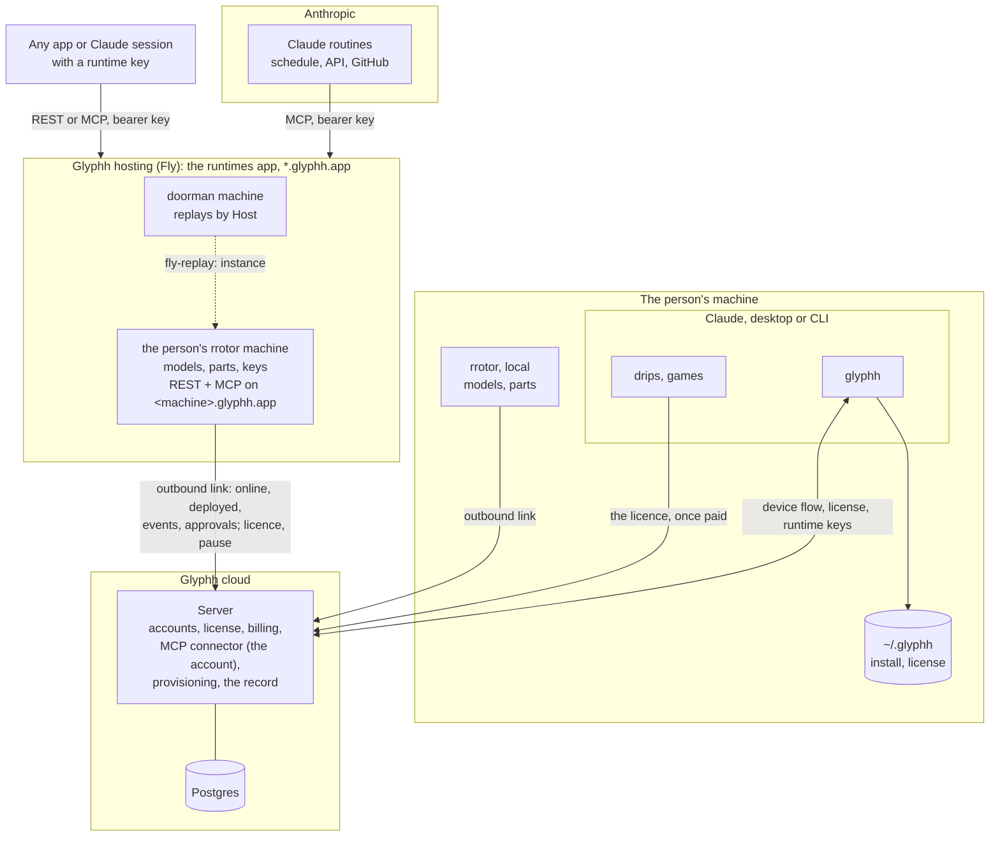
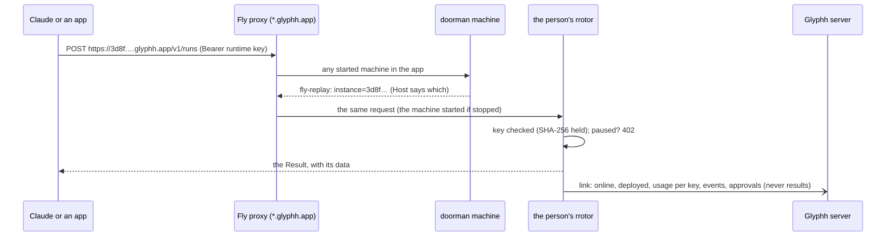
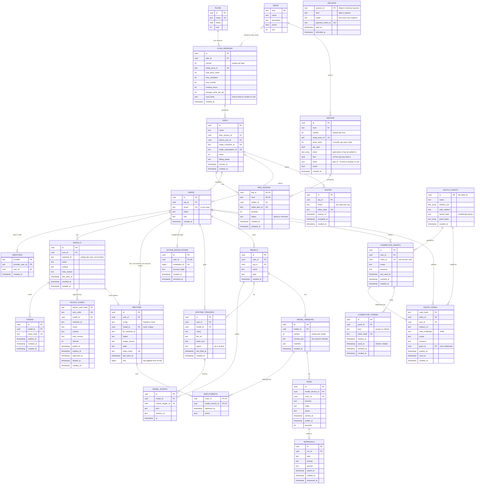

# Glyphh

Glyphh as it is built: the [product](#product), the [architecture](#architecture), the [data model](#data-model) and the [plans](#plans). Everything here works today, in `glyphh-ai/server`, `glyphh-ai/mods`, `glyphh-ai/glyphh` or `glyphh-ai/rrotor`; what is decided but not built is in [roadmap.md](roadmap.md), and nothing else. How the parts call each other, step by step, is in rrotor's `docs/architecture.md`. The platform's pages are specified in `glyphh-ai/platform`'s README, from the routes in [The platform](#the-platform) below.

## Product

**Glyphh is a platform, a server and runtimes.** A person signs in once on the platform (the one web app), has a runtime where their Ada models live and run, and connects Claude to that runtime once. Mods for Claude are products beside it: Claude Code plugins installed from one Glyphh marketplace, turned on by the same account.

| Mod | What it is | Runs | Sold | State |
|---|---|---|---|---|
| `glyphh` | The account: sign in, the licence, and the account, org, plan and billing panels. Every other mod depends on it | Claude | Every plan | Built |
| `drips` | Visual effects with sound over Claude: confetti, fireworks, hearts, a matrix rain; your own recipes, played by name or by Claude | The person's Mac | Once, $8 per machine, no account | Built |
| `games` | Games with sound over Claude: Missile Command, Chickn, Blocks, Rocks, Dash; your top score to beat | The person's Mac | Once, $8 per machine, no account | Built |
| Ada | Ada models in your runtime: a typed spec and a precedent store, deployed by commit, run with no network, called by Claude and by any app at the runtime's own address | **rrotor**, an isolated runtime: local on every plan; hosted on every plan | Add-on | Built: the runtime, the `ada` plugin (a skill, in `mods`), the SDKs `@glyphh-ai/ada` and `glyphh-ada` (`glyphh-ai/ada`, public) |

- **Ada is an add-on.** A plan (Free, Pro, Team) includes no mod: it sets the account's limits and which add-ons it may have. Each add-on is a line on the org's one Stripe subscription.
- **Drips and Games are bought once**, per machine, with no Glyphh account: a Stripe Payment Link, then a licence the server signs for that install, checked offline from then on (below, Bought once).
- **The platform is the one door.** Sign-in, the runtime and its keys, approvals, billing and the org are pages on the platform; the server renders nothing. In Claude, the `glyphh` mod and the Glyphh connector show the account too.
- **Glyphh has no model in it.** Claude is the brain, on the person's own Claude; Glyphh's machines do exact work. Glyphh never holds a Claude login ([Anthropic's terms](#anthropics-terms)).
- **Desktop first, then the CLI.** Mods look like Claude: its theme, its fonts. **Functional first:** every screen works before design draws it.

## Architecture




**What a person makes stays theirs:** their models, their precedents and their data, in their own rrotor. **Nothing of Glyphh's is on the data path:** a call goes from the caller to the person's machine over Fly's proxy, and the answer comes straight back. The server holds who they are, what they pay for, and the record of their models and runs, never their content, and never a result.

### The parts

| Part | What it is | Repo | State |
|---|---|---|---|
| **The platform** | The one web app: sign in, the runtime and its keys, approvals, billing, the org, the models record; every browser step of every flow | `glyphh-ai/platform` | Routes specified below; pages to build to the design |
| **The server** | The API and the authorization server: accounts, orgs, installs, the signed licence, plans and add-ons on Stripe, the Glyphh connector (`/mcp`), provisioning, the runtime link and approvals. Renders nothing | `glyphh-ai/server` | Built |
| **The `glyphh` mod** | The account in Claude | `glyphh-ai/glyphh` | Built |
| **The mods** | `glyphh` (the account), `drips` and `games` (bought once, on `shared/unlock/`), `ada` (the skill: build, deploy and call models on the runtime's connector; no hooks) | `glyphh-ai/mods` | Built |
| **The SDKs** | `@glyphh-ai/ada` (npm) and `glyphh-ada` (PyPI): a runtime's API for an app, with a runtime key; one contract (the Result, the Answer, the error) with fixtures taken live | `glyphh-ai/ada` (public, MIT) | Built; publishing on a `sdk-v*` tag |
| **rrotor** | The runtime Ada installs into: a small base image, the model sandbox and runner, and a part per mod | `glyphh-ai/rrotor` | Built, local and hosted |
| **The marketplace** | What buyers install from: each mod built, with its live values | Written by each source repo's release build | Built (publishing off) |

### The platform

The platform is a client of the server and nothing more: a confidential OAuth client for its own sign-in (tokens in a sealed HttpOnly cookie; the browser never holds a token), and the pages every browser flow lands on. The server sends a browser to these routes; each reads what it needs from the server and answers with the server call named.

| Platform route | Arrives from | Shows | Answers with |
|---|---|---|---|
| `/device` `?code=` | `GET {server}/v1/device?code=` (the link Claude shows; without a code, a field to type it) | The code to match against Claude's, Continue with each of `GET {server}/auth/providers` → `GET {server}/auth/{provider}/start?code=` | — |
| `/device/approve` `?consent=` | the provider's callback | `GET {server}/auth/consent?consent=` → `{kind: "device", code, name, surface, email}` | `GET {server}/auth/approve?consent=&decision=approve\|deny` |
| `/device/done` `?result=approved\|denied` | `/auth/approve` | Signed in, go back to Claude; or nothing was signed in | — |
| `/authorize` `?oauth=&client=` | `GET {server}/oauth/authorize` (a client's OAuth request, checked) | "<client> wants to use your Glyphh account", Continue with each provider → `GET {server}/auth/{provider}/start?oauth=` | — |
| `/allow` `?consent=` | the provider's callback | `GET {server}/auth/consent?consent=` → `{kind: "oauth", client, returns_to, resource, email}`: Allow or Deny | `GET {server}/auth/oauth/allow?consent=&decision=allow\|deny` (the server sends the browser on to the client) |
| `/account` `?linked=<provider>` | a provider link's callback | The account, with the provider now linked | — |
| `/github` `?installed=<login>` | the GitHub App's callback | The App is installed on that account | — |
| `/billing` `?done=1` | Stripe's checkout and portal | Billing, refreshed | — |
| `/error` `?code=&message=&trace=` | any refusal in a browser flow | The message and the trace id to quote | — |

The consent values are signed by the server and tied to the browser that started the flow by the server's short-lived cookie (`glyphh_signin`, ten minutes, on the server's domain), so the answering `GET` must be a top-level navigation from that browser. The platform reads `GET /auth/consent` from the browser itself (`credentials: include`): the server answers it with CORS for the platform's origin only (`GLYPHH_PLATFORM_URL`), with credentials. The cookie is `SameSite=Lax` when the platform and the server share a site (`app.glyphh.ai` and `api.glyphh.ai`), and `SameSite=None; Secure` when they do not (locally, `localhost` beside a tunnel), so that read still carries it. Signed in on the platform, a person reaching `/authorize` for a runtime connector sees only Allow.

The pages that are the platform's own, from the API with the session's token: Home (the runtime: `GET /v1/runtime`, its address, state, hours; `POST /v1/runtime/start`, `/stop`), Keys (`GET`/`POST /v1/runtime/keys`, `DELETE /v1/runtime/keys/{id}`), Approvals (`GET /v1/approvals`, `/stream`, `POST /v1/approvals/{id}`), Models (`GET /v1/models`, `DELETE /v1/models/{id}`), Billing (`GET /v1/plans`, `/v1/addons`, `POST /v1/billing/*`), Org (`GET /v1/org`, `/members`, `/invites`), Account (`GET`/`PATCH /v1/me`, `/v1/installs`, `POST /v1/me/identities`).

### Mods and how they are installed

- **A mod is a Claude Code plugin** whose hooks are a code module (`.claude-plugin/plugin.json`, `hooks/hooks.json` naming `register.tsx`). A mod can ship its own MCP server, skills and commands. Mods are behind `CLAUDE_CODE_ENABLE_FUNCTION_HOOKS` while the API is early access.
- **Installed from the Glyphh marketplace** at the user scope, so it loads in every session, the desktop's Code tab too. Every mod depends on `glyphh`.
- **Source and releases are apart.** The source repos hold tests, the shared modules and the release scripts; a release build writes only each mod's shipped files and the marketplace file, with the live server address and licence key swapped in.
- **A mod sold once** (`drips`, `games`) keeps its own licence and checks it at start; `/<mod> unlock` buys it. **A mod on the account** checks the plan's licence at start.

### Two kinds of panel

| | Mod panels | MCP App panels |
|---|---|---|
| What | Claude's own elements: boxes, text, buttons, inputs, selects, links, markdown, SVG | An HTML page with scripts that an MCP tool returns (`text/html;profile=mcp-app`, at a `ui://` address), shown in a frame |
| Can | Forms, lists, actions, on desktop and CLI | Live pictures, take control, anything a page can do; the host passes its theme as CSS variables |
| Used for | Account, org, plan, billing | The connector's account panel; the sign-in card |

Proved on 2026-10-12 (`glyphh-ai/server`, branch `proto/stream`): an MCP App panel in Claude showed a machine's screen live and took control of it. Its lessons hold: Claude's panel frame preflights every POST; tickets stay out of URLs; a panel's `ui://` address carries its version.

### `glyphh`: the account (built)

- **Sign in** by device flow: `/glyphh` shows the code and opens the link in Claude's browser pane (in the CLI, prints it); the link lands on the platform's `/device` page, where the person signs in with Google or GitHub and approves the install. One sign-in serves every mod on that machine. Asking Claude "sign in to Glyphh" shows a sign-in card in the chat, from the mod's own MCP server.
- **Licence:** fetched and checked (Ed25519) at start and refreshed daily; every mod reads it.
- **Panels:** account, org, plan, billing.

### `ada`: models and rrotor

**An Ada model is a typed spec and a precedent store; rrotor runs it; Claude calls it.** Ada is a library (`glyphh_kernel.py`, `glyphh_spec.py`, `glyphh_nsm.py`; numpy only): a model is `spec.json` and a small `model.py` whose functions call the kernel (`record`, `query`, `facts`, `probabilities`, `decide`). Nothing is trained; the model learns from the precedents it records. To rrotor a model is a **model**: a Python package with a manifest, deployed by commit, run in the sandbox, answering with a `Result`.

rrotor deploys a model by commit and runs it in its sandbox; the Ada part; the hosted runtime on Fly (on every plan, made on first start, stopped when idle, the plan's hours tallied); each runtime reached directly at `<machine>.glyphh.app` with a runtime key, REST and MCP served by rrotor itself (below, Reaching a runtime); the server's models record, rrotor's link, approvals and the GitHub App. Nothing calls a model through the server.

**A model**, as rrotor runs one:

```python
from rrotor import Ctx, Result


def load(ctx: Ctx) -> None: ...  # once per run: read config, open the store
def start(ctx: Ctx, inputs: dict) -> Result: ...  # the main job
def decide(ctx: Ctx, case: dict) -> Result: ...  # custom functions, each callable on its own
def end(ctx: Ctx) -> None: ...  # always runs: close up, keep results
```

- **Every call returns a `Result`:** a status and data. The status tells the caller what is next:

| `status` | Means | Claude does |
|---|---|---|
| `done` | Here is the result: data, a file, a link | Uses it, or finishes |
| `needs_input` | A value is missing, or a choice: "pick A, B or C" | Answers, then `continue` |
| `needs_approval` | About to act: "record this" | Asks the person; unattended, leaves it waiting for them |
| `failed` | Which step and why | Retries, tries another way, or reports |

- **`ctx` is what the model was granted**, nothing else: `ctx.http` (only the hosts the manifest declares; an Ada model declares none), `ctx.db` (its own databases, from the database parts), `ctx.secrets`, `ctx.files`, `ctx.log`, `ctx.checkpoint` (resume a run between calls).
- **Folders exist only through the model:** a model sees its own folder (`ctx.files`, `/data/models/<name>/files`) and its persistent data folder (`/data/models/<name>/data`, Ada's precedent store, outside git) and nothing else; no model reaches another's.
- **The manifest** declares the model's functions and their inputs, the hosts it reaches, its secrets, its databases, the parts it needs (Ada's kernel), the steps that need approval, and the Claude connectors its routine needs.
- **A model lives in the runtime and in git:** each is a repo in the person's own GitHub account; a version is a commit. The server keeps only an index (name, repo, versions as commit SHAs, where each is deployed) and the run records. Glyphh's cloud never keeps a copy of the code or the precedents.
- **Git is required for hosted models:** the person installs the Glyphh GitHub App on their account (built); deploying pins a commit, and the hosted rrotor fetches exactly that commit with a short-lived token the App issues for that repo. Local-only use needs no GitHub.
- **A redeploy that changes the encoding** (the spec's `seed`, `dim`, `encoding` or `spec_id`) re-encodes the store from its recorded facts before the new version is active, or refuses the deploy (`E_ADA_ENCODING`) when the old facts cannot be read by the new spec.
- **`clearance`** comes from the caller's Glyphh identity (the run's caller, the person's plan and org role), passed in the call and never from the inputs, so a model's facts are filtered by who asks.
- **Secrets are never committed:** they stay in rrotor's vault.

**In Claude, on the runtime.** Claude has the person's runtime as a connector (`https://<machine>.glyphh.app/mcp`, a runtime key): with the person it writes the spec and the model's functions, deploys by commit, calls the model (`model_call(model, function, inputs)`, then `model_continue(run_id, answer)` as needed), reads the result and fixes it until it passes. Any app does the same over REST (`POST /v1/runs` at the runtime's address) with a runtime key. Fly's proxy lands each request on the person's machine, starting it if it was stopped; nothing of Glyphh's sees the call or the answer. rrotor runs the step in its sandbox and answers the `Result`. There is no Ada mod; the runtime is started and its keys are made on the platform (or with the Glyphh connector's `start_runtime` and `create_runtime_key`).

A step that `needs_approval` waits for the person: the approval is on the platform's Approvals page and in Claude's band; the first answer wins.

### rrotor

**One isolated runtime per person, local and hosted.** A person never sees machines: they have a runtime where their models live and run.

| | Local runtime (built) | Hosted runtime (built) |
|---|---|---|
| Who | Every plan, Free included | Every plan: the plan's hours a month (Free 5, Pro and Team 50) |
| Where | The person's own computer (Apple's `container`, else OrbStack, else Docker), installed and started by the first mod that needs it | One Fly machine and its volume per person, made the first time the person starts it (`POST /v1/runtime/start`); nobody sees or manages it |
| Up | While the computer is on | Stopped after `GLYPHH_RUNTIME_IDLE_MINUTES` (10) with no run; a request to its hostname starts it (Fly) |
| Called by | Claude on that computer, on its loopback API | Claude anywhere and any app, at `<machine>.glyphh.app` with a runtime key |
| Caps | The computer's own | Runtime hours a month and storage, per plan |

Both run the same image and the same SDK; a model built locally deploys to the hosted runtime unchanged.

- **A small base image** (`ghcr.io/glyphh-ai/rrotor`): Python, Node, the model sandbox, the link client, the local API and the model runner. **Headless:** no UI, no desktop, nothing to log into.
- **A part per mod**, installed into rrotor from the mod's own release, versioned, verified and licensed by the plan: Ada's numpy and kernel, and the database parts (Postgres with pgvector, MongoDB, Neo4j) a model asks for.
- **No sign-in of its own:** the mod, signed in, asks the server for the runtime token (`POST /v1/runtime/local`) and hands it to rrotor; signing the install out cuts rrotor off.
- **No inbound ports from outside the machine:** the local API listens on loopback only, behind a token only the mod holds; rrotor connects out to the server and takes remote calls over that link.
- **Each run sandboxed** (bubblewrap, Landlock, seccomp): only its model and its own data mounted; network only through an egress proxy that lets through the hosts the manifest declares; anything else refused and recorded.
- **One volume, `/data`:** model versions, secrets (encrypted), run logs and outputs.
- **No Claude login, no model, no keys of Claude's** anywhere in it.

### Reaching a runtime

**Every hosted runtime has a public address, `https://<machine>.glyphh.app`, and nothing of Glyphh's is between the caller and it.**




- **One Fly app, `glyphh-runtimes`, a wildcard certificate `*.glyphh.app` and a wildcard DNS record.** The hostname *is* the machine id, so no lookup anywhere: a machine that gets a request for another `Host` answers `fly-replay: instance=<id>` and Fly's proxy replays it there, starting that machine if it is stopped. One small always-on **doorman** machine takes the first hop, so nobody's machine is woken to bounce someone else's request. `fly-replay` carries bodies up to 1 MB: calls, continues and MCP; a deploy bundle goes by git through the link as before.
- **Auth is rrotor's:** a request carries a **runtime key** (`Authorization: Bearer`), checked against the SHA-256s rrotor holds. Keys are made from the account (`POST /v1/runtime/keys {name, expires_in_days}`, or the `glyphh` mod and the connector's `create_runtime_key`), shown once, and their hashes reach rrotor in its `welcome` and as `keys` down the link when they change; revoking one is the same message. **A key expires** 1 to 365 days from when it is made, or never (`expires_in_days` left out): the platform warns before making one that never expires. An expired key leaves the list rrotor holds: the server's minute tick sends `keys` for any runtime whose key expired since the last, and a `welcome` never carries one. A revoked or expired key stays in the account's list, dated, until the person deletes it (`DELETE /v1/runtime/keys/{id}/record`); a live key cannot be deleted, only revoked first (`E_CONFLICT`, `reason: live`). The local rrotor keeps its loopback-only API and local token.
- **What rrotor reports, and never more:** every minute it has calls to report, rrotor sends `usage` up the link: for each runtime key that let a request in since the last report, its SHA-256, the number of calls and when it was last used (numbered, kept in rrotor's outbox until acknowledged, so each report counts once; calls in the minute before a crash are lost). The server adds them to that key's `calls` and `last_used_at`, shown with the key (`GET /v1/runtime/keys`). After **every** deploy, however it was asked for (the server's `deploy`, rrotor's own `POST /v1/models/deploy` or its MCP `model_deploy`), rrotor sends `deployed` with the model, version, commit, and the repo and manifest when it has them; a model or version the server has not seen is recorded then (in the person's org, without counting against the Ada models limit: the runtime already holds it), so `GET /v1/models` shows every model on the runtime. Each `hello` lists the versions active on the runtime, and the server records them the same way (without repo or manifest), so models deployed before the link last went down are never missed. Never a call's inputs, outputs or the key itself.
- **The API on the machine is rrotor's own** (rrotor's `docs/architecture.md`, section 7): `POST /v1/runs` answers the first `Result` with its data, `/continue`, `/cancel`, `GET /v1/runs/{id}`, `/log`, `/approvals`, `GET /v1/models`, `POST /v1/models/deploy`. **MCP too:** `https://<machine>.glyphh.app/mcp` (Streamable HTTP, the runtime key as the bearer) with `models_list`, `model_deploy`, `model_call`, `model_continue`, `run_status`, so Claude adds the runtime as a connector and talks to it directly.
- **The hours gate:** the plan version carries the month's hosted hours (Free 5, Pro and Team 50); every minute the server adds a minute to each online runtime's month and, past the cap, sends `pause` down the link and stops the machine; rrotor answers `402 E_LIMIT runtime_hours` to every request until `resume`, which the month's turn sends. `models` and `precedents` come from the licence in `welcome`.
- **The server's part:** provisioning (the doorman with the first runtime; a machine and its volume per person, its token and the public domain in its environment), keys, hours, the licence, the record of versions (`/v1/models`, by commit) and what rrotor reports up the link. Down the link go only the licence and keys (in `welcome` and as `keys`), `pause`/`resume`, a deploy, and an approval's answer (`continue`); no call, and no result comes up. The Glyphh connector's tools are the account's and the runtime's (`runtime`, `start_runtime`, `stop_runtime`, `runtime_keys`, `create_runtime_key`, `revoke_runtime_key`); calling a model is the runtime's own MCP.
- **One-time on Fly:** the app `glyphh-runtimes`, `fly certs add "*.glyphh.app"` on it, a wildcard DNS record `*.glyphh.app` to the app's IPs, and the hosted image pushed to `registry.fly.io/glyphh-runtimes` (Fly's proxy pulls no private GHCR image). The server's `GLYPHH_FLY_*` settings name them.
- **Why not a proxy of ours:** the server on the data path couples every customer's throughput to it and makes "we never see your data" a promise instead of a fact; a Cloudflare Worker (the archived `edge`) would do the routing with a lookup, a service token and an origin secret, and still terminate TLS on a third party. Fly's replay does it with none of that; if it proves flaky, the Worker is the fallback, with the same rrotor and server contract.

### On the machine: `~/.glyphh`

Only what the mods need to start and sign in; nothing here goes to the cloud.

| Path | What |
|---|---|
| `install.json` | This install's id and token, mode 0600 |
| `license.json` | The signed licence: plan, limits, mods, expiry |

### In rrotor: `/data`

The same layout in the local and the hosted rrotor. rrotor calls a deployed model a model, and its paths say so.

| Path | What |
|---|---|
| `models/<name>/<commit>/` | A deployed version of a model: the checkout of that commit, its manifest and installed dependencies |
| `models/<name>/files/` | The model's own folder, the only folder it sees |
| `models/<name>/data/` | The model's persistent data, outside git: its precedent store |
| `secrets/` | Each model's secrets, encrypted with rrotor's key |
| `parts/<part>/` | The parts the mods installed |
| `db/` | The database parts' data: each model its own database |
| `runs/<run_id>/` | A run's log, checkpoints and outputs |

### The server

The `glyphh-ai/server` repo: Python 3.13, FastAPI, Pydantic v2, SQLAlchemy 2 (async) on Postgres, in Docker. Database first, then API; 100% test coverage; errors with stable codes and a trace id; small files.

- **Sign in by device flow (RFC 8628)**; an **install** is a machine: signing in again on the same machine reuses its install, so the plan's installs count machines, not sign-ins.
- **Org:** the first user is its admin and pays; one org per user; members by invite.
- **Plans and seats:** per seat, through Stripe. A plan sets the account's limits; it includes no mod.
- **Add-ons:** every mod, one Stripe subscription item each on the org's one subscription, prorated; per seat or flat; each add-on version names the plans it may be added to, whether Free may have it, and the mod's limits on each plan (below, Add-ons).
- **Licence:** short-lived, signed, per install: plan, account limits, and each add-on the org has, with its limits (below, The license).
- **The Glyphh connector:** a remote MCP server (`/mcp`, Streamable HTTP) that Claude and routines call, signed in with OAuth (below, The connector). Its tools are the account's and the runtime's; calling a model is the runtime's own MCP, at its address.
- **The runtime link:** rrotor's outbound WebSocket (its own token); what rrotor reports comes up (online, deployed, events, approvals, each run's status and seconds) and only the licence, keys, `pause`/`resume`, a deploy and an approval's answer go down. A local runtime's token stops working when its install is signed out.
- **Approvals:** a step that needs approval is a row in `approvals` and a signal on **Redis** pub/sub to the server process holding the person's connection (`/v1/approvals/stream`: the platform's Approvals page, and Claude's band); the first answer wins. Redis runs on the server's own Fly machine and holds only what is live; Postgres holds everything kept.
- **Models:** the record of each Ada model (a model, to rrotor and in the tables), its versions and deployments, and of each run (who called it, status, times), never its content (`/v1/models`).
- **Hosting:** makes each person's runtime on Fly when they first start it (a machine and a volume in Glyphh's one Fly app, the runtime token in the machine's environment, the licence and keys in its `welcome`), stops it when idle, and tallies its online time against the plan's hours, pausing it past them until the month turns.
- **Limits are enforced here** where the server sees the use: members, seats and installs. Every mod limit the mod enforces from its licence.

### API

JSON over HTTPS under `/v1`, described by `/openapi.json`. Every call but the device flow's, the plans and mods lists, the browser steps and Stripe's webhook carries an install's token or an OAuth access token (`Authorization: Bearer`): the platform signs in as an OAuth client, so `/v1` takes either, as the same person and org. A caller by access token has no install: `POST /v1/sign-out` ends its grant instead, no install is `current` in `GET /v1/installs`, and `POST /v1/runtime/local` refuses it (a local runtime belongs to an install). `/mcp` takes only an access token. The server renders no page: a browser in a flow is sent to the platform (above, The platform). Refusals are `{"error": {"code", "message", "trace_id"}}`; a limit is `E_LIMIT` with `limit`, `used`, `max` and the `plan` that lifts it.

| Area | Calls |
|---|---|
| Device flow | `POST /v1/device/code` (with the mod's `machine_id`), `POST /v1/device/token`, `GET /v1/device?code=` (to the platform's `/device`) |
| Browser steps | `GET /auth/providers` (`{providers: [google, github]}`), `GET /auth/{provider}/start?code=\|link=\|oauth=` (to the provider), `GET /auth/{provider}/callback` (to the platform's `/device/approve`, `/allow` or `/account`), `GET /auth/consent?consent=` (what a consent asks), `GET /auth/approve?consent=&decision=`, `GET /auth/oauth/allow?consent=&decision=`, `GET /billing/done` (to the platform's `/billing`); each consent signed, ten minutes, tied to the browser by the `glyphh_signin` cookie; a refusal on any of these goes to the platform's `/error` |
| Account | `GET`/`PATCH /v1/me` (the plan with each mod's limits, and what is used where the server sees it: members, seats, installs), `POST /v1/me/identities` (a link that adds Google or GitHub), `DELETE /v1/me/identities/{provider}`, `GET /v1/installs`, `DELETE /v1/installs/{id}`, `POST /v1/sign-out`, `GET /v1/license`, `GET /v1/license/key` |
| Org | `GET`/`PATCH /v1/org`, `GET /v1/org/members`, `DELETE /v1/org/members/{user_id}`, `GET`/`POST /v1/org/invites`, `DELETE /v1/org/invites/{id}`, `POST /v1/invites/accept` |
| Mods, plans, billing | `GET /v1/mods` (each mod, the plans that include it, and `addon`: the add-on it is sold as, `price_cents`, `per_seat`, `plans` and `free`, or `null`), `GET /v1/plans` (each plan's newest version: price, account limits, each mod and its limits), `POST /v1/billing/checkout`, `/plan`, `/seats`, `/portal`, `POST /v1/stripe/webhook` |
| Bought once | `GET /v1/unlock/license?mod=&install=` (open: `paid` false until the mod's Payment Link checkout for that install is paid, then the licence); Stripe's webhook records `checkout.session.completed` in `payment` mode and `charge.refunded` (below, Bought once) |
| Add-ons | `GET /v1/addons` (the catalog for the org's plan, with prices, and what the org has), `POST /v1/billing/checkout` with `addons`, `POST /v1/billing/addons/preview`, `POST /v1/billing/addons`, `DELETE /v1/billing/addons/{mod}` (below, Add-ons) |
| Runtime | `POST /v1/runtime/local` (a local rrotor's runtime token, for this install: made the first time, rotated after, shown once); `/v1/runtime/link`, the runtime's outbound WebSocket, hosted or local (protocol 1, as rrotor's `docs/architecture.md` section 6: the token in the `Authorization` header, a local runtime refused once its install is signed out, `hello` then `welcome`, the runtime `online` until it closes; results and events acked and applied once by their sequence number; a newer link of the same runtime takes over). Which server process holds which link: in memory, and a Redis channel per runtime, so a call made on any process reaches it. The service functions other code calls: `send_call` (writes the run; `call` carries the caller's `clearance`, 0 to 1, the model's `ctx.clearance`), `send_continue`, `send_cancel`, `send_deploy`. A local runtime no process holds answers `E_UNAVAILABLE` with when it was last seen; a hosted one is woken (its machine started, `wake_hosted`) and the message waits up to 45 s for its link. `GET /v1/runtime` (the hosted runtime: state, region, image, run time this month, the plan's hours), `POST /v1/runtime/start` (made the first time, on any plan; `E_UNAVAILABLE` `hosting_off` or `fly_failed`), `POST /v1/runtime/stop`, `DELETE /v1/runtime` (the machine, the volume and every model's data on it); `GET`/`POST /v1/runtime/keys` (a key shown once, `glyphh_rk_…`; its hash to rrotor at once when linked, else in its next welcome), `DELETE /v1/runtime/keys/{id}` (revoked: named in the list, dated, no longer taken) |
| GitHub | `POST /v1/github/install` (a link for the browser, as linking does), `GET /v1/github/install` (to the Glyphh GitHub App's install page), `GET /v1/github/callback` (records the installation, from the browser that started it, when GitHub says it is on the person's own GitHub account), `GET /v1/github/installations`; the Cloud mints a repo-scoped installation token per deploy |
| Routine triggers | `GET`/`POST /v1/routine-triggers` (name, fire URL, token, optional model; the token is never shown again), `DELETE /v1/routine-triggers/{id}`; the Cloud fires them (`POST …/fire`) on a model's events |
| Connector | `GET /.well-known/oauth-protected-resource` (and `/mcp` after it), `GET /.well-known/oauth-authorization-server`, `POST /oauth/register`, `GET /oauth/authorize`, `POST /oauth/token`, `POST /oauth/revoke`, `POST /mcp`; `GET /v1/connector/grants`, `DELETE /v1/connector/grants/{id}` (below, The connector) |
| Models | `GET`/`POST /v1/models` (within Ada's `models` limit, `E_LIMIT` past it; `E_FORBIDDEN` `no_ada` without Ada; a name once per person), `GET`/`DELETE /v1/models/{id}` (the record, its versions, deployments and runs; the rrotor keeps its copy until a `remove` deploy), `POST /v1/models/{id}/versions` (a commit's SHA and its manifest: the next version; `E_CONFLICT` `commit_known`), `POST /v1/models/{id}/deploy` (`version`, `action` deploy \| activate \| remove, `runtime_id` or the caller's own: the install's local runtime, else the one seen most recently; the rrotor answers `deployed` on its link and only then is the version active there) |
| Runs | None here: a model is called on the runtime itself (above, Reaching a runtime). The server keeps the run record it hears over the link (status, times, seconds), never inputs or outputs |
| Approvals | `GET /v1/approvals` (waiting, newest first), `GET /v1/approvals/stream` (server-sent events: `approval`, `answered`; the waiting ones replayed first, a heartbeat every 20 s), `POST /v1/approvals/{id}` {`approve` \| `decline`} (first answer wins); a run's `needs_approval` enters through the link; the answer goes down it as `continue` (a runtime not connected answers `E_UNAVAILABLE` and the step keeps waiting). Not built yet: the email when no Claude is open waits on a mail provider (`notified_at` stays empty) |

### The license

`GET /v1/license` answers the install's license; `GET /v1/license/key` the public key (`{"alg": "Ed25519", "public_key": "<base64 of the raw 32 bytes>"}`). A mod verifies it offline: the signature (base64) is Ed25519 over the payload's canonical JSON, the payload's keys sorted at every level, no spaces, ASCII only (Python's `json.dumps(payload, sort_keys=True, separators=(",", ":"))`, UTF-8), and the license holds until `expires_at` (24 hours; the mod fetches a new one daily).

```json
{
  "payload": {
    "install_id": "6a1d…",
    "user_id": "0f3c…",
    "org_id": "9b2e…",
    "plan": "Pro",
    "limits": {"members": 1, "installs": 5},
    "mods": {
      "ada": {"limits": {"models": 3, "precedents": 10000}}
    },
    "expires_at": "2026-10-16T09:30:00Z"
  },
  "signature": "q8Zk…=="
}
```

(A Pro org with the Ada add-on.)

- `mods` names each add-on the org has, and only those, with that add-on version's limits on the org's plan. A mod not in it is not included; a retired mod is in no license. `limits` holds every limit of that mod: a number, or `null` for unlimited; a switch is `0` or `1`.
- `limits` at the top are the account's: `members` (per org) and `installs` (per user), `null` for unlimited.

### Add-ons

Every mod is an add-on to the plan: a line on the org's one Stripe subscription, on the same invoice, prorated when it changes. Writes are the admin's.

- **`GET /v1/addons`** (anyone in the org): each add-on on sale, and each the org has (at the version it added): `mod`, `name`, `description`, `version`, `price_cents` (a month, per seat when `per_seat`, else flat), `per_seat`, `monthly_cents` (for the org's seats now), `plans` (the paid plans it may be added to), `free` (whether a Free org may have it), `allowed` (on the org's plan), `limits` (the mod's limits on the org's plan; `null` when the plan may not have it and the org hasn't it), `added`, `quantity` (on the subscription; `null` when not added).
- **`POST /v1/billing/checkout`** `{"plan", "seats", "addons": ["ada"]}`: one Checkout with the plan's line and one per add-on (a per-seat add-on's quantity is the seats, a flat one's 1). `plan` `Free` with only add-ons the catalog allows on Free subscribes to those alone.
- **`POST /v1/billing/addons/preview`** `{"mod", "action": "add" | "remove"}`: what changes now, from Stripe's preview invoice (`POST /v1/invoices/create_preview` on the subscription): `{"mod", "action", "prorated_cents", "currency", "monthly_cents", "proration_date"}`; `prorated_cents` is the sum of the proration lines (negative for a credit), `monthly_cents` the add-on's monthly amount at the seats now. Passing `proration_date` back when applying makes Stripe charge exactly what was previewed.
- **`POST /v1/billing/addons`** `{"mod", "proration_date"?}` adds a subscription item, prorated; **`DELETE /v1/billing/addons/{mod}`** (`?proration_date=`) deletes it, prorated (a credit). Both answer the same list as `GET /v1/addons`, synced from Stripe's answer at once.
- **Refusals** (stable codes): not the admin `E_FORBIDDEN`; no subscription `E_CONFLICT` `reason: not_subscribed` (subscribe with checkout); not allowed on the org's plan `E_CONFLICT` `reason: not_on_plan`; already added `E_CONFLICT` `reason: already_added`; not added `E_NOT_FOUND` `reason: not_added`; the subscription's last item `E_CONFLICT` `reason: last_item` (cancel in the billing portal); a mod with no add-on on sale `E_INVALID` `reason: no_addon`. Changing plan to one an added add-on isn't allowed on is `E_CONFLICT` `reason: not_on_plan`.
- **Seats:** changing the seats changes every per-seat add-on's quantity with the plan's, in one prorated update.
- **Stripe's webhook** keeps the org's add-ons true: on every subscription event it reads the subscription fresh and matches each item's price to an add-on version (the plan's item to a plan version); an item there is an add-on the org has (`active`, its item id and quantity), an add-on no longer there is `removed`; a subscription that ended removes them all. Replays and events out of order change nothing, as for the plan.

### Bought once

Drips and Games are sold once, per machine, with no Glyphh account. Each has a Stripe **Payment Link** (`PAYMENT_LINK` in the mod, set by the release build) whose metadata names the mod (`mod: drips`). `/<mod> unlock` opens it with the mod's own install id as `client_reference_id`, then asks `GET /v1/unlock/license?mod=<mod>&install=<id>` every few seconds.

- **The webhook** records a `checkout.session.completed` in `payment` mode whose metadata names a mod sold once and whose `payment_status` is `paid`: one `unlocks` row per session (a replay changes nothing), with its payment intent. A `charge.refunded` marks the row of that payment intent refunded.
- **The licence** is `base64url(payload) "." base64url(signature)`: the payload `{"v": 1, "mod", "install", "session", "issued"}` as compact JSON, the Ed25519 signature (the server's one key, `GET /v1/license/key`) over the first part's text. The mod checks it offline and keeps it; `/<mod> key <licence>` carries it to another machine. A refunded purchase is no longer handed out; a licence already on a machine keeps working, which an offline check cannot help.
- **No account, no org, no row-level security:** the install id is the only key, the licence is for that install alone, and nothing else is learned from it.

### The connector

A remote MCP server at `{public_url}/mcp`, its own OAuth 2.1 authorization server, following MCP's authorization spec (revision 2026-07-28). Through it a person manages their Glyphh account from Claude or any MCP client.

**Discovery.**

- `GET /.well-known/oauth-protected-resource` and `/.well-known/oauth-protected-resource/mcp` (RFC 9728): `resource` `{public_url}/mcp`, `authorization_servers` `[{public_url}]`, `scopes_supported` `["account"]`, `bearer_methods_supported` `["header"]`.
- `GET /.well-known/oauth-authorization-server` (RFC 8414): the issuer `{public_url}` and its endpoints; `response_types_supported` `["code"]`, `grant_types_supported` `["authorization_code", "refresh_token"]`, `code_challenge_methods_supported` `["S256"]`, `token_endpoint_auth_methods_supported` `["none", "client_secret_post", "client_secret_basic"]`, `scopes_supported` `["account"]`, `authorization_response_iss_parameter_supported` `true` (RFC 9207).
- `/mcp` without a good token answers 401 with `WWW-Authenticate: Bearer resource_metadata="{public_url}/.well-known/oauth-protected-resource/mcp", scope="account"` (and `error="invalid_token"` when a token was sent).

**Registration.** `POST /oauth/register` (RFC 7591): `redirect_uris` (1 to 10; each `https`, or `http` on `localhost`, `127.0.0.1` or `[::1]`; no fragment), `client_name`, `token_endpoint_auth_method` (`none` for a public client; `client_secret_basic`, RFC 7591's default, or `client_secret_post` get a `client_secret`, shown once and kept hashed), `grant_types` within `authorization_code` and `refresh_token` (both when left out), `response_types` `["code"]`; any other metadata is ignored. Refusals are `invalid_redirect_uri` or `invalid_client_metadata`. Client ID metadata documents are not supported yet.

**Authorization.** `GET /oauth/authorize` with `response_type=code`, `client_id`, `redirect_uri` (exactly as registered), `state` (required), `code_challenge` and `code_challenge_method=S256` (required), `scope` (`account`, the default) and `resource` (`{public_url}/mcp` or `{public_url}`; the token is bound to `{public_url}/mcp`). An unknown client or redirect URI is a page and never a redirect; any other refusal goes back to the redirect URI as `error`, `error_description`, `state` and `iss`. The page offers Continue with Google or GitHub (the same provider pages as the device sign-in, tied to the browser by the same cookie, 10 minutes), then the Allow page: "Allow <client name> to use your Glyphh account?", the redirect URI's host and the email signed in, Allow and Deny, its form signed and tied to that browser. Allow redirects with a `code` (single use, 2 minutes), `state` and `iss`; Deny with `error=access_denied`.

**Tokens.** `POST /oauth/token` (form-encoded):

- `grant_type=authorization_code`: `code`, `redirect_uri`, `client_id`, `code_verifier` (PKCE S256, compared in constant time), and `resource` if the authorization named one. A code used twice revokes what it issued.
- `grant_type=refresh_token`: `refresh_token`, `client_id`. The refresh token rotates on every use; a used one presented again revokes the whole grant.
- Answers `access_token` (opaque, 1 hour), `token_type` `Bearer`, `expires_in`, `refresh_token` (30 days) and `scope`, with `Cache-Control: no-store`. Every token and code is random and kept only as a SHA-256 hash.
- `POST /oauth/revoke` (RFC 7009): a refresh token revokes its grant, an access token itself; always 200.
- These endpoints answer refusals in OAuth's own shape (`{"error": "invalid_grant", "error_description": …}`, RFC 6749 section 5.2 and RFC 7591 section 3.2.2), not the API's: OAuth clients read that shape.

Nothing on these endpoints is rate-limited yet: the server has no rate limiting anywhere so far.

**Grants.** One per person and client: allowing the same client again reuses its grant. `GET /v1/connector/grants` lists the person's grants (client, scope, when allowed and last used); `DELETE /v1/connector/grants/{id}` revokes one and every token it holds; the connector's own `revoke_grant` does the same.

**`/mcp`.** Streamable HTTP, stateless: `POST` only (`GET` and `DELETE` answer 405), each request answered with one JSON object; no sessions. It speaks MCP 2026-07-28 (each request's `_meta` carries `io.modelcontextprotocol/protocolVersion` and `clientCapabilities`, mirrored in the `MCP-Protocol-Version`, `Mcp-Method` and `Mcp-Name` headers, checked against the body; `server/discover`) and the earlier `initialize` revisions 2025-11-25, 2025-06-18 and 2025-03-26. An `Origin` header other than the server's own or `GLYPHH_MCP_ORIGINS` is refused (403). The access token must be one the authorization server issued for `{public_url}/mcp`, its grant not revoked; the request then runs as that person, in their org (row-level security).

| Tool | Does | Who |
|---|---|---|
| `whoami` | The account, its org and role | Everyone |
| `plan` | The plan, each mod and its limits, the add-ons the org has, what is used, seats, billing status and when it renews | Everyone |
| `addons` | The add-on catalog for the org's plan, with prices and limits, and which the org has | Everyone |
| `add_mod`, `remove_mod` | `mod`: the first call answers the prorated price now and the monthly price (Stripe's preview) and changes nothing; the same call with `confirm: true` (and the `proration_date` the first answered) adds or removes it, prorated | Admin |
| `plans` | What each plan costs and includes: account limits, each mod and its limits | Everyone |
| `upgrade` | `plan`, `seats`: Stripe Checkout's address when not subscribed; changes plan (prorated) when subscribed | Admin |
| `billing_portal` | Stripe's portal address: card, invoices, cancel | Admin |
| `seats` | `seats`: change the seats, prorated | Admin |
| `installs`, `sign_out_install` | The person's installs; sign one out (`install_id`) | Everyone |
| `members`, `invite` | The org's members and open invites; invite by `email` (the link, shown once) | Everyone; `invite` the admin |
| `connector_grants`, `revoke_grant` | The connector's grants; revoke one (`grant_id`) | Everyone |
| `runtime`, `start_runtime`, `stop_runtime` | The person's hosted runtime: its address, state and the month's hours; start it (made the first time); stop it | Everyone |
| `runtime_keys`, `create_runtime_key`, `revoke_runtime_key` | The keys that call the runtime at its address; make one (`name`; shown once); revoke one (`key_id`) | Everyone |

Each result is a short text and the same as structured content; a refusal is a tool result with `isError` and the API's error (`{"error": {"code", "message", "trace_id", …}}`) as structured content.

**The account panel.** One MCP App resource, `ui://glyphh/account/2` (`text/html;profile=mcp-app`, MCP Apps 2026-01-26), listed by `resources/list` and read by `resources/read`; `whoami` and `plan` name it in `_meta.ui.resourceUri`. It shows who you are, the plan, each mod with its limits and what is used, the add-ons with their prices and Add or Remove (each shows the prorated price and asks to confirm before it applies), Upgrade (opens Checkout), Manage billing, the installs (sign one out) and the grants (revoke one); every action is a call of the connector's own tools through the host. The server advertises nothing for it, as MCP Apps says: on 2026-07-28 requests the tools carry the link only when the request's `clientCapabilities` name the `io.modelcontextprotocol/ui` extension with that mime type; on the stateless earlier revisions, where a request carries no capabilities, they always carry it, and a client without panels ignores it. Its address carries its version: a new panel is a new address (`/2` since the add-ons, 2026-10-15). Generic styling, with the host's theme variables, for now.

### Panels

The panels in Claude; the platform's pages are above. Each works before design draws it.

| Panel | Where | Kind | State |
|---|---|---|---|
| Sign in, account, org, plan, billing | `glyphh` | Mod | Built |
| The sign-in card, in the chat | `glyphh`'s MCP server | MCP App | Built |
| The account: who, plan, each mod's limits, add-ons (add, remove), upgrade, billing, installs, grants | The Glyphh connector | MCP App | Built |
| Not in your plan, with the add-on's offer and **Add it** | the mods on the account | Mod | Built |
| Locked, with the price and **Unlock**; the Drips page and button; the games | `drips`, `games` | Mod | Built |

### Anthropic's terms

From Claude Code's legal page and the Consumer Terms (checked 2026-10-14):

- Third-party developers may not offer Claude.ai login in their apps, route requests through someone's subscription, or "collect, store, or intermediate Claude.ai credentials or session tokens"; nor pay for or resell Claude usage on their users' behalf.
- **Glyphh never touches a Claude login:** Claude runs on the person's own subscription in Anthropic's own products (Claude Code, routines, scheduled tasks) and calls Glyphh's tools. rrotor has no Claude in it.
- A routine's API token, if a person gives one to Glyphh to start their routine, starts that routine only; it is not a Claude login.

## Data model

### In the cloud




Every table and column is drawn, as the database has them; the tables from rrotors on are for Ada models, which rrotor runs as models, so the tables say `models`. Timestamps carry the time zone; ids are made by the database.

- **Plan versions never change their price or limits.** Changing either adds a version with its own Stripe price; an org stays on the version it subscribed to.
- **Mods and their limits:** `mod_limits` is `{"<mod>": {"<limit>": number | null}}`: the mods a version includes, each with every one of its limits (`null` unlimited; a switch `0` or `1`). Every plan's is empty now, since every mod is an add-on. A retired mod (`active` false) is in no license.
- **Add-ons** (`addons`): each mod, sold as a line on the org's subscription. A version never changes its price, flags or limits: a new Stripe price is a new version (as plan versions); `active` false takes it off sale, and an org keeps the version it added. `limits` is `{"<plan>" | "*": {"<limit>": number | null}}`: the mod's limits on that plan, `*` for every plan not named. `plans` names the paid plans it may be added to; `free` lets a Free org have it (off unless set).
- **Org add-ons** (`org_addons`): one row per org and mod, written only from Stripe's subscription: the version it sells (`addon_id`), its subscription item and quantity, `active` while the item is on the subscription and `removed` after (the item id cleared). Row-level security on the org, as the rest.
- **A limit left empty is unlimited.** `runtime_hours` is the hosted runtime's running time each month; `storage_cents_per_gb` the storage rate (every GB billed, none included); the person's cap is on their runtime. When the hours and any top-ups run out, calls are refused with `E_LIMIT`, unless auto top-up is on within the spend cap. Storage is billed per GB-month on the volume's size, which is the person's cap.
- **Runtimes** (`rrotors`): one hosted per Pro and Team user (`mode: hosted`), and one local per install that started one (`mode: local`, keyed by its install); each its own token. `state` is `online` while its link is up, `offline` after; `seq` is the last result or event sequence number applied from its link, so a replay is applied once (a new token starts it again).
- **Installs are machines:** `INSTALLS.machine_id` is the id the mod sends (a hash of the hardware UUID, or a random id it keeps; 16 to 128 of `A-Za-z0-9_-`), unique per user among installs not revoked. `DEVICE_CODES.machine_id` carries it to approval, which reuses that machine's install (its old tokens revoked, no limit checked) or makes one within `max_installs`. Revoking an install frees its slot.
- **One org per user;** people found by the provider's own id; installs and tokens hashed; tenant isolation by row-level security on the org.
- **Models** (Ada models, as rrotor runs them): the record only: name, repo, versions (commit SHA, manifest), where each is deployed. The code is in the person's repo and their runtimes; secrets and data are in the rrotor.
- **GitHub installations:** the person's Glyphh GitHub App installation, from which the Cloud mints a short-lived token per deploy; no long-lived GitHub key is kept.
- **Routine triggers:** the routines the person let Glyphh start (fire URL and token, encrypted), marked broken on a 401. **Model events:** what a model raised and the routine session it started; an event that fired no routine has neither.
- **Runs:** who called (`routine`, `claude`, `panel`, `test`), the status, the times and the seconds rrotor ran, for the log and the hours; never inputs, outputs or content.
- **Approvals:** a step waiting for the person, until answered anywhere; `notified_at` when the person was emailed about it.
- **OAuth clients:** the MCP clients that registered (RFC 7591), each with its exact redirect URIs; a confidential one's secret only as a hash. They belong to no org.
- **OAuth codes:** an authorization the person allowed, until its code is redeemed (once, within 2 minutes), with its PKCE challenge and the resource it is for; `grant_id` names the grant it went into, so a second use revokes it.
- **Connector grants:** each client (a routine, the desktop, claude.ai) the person allowed to call the Glyphh connector, one live per client, revocable one by one. **Connector tokens:** its access tokens (1 hour) and refresh tokens (30 days, rotated on use; a rotated one used again revokes the grant), kept only as hashes.
- **Unlocks:** a mod bought once for one machine, from Stripe's finished Payment Link checkout, keyed by the session; its payment intent, so a refund finds it. No org and no user: outside row-level security.
- **Orgs:** `renews_at` is when the subscription renews, from Stripe; empty when it isn't subscribed or ends at the period's end.

### In rrotor

- **Models** live under `models/<name>/`: each deployed commit, the model's own folder and its precedent store.

## Plans

Every plan is a subscription, billed per seat, per month. A plan sets the account's limits and which add-ons it may have; it includes no mod. Drips and Games are outside the plans: $8 once, per machine, each. Installs, runtime hours and storage are per user.

| | Free | Pro | Team |
|---|---|---|---|
| Price per seat | $0 | $8 | $16 |
| Members | 1 | 1 | Unlimited |
| Installs | 1 | 5 | 10 |
| Add-ons | Those allowed on Free (Ada) | Every add-on | Every add-on |
| Local runtime | Yes | Yes | Yes |
| Hosted runtime | Yes | Yes | Yes |
| Runtime hours a month | 5 | 50 | 50 |

Plans are versioned: an org is pinned to the version it signed up on; a new version applies to new orgs. Storage pricing and buying more hours are on the roadmap.

### Add-ons

Each a line on the org's subscription, prorated when added or removed; per seat (its quantity follows the seats) unless set flat. Each Stripe price comes from the environment (`GLYPHH_STRIPE_PRICE_<MOD>`), as the plans' do. Every price, the per-seat choice and every limit here is a placeholder in the seed (`db/seed_addons.py`) until Chris sets them.

| Add-on | Price a month | Per seat | Plans | On Free | Limits on Pro | Limits on Team |
|---|---|---|---|---|---|---|
| `ada` | $4 | Yes | Free, Pro, Team | Yes | `models` 3, `precedents` 10000 (on Free and Pro) | Unlimited, unlimited |

- **Storage is never included:** every GB is billed, at **$0.50 per GB-month** on what the runtime holds (its volume's size), prorated by the day on the monthly invoice. The person sets a cap (1 GB to start, up to 100 GB); the volume's size is the cap, so the bill can't pass it. Growing it is a click; it never shrinks.
- **What the hosted runtime costs Glyphh:** about $0.019 an hour running on 2 GB ($0.035 on 4 GB) and $0.15 per GB-month of volume, held or not.
