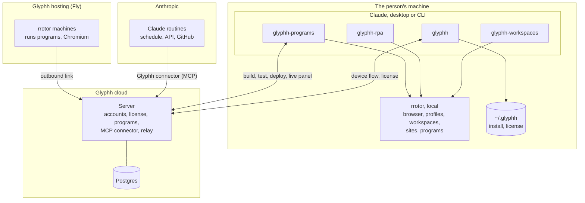
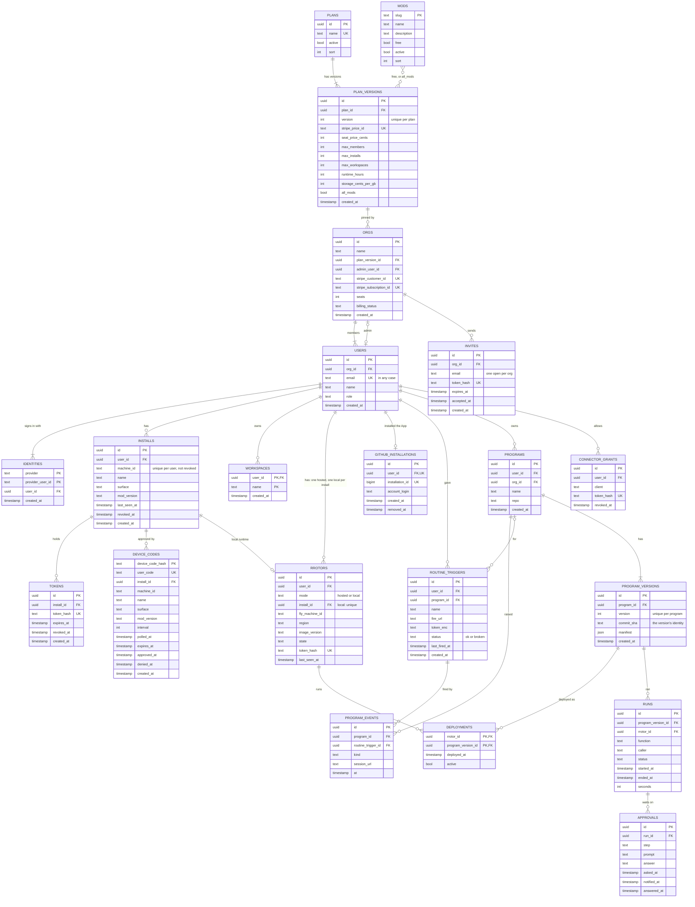
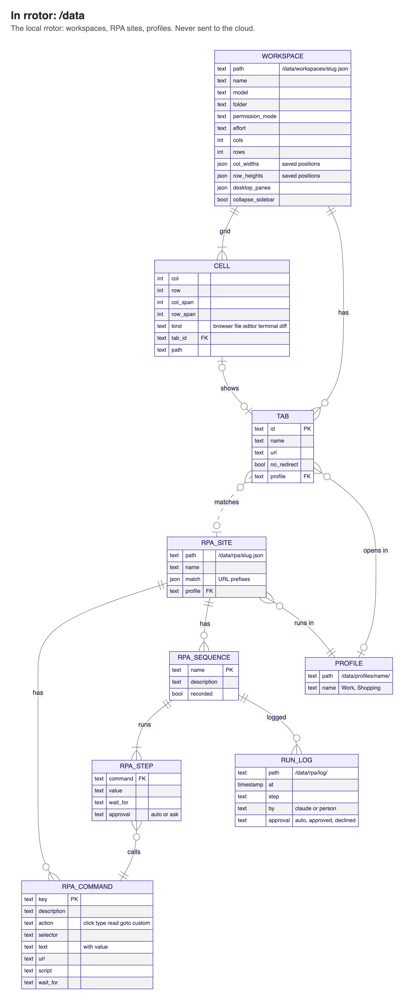

# Glyphh

The one doc for the relaunch (Chris, 2026-10-13 and 14): the [product](#product), the [architecture](#architecture), the [data model](#data-model) and the [plans](#plans). It replaces the programs, rrotor and machines architecture of 2026-10-12; that version is in git history (`25c1288`).

## Product

**Glyphh makes mods for Claude, as a business** (Chris, 2026-10-14). A mod is a Claude Code plugin that adds commands, tools and panels to Claude. Each mod is its own product, installed from one Glyphh marketplace; one Glyphh account and one subscription turn them on.

| Mod | What it is | Runs | Plans |
|---|---|---|---|
| `glyphh` | The account: sign in, license, account, org, plan and billing panels. Every other mod depends on it | Claude | Every plan |
| `glyphh-workspaces` | Workspaces: a layout grid of live web tabs plus the Claude session it runs (model, folder, permission mode, effort); switching workspaces switches all of it | The person's machine | Licensed; Free up to 2 workspaces |
| `glyphh-rpa` | A browser for Claude apart from yours, on your machine: named profiles signed in only where you choose, tasks recorded once and run as tools, Claude watched live and stopped for your approval | The person's machine only | Licensed: Pro, Team |
| `glyphh-programs` | Programs: deterministic Python jobs, built with Claude, run by **rrotor**, an isolated runtime, called by Claude and by Claude's routines | The local runtime on every plan; a hosted runtime on Pro and Team | Every plan: local. Pro and Team: hosted, capped by hours and storage |

- **Pro and Team include every mod**, and every mod as it ships. One mod sold on its own can come later without a redesign.
- **Everything is in Claude.** Every screen is a panel Claude shows; there is no Glyphh app and no Glyphh web UI, only the device sign-in's page and Stripe's.
- **Glyphh has no model in it.** Claude is the brain, on the person's own Claude; Glyphh's machines do exact work. Glyphh never holds a Claude login.
- **Desktop first, then the CLI.** Mods look like Claude: its theme, its fonts.
- **Functional first.** Every screen works before design draws it.

## Architecture




**What a person makes stays theirs:** workspaces and RPA on their own machine; programs, their data and their sign-ins in their own rrotor. The server holds who they are, what they pay for, and the record of their programs and runs, never their content.

### Mods and how they are installed

- **A mod is a Claude Code plugin** whose hooks are a code module (`.claude-plugin/plugin.json`, `hooks/hooks.json` naming `register.tsx`). Mods are on by default since Claude Code 2.1.287. A mod can ship its own MCP server, skills and commands.
- **Installed from the marketplace**, in a terminal: `/plugin install glyphh-programs --marketplace glyphh-ai/releases`. Installed at the user scope it loads in every session, the desktop's Code tab too. Every mod depends on `glyphh`.
- **Source and releases are apart.** `glyphh-ai/glyphh` (private): the source, one folder per mod, with tests. `glyphh-ai/releases` (public): the marketplace file and each mod as one built, minified module.
- **Each mod checks the license** at start; a mod the license does not include shows only which plans include it.

### Two kinds of panel

| | Mod panels | MCP App panels |
|---|---|---|
| What | Claude's own elements: boxes, text, buttons, inputs, selects, links, markdown, SVG | An HTML page with scripts that an MCP tool returns (`text/html;profile=mcp-app`, at a `ui://` address), shown in a frame |
| Can | Forms, lists, actions, on desktop and CLI | Live pictures, take control, anything a page can do; the host passes its theme as CSS variables |
| Used for | Account, org, plan, billing, workspaces, programs, sequences | **The live panel:** a run streamed live, sign-ins, approvals |

Proved on 2026-10-12 (`glyphh-ai/server`, branch `proto/stream`): an MCP App panel in Claude showed a machine's screen live and took control of it. Its lessons hold: Claude's panel frame preflights every POST; tickets stay out of URLs; a panel's `ui://` address carries its version.

### `glyphh`: the account

- **Sign in** by device flow: `/glyphh` shows the code and opens the link in Claude's browser pane (in the CLI, prints it); the person signs in with Google or GitHub. One sign-in serves every mod on that machine.
- **License:** fetched and checked (Ed25519) at start and refreshed daily; every mod reads it.
- **Panels:** account, org, plan, billing.
- **Starts the local rrotor** (Docker, OrbStack or Apple's `container`): the one place on the machine that holds the browser and its named profiles, workspaces, RPA sites and programs (Chris, 2026-10-14). The other mods work through it.

### `glyphh-workspaces`

Built from `~/development/glyphh/workspaces`.

- **Workspaces:** switch with `/dip`. A workspace sets the session's model, folder, permission mode and effort, and opens its grid of tabs.
- **Tabs:** a URL, its profile, and **no redirect** (a site is never handed to its native app: Slack, Teams, Zoom, Discord, Notion).
- **Workspace files live in the local rrotor** (`/data/workspaces/<slug>.json`); its Chromium renders the tabs.
- **Live pages:** on desktop the layout as one page in Claude's browser pane (`/stream`, WebRTC, JPEG fallback); in the CLI drawn in the terminal (kitty graphics: Ghostty, kitty).
- **The limit:** each workspace's name is registered with the server; past the plan's limit it is refused.
- **With RPA licensed,** a tab on a site that has sequences gets their tools, run in the tab.

### `glyphh-rpa`: local only

A browser for Claude apart from the person's own, on their machine: it runs in the local rrotor, never the hosted one. Claude never works in the person's own browser: it works in a named profile holding only the sign-ins made in it.

- **Everything is an MCP tool** (the local rrotor's), and a skill teaches Claude the flow. The person says "Use Glyphh to post our weekly update to LinkedIn; ask me before it posts; work it out, then let's test it", and Claude opens the live panel, picks or makes a profile, asks the person to sign in (they take control; Claude sees nothing while they do), asks what to call the task, records the person or works it out, saves it as a sequence and test-runs it, stopping at every `ask` step.
- **Tools:** `profile_list`, `profile_create`, `panel_open`, `ask_user` (`login`, `approve`, `choose`, `text`), `page_read`, `page_act`, `record_start`, `record_stop`, `site_save`, `sequence_save`, `run`, `sites_list`, `log_read`.
- **Sites and sequences** keep `glyphh-ai/app`'s format (`src/shared/rpa.ts`), each step `auto` or `ask`; saved sequences become tools (`<site>_<sequence>`).
- **Runs on a schedule** through Claude's Desktop scheduled tasks (local routines), which run on the person's machine, if they load plugins (to prove).

### `glyphh-programs`: programs and rrotor

**A program is a deterministic Python job; rrotor runs it; Claude calls it.** rrotor is the 2026-10-12 machine without what made it hard: no model, no agent loop, no gateway, no scheduler, no CLI sign-ins, no UI of its own. It runs exact programs, safely, and streams them live.

**A program** is a Python package with a manifest:

```python
from glyphh import Ctx, Result


def load(ctx: Ctx) -> None: ...  # once per run: open the profile, read config
def start(ctx: Ctx, inputs: dict) -> Result: ...  # the main job
def fetch_leads(ctx: Ctx, since: str) -> Result: ...  # custom functions, each callable on its own
def end(ctx: Ctx) -> None: ...  # always runs: close up, keep results
```

- **Every call returns a `Result`:** a status and data. The status tells the caller what is next:

| `status` | Means | Claude does |
|---|---|---|
| `done` | Here is the result: data, a file, a link | Uses it, or finishes |
| `needs_input` | A value is missing, or a choice: "pick A, B or C" | Answers, then `continue` |
| `needs_approval` | About to act: "click Post" | Asks the person; unattended, leaves it waiting for them |
| `needs_signin` | A site signed the program out | Opens the live panel for the person; unattended, stops and says so |
| `failed` | Which step and why | Retries, tries another way, or reports |

- **`ctx` is what the program was granted**, nothing else: `ctx.browser` (a named profile in rrotor), `ctx.http` (only the hosts the manifest declares), `ctx.db.postgres`, `ctx.db.mongo`, `ctx.db.neo4j` (its own databases), `ctx.secrets`, `ctx.files`, `ctx.log`, `ctx.checkpoint` (resume a run between calls).
- **Folders exist only through the program** (Chris, 2026-10-14): a program sees its own folder (`ctx.files`, `/data/programs/<name>/files`) and nothing else; there is no folder access into rrotor from outside, and no program reaches another's.
- **The manifest** declares the program's functions and their inputs, the hosts it reaches, its secrets, its databases, its browser profiles and sites, the steps that need approval, and the Claude connectors its routine needs.
- **Programs live in the runtime and in git** (Chris, 2026-10-14): each program is a repo in the person's own GitHub account. The runtime holds the checked-out code, its files, databases, browser profiles, secrets and run logs, where it is built, tested and run; a version is a commit. The server keeps only an index (each program's name, repo, versions as commit SHAs, where each is deployed) so Claude and routines can call it by name, and the run records. Glyphh's cloud never keeps a copy of the code.
- **Git is required for hosted programs:** the person links GitHub (linking is built) and installs the Glyphh GitHub App on their account; deploying pins a commit, and the hosted rrotor fetches exactly that commit with a short-lived token the App issues for that repo. Local-only use needs no GitHub.
- **Secrets are never committed:** they stay in the rrotor's vault; the programs mod's ignore rules and a pre-commit check keep them out.

**Build time: in Claude, with the mod.** The SDK is part of `glyphh-programs`: its tools and skills let Claude, with the person, write the program, run it against their rrotor, read the result and fix it until it passes, then deploy it and **create its routine** (prompt, triggers, connectors). Whatever is missing, Claude asks for: connect a Claude connector, add a secret, or **sign in to a site**, which opens the live panel on the run in rrotor: the person takes control and signs in; the sign-in stays in that profile on rrotor; Claude sees nothing while they hold it.

**Run time: Claude's routines are the runner.**

1. A routine fires on its schedule, its API trigger or a GitHub event, on Anthropic's machines, on the person's own Claude subscription.
2. Claude calls the **Glyphh connector** (a remote MCP server on the Glyphh server, added once at claude.ai/customize/connectors): `call(program, function, inputs)`, then `continue(run_id, answer)` as needed.
3. The server wakes the person's hosted runtime and passes the call over its outbound link. (A local runtime is reached by Claude on that computer, so cloud routines call the hosted one; local scheduled tasks call the local one.)
4. rrotor runs the step in its sandbox and answers the `Result`; Claude decides what is next: another connector, another program, an artifact.

A routine can chain all of it in one run: read a connector, run a program, do something else, publish an artifact. Routines run without approvals, so Glyphh's own rule is the brake: a step that `needs_approval` with nobody watching waits for the person (the panel, a push, an email). Claude can also call programs directly, in any session.

**The live panel** streams a run: the program's browser, its steps, its log, approvals, take control. It is an MCP App panel, from the mod while building and from the connector where Claude shows panels; frames come from rrotor through the server's relay (WebRTC end to end where it connects).

**rrotor: one isolated runtime per person, local and hosted** (Chris, 2026-10-14). A person never sees machines: they have a runtime where their programs live and run.

| | Local runtime | Hosted runtime |
|---|---|---|
| Who | Every plan, Free included | Pro and Team |
| Where | The person's own computer (Docker, OrbStack, or Apple's `container` on a Mac), started by the mod | One Fly machine and its volume per person, which Glyphh provisions on upgrade; nobody sees or manages it |
| Up | While the computer is on | Stopped when idle, woken per call (Fly starts a stopped machine in seconds) |
| Called by | Claude on that computer, and Claude's Desktop scheduled tasks (local routines) | Claude anywhere and Claude's routines, through the Glyphh connector |
| Caps | The computer's own | Runtime hours a month and storage, per plan |

Both run the same image, the same programs and the same SDK; a program built locally deploys to the hosted runtime unchanged.

**rrotor, locked down.**

- One Linux image (`ghcr.io/glyphh-ai/rrotor`), **headless**: no UI, no desktop, nothing to log into. It carries what programs build on (Chris, 2026-10-14):
    - **Python** (the runner and programs) and **Node**;
    - **Postgres with pgvector**, **MongoDB** and **Neo4j**: each program its own database and role, so one program never reads another's data;
    - **Chromium**, on a virtual screen per profile, for the live panel and take control.

  The databases start when a program that declares them runs and stop after (Neo4j is a JVM that wants about a gigabyte).
- **The hosted runtime** is one Fly machine per Pro and Team user, with a volume sized to the person's storage cap; Fly's daily volume snapshots back it up. On a downgrade or cancel it stops, its data is kept 30 days with a warning, then archived or deleted.
- **No inbound ports**: it connects out to the server and takes calls over that link. Its own token, in a header.
- **Each run sandboxed** (bubblewrap and Landlock, tested on 2026-10-12): only its program and `/data/<program>` mounted; network only through an egress proxy that lets through the hosts the manifest declares; anything else refused and recorded.
- **Read-only system; one volume, `/data`:** program versions, secrets (encrypted), browser profiles, run logs and outputs.
- **No Claude login, no model, no keys of Claude's** anywhere in it.

### On the machine: `~/.glyphh`

Only what the mods need to start and sign in; nothing here goes to the cloud.

| Path | Mod | What |
|---|---|---|
| `install.json` | `glyphh` | This install's id and token, mode 0600 |
| `license.json` | `glyphh` | The signed license: plan, limits, mods, expiry |

### In rrotor: `/data`

The same layout in the local and the hosted rrotor; workspaces and RPA sites are only in the local one.


| Path | What |
|---|---|
| `programs/<name>/<commit>/` | A deployed version: the checkout of that commit, its manifest and installed dependencies |
| `secrets/` | Each program's secrets, encrypted with rrotor's key |
| `profiles/<name>/` | Named Chromium profiles: each holds only the sign-ins made in it |
| `workspaces/<slug>.json` | Workspaces (local rrotor): session, grid, cells, tabs |
| `rpa/<slug>.json`, `rpa/log/` | RPA sites and sequences with their approval rules, and what ran (local rrotor) |
| `programs/<name>/files/` | The program's own folder, the only folder it sees |
| `db/` | Postgres (pgvector), MongoDB and Neo4j data: each program its own database |
| `runs/<run_id>/` | A run's log, checkpoints and outputs |

### The server

The `glyphh-ai/server` repo: Python 3.13, FastAPI, Pydantic v2, SQLAlchemy 2 (async) on Postgres, in Docker. Database first, then API; 100% test coverage; errors with stable codes and a trace id; small files.

- **Sign in by device flow (RFC 8628)**; an **install** is a machine: signing in again on the same machine reuses its install, so the plan's installs count machines, not sign-ins.
- **Org:** the first user is its admin and pays; one org per user; members by invite.
- **Plans and seats:** per seat, through Stripe.
- **Mods:** the catalog; a plan version includes every mod or the free ones.
- **License:** short-lived, signed, per install: plan, limits, mods.
- **Programs:** the record of each program, its versions and deployments, and of each run (who called it, status, times), never its content.
- **The Glyphh connector:** a remote MCP server (`/mcp`, Streamable HTTP) that Claude and routines call, signed in with OAuth (the person allows Claude once); its tools are `programs_list`, `call`, `continue`, `run_status` and the live panel.
- **The relay:** rrotor's outbound link (a WebSocket, its own token); calls go down it, results and the live stream come back. A local runtime's token stops working when its install is revoked.
- **Approvals, shown in Claude** (Chris, 2026-10-14): a step that needs approval is a row in `approvals` (the record, kept until answered) and a signal on **Redis** pub/sub to the server process holding the person's connection. The `glyphh` mod keeps one live connection while Claude is open (`/v1/approvals/stream`) and shows a band above the prompt with Approve and Decline, a toast and a native notification, with no Claude turn; the first answer wins, the band clears in every open Claude, and an email goes out when no Claude is open (`notified_at`).
- **Redis runs on the server's own Fly machine**, beside the server (Chris, 2026-10-14); in development it is a service in `compose.yaml`. It holds only what is live (pub/sub); Postgres holds everything kept.
- **Hosting:** provisions each Pro and Team user's runtime on Fly on upgrade, wakes it per call, stops it when idle, counts its hours and bills its storage up to the person's cap.
- **Limits are enforced here:** members, installs, workspaces, runtime hours and storage.

### API

JSON over HTTPS under `/v1`, described by `/openapi.json`. Every call but the device flow's, the plans and mods lists and Stripe's webhook carries a token (`Authorization: Bearer`). Refusals are `{"error": {"code", "message", "trace_id"}}`; a limit is `E_LIMIT` with `limit`, `used`, `max` and the `plan` that lifts it.

**Built:**

| Area | Calls |
|---|---|
| Device flow | `POST /v1/device/code` (with the mod's `machine_id`), `POST /v1/device/token`, `GET /v1/device?code=` |
| Account | `GET`/`PATCH /v1/me`, `POST /v1/me/identities` (a link that adds Google or GitHub), `DELETE /v1/me/identities/{provider}`, `GET /v1/installs`, `DELETE /v1/installs/{id}`, `POST /v1/sign-out`, `GET /v1/license`, `GET /v1/license/key` |
| Workspaces | `GET`/`POST /v1/workspaces`, `PATCH`/`DELETE /v1/workspaces/{name}` |
| Org | `GET`/`PATCH /v1/org`, `GET /v1/org/members`, `DELETE /v1/org/members/{user_id}`, `GET`/`POST /v1/org/invites`, `DELETE /v1/org/invites/{id}`, `POST /v1/invites/accept` |
| Mods, plans, billing | `GET /v1/mods`, `GET /v1/plans`, `POST /v1/billing/checkout`, `/plan`, `/seats`, `/portal`, `POST /v1/stripe/webhook` |
| Runtime | `POST /v1/runtime/local` (a local rrotor's runtime token, for this install: made the first time, rotated after, shown once) |
| GitHub | `POST /v1/github/install` (a link for the browser, as linking does), `GET /v1/github/install` (to the Glyphh GitHub App's install page), `GET /v1/github/callback` (records the installation, from the browser that started it, when GitHub says it is on the person's own GitHub account), `GET /v1/github/installations`; the Cloud mints a repo-scoped installation token per deploy |
| Routine triggers | `GET`/`POST /v1/routine-triggers` (name, fire URL, token, optional program; the token is never shown again), `DELETE /v1/routine-triggers/{id}`; the Cloud fires them (`POST …/fire`) on a program's events |

**To build, for programs:**

| Area | Calls |
|---|---|
| Programs | `GET`/`POST /v1/programs`, `GET`/`DELETE /v1/programs/{id}`, `POST /v1/programs/{id}/versions` (commit SHA, manifest), `POST /v1/programs/{id}/deploy` (a version) |
| Runs | `POST /v1/runs` (program, function, inputs), `POST /v1/runs/{id}/continue`, `GET /v1/runs/{id}`, `GET /v1/runs` (filtered, paged), `POST /v1/runs/{id}/approve`, `GET /v1/runs/{id}/live` (the stream, by ticket) |
| Runtime | `GET /v1/runtime` (state, hours used, storage used), `POST /v1/runtime/start`, `/stop`, `POST /v1/runtime/storage` (grow it); `/v1/runtime/link` (the runtime's outbound WebSocket, hosted or local) |
| Approvals | `GET /v1/approvals` (waiting), `GET /v1/approvals/stream` (server-sent events: `approval`, `answered`), `POST /v1/approvals/{id}` {`approve` \| `decline`} (first answer wins; sends `continue` to the runtime) |
| Hours | `GET /v1/hours` (balance and ledger), `POST /v1/hours/top-up` (Stripe Checkout), auto top-up and the spend cap on `PATCH /v1/org` |
| Connector | `/mcp` (Streamable HTTP) and its OAuth endpoints (authorize, token, registration); the Allow page ("Allow Claude to use your Glyphh?", after Google or GitHub sign-in), the only server page besides the device page |

### Panels

Each works before design draws it.

| Panel | Mod | Kind |
|---|---|---|
| Sign in, account, org, plan, billing | `glyphh` | Mod |
| Workspaces: list, create, edit, delete | `glyphh-workspaces` | Mod |
| The local live panel: a profile's tab, steps, approvals, take control, record | `glyphh-rpa` | MCP App |
| Sites and sequences: run, edit, delete | `glyphh-rpa` | Mod |
| Programs: list, versions, deploy, runs, needs you | `glyphh-programs` | Mod |
| The live panel: a run in rrotor, its browser, steps, approvals, take control, sign in | `glyphh-programs` | MCP App |
| Runtime: local on or off; hosted state, hours and storage used, top up, grow storage | `glyphh-programs` | Mod |
| Not in your plan | every mod | Mod |

### Anthropic's terms

From Claude Code's legal page and the Consumer Terms (checked 2026-10-14):

- Third-party developers may not offer Claude.ai login in their apps, route requests through someone's subscription, or "collect, store, or intermediate Claude.ai credentials or session tokens"; nor pay for or resell Claude usage on their users' behalf.
- **Glyphh never touches a Claude login:** Claude runs on the person's own subscription in Anthropic's own products (Claude Code, routines, scheduled tasks) and calls Glyphh's tools. rrotor has no Claude in it.
- A routine's API token, if a person gives one to Glyphh to start their routine, starts that routine only; it is not a Claude login.

### To prove first

- **The live panel from the mod's own MCP server** in the Code tab, on a run in rrotor, with take control and a sign-in.
- **The Glyphh connector in a routine:** a routine calling `call` and `continue` on a test program, end to end.
- **Desktop scheduled tasks** (local routines) loading plugins and their local MCP servers, for `glyphh-rpa`.
- **Waking the hosted runtime per call** fast enough for a tool call (Fly start, link up, answer).
- **The local runtime** starting from the mod on a Mac (Apple's `container`, or Docker/OrbStack).
- **Dependencies through the marketplace**, and **a built mod loading** as its source does.
- **Google sign-in in Chromium under automation** ("This browser or app may not be secure").

## Data model

### In the cloud




Every table and column is drawn, as the database has them; the tables from rrotors on are for programs. Timestamps carry the time zone; ids are made by the database.

- **Plan versions never change their price or limits.** Changing either adds a version with its own Stripe price; an org stays on the version it subscribed to.
- **Mods:** `all_mods` true includes every active mod, new ones too (Pro, Team); false, only the free ones. A mod once free stays free.
- **A limit left empty is unlimited.** `runtime_hours` is the hosted runtime's running time each month; `storage_cents_per_gb` the storage rate (every GB billed, none included); the person's cap is on their runtime. When the hours and any top-ups run out, calls are refused with `E_LIMIT`, unless auto top-up is on within the spend cap. Storage is billed per GB-month on the volume's size, which is the person's cap.
- **Runtimes** (`rrotors`): one hosted per Pro and Team user (`mode: hosted`), and one local per install that started one (`mode: local`, keyed by its install); each its own token.
- **Installs are machines:** `INSTALLS.machine_id` is the id the mod sends (a hash of the hardware UUID, or a random id it keeps; 16 to 128 of `A-Za-z0-9_-`), unique per user among installs not revoked. `DEVICE_CODES.machine_id` carries it to approval, which reuses that machine's install (its old tokens revoked, no limit checked) or makes one within `max_installs`. Revoking an install frees its slot.
- **One org per user;** people found by the provider's own id; installs and tokens hashed; tenant isolation by row-level security on the org.
- **Programs:** the record only: name, repo, versions (commit SHA, manifest), where each is deployed. The code is in the person's repo and their runtimes; secrets and data are in the rrotor.
- **GitHub installations:** the person's Glyphh GitHub App installation, from which the Cloud mints a short-lived token per deploy; no long-lived GitHub key is kept.
- **Routine triggers:** the routines the person let Glyphh start (fire URL and token, encrypted), marked broken on a 401. **Program events:** what a program raised and the routine session it started.
- **Runs:** who called (`routine`, `claude`, `panel`, `test`), the status, the times and the seconds rrotor ran, for the log and the hours; never inputs, outputs or content.
- **Approvals:** a step waiting for the person, until answered anywhere; `notified_at` when the person was emailed about it.
- **Connector grants:** each Claude (a routine, the desktop, claude.ai) the person allowed to call the Glyphh connector, revocable one by one.

### In rrotor



- **A workspace is one file**: its session, its grid with saved sizes, its cells and tabs (URL, profile, no redirect).
- **A site is one file** (`rpa/<slug>.json`): the URLs it matches, its profile, its commands and sequences, each step `auto` or `ask`; every run logged with who did each step.
- **Named profiles** (`profiles/<name>/`) hold only the sign-ins made in them.

## Plans

Billed per seat, per month. Installs, workspaces, runtime hours and storage are per user.

| | Free | Solo | Pro | Team |
|---|---|---|---|---|
| Price per seat | $0 | ? | $8 | $16 |
| Mods | `glyphh`, `glyphh-workspaces`, `glyphh-programs` (local) | ? | Every mod | Every mod |
| Members | 1 | 1 | 1 | Unlimited |
| Installs | 1 | ? | 5 | 10 |
| Workspaces | 2 | ? | 10 | Unlimited |
| Local runtime | Yes | Yes | Yes | Yes |
| Hosted runtime (cloud) | No | No | Yes | Yes |
| Runtime hours a month | — | — | ? | ? |
| Storage | — | — | $0.50 per GB-month, capped | $0.50 per GB-month, capped |

- **Hours top-ups:** bought one-off, kept until used; optional auto top-up within a monthly spend cap.
- **Storage is never included** (Chris, 2026-10-14): every GB is billed, at **$0.50 per GB-month** on what the runtime holds (its volume's size), prorated by the day on the monthly invoice. The person sets a cap (1 GB to start, up to 100 GB); the volume's size is the cap, so the bill can't pass it. Growing it is a click; it never shrinks.
- To decide: the hours per plan and the top-up price. The hosted runtime costs Glyphh about $0.019 an hour running on 2 GB ($0.035 on 4 GB) and $0.15 per GB-month of volume, held or not.
