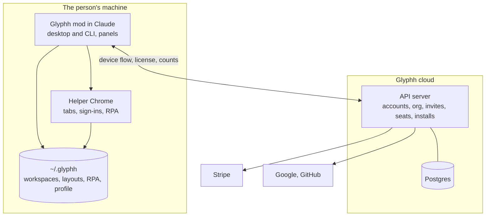
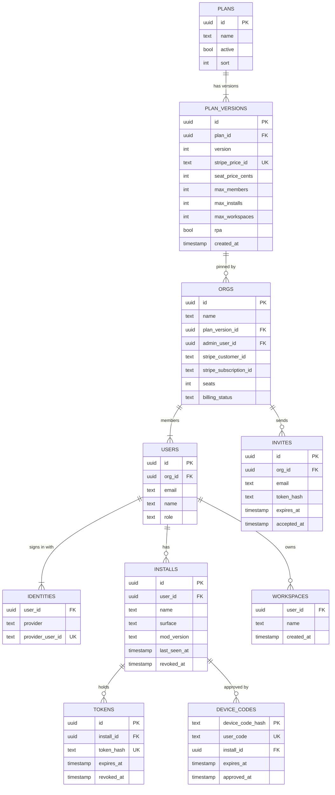

# Glyphh

The one doc for the relaunch (Chris, 2026-10-13): the [product](#product), the [architecture](#architecture), the [data model](#data-model) and the [plans](#plans). It replaces the programs, rrotor and machines architecture; that version is in git history (`25c1288`).

## Product

Glyphh is a **Claude mod**: workspaces inside Claude. A workspace is a layout grid of live web tabs plus the Claude session it runs: model, folder, permission mode and effort. Switching workspaces switches all of it.

- **Everything is in Claude.** Every screen is a panel Claude renders: sign in, account, members, invites, plan, seats. There is no Glyphh app, no Glyphh web UI and no server-rendered page.
- **Desktop first, then the CLI.** The same mod runs in both. In the CLI it looks and feels CLI native.
- **It looks like Claude.** Fonts and colors follow whichever Claude theme the person picked, on both surfaces.
- **Functional first.** Every screen works before design draws it; design then builds the screens.

## Architecture

Two parts: the mod on the machine, and one small server. **What a person makes stays on their machine; the cloud holds only who they are, their org and what they pay for.**

### The mod

Built from `~/development/glyphh/workspaces` (its README holds what a Claude mod can and cannot do).

- **Workspaces:** switch with `/dip`, by number or name. A workspace sets the session's model, folder, permission mode and effort, and opens its grid.
- **Tabs:** each browser cell is a tab with a URL. **No redirect** keeps a tab in its cell when the site tries to hand itself to its native app (Slack, Teams, Zoom, Discord, Notion), as `glyphh-ai/app`'s `forceWeb` did.
- **Live pages:** the helper Chrome renders every tab, driven over a private pipe (`--remote-debugging-pipe`), never a debugging port.
    - **Desktop:** the layout as one page in Claude's browser pane, each tab as WebRTC video (JPEG when WebRTC fails); clicks, keys and scrolls go back over CDP.
    - **CLI:** frames drawn in the terminal with the kitty graphics protocol (Ghostty, kitty), the grid in characters, dividers dragged with the mouse.
- **Sign-ins last:** the helper Chrome keeps one profile on disk, so a tab signed in once stays signed in across Claude restarts.
- **RPA:** each tab can carry commands (click, type, read, go to, a script) and sequences of them, in `glyphh-ai/app`'s format (`src/shared/rpa.ts`). Each becomes a tool Claude can call. They run against the tab over CDP.
- **Take control:** the person's clicks, keys and paste go into a tab while Claude waits; Claude sees no screenshot while they hold it, so a password or a code never reaches the model. Control is handed back with one click.
- **Record:** the person does a task once in a tab and the helper captures each step (click, type, go to, with its selector) as an RPA sequence; they name it, fix or drop steps, test-run it and save it, and it becomes a tool. Recording happens in a panel in Claude: the tab live, with Record, Stop and the steps as they are captured.
- **The helper is the machine.** Render, watch, take control, drive and record are the helper's own local API; the mod is its client. Only Claude uses it for now; other agents could pair with it later.
- **Panels:** every account screen is a panel the mod renders in Claude, reading and writing the API.
- **Theme:** the mod reads the person's Claude theme and draws with its fonts and colors.

### On the machine: `~/.glyphh`

Nothing here goes to the cloud.

| Path | What |
|---|---|
| `install.json` | This install's id and token, mode 0600 |
| `license.json` | The signed license: plan, limits, features, expiry |
| `workspaces/<slug>.json` | A workspace: model, folder, permission mode, effort, the grid with its saved positions, its tabs (URL, no redirect, RPA) |
| `chrome/` | The helper Chrome's profile: the tabs' sign-ins |

Positions dragged in the grid are written back to the workspace's file, so they are there when Claude opens again.

### The server

The `glyphh-ai/server` repo: Python 3.12+, FastAPI, Pydantic v2, SQLAlchemy 2 (async) on Postgres, in Docker. Built database first, then API, then SDK; 100% test coverage; errors with stable codes and a trace id; small files.

- **Sign in, by device flow (RFC 8628).** The mod asks for a code; the sign-in panel shows it and its link; the person signs in with Google or GitHub and approves; the mod, polling, gets the install's token. Each approval is an **install**.
- **Org.** The first user creates the org, is its admin and handles all billing. A user belongs to exactly one org. The admin invites members by email; an invite is accepted by signing in.
- **Plans and seats.** Each seat is a member. The admin subscribes through Stripe and adds or removes seats; Stripe's webhooks keep the org's subscription and seat count true.
- **License.** The server signs a short-lived license for each install (plan, limits, features, expiry) that the mod checks with its public key and refreshes. It carries what the mod gates locally (RPA).
- **Limits are enforced by the server**, at the moment they would be crossed:
    - **members:** an invite is refused when the org is at its plan's limit or out of seats;
    - **installs:** a device approval is refused when the user is at their limit;
    - **workspaces:** the mod registers each workspace's name when it creates one and removes it when it deletes one; creating one past the limit is refused. Only the name and the user go to the server, nothing of what is in it.
- **What goes:** machines, the machine link, threads, needs you, super powers, launch tickets, the relay and the MCP server.

### API

JSON over HTTPS under `/v1`, described by `/openapi.json`. Every call but the device flow's, the plans list and Stripe's webhook carries the install's token (`Authorization: Bearer`). Refusals are `{"error": {"code", "message", "trace_id"}}`; a limit reached is `E_LIMIT`, naming the limit, what is used and the plan that would lift it.

**Device flow** (RFC 8628):

| Call | Does |
|---|---|
| `POST /v1/device/code` `{name, surface, mod_version}` | Starts a sign-in: `device_code`, `user_code`, `verification_uri`, `verification_uri_complete`, `interval`, `expires_in` |
| `POST /v1/device/token` `{device_code}` | Polled: `authorization_pending`, `slow_down`, `expired_token`, `access_denied`, or the install's `access_token` and `install_id` |
| `GET /v1/device?code=` | The page the link opens: Continue with Google or GitHub, then this install is approved and the page says to go back to Claude |

Signing in the first time makes the person's org (Free, them its admin), unless an invite for their email is waiting, in which case they join that org. The install is refused past the plan's `max_installs`.

**Account:**

| Call | Does |
|---|---|
| `GET /v1/me` | The user, their org and role, the plan version and its limits, and what is used (members, seats, installs, workspaces) |
| `PATCH /v1/me` `{name}` | Rename |
| `GET /v1/installs` · `DELETE /v1/installs/{id}` | List installs; revoke one (signs that machine out) |
| `POST /v1/sign-out` | Revoke this install |
| `GET /v1/license` | This install's license, signed (Ed25519): plan, limits, features, `expires_at` (24 hours) |
| `GET /v1/license/key` | The public key the mod checks it with |
| `GET /v1/workspaces` · `POST /v1/workspaces` `{name}` · `PATCH /v1/workspaces/{name}` `{name}` · `DELETE /v1/workspaces/{name}` | The user's workspace names; creating one past `max_workspaces` is refused |

**Org** (writes are the admin's):

| Call | Does |
|---|---|
| `GET /v1/org` · `PATCH /v1/org` `{name}` | The org |
| `GET /v1/org/members` · `DELETE /v1/org/members/{user_id}` | Members; remove one (never the admin) |
| `GET /v1/org/invites` · `POST /v1/org/invites` `{email}` · `DELETE /v1/org/invites/{id}` | Invites; one is refused past the plan's members or the seats bought. An invite answers with its link to share |
| `POST /v1/invites/accept` `{token}` | An existing user joins: only when their own org has no one else and nothing paid, which is then removed |

**Plans and billing** (writes are the admin's):

| Call | Does |
|---|---|
| `GET /v1/plans` | Each plan's newest version: price per seat, limits, features |
| `POST /v1/billing/checkout` `{plan, seats}` | Stripe Checkout's address, to open in the browser pane |
| `POST /v1/billing/plan` `{plan}` | Change plan: the newest version of it, prorated |
| `POST /v1/billing/seats` `{seats}` | Change the seats; never below the members |
| `POST /v1/billing/portal` | Stripe's portal address: card, invoices, cancel |
| `POST /v1/stripe/webhook` | Stripe's events keep `orgs` true: plan version, seats, status |

### Panels

Each works before design draws it.

1. **Sign in:** the code, the link, waiting, signed in.
2. **Account:** name, email, sign-in providers, installs (revoke one), sign out.
3. **Org:** name; members with their role (remove one); invites (send, revoke, pending).
4. **Plan:** the current plan and its limits, what is used, change plan.
5. **Billing** (admin): seats (add, remove), the card and invoices through Stripe's own pages.
6. **Workspaces:** list, create, edit (model, folder, permission mode, effort, grid, tabs), delete.
7. **Record:** a tab live with take control; Record and Stop; the captured steps (rename, fix, drop); test-run; save as a tool.
8. **RPA:** a tab's commands and sequences; run, edit, delete.

### To prove first

- **Google sign-in in the helper Chrome:** Google may refuse a sign-in in a Chrome under automation ("This browser or app may not be secure"). Gmail and Calendar tabs depend on it.
- **Sign-in pages from a panel:** on desktop, Google's and GitHub's pages open in Claude's browser pane; in the CLI there is no pane, so they open in the system browser. Whether Google allows its page in the browser pane is to test.
- **The theme:** whether a mod can read the active Claude theme, or has to read it from Claude's settings.

## Data model

### In the cloud

- **Plan versions never change.** Changing a plan's price or limits adds a version with its own Stripe price (Stripe prices cannot change either). An org stays on the version it subscribed to (`orgs.plan_version_id`), so an update never touches an org; new orgs get the newest version, and an org moves only when its admin changes plan or we migrate it on purpose.
- **A limit left empty is unlimited.**
- **One org per user:** `users.org_id`, not a memberships table. `role` is `admin` or `member`; the org's first user is its admin (`orgs.admin_user_id`).
- **People are found by the provider's own id** (`identities`), never by email alone.
- **Installs:** one per device-flow approval, with its surface (`desktop` or `cli`). Revoking one signs that machine out. Its tokens are stored hashed.
- **Workspaces:** names only, for the limit. Everything else about a workspace is in `~/.glyphh`.
- **Tenant isolation:** row-level security keyed on the org.

### On the machine

- **A workspace is one file**, `workspaces/<slug>.json`: its session (model, folder, permission mode, effort), its grid (columns, rows and their saved sizes), the desktop panes it opens, its cells and its tabs.
- **A cell** sits at a column and row with its spans, and is a `browser` (showing one of the workspace's tabs), `file`, `editor`, `terminal` or `diff`.
- **A tab** is a URL with its name and no redirect, and carries its RPA: commands, and sequences of steps that call them (`recorded` when made with Record).
- **Every tab signs in through the one Chrome profile** (`chrome/`).
- **`license.json`** is refreshed from the server through the install's token and carries the plan's limits and features.

## Plans

Billed per seat, per month. Installs and workspaces are per user.

| | Free | Pro | Team |
|---|---|---|---|
| Price per seat | $0 | $8 | $16 |
| Members | 1 | 1 | Unlimited |
| Installs | 1 | 5 | 10 |
| Workspaces | 2 | 10 | Unlimited |
| RPA | No | Yes | Yes |

Team's installs are capped so one seat can't be shared across a team's machines.
