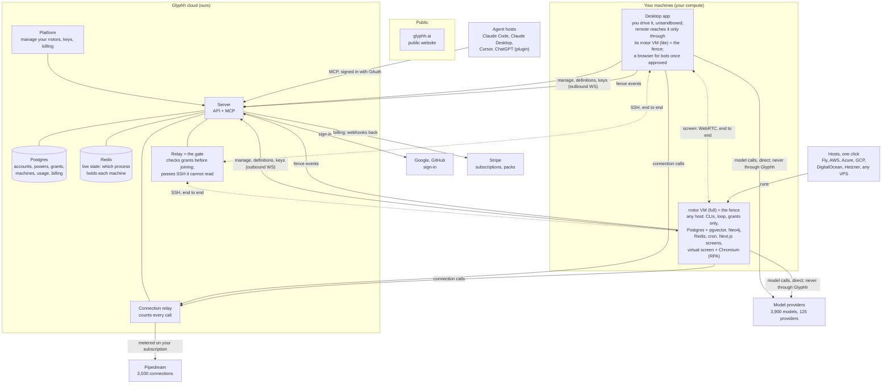

# Architecture

## Decided
### How everything is built

- **Every capability is built in this order: the database (drawn in the data model first), then the API, then the SDK.** MCP exposes the same service function the API serves, so one function sits behind every surface.
- **100% test coverage is the target**, enforced in CI.
- **Builds and deploys are automatic:** every merge to main is tested, built and deployed, and clients update themselves.
- **Everything runs in Docker**, locally and in production.

### Server

A single-deployment, multi-tenant cloud SaaS, headless first: every capability is an API (OpenAPI) and an MCP tool before it is any screen, with the same permission checks behind both.

- **API:** REST with OpenAPI over one service layer; Server-Sent Events where results stream (model output, long jobs, live updates).
- **MCP:** the Streamable HTTP transport on one `/mcp` endpoint, in stateless mode. Its tools are generated from the same service layer and curated to task-sized tools, not one per endpoint.
    - **Stateless:** every call stands alone and carries its own auth and tenant, so any process behind the load balancer answers it and a deploy or a crash drops nothing. A call still streams its progress and result.
    - **What stateless gives up:** pushes outside a call (resource subscriptions, tool-list change notices, the server asking the client something mid-session).
    - **If those are needed later:** keep the session state in Postgres, not in process memory, so the server stays scalable and needs no sticky sessions.

- **Language and framework:** Python 3.12+, FastAPI, Pydantic v2, async throughout.
- **Shape:** one deployment for every tenant, run as two or more stateless processes behind a load balancer.

### Paths

- **rrotor → CLI or model → provider:** the thinking goes straight to the provider, on the member's own subscription or key. Glyphh never sees it.
- **rrotor → connector → server:** every connection call goes through the server, which relays it to Pipedream and counts it, because each one is a cost Glyphh pays.

### Models

Glyphh is a model runtime, not a gateway. The one thing it governs is which models and connections an org's users may add, set by the org and narrowed by its teams. Spend, rate limits and every other rule belong to an AI gateway the customer puts in front of their models (a model's base URL can point at it). A model is a person's own: they add it with their own key (a provider, the provider's model id and an API key), and a super power is granted as many of theirs as it needs; when it runs, rrotor calls the provider directly with that key. Glyphh stores the model's setup and never routes, meters, limits or pays for a model call. The key is encrypted on the server and handed only to a member's own runtime.

Adding a model happens in the app, where the member edits a super power: its models opens the full catalog, the way connections opens Pipedream's, searchable by provider, name and type, each entry with its provider's logo, name, description and type. Picking one asks for the key in that same window; the app sends it to the server's API through the SDK, and the server saves the model as the member's power, encrypted, and grants it to the super power being edited (Glyphh needs no grant). When that super power runs, rrotor asks the server for what it was granted and gets its models with their keys, over its own machine connection, and hands them to the loop and to the slots of its tasks. The platform does the same for an agent that needs a key (below).

### Connections

Connections are the moat: about 3,500 services (Gmail, Slack, Salesforce, ...) through Pipedream. A connection is always one person's own account; Pipedream holds the account and its sign-in, and Glyphh stores no secret for it. A super power is granted the connections it may use, and whichever loop runs it (Claude Code, Codex or rrotor's own), rrotor hands it exactly those and nothing of the loop's own (for Claude Code, `--mcp-config` with `--strict-mcp-config`). Every call goes through the server, which checks the tool's permission and the org's credits, relays it to Pipedream with a short-lived token minted for the run, and counts it.

### Glyphh and the super powers under it

- **Glyphh, the super agent, has everything:** every power, every super power and every machine the member has. There is one per member, and it is what the member drives.
- **Every other super power sits under Glyphh and has only what it is granted:** its folders (read or write), connections, models, skills, tasks, plugins, the machines it may run on and the other super powers it may call. Its loop is picked, not granted: every super power has exactly one. Nothing else of the member's, whether or not anyone is watching.

- **Who is driving decides what can be asked.** In a run the member drives, a tool set to `ask` asks them. In a run nobody is watching (autonomous: on a clock, or started by an agent), `ask` means refused, so it uses only tools that are allowed, by the member or by the super power's own override.

Glyphh has the super power editor: the skills and tools to create a super power, grant and take back its powers, machines and super powers, and test-run it. Only Glyphh edits super powers; a super power under it cannot change its own grants or another's. Every editor step is a server operation, so it is an API call and an MCP tool too: a member edits a super power by talking to Glyphh, or in the app's editor. Ported from the old app's super power and power builders.

### What a super power can be

- **Workflows and data pipelines:** what the power types (tasks and the rest) are today. They run on their own, by hand or on a schedule.
- **Screens:** a super power can have a UI of its own, not only a chat.

### What rrotor carries

Everything a super power needs to run, on the member's own machine:

- **The CLIs, already installed:** Claude Code, Codex, Gemini and the rest, ready to be a super power's loop.
- **Postgres with pgvector:** a super power's own data and its vectors. The server's Postgres has no pgvector; vectors live only in rrotor.
- **Neo4j:** a super power's graph.
- **Redis and cron:** queues, caches and the machine's own clock.
- **A Next.js server:** serves a super power's screens.
- **The loop:** the CLI or rrotor's own, with the super power's models and powers.

It is the agent runtime: from it, a super power reaches about 3,900 models across about 125 providers directly, never through Glyphh's servers, and about 3,500 connections, which go through the server and are counted against the member's subscription.

**The desktop app is a rrotor too, a lite one:** the CLIs and the loop, without pgvector or Neo4j. It connects to the member's other machines, so they can spread super powers across them and manage them all from one place.

A super power's data and screens live in its member's rrotor, never on the server: the server holds the super power's definition and its grants, not what it stores.

Still to draw with the rrotor definition: how a super power's data is kept apart from another's in that Postgres, and how its screens reach the app and the web when the machine is remote.

### rrotor is a Linux VM; the app you drive is not sandboxed

Decided 2026-10-11:

- **rrotor is a small Linux VM.** On a server it is the machine; on a desktop the app runs it headless (Apple's Virtualization framework on macOS, WSL2 on Windows, locked down: no automounted drives, no Windows interop, no Windows PATH). Inside it, a run sees only the folders it was granted, mounted in; the rest of the desktop does not exist for it, so no shell, Bash tool or program can reach past them. On Linux desktops the same fence comes from namespaces and Landlock, without a VM.
- **The app runs unsandboxed, because the member is driving.** Like Claude Code on their own machine: they see each step, approve what is risky, and can stop it. Glyphh, the agent they drive, has everything.
- **Remote control reaches a desktop only through its rrotor, and only by grants.** Another machine, the web, the platform or a super power running unattended never touches the app or the desktop directly: it reaches the rrotor VM, which holds only what was granted. A super power is fenced whether or not anyone is watching it.
- **The app's own tools that touch files, shells or processes move into rrotor,** so nothing remote can reach the desktop through a tool in the app instead of through bash. The app keeps its screens, its windows and its browser, which already keeps its own storage apart from the member's own browser; its downloads and uploads go to a granted folder.

### Runtime hosting

Glyphh does not host runtimes. Members run rrotor on their own compute: their desktop, or a remote server on any infrastructure (Fly.io, Railway, Render, AWS, a VPS).

- rrotor ships as one Linux image: a Docker image for servers, and the same system as the VM the desktop app runs.
- It connects out to the server, never in, so a remote server needs no public address, ports or firewall rules.
- **One-click hosting:** a real VM, not a platform container (per-run sandboxes and the virtual screen need a whole machine): Fly Machines, AWS (a CloudFormation quick-create link), Azure (Deploy to Azure), GCP, DigitalOcean and Hetzner (a first-boot script), and a one-line install for any other VPS.
- **A new host registers itself:** the button carries a one-time code the server mints already approved, for minutes and one use; on first boot the machine trades it for its own token and SSH key. The member never copies a token, and no code is minted when the plan has no machine left.
- The server knows which machines a member has registered, what each is (desktop or remote, lite or full, its platform and rrotor version), and whether each is online.

### Browsers and RPA on rrotor

A full rrotor runs a virtual screen (a display with no monitor) and a real Chromium in it, so a super power can work websites on a headless server: Glyphh drives the browser through Chromium's own control protocol (click, type, read, go to a page) and screenshots when it needs to see. The old app's RPA tools move here, and the old browser workers already ran this way.

- **Watching:** the screen streams to the member's app or the web over WebRTC, whose video is encrypted end to end by design: the server only passes the call setup over the relay, and a TURN relay used when no direct path exists cannot decrypt it. If WebRTC cannot connect, screen frames go over the SSH channel instead. The server never sees the screen.
- **Signing into a website:** the member takes control. The bot pauses, the member's taps and keystrokes go straight into the remote browser over the encrypted channel, they type the password and do the 2FA themselves, and hand control back. While they hold it no screenshot goes to the model, so a password or a code never reaches the model or a chat. The run's log records when control changed hands.
- **Sessions stay on the machine:** each browser profile (a `browsers` power) lives on one rrotor and is granted like a folder, so one super power's signed-in sites are never another's. Cookies never leave that machine.
- **On a desktop:** when the member drives Glyphh, it uses the app's own browser and the member's own sessions, because they are at the keyboard. A super power running on the desktop (unattended, a bot) never touches the app's browser: it gets its own Chromium and virtual screen inside the desktop's rrotor VM, fenced and watched like a remote rrotor's, and the member's own sessions are never shared with it.
- **Fetched only with the member's approval:** the desktop's VM does not carry the browser until the first super power that needs one is placed on that desktop. Then the app asks first and explains: what it is (a separate browser inside the fence, for super powers only, which never sees the member's own sessions), what it costs (a few hundred MB on disk, roughly 300 to 500 MB of memory while a browser is open), and why (browser work runs on this machine and its own internet address, which some sites trust more than a cloud server). Declined, the super power cannot be placed on that desktop and is offered a remote rrotor instead; approved, the browser is fetched once and kept.
- **Later:** a password manager (1Password) can fill sign-ins without the model seeing them. Passkeys are tied to the member's own device and cannot be used remotely; such sites need a password and 2FA through take-over.

### Machine to machine: SSH over the relay

A member's machines reach each other, so from machine A they can watch machine B work, drive it, or open a terminal on it. Neither machine needs a public address or an open port, and the server cannot read what passes between them.

- **Every machine connects out to the server** over one WebSocket, signed in with its own machine token (in a header, never in the URL). The server is the relay: it joins two of the member's machine connections and passes bytes between them.
- **The two machines speak SSH to each other** through that relay, so the encryption is end to end: the server forwards only ciphertext. The server is a jump host that cannot see in.
- **Keys:** each machine makes its own SSH key pair when it signs in. The private key never leaves it; the public key and its fingerprint are registered on the machine's row. A machine accepts only its member's own machines' keys, and remembers every key it has seen: a key that changes is refused, never trusted quietly, so even a compromised server cannot slip in a key of its own.
- **rrotor runs its own SSH server,** not the machine's system SSH, offering only rrotor's own channels:
    - **watch:** a run's events as they happen, with what came before it first, from rrotor's own Postgres;
    - **drive:** send a prompt, answer a question, stop a run;
    - **files:** inside the folders the member granted;
    - **shell:** off until the member turns it on for that machine (`shell_enabled`), because a shell is the whole machine.
- **Who:** for now only the machine's owner, from their own machines, the app or the web. The server checks it before joining two connections.
- **When B drops:** A is told at once, and can join again when B is back.

**The relay is the gate; rrotor is the fence.** The relay cannot read the stream, and an escape attempt never crosses it anyway (`cd /` happens inside B's VM), so the folders are enforced in B's rrotor, where what was not granted is not mounted. The relay guards the door in front: before it joins two machines it checks who is asking, which machine, which super power and which channel (watch, drive, files, shell) against the grants, and refuses anything else before SSH starts; B's rrotor checks the same again when the channel opens. When a grant is revoked, a machine removed or a power disabled, the relay cuts the live sessions at once and the server tells rrotor to unmount. When something inside a run reaches past its fence, rrotor reports it to the server (`fence_events`), and the platform shows it. Neither depends on the other being honest.

Ported from the old relay (`/ws/attach`), which kept the outbound sockets, the fixed list of methods and the folder grants, but let the server read every frame, put the user's sign-in token in the URL, and had no machine identity of its own.

### Platform

A web app in its own repo (`glyphh-ai/platform`): a client of the server's API through the SDK, like the app, the CLI and the plugin. The server stays headless and serves no pages.

It holds what must never go through a chat: an API key is never typed to an agent or passed through MCP. The app's own window is not a chat, so the app takes a key directly; an agent never does. A tool that needs a key returns a one-time link to the platform (single use, short lived, tied to that member and that model); the agent opens it in the browser, the member signs in (the link alone is never enough), pastes the key, and the platform sends it to the server's API, encrypted at rest there. The agent only hears that it was saved and the key's last four characters. For people it shows what each one has, never what is inside: Tom has 4 connections, 3 models, 2 super powers and 2 machines. The platform also carries sign-in and consent, approving a machine's sign-in code, accepting an invite, and the hand-off to Stripe for billing.

Its usage and billing pages read the server's usage events and credit ledger through the API, scoped as the data model says (a user their own, an org admin the org, a super admin every org):

- **Usage:** the period's credits used and left, then the same calls grouped by user, by connector, by super power, by machine and by day, and the call log under it: time, user, super power, machine, connector, tool, duration, credits and status, filtered by any of them and exported as CSV. Each row opens to its full detail.
- **Billing** (org admins): the plan, seats, included and extra machines, the period's dates, the credit allowance and packs with their ledger, upgrading, buying a pack, and the hand-off to Stripe for invoices and payment methods.

The API behind them is three operations, also MCP tools so an agent can answer "what did we spend on Gmail this month": a summary grouped by one dimension over a time range, the call log (filtered, newest first, paged by cursor), and the balance with its ledger.

### Interfaces

Two ways in, one per surface, both in the `glyphh-ai/glyphh` repo (private for now, public later). Neither carries logic of its own: same accounts, permission checks and tenant rules as the server.

- **SDK (on the API):** a typed client generated from the server's OpenAPI spec; handles sign-in and tokens, streaming over Server-Sent Events, retries and pagination. TypeScript first (the app on desktop, web and mobile, and the CLI), Python second.
- **Plugin (on MCP):** one install for agent hosts (Claude Code and Claude Desktop, Cursor, ChatGPT apps): the `/mcp` connection signed in with OAuth, plus skills that teach the agent to use Glyphh's tools.

### Access

- **Sign-in:** Google and GitHub. Their screens are the sign-in; the server takes the callback and redirects back to the app or agent, so it serves no page of its own. No magic links: mail scanners use them up, they break across devices, and they train people to click sign-in links in email. Microsoft can follow, the same way, when business users need it.
- **People are found by the provider's own id** for them, never by email alone, so a changed email or a hidden GitHub email still finds the same person.
- **Tokens:** after a Google or GitHub sign-in the server issues its own tokens to the app and the platform; every token carries its org.
- **Machines** sign in with a code the member approves in the browser, and get a machine token of their own, sent in a header, never in a URL.
- **Agent hosts** (the plugin in Claude Code, Cursor, ChatGPT) sign in with OAuth: the member approves each host, and can revoke one without the others.

### Data

- **Database:** one Postgres for every tenant, without pgvector: the durable truth.
- **Live state:** Redis, managed with a standby, for what is only true right now: which server process holds each machine's connection, machine heartbeats (keys that expire on their own when a machine goes quiet), and messages between server processes (cut this session, unmount this folder, this grant was revoked); later rate counters and short-lived caches. Losing it loses nothing: machines reconnect and register again in seconds.
- **Joining two machines** happens on the process that already holds B's connection: A's request is sent there, so SSH bytes flow through one process and never cross between servers. Redis carries only the lookup and the control messages, never the bytes.
- **Tenant isolation:** row-level security keyed on the org, enforced by the database.
- **Access:** SQLAlchemy 2 (async) over asyncpg.
- **Schema:** one schema file until relaunch, then Alembic migrations.
- **Background work:** Postgres, with no queue table of its own: the clock reads `schedules.next_run_at`, and each job is its own table's state (a Stripe event not yet processed, a machine to unmount), taken with `FOR UPDATE SKIP LOCKED` so two processes never take the same one.
- **Files:** object storage (R2 or S3), with references in Postgres: power and super power bundles, run logs, provider logos.
- **What lives where:** the server's Postgres holds accounts, powers, grants, machines, schedules, runs, usage and billing ([data model](data-model.md)). A member's rrotor holds what their super powers make: their data, vectors and graphs, and their screens. Nothing a super power stores ever lives on the server. Where conversations live is still open.

### Operations

- OpenTelemetry tracing and metrics, logs tagged by tenant.
- Managed Postgres with point-in-time recovery, and connection pooling.

### Not at the start

- No single sign-on, SCIM, enterprise roles or audit log.
