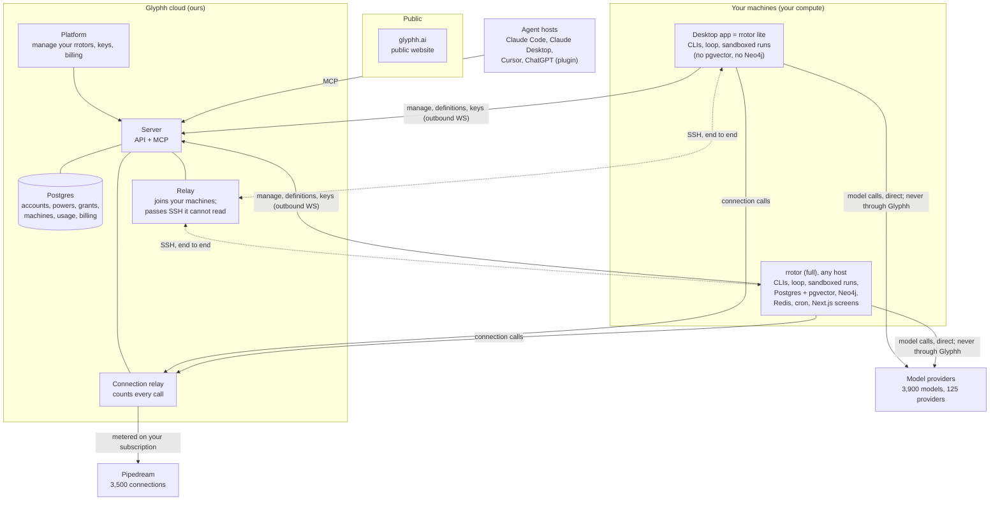

# Architecture

## Decided

### How everything is built

- **Every capability is built in this order: the database (drawn in the data model first), then the API, then the SDK.** MCP exposes the same service function the API serves, so one function sits behind every surface.
- **100% test coverage is the target**, enforced in CI.
- **Builds and deploys are automatic:** every merge to main is tested, built and deployed, and clients update themselves.
- **Everything runs in Docker**, locally and in production.

### Server

A single-deployment, multi-tenant cloud SaaS, headless first: every capability is an API (OpenAPI) and an MCP tool before it is any screen, with the same permission checks behind both.

- **API:** REST with OpenAPI over one service layer; Server-Sent Events where results stream (model output, long jobs, live updates).
- **MCP:** the Streamable HTTP transport on one `/mcp` endpoint, in stateless mode. Its tools are generated from the same service layer and curated to task-sized tools, not one per endpoint.
    - **Stateless:** every call stands alone and carries its own auth and tenant, so any process behind the load balancer answers it and a deploy or a crash drops nothing. A call still streams its progress and result.
    - **What stateless gives up:** pushes outside a call (resource subscriptions, tool-list change notices, the server asking the client something mid-session).
    - **If those are needed later:** keep the session state in Postgres, not in process memory, so the server stays scalable and needs no sticky sessions.

- **Language and framework:** Python 3.12+, FastAPI, Pydantic v2, async throughout.
- **Shape:** one deployment for every tenant, run as two or more stateless processes behind a load balancer.

### Models

Glyphh is a model runtime, not a gateway. The one thing it governs is which models and connections an org's users may add, set by the org and narrowed by its teams. Spend, rate limits and every other rule belong to an AI gateway the customer puts in front of their models (a model's base URL can point at it). A model is a person's own: they add it with their own key (a provider, the provider's model id and an API key), and a super power names one of theirs; when it runs, rrotor calls the provider directly with that key. Glyphh stores the model's setup and never routes, meters, limits or pays for a model call. The key is encrypted on the server and handed only to a member's own runtime.

Adding a model happens in the app, where the member edits a super power: its models opens the full catalog, the way connections opens Pipedream's, searchable by provider, name and type, each entry with its provider's logo, name, description and type. Picking one asks for the key in that same window; the app sends it to the server's API through the SDK, and the server saves the model as the member's power, encrypted, and grants it to the super power being edited (Glyphh needs no grant). When that super power runs, rrotor asks the server for what it was granted and gets its models with their keys, over its own machine connection, and slots it into the loop. The platform does the same for an agent that needs a key (below).

### Connections

Connections are the moat. A super power declares the connections it needs by name; only Glyphh's connections are used: an MCP server with its sign-in, added in Glyphh, encrypted and never returned. Whichever loop runs the super power (Claude Code, Codex or rrotor's own), rrotor hands it exactly those connections and nothing of the loop's own (for Claude Code, `--mcp-config` with `--strict-mcp-config`).

### Platform

A web app in its own repo (`glyphh-ai/platform`): a client of the server's API through the SDK, like the app, the CLI and the plugin. The server stays headless and serves no pages.

It holds what must never go through a chat: an API key is never typed to an agent or passed through MCP. The app's own window is not a chat, so the app takes a key directly; an agent never does. A tool that needs a key returns a one-time link to the platform (single use, short lived, tied to that member and that model); the agent opens it in the browser, the member signs in (the link alone is never enough), pastes the key, and the platform sends it to the server's API, encrypted at rest there. The agent only hears that it was saved and the key's last four characters. For people it shows what each one has, never what is inside: Tom has 4 connections, 3 models, 2 super powers and 2 machines. The platform also carries sign-in and consent, approving a machine's sign-in code, accepting an invite, and the hand-off to Stripe for billing.

Its usage and billing pages read the server's usage events and credit ledger through the API, scoped as the data model says (a user their own, an org admin the org, a super admin every org):

- **Usage:** the period's credits used and left, then the same calls grouped by user, by connector, by super power, by machine and by day, and the call log under it: time, user, super power, machine, connector, tool, duration, credits and status, filtered by any of them and exported as CSV. Each row opens to its full detail.
- **Billing** (org admins): the plan, seats, included and extra machines, the period's dates, the credit allowance and packs with their ledger, upgrading, buying a pack, and the hand-off to Stripe for invoices and payment methods.

The API behind them is three operations, also MCP tools so an agent can answer "what did we spend on Gmail this month": a summary grouped by one dimension over a time range, the call log (filtered, newest first, paged by cursor), and the balance with its ledger.

### Paths

- **rrotor → CLI or model → provider:** the thinking goes straight to the provider, on the member's own subscription or key. Glyphh never sees it.
- **rrotor → connector → server:** every connection call goes through the server, which relays it to Pipedream and counts it, because each one is a cost Glyphh pays.

### Glyphh and the super powers under it

- **Glyphh, the super agent, has everything:** every power, every super power and every machine the member has. There is one per member, and it is what the member drives.
- **Every other super power sits under Glyphh and has only what it is granted:** its folders, connections, machines, loops, models, skills, tasks, plugins and the other super powers it may call. Nothing else of the member's, whether or not anyone is watching.

Glyphh has the super power editor: the skills and tools to create a super power, grant and take back its powers, machines and super powers, and test-run it. Only Glyphh edits super powers; a super power under it cannot change its own grants or another's. Every editor step is a server operation, so it is an API call and an MCP tool too: a member edits a super power by talking to Glyphh, or in the app's editor. Ported from the old app's super power and power builders.

### What a super power can be

- **Workflows and data pipelines:** what the power types (tasks and the rest) are today. They run on their own, by hand or on a schedule.
- **Screens:** a super power can have a UI of its own, not only a chat.

### What rrotor carries

Everything a super power needs to run, on the member's own machine:

- **The CLIs, already installed:** Claude Code, Codex, Gemini and the rest, ready to be a super power's loop.
- **Postgres with pgvector:** a super power's own data and its vectors. The server's Postgres has no pgvector; vectors live only in rrotor.
- **Neo4j:** a super power's graph.
- **Redis and cron:** queues, caches and the machine's own clock.
- **A Next.js server:** serves a super power's screens.
- **The loop:** the CLI or rrotor's own, with the super power's models and powers.

It is the agent runtime: from it, a super power reaches about 3,900 models across 125 providers directly, never through Glyphh's servers, and about 3,500 connections, which go through the server and are counted against the member's subscription.

**The desktop app is a rrotor too, a lite one:** the CLIs, the loop and sandboxed runs, without pgvector or Neo4j. It connects to the member's other machines, so they can spread super powers across them and manage them all from one place.

A super power's data and screens live in its member's rrotor, never on the server: the server holds the super power's definition and its grants, not what it stores.

Still to draw with the rrotor definition: how a super power's data is kept apart from another's in that Postgres, and how its screens reach the app and the web when the machine is remote.

### Machine to machine: SSH over the relay

A member's machines reach each other, so from machine A they can watch machine B work, drive it, or open a terminal on it. Neither machine needs a public address or an open port, and the server cannot read what passes between them.

- **Every machine connects out to the server** over one WebSocket, signed in with its own machine token (in a header, never in the URL). The server is the relay: it joins two of the member's machine connections and passes bytes between them.
- **The two machines speak SSH to each other** through that relay, so the encryption is end to end: the server forwards only ciphertext. The server is a jump host that cannot see in.
- **Keys:** each machine makes its own SSH key pair when it signs in. The private key never leaves it; the public key and its fingerprint are registered on the machine's row. A machine accepts only its member's own machines' keys, and remembers every key it has seen: a key that changes is refused, never trusted quietly, so even a compromised server cannot slip in a key of its own.
- **rrotor runs its own SSH server,** not the machine's system SSH, offering only rrotor's own channels:
    - **watch:** a run's events as they happen, with what came before it first, from rrotor's own Postgres;
    - **drive:** send a prompt, answer a question, stop a run;
    - **files:** inside the folders the member granted;
    - **shell:** off until the member turns it on for that machine (`shell_enabled`), because a shell is the whole machine.
- **Who:** for now only the machine's owner, from their own machines, the app or the web. The server checks it before joining two connections.
- **When B drops:** A is told at once, and can join again when B is back.

**Known gap, not yet decided:** the super power's folders are enforced only where rrotor does the work itself (its files channel and its MCP tools). A CLI's own Bash tool runs as rrotor's user, so it can read anything that user can (`cat ~/.ssh/...`), and the shell, once on, is the whole machine. The working folder is not a fence. The proposal on the table: every run inside an operating-system sandbox that holds only its granted folders and its run folder (a container per run on remote servers; Seatbelt on macOS and bubblewrap on Linux desktops; the CLI's own sandbox as a second layer, never the only one), the shell inside the same sandbox by default, and a whole-machine shell as its own switch. Windows desktops would need a container (WSL or Docker) for the same guarantee.

Ported from the old relay (`/ws/attach`), which kept the outbound sockets, the fixed list of methods and the folder grants, but let the server read every frame, put the user's sign-in token in the URL, and had no machine identity of its own.

### Runtime hosting

Glyphh does not host runtimes. Members run rrotor on their own compute: their desktop, or a remote server on any infrastructure (Fly.io, Railway, Render, AWS, a VPS).

- rrotor ships as one Docker image, so it runs anywhere Docker does.
- It connects out to the server, never in, so a remote server needs no public address, ports or firewall rules.
- Glyphh supplies the setup: one-click configs for the common hosts, a one-line `docker run`, and docs for the rest.
- The server only knows which runtimes a member has registered, and whether each is online.

### Interfaces

Two ways in, one per surface, both in the `glyphh-ai/glyphh` repo (private for now, public later). Neither carries logic of its own: same accounts, permission checks and tenant rules as the server.

- **SDK (on the API):** a typed client generated from the server's OpenAPI spec; handles sign-in and tokens, streaming over Server-Sent Events, retries and pagination. TypeScript first (the app on desktop, web and mobile, and the CLI), Python second.
- **Plugin (on MCP):** one install for agent hosts (Claude Code and Claude Desktop, Cursor, ChatGPT apps): the `/mcp` connection signed in with OAuth, plus skills that teach the agent to use Glyphh's tools.

### Access

- **Sign-in:** Google and GitHub. Their screens are the sign-in; the server takes the callback and redirects back to the app or agent, so it serves no page of its own. No magic links: mail scanners use them up, they break across devices, and they train people to click sign-in links in email. Microsoft can follow, the same way, when business users need it.
- **Tokens:** after Google sign-in the server issues its own tokens to the app, the CLI and the plugin; every token carries its org.

### Data

- **Database:** one Postgres for every tenant, without pgvector.
- **Tenant isolation:** row-level security keyed on the org, enforced by the database.
- **Access:** SQLAlchemy 2 (async) over asyncpg.
- **Schema:** one schema file until relaunch, then Alembic migrations.
- **Background jobs:** a Postgres-backed queue.
- **Files:** object storage (R2 or S3), with references in Postgres.

### Operations

- OpenTelemetry tracing and metrics, logs tagged by tenant.
- Managed Postgres with point-in-time recovery, and connection pooling.

### Not at the start

- No single sign-on, SCIM, enterprise roles or audit log.
