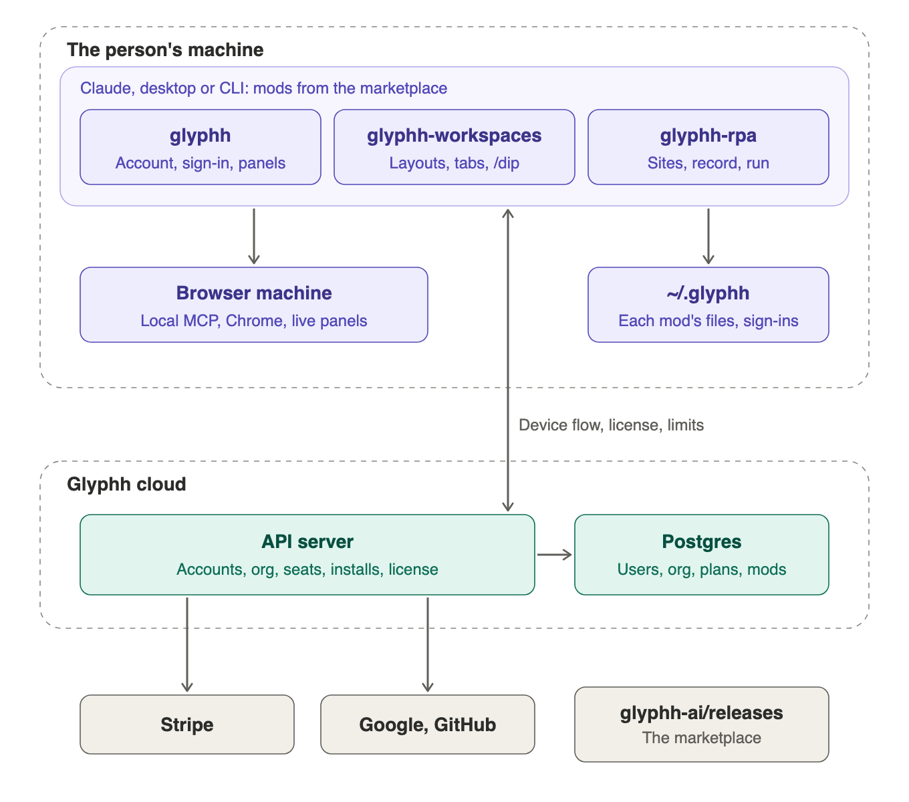
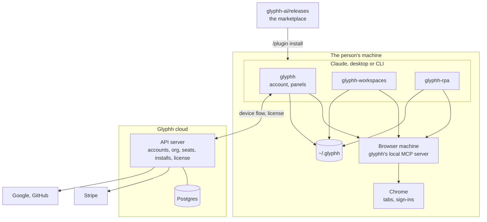
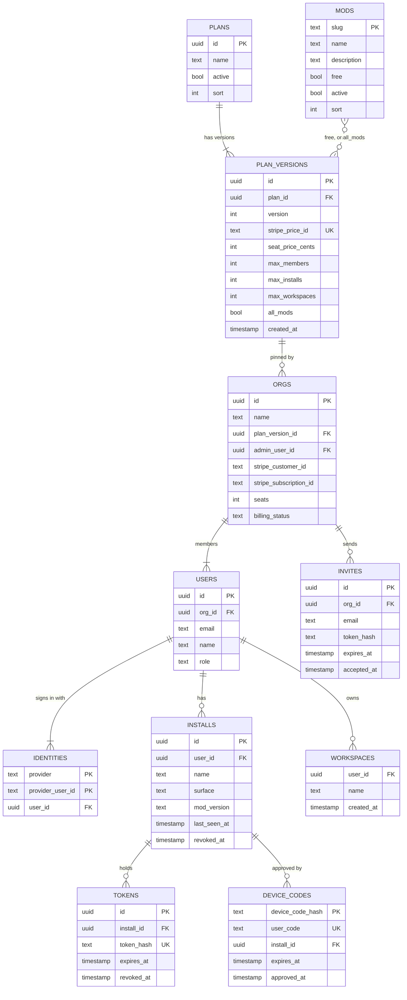

# Glyphh

The one doc for the relaunch (Chris, 2026-10-13 and 14): the [product](#product), the [architecture](#architecture), the [data model](#data-model) and the [plans](#plans). It replaces the programs, rrotor and machines architecture; that version is in git history (`25c1288`).

## Product

**Glyphh makes mods for Claude, as a business** (Chris, 2026-10-14). A mod is a Claude Code plugin that adds commands, tools and panels to Claude. Each mod is its own product, installed on its own from one Glyphh marketplace; one Glyphh account and one subscription turn them on.

The first mods:

| Mod | What it is | Plans |
|---|---|---|
| `glyphh` | The account: sign in, license, account, org, plan and billing panels, and the browser machine every other mod uses | Every plan; the others depend on it |
| `glyphh-workspaces` | Workspaces: a layout grid of live web tabs plus the Claude session it runs (model, folder, permission mode, effort); switching workspaces switches all of it | Every plan; Free up to 2 workspaces |
| `glyphh-rpa` | A website as tools: commands and sequences on a site, a live tab in a panel in Claude, take control, record a task once and run it | Pro and Team |

- **Pro and Team include every mod**, and every mod as it ships, so the subscription grows in value. One mod sold on its own as an add-on can come later without a redesign.
- **Everything is in Claude.** Every screen is a panel Claude shows. There is no Glyphh app and no Glyphh web UI; the only pages are the device sign-in's and Stripe's own.
- **Desktop first, then the CLI.** The same mods run in both. In the CLI they look and feel CLI native.
- **They look like Claude.** Fonts and colors follow the person's Claude theme.
- **Functional first.** Every screen works before design draws it; design then builds the screens.

## Architecture

Three parts: the mods on the machine, one small server, and the marketplace they are installed from. **What a person makes stays on their machine; the cloud holds only who they are, their org and what they pay for.**

### Mods and how they are installed

- **A mod is a Claude Code plugin** whose hooks are a code module (`hooks/hooks.json` naming `register.tsx`, with `.claude-plugin/plugin.json`). It hooks Claude's events (session start, commands, tool calls, drawing) and reaches everything else through the engine (`$`): files, HTTP, processes, panels, MCP servers.
- **Installed from the marketplace**, in a terminal: `/plugin install glyphh-workspaces --marketplace glyphh-ai/releases`. Installed at the user scope, a mod loads in every session, the desktop app's Code tab too. Every mod depends on `glyphh` (`plugin.json` `dependencies`).
- **Source and releases are apart.** `glyphh-ai/glyphh` (private) holds the source, one folder per mod (`mods/glyphh`, `mods/glyphh-workspaces`, `mods/glyphh-rpa`), with their tests. `glyphh-ai/releases` (public) is the marketplace: `.claude-plugin/marketplace.json` listing every mod, and each mod as one built, minified module. Nobody installing a mod gets the source, the tests or the history.
- **Each mod checks the license** when a session starts: a mod the license does not include draws only a panel that says which plans include it.
- **Under development** a mod runs from its folder: `claude --plugin-dir <folder>`, or on the desktop linked into the session's mods folder with hot reloading.

### Two kinds of panel

| | Mod panels | MCP App panels |
|---|---|---|
| What | Drawn from Claude's own elements: boxes, text, buttons, inputs, selects, links, markdown, SVG | An HTML page with scripts, which an MCP tool returns (`text/html;profile=mcp-app`, at a `ui://` address) and Claude shows in a frame |
| Can | Forms, lists, actions, at once on desktop and CLI | Live pictures, video, take control, anything a page can do; the host passes its theme as CSS variables (`--color-*`, `--font-*`) |
| Cannot | Pictures (desktop), scripts, video | Draw in the CLI's own terminal |
| Used for | Account, org, plan, billing, workspaces, a site's commands | A live tab, take control, record |

Proved on 2026-10-12 (`glyphh-ai/server`, branch `proto/stream`): an MCP App panel in Claude showed a machine's screen live and took control of it. What it taught still holds: Claude's panel frame preflights every POST; tickets stay out of URLs; a panel's `ui://` address carries its version, since hosts keep its HTML by address.

### `glyphh`: the account and the browser machine

- **Sign in** by device flow: `/glyphh` shows the code and opens the link in Claude's browser pane (in the CLI, prints it); the person signs in with Google or GitHub; the mod, polling, gets the install's token. One sign-in serves every mod.
- **License:** fetched and checked (Ed25519) at start and refreshed daily; every mod reads it.
- **Panels** (mod panels): account, org, plan, billing.
- **The browser machine:** `glyphh` ships a local MCP server (the plugin's own, started by Claude), which owns Chrome:
    - Chrome driven over a private pipe (`--remote-debugging-pipe`), never a debugging port; one profile on disk, so a site signed in once stays signed in. One owner, since Chrome opens a profile once.
    - Render, watch, take control, drive and record are its MCP tools; the other mods call them (`$.mcp.call`), and Claude calls those the mods allow.
    - Its MCP App panels show a tab live (frames, or WebRTC where the frame allows it) with take control: the person's clicks, keys and paste go into the tab while Claude waits, and Claude sees no picture while they hold it, so a password or a code never reaches the model.
    - Only this machine's Claude reaches it; other agents could pair with it later.

### `glyphh-workspaces`

Built from `~/development/glyphh/workspaces` (its README holds what a mod can and cannot do).

- **Workspaces:** switch with `/dip`, by number or name. A workspace sets the session's model, folder, permission mode and effort, and opens its grid.
- **Tabs:** each browser cell is a tab with a URL. **No redirect** keeps a tab in its cell when the site tries to hand itself to its native app (Slack, Teams, Zoom, Discord, Notion), as `glyphh-ai/app`'s `forceWeb` did.
- **Live pages:** the browser machine renders every tab.
    - **Desktop:** the layout as one page in Claude's browser pane (`/stream`), each tab as WebRTC video (JPEG when WebRTC fails); clicks, keys and scrolls go back.
    - **CLI:** frames drawn in the terminal with the kitty graphics protocol (Ghostty, kitty), the grid in characters, dividers dragged with the mouse.
- **Saved as it is left:** dragged sizes are written back to the workspace's file.
- **The limit:** the mod registers each workspace's name with the server when it creates one; past the plan's limit it is refused.
- **Panel** (mod panel): list, create, edit (model, folder, permission mode, effort, grid, tabs), delete.

### `glyphh-rpa`

- **Sites:** a site is a URL it matches, with its commands (click, type, read, go to, a script, in `glyphh-ai/app`'s format, `src/shared/rpa.ts`) and sequences of them. Each command and sequence becomes a tool Claude can call; they run in the browser machine's tab for that site, so a workspace's tab on that site gets them too.
- **Record:** the person does a task once in a live tab and each step (click, type, go to, with its selector) is captured as a sequence; they name it, fix or drop steps, test-run it and save it, and it becomes a tool.
- **Panels:** the record panel (MCP App: the tab live, take control, Record and Stop, the steps as they are captured); a site's commands and sequences (mod panel: run, edit, delete).

### On the machine: `~/.glyphh`

Nothing here goes to the cloud.

| Path | Mod | What |
|---|---|---|
| `install.json` | `glyphh` | This install's id and token, mode 0600 |
| `license.json` | `glyphh` | The signed license: plan, limits, mods, expiry |
| `chrome/` | `glyphh` | The browser machine's Chrome profile: every site's sign-in |
| `workspaces/<slug>.json` | `glyphh-workspaces` | A workspace: session, grid with its saved sizes, cells, tabs |
| `rpa/<slug>.json` | `glyphh-rpa` | A site: what it matches, its commands and sequences |

### The server

The `glyphh-ai/server` repo: Python 3.13, FastAPI, Pydantic v2, SQLAlchemy 2 (async) on Postgres, in Docker. Built database first, then API; 100% test coverage; errors with stable codes and a trace id; small files.

- **Sign in, by device flow (RFC 8628).** Each approval is an **install**: one machine, signed in once for every mod.
- **Org.** The first user creates the org, is its admin and handles all billing. A user belongs to exactly one org. The admin invites members by email; an invite is accepted by signing in.
- **Plans and seats.** Each seat is a member. The admin subscribes through Stripe and adds or removes seats; Stripe's webhooks keep the org's subscription and seat count true.
- **Mods.** The server keeps the catalog of mods. A plan version includes every mod (Pro, Team) or only the free ones (Free).
- **License.** The server signs a short-lived license for each install (plan, limits, the mods it includes, expiry) that the mods check with its public key.
- **Limits are enforced by the server**, at the moment they would be crossed:
    - **members:** an invite is refused when the org is at its plan's limit or out of seats;
    - **installs:** a device approval is refused when the user is at their limit;
    - **workspaces:** creating one past the limit is refused. Only the name and the user go to the server, nothing of what is in it.
- **What a mod gates locally** (a mod not in the license) can be edited out by someone determined; what is worth paying for is enforced here.

### API

JSON over HTTPS under `/v1`, described by `/openapi.json`. Every call but the device flow's, the plans and mods lists and Stripe's webhook carries the install's token (`Authorization: Bearer`). Refusals are `{"error": {"code", "message", "trace_id"}}`; a limit reached is `E_LIMIT`, with `limit`, `used`, `max` and the `plan` that would lift it.

**Device flow** (RFC 8628):

| Call | Does |
|---|---|
| `POST /v1/device/code` `{name, surface, mod_version}` | Starts a sign-in: `device_code`, `user_code`, `verification_uri`, `verification_uri_complete`, `interval`, `expires_in` |
| `POST /v1/device/token` `{device_code}` | Polled: `authorization_pending`, `slow_down`, `expired_token`, `access_denied`, or the install's `access_token` and `install_id` |
| `GET /v1/device?code=` | The page the link opens: Continue with Google or GitHub, then this install is approved and the page says to go back to Claude |

Signing in the first time makes the person's org (Free, them its admin), unless an invite for their email is waiting, in which case they join that org. The install is refused past the plan's `max_installs`.

**Account:**

| Call | Does |
|---|---|
| `GET /v1/me` | The user, their org and role, the plan version, its limits and mods, and what is used (members, seats, installs, workspaces) |
| `PATCH /v1/me` `{name}` | Rename |
| `GET /v1/installs` · `DELETE /v1/installs/{id}` | List installs; revoke one (signs that machine out) |
| `POST /v1/sign-out` | Revoke this install |
| `GET /v1/license` | This install's license, signed (Ed25519): plan, limits, `mods`, `expires_at` (24 hours) |
| `GET /v1/license/key` | The public key the mods check it with |
| `GET /v1/workspaces` · `POST /v1/workspaces` `{name}` · `PATCH /v1/workspaces/{name}` `{name}` · `DELETE /v1/workspaces/{name}` | The user's workspace names; creating one past `max_workspaces` is refused |

**Org** (writes are the admin's):

| Call | Does |
|---|---|
| `GET /v1/org` · `PATCH /v1/org` `{name}` | The org |
| `GET /v1/org/members` · `DELETE /v1/org/members/{user_id}` | Members; remove one (never the admin) |
| `GET /v1/org/invites` · `POST /v1/org/invites` `{email}` · `DELETE /v1/org/invites/{id}` | Invites; one is refused past the plan's members or the seats bought. An invite answers with its link to share |
| `POST /v1/invites/accept` `{token}` | An existing user joins: only when their own org has no one else and nothing paid, which is then removed |

**Mods, plans and billing** (writes are the admin's):

| Call | Does |
|---|---|
| `GET /v1/mods` | The catalog: each mod's slug, name, description, whether it is free, and the plans that include it |
| `GET /v1/plans` | Each plan's newest version: price per seat, limits, its mods |
| `POST /v1/billing/checkout` `{plan, seats}` | Stripe Checkout's address, to open in the browser pane |
| `POST /v1/billing/plan` `{plan}` | Change plan: the newest version of it, prorated |
| `POST /v1/billing/seats` `{seats}` | Change the seats; never below the members and open invites |
| `POST /v1/billing/portal` | Stripe's portal address: card, invoices, cancel |
| `POST /v1/stripe/webhook` | Stripe's events keep `orgs` true: plan version, seats, status |

### Panels

Each works before design draws it.

| Panel | Mod | Kind |
|---|---|---|
| Sign in: the code, the link, waiting, signed in | `glyphh` | Mod |
| Account: name, email, providers, installs (revoke), sign out | `glyphh` | Mod |
| Org: name, members (remove), invites (send, revoke) | `glyphh` | Mod |
| Plan: plan, limits, usage, mods included, change plan | `glyphh` | Mod |
| Billing (admin): seats, checkout, Stripe's portal | `glyphh` | Mod |
| A live tab with take control | `glyphh` | MCP App |
| Workspaces: list, create, edit, delete | `glyphh-workspaces` | Mod |
| Record: the tab live, take control, Record and Stop, the steps, test-run, save | `glyphh-rpa` | MCP App |
| A site's commands and sequences: run, edit, delete | `glyphh-rpa` | Mod |
| Not in your plan: which plans include this mod | every mod | Mod |

### To prove first

- **MCP App panels from a plugin's local MCP server in the Code tab:** proved from the server's remote MCP; to prove from `glyphh`'s own local server, with one live tab and take control.
- **Dependencies through the marketplace:** that installing `glyphh-workspaces` brings `glyphh` with it.
- **A built mod loads:** that one minified module per mod loads and validates as its source does.
- **Google sign-in in the browser machine's Chrome:** Google may refuse a sign-in in a Chrome under automation ("This browser or app may not be secure"). Gmail and Calendar tabs depend on it.
- **Sign-in pages from a panel:** whether Google allows its sign-in page in Claude's browser pane.

## Data model

### In the cloud

- **Plan versions never change their price or limits.** Changing either adds a version with its own Stripe price (Stripe prices cannot change either). An org stays on the version it subscribed to (`orgs.plan_version_id`), so an update never touches an org; new orgs get the newest version, and an org moves only when its admin changes plan or we migrate it on purpose.
- **Which mods a version includes:** `all_mods` true includes every active mod, new ones as they ship (Pro, Team); false, only the free ones (Free). A mod once free stays free, so no org ever loses a mod it had.
- **A limit left empty is unlimited.**
- **One org per user:** `users.org_id`, not a memberships table. `role` is `admin` or `member`; the org's first user is its admin (`orgs.admin_user_id`).
- **People are found by the provider's own id** (`identities`), never by email alone.
- **Installs:** one per device-flow approval, one per machine for every mod, with its surface (`desktop` or `cli`). Revoking one signs that machine out. Its tokens are stored hashed.
- **Workspaces:** names only, for the limit. Everything else about a workspace is in `~/.glyphh`.
- **Tenant isolation:** row-level security keyed on the org.

### On the machine

- **A workspace is one file**, `workspaces/<slug>.json`: its session (model, folder, permission mode, effort), its grid (columns, rows and their saved sizes), the desktop panes it opens, its cells and its tabs.
- **A cell** sits at a column and row with its spans, and is a `browser` (showing one of the workspace's tabs), `file`, `editor`, `terminal` or `diff`.
- **A tab** is a URL with its name and no redirect.
- **A site is one file**, `rpa/<slug>.json`: what URLs it matches, its commands, and sequences of steps that call them (`recorded` when made with Record). A tab on a matching URL gets the site's tools.
- **Every site signs in through the one Chrome profile** (`chrome/`).
- **`license.json`** is refreshed from the server through the install's token and carries the plan's limits and mods.

## Plans

Billed per seat, per month. Installs and workspaces are per user.

| | Free | Pro | Team |
|---|---|---|---|
| Price per seat | $0 | $8 | $16 |
| Mods | `glyphh`, `glyphh-workspaces` | Every mod | Every mod |
| Members | 1 | 1 | Unlimited |
| Installs | 1 | 5 | 10 |
| Workspaces | 2 | 10 | Unlimited |

Team's installs are capped so one seat can't be shared across a team's machines.
