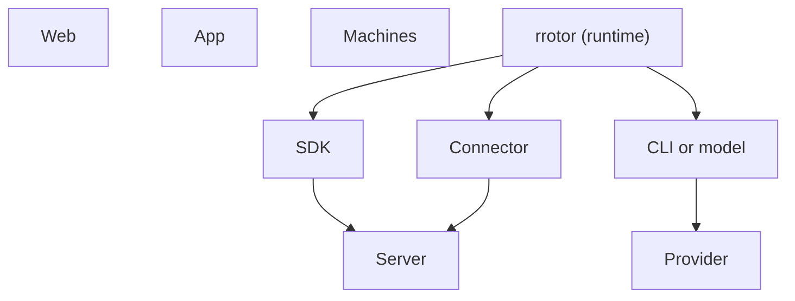

# Architecture

## Decided

### How everything is built

- **Every capability is built in this order: the database (drawn in the data model first), then the API, then the SDK.** MCP exposes the same service function the API serves, so one function sits behind every surface.
- **100% test coverage is the target**, enforced in CI.
- **Builds and deploys are automatic:** every merge to main is tested, built and deployed, and clients update themselves.
- **Everything runs in Docker**, locally and in production.

### Server

A single-deployment, multi-tenant cloud SaaS, headless first: every capability is an API (OpenAPI) and an MCP tool before it is any screen, with the same permission checks behind both.

- **API:** REST with OpenAPI over one service layer; Server-Sent Events where results stream (model output, long jobs, live updates).
- **MCP:** the Streamable HTTP transport on one `/mcp` endpoint, in stateless mode. Its tools are generated from the same service layer and curated to task-sized tools, not one per endpoint.
    - **Stateless:** every call stands alone and carries its own auth and tenant, so any process behind the load balancer answers it and a deploy or a crash drops nothing. A call still streams its progress and result.
    - **What stateless gives up:** pushes outside a call (resource subscriptions, tool-list change notices, the server asking the client something mid-session).
    - **If those are needed later:** keep the session state in Postgres, not in process memory, so the server stays scalable and needs no sticky sessions.

- **Language and framework:** Python 3.12+, FastAPI, Pydantic v2, async throughout.
- **Shape:** one deployment for every tenant, run as two or more stateless processes behind a load balancer.

### Models

Glyphh is a model runtime, not a gateway, and it governs nothing: limits, access rules and spend belong to an AI gateway the customer puts in front of their models (a model's base URL can point at it). A super power names a model its org added (a provider, the provider's model id and an API key); when it runs, rrotor calls the provider directly with that key. Glyphh stores the model's setup and never routes, meters, limits or pays for a model call. The key is encrypted on the server and handed only to a member's own runtime.

### Connections

Connections are the moat. A super power declares the connections it needs by name; only Glyphh's connections are used: an MCP server with its sign-in, added in Glyphh, encrypted and never returned. Whichever loop runs the super power (Claude Code, Codex or rrotor's own), rrotor hands it exactly those connections and nothing of the loop's own (for Claude Code, `--mcp-config` with `--strict-mcp-config`).

### Paths

- **rrotor → CLI or model → provider:** the thinking goes straight to the provider, on the member's own subscription or key. Glyphh never sees it.
- **rrotor → connector → server:** every connection call goes through the server, which relays it to Pipedream and counts it, because each one is a cost Glyphh pays.

### Runtime hosting

Glyphh does not host runtimes. Members run rrotor on their own compute: their desktop, or a remote server on any infrastructure (Fly.io, Railway, Render, AWS, a VPS).

- rrotor ships as one Docker image, so it runs anywhere Docker does.
- It connects out to the server, never in, so a remote server needs no public address, ports or firewall rules.
- Glyphh supplies the setup: one-click configs for the common hosts, a one-line `docker run`, and docs for the rest.
- The server only knows which runtimes a member has registered, and whether each is online.

### Interfaces

Two ways in, one per surface, both in the `glyphh-ai/glyphh` repo (private for now, public later). Neither carries logic of its own: same accounts, permission checks and tenant rules as the server.

- **SDK (on the API):** a typed client generated from the server's OpenAPI spec; handles sign-in and tokens, streaming over Server-Sent Events, retries and pagination. TypeScript first (the app on desktop, web and mobile, and the CLI), Python second.
- **Plugin (on MCP):** one install for agent hosts (Claude Code and Claude Desktop, Cursor, ChatGPT apps): the `/mcp` connection signed in with OAuth, plus skills that teach the agent to use Glyphh's tools.

### Access

- **Sign-in:** Google and GitHub. Their screens are the sign-in; the server takes the callback and redirects back to the app or agent, so it serves no page of its own. No magic links: mail scanners use them up, they break across devices, and they train people to click sign-in links in email. Microsoft can follow, the same way, when business users need it.
- **Tokens:** after Google sign-in the server issues its own tokens to the app, the CLI and the plugin; every token carries its org.

### Data

- **Database:** one Postgres for every tenant, without pgvector.
- **Tenant isolation:** row-level security keyed on the org, enforced by the database.
- **Access:** SQLAlchemy 2 (async) over asyncpg.
- **Schema:** one schema file until relaunch, then Alembic migrations.
- **Background jobs:** a Postgres-backed queue.
- **Files:** object storage (R2 or S3), with references in Postgres.

### Operations

- OpenTelemetry tracing and metrics, logs tagged by tenant.
- Managed Postgres with point-in-time recovery, and connection pooling.

### Not at the start

- No single sign-on, SCIM, enterprise roles or audit log.
