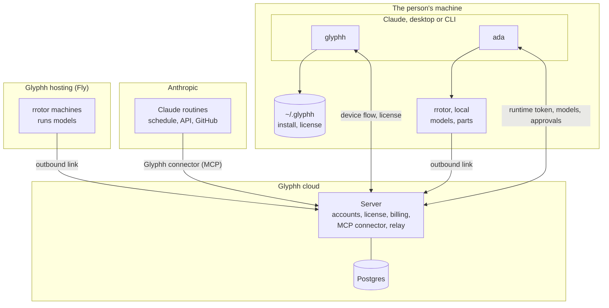
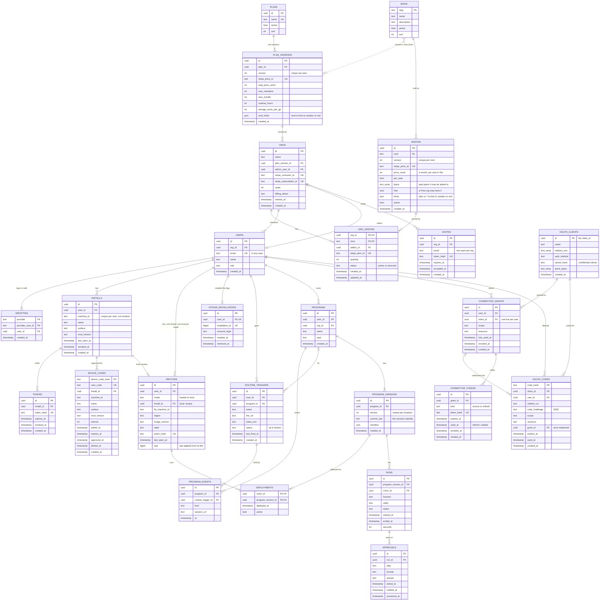

# Glyphh

The design of Glyphh as it stands: the [product](#product), the [architecture](#architecture), the [data model](#data-model) and the [plans](#plans). Each part is marked **built** (working, in `glyphh-ai/server`, `glyphh-ai/mods`, `glyphh-ai/glyphh` or `glyphh-ai/rrotor`) or **designed** (decided, not built). How the parts call each other, step by step, is in rrotor's `docs/architecture.md`. Earlier versions of this doc are in git history.

## Product

**Glyphh makes mods for Claude, as a business.** A mod is a Claude Code plugin that adds commands, tools and panels to Claude. Each mod is its own product, installed from one Glyphh marketplace; one Glyphh account and one subscription turn them on.

| Mod | What it is | Runs | Sold | State |
|---|---|---|---|---|
| `glyphh` | The account: sign in, the licence, and the account, org, plan and billing panels. Every other mod depends on it | Claude | Every plan | Built |
| `ada` | Ada models in your rrotor: a typed spec and a precedent store, deployed by commit, run with no network, called by Claude and by Claude's routines | **rrotor**, an isolated runtime: local on every plan; hosted on Pro and Team | Add-on | Mod designed; rrotor built (local) |

- **Every mod is an add-on.** A plan (Free, Pro, Team) includes no mod: it sets the account's limits and which add-ons it may have. Each add-on is a line on the org's one Stripe subscription.
- **Everything is a subscription.** Nothing is bought one-off.
- **Everything is in Claude.** Every screen is a panel Claude shows; there is no Glyphh app and no Glyphh web UI, only the device sign-in's page, the connector's sign-in and Allow page, and Stripe's.
- **Glyphh has no model in it.** Claude is the brain, on the person's own Claude; Glyphh's machines do exact work. Glyphh never holds a Claude login ([Anthropic's terms](#anthropics-terms)).
- **Desktop first, then the CLI.** Mods look like Claude: its theme, its fonts. **Functional first:** every screen works before design draws it.

## Architecture




**What a person makes stays theirs:** their models, their precedents and their data, in their own rrotor. The server holds who they are, what they pay for, and the record of their models and runs, never their content.

### The parts

| Part | What it is | Repo | State |
|---|---|---|---|
| **The server** | Accounts, orgs, installs, the signed licence, plans and add-ons on Stripe, the Glyphh connector (`/mcp`), the runtime link and approvals | `glyphh-ai/server` | Built (the models and runs API designed) |
| **The `glyphh` mod** | The account in Claude | `glyphh-ai/glyphh` | Built |
| **The Ada mod** | `ada`, carrying the shared sign-in and licence module (`shared/licence/`) | `glyphh-ai/mods` | Designed |
| **rrotor** | The runtime Ada installs into: a small base image, the program sandbox and runner, and a part per mod | `glyphh-ai/rrotor` | Local built; hosted designed |
| **The marketplace** | What buyers install from: each mod built, with its live values | Written by each source repo's release build | Built (publishing off) |

### Mods and how they are installed

- **A mod is a Claude Code plugin** whose hooks are a code module (`.claude-plugin/plugin.json`, `hooks/hooks.json` naming `register.tsx`). A mod can ship its own MCP server, skills and commands. Mods are behind `CLAUDE_CODE_ENABLE_FUNCTION_HOOKS` while the API is early access.
- **Installed from the Glyphh marketplace** at the user scope, so it loads in every session, the desktop's Code tab too. Every mod depends on `glyphh`.
- **Source and releases are apart.** The source repos hold tests, the shared modules and the release scripts; a release build writes only each mod's shipped files and the marketplace file, with the live server address and licence key swapped in.
- **Each mod checks the licence** at start. A mod the licence does not include is closed with its offer ("Ada is an add-on ($4/month per seat on Pro). Add it in /ada.") and **Add it**.

### Two kinds of panel

| | Mod panels | MCP App panels |
|---|---|---|
| What | Claude's own elements: boxes, text, buttons, inputs, selects, links, markdown, SVG | An HTML page with scripts that an MCP tool returns (`text/html;profile=mcp-app`, at a `ui://` address), shown in a frame |
| Can | Forms, lists, actions, on desktop and CLI | Live pictures, take control, anything a page can do; the host passes its theme as CSS variables |
| Used for | Account, org, plan, billing, models | **The live panel:** a run's steps and log as they happen, approvals; the connector's account panel |

Proved on 2026-10-12 (`glyphh-ai/server`, branch `proto/stream`): an MCP App panel in Claude showed a machine's screen live and took control of it. Its lessons hold: Claude's panel frame preflights every POST; tickets stay out of URLs; a panel's `ui://` address carries its version.

### `glyphh`: the account (built)

- **Sign in** by device flow: `/glyphh` shows the code and opens the link in Claude's browser pane (in the CLI, prints it); the person signs in with Google or GitHub. One sign-in serves every mod on that machine. Asking Claude "sign in to Glyphh" shows a sign-in card in the chat, from the mod's own MCP server.
- **Licence:** fetched and checked (Ed25519) at start and refreshed daily; every mod reads it.
- **Panels:** account, org, plan, billing.

### `ada`: models and rrotor

**An Ada model is a typed spec and a precedent store; rrotor runs it; Claude calls it.** Ada is a library (`glyphh_kernel.py`, `glyphh_spec.py`, `glyphh_nsm.py`; numpy only): a model is `spec.json` and a small `program.py` whose functions call the kernel (`record`, `query`, `facts`, `probabilities`, `decide`). Nothing is trained; the model learns from the precedents it records. To rrotor a model is a **program**: a Python package with a manifest, deployed by commit, run in the sandbox, answering with a `Result`.

**Built:** rrotor deploys a program by commit and runs it in its sandbox; the server hands a mod the runtime token and takes rrotor's link, approvals and the GitHub App. **Designed:** the Ada mod (it installs and starts rrotor, deploys models and calls them), the Ada part (numpy and the kernel), the server's models and runs API, the hosted runtime, the live panel and calls from routines.

**A program**, as rrotor runs one:

```python
from rrotor import Ctx, Result


def load(ctx: Ctx) -> None: ...  # once per run: read config, open the store
def start(ctx: Ctx, inputs: dict) -> Result: ...  # the main job
def decide(ctx: Ctx, case: dict) -> Result: ...  # custom functions, each callable on its own
def end(ctx: Ctx) -> None: ...  # always runs: close up, keep results
```

- **Every call returns a `Result`:** a status and data. The status tells the caller what is next:

| `status` | Means | Claude does |
|---|---|---|
| `done` | Here is the result: data, a file, a link | Uses it, or finishes |
| `needs_input` | A value is missing, or a choice: "pick A, B or C" | Answers, then `continue` |
| `needs_approval` | About to act: "record this" | Asks the person; unattended, leaves it waiting for them |
| `failed` | Which step and why | Retries, tries another way, or reports |

- **`ctx` is what the program was granted**, nothing else: `ctx.http` (only the hosts the manifest declares; an Ada model declares none), `ctx.db` (its own databases, from the database parts), `ctx.secrets`, `ctx.files`, `ctx.log`, `ctx.checkpoint` (resume a run between calls).
- **Folders exist only through the program:** a program sees its own folder (`ctx.files`, `/data/programs/<name>/files`) and its persistent data folder (`/data/programs/<name>/data`, Ada's precedent store, outside git) and nothing else; no program reaches another's.
- **The manifest** declares the program's functions and their inputs, the hosts it reaches, its secrets, its databases, the parts it needs (Ada's kernel), the steps that need approval, and the Claude connectors its routine needs.
- **A model lives in the runtime and in git:** each is a repo in the person's own GitHub account; a version is a commit. The server keeps only an index (name, repo, versions as commit SHAs, where each is deployed) and the run records. Glyphh's cloud never keeps a copy of the code or the precedents.
- **Git is required for hosted models:** the person installs the Glyphh GitHub App on their account (built); deploying pins a commit, and the hosted rrotor fetches exactly that commit with a short-lived token the App issues for that repo. Local-only use needs no GitHub.
- **A redeploy that changes the encoding** (the spec's `seed`, `dim`, `encoding` or `spec_id`) re-encodes the store from its recorded facts before the new version is active, or refuses the deploy (`E_ADA_ENCODING`) when the old facts cannot be read by the new spec.
- **`clearance`** comes from the caller's Glyphh identity (the run's caller, the person's plan and org role), passed in the call and never from the inputs, so a model's facts are filtered by who asks.
- **Secrets are never committed:** they stay in rrotor's vault.

**Build time: in Claude, with the mod.** The mod's tools and skills let Claude, with the person, write the spec and the model's functions, run it against their rrotor, read the result and fix it until it passes, then deploy it and create its routine. Whatever is missing, Claude asks for: a Claude connector, or a secret.

**Run time: Claude's routines are the runner** (designed).

1. A routine fires on its schedule, its API trigger or a GitHub event, on Anthropic's machines, on the person's own Claude subscription.
2. Claude calls the **Glyphh connector**: `call(model, function, inputs)`, then `continue(run_id, answer)` as needed.
3. The server wakes the person's hosted runtime and passes the call over its outbound link. (A local runtime is reached by Claude on that computer, so cloud routines call the hosted one; local scheduled tasks call the local one.)
4. rrotor runs the step in its sandbox and answers the `Result`; Claude decides what is next.

Routines run without approvals, so Glyphh's own rule is the brake: a step that `needs_approval` with nobody watching waits for the person (the band in Claude, a toast, an email). Claude can also call a model directly, in any session.

**The live panel** (designed) shows a run as it happens: its steps, its log and its approvals. It is an MCP App panel; the run's events come from rrotor through the server's relay.

### rrotor

**One isolated runtime per person, local and hosted.** A person never sees machines: they have a runtime where their models live and run.

| | Local runtime (built) | Hosted runtime (designed) |
|---|---|---|
| Who | Every plan, Free included | Pro and Team |
| Where | The person's own computer (Apple's `container`, else OrbStack, else Docker), installed and started by the first mod that needs it | One Fly machine and its volume per person, which Glyphh provisions on upgrade; nobody sees or manages it |
| Up | While the computer is on | Stopped when idle, woken per call |
| Called by | Claude on that computer, through the mods' local API | Claude anywhere and Claude's routines, through the Glyphh connector |
| Caps | The computer's own | Runtime hours a month and storage, per plan |

Both run the same image and the same SDK; a model built locally deploys to the hosted runtime unchanged.

- **A small base image** (`ghcr.io/glyphh-ai/rrotor`): Python, Node, the program sandbox, the link client, the local API and the program runner. **Headless:** no UI, no desktop, nothing to log into.
- **A part per mod**, installed into rrotor from the mod's own release, versioned, verified and licensed by the plan: Ada's numpy and kernel, and the database parts (Postgres with pgvector, MongoDB, Neo4j) a program asks for.
- **No sign-in of its own:** the mod, signed in, asks the server for the runtime token (`POST /v1/runtime/local`) and hands it to rrotor; signing the install out cuts rrotor off.
- **No inbound ports from outside the machine:** the local API listens on loopback only, behind a token only the mod holds; rrotor connects out to the server and takes remote calls over that link.
- **Each run sandboxed** (bubblewrap, Landlock, seccomp): only its program and its own data mounted; network only through an egress proxy that lets through the hosts the manifest declares; anything else refused and recorded.
- **One volume, `/data`:** program versions, secrets (encrypted), run logs and outputs.
- **No Claude login, no model, no keys of Claude's** anywhere in it.

### On the machine: `~/.glyphh`

Only what the mods need to start and sign in; nothing here goes to the cloud.

| Path | What |
|---|---|
| `install.json` | This install's id and token, mode 0600 |
| `license.json` | The signed licence: plan, limits, mods, expiry |

### In rrotor: `/data`

The same layout in the local and the hosted rrotor. rrotor calls a deployed model a program, and its paths say so.

| Path | What |
|---|---|
| `programs/<name>/<commit>/` | A deployed version of a model: the checkout of that commit, its manifest and installed dependencies |
| `programs/<name>/files/` | The program's own folder, the only folder it sees |
| `programs/<name>/data/` | The model's persistent data, outside git: its precedent store |
| `secrets/` | Each model's secrets, encrypted with rrotor's key |
| `parts/<part>/` | The parts the mods installed |
| `db/` | The database parts' data: each model its own database |
| `runs/<run_id>/` | A run's log, checkpoints and outputs |

### The server

The `glyphh-ai/server` repo: Python 3.13, FastAPI, Pydantic v2, SQLAlchemy 2 (async) on Postgres, in Docker. Database first, then API; 100% test coverage; errors with stable codes and a trace id; small files.

- **Sign in by device flow (RFC 8628)**; an **install** is a machine: signing in again on the same machine reuses its install, so the plan's installs count machines, not sign-ins.
- **Org:** the first user is its admin and pays; one org per user; members by invite.
- **Plans and seats:** per seat, through Stripe. A plan sets the account's limits; it includes no mod.
- **Add-ons:** every mod, one Stripe subscription item each on the org's one subscription, prorated; per seat or flat; each add-on version names the plans it may be added to, whether Free may have it, and the mod's limits on each plan (below, Add-ons).
- **Licence:** short-lived, signed, per install: plan, account limits, and each add-on the org has, with its limits (below, The license).
- **The Glyphh connector:** a remote MCP server (`/mcp`, Streamable HTTP) that Claude and routines call, signed in with OAuth (below, The connector). Its tools now are the account's; the model tools come with Ada.
- **The runtime link:** rrotor's outbound WebSocket (its own token); calls go down it, results and events come back. A local runtime's token stops working when its install is signed out.
- **Approvals, shown in Claude:** a step that needs approval is a row in `approvals` and a signal on **Redis** pub/sub to the server process holding the person's connection; the mod keeps one live connection while Claude is open (`/v1/approvals/stream`) and shows Approve and Decline; the first answer wins. Redis runs on the server's own Fly machine and holds only what is live; Postgres holds everything kept.
- **Models:** the record of each Ada model (a program, to rrotor and in the tables), its versions and deployments, and of each run (who called it, status, times), never its content (designed).
- **Hosting:** provisions each Pro and Team user's runtime on Fly, wakes it per call, stops it when idle, counts its hours and bills its storage (designed).
- **Limits are enforced here** where the server sees the use: members, seats and installs. Every mod limit the mod enforces from its licence.

### API

JSON over HTTPS under `/v1`, described by `/openapi.json`. Every call but the device flow's, the plans and mods lists and Stripe's webhook carries an install's token (`Authorization: Bearer`); `/mcp` takes a connector access token instead, and only `/mcp` does. Refusals are `{"error": {"code", "message", "trace_id"}}`; a limit is `E_LIMIT` with `limit`, `used`, `max` and the `plan` that lifts it.

**Built:**

| Area | Calls |
|---|---|
| Device flow | `POST /v1/device/code` (with the mod's `machine_id`), `POST /v1/device/token`, `GET /v1/device?code=` |
| Account | `GET`/`PATCH /v1/me` (the plan with each mod's limits, and what is used where the server sees it: members, seats, installs), `POST /v1/me/identities` (a link that adds Google or GitHub), `DELETE /v1/me/identities/{provider}`, `GET /v1/installs`, `DELETE /v1/installs/{id}`, `POST /v1/sign-out`, `GET /v1/license`, `GET /v1/license/key` |
| Org | `GET`/`PATCH /v1/org`, `GET /v1/org/members`, `DELETE /v1/org/members/{user_id}`, `GET`/`POST /v1/org/invites`, `DELETE /v1/org/invites/{id}`, `POST /v1/invites/accept` |
| Mods, plans, billing | `GET /v1/mods` (each mod, the plans that include it, and `addon`: the add-on it is sold as, `price_cents`, `per_seat`, `plans` and `free`, or `null`), `GET /v1/plans` (each plan's newest version: price, account limits, each mod and its limits), `POST /v1/billing/checkout`, `/plan`, `/seats`, `/portal`, `POST /v1/stripe/webhook` |
| Add-ons | `GET /v1/addons` (the catalog for the org's plan, with prices, and what the org has), `POST /v1/billing/checkout` with `addons`, `POST /v1/billing/addons/preview`, `POST /v1/billing/addons`, `DELETE /v1/billing/addons/{mod}` (below, Add-ons) |
| Runtime | `POST /v1/runtime/local` (a local rrotor's runtime token, for this install: made the first time, rotated after, shown once); `/v1/runtime/link`, the runtime's outbound WebSocket, hosted or local (protocol 1, as rrotor's `docs/architecture.md` section 6: the token in the `Authorization` header, a local runtime refused once its install is signed out, `hello` then `welcome`, the runtime `online` until it closes; results and events acked and applied once by their sequence number; a newer link of the same runtime takes over). Which server process holds which link: in memory, and a Redis channel per runtime, so a call made on any process reaches it. The service functions other code calls: `send_call` (writes the run), `send_continue`, `send_cancel`, `send_deploy`. A runtime no process holds answers `E_UNAVAILABLE` with when it was last seen; waking a stopped hosted runtime on Fly is one seam, `wake_hosted`, not built |
| GitHub | `POST /v1/github/install` (a link for the browser, as linking does), `GET /v1/github/install` (to the Glyphh GitHub App's install page), `GET /v1/github/callback` (records the installation, from the browser that started it, when GitHub says it is on the person's own GitHub account), `GET /v1/github/installations`; the Cloud mints a repo-scoped installation token per deploy |
| Routine triggers | `GET`/`POST /v1/routine-triggers` (name, fire URL, token, optional program; the token is never shown again), `DELETE /v1/routine-triggers/{id}`; the Cloud fires them (`POST …/fire`) on a program's events |
| Connector | `GET /.well-known/oauth-protected-resource` (and `/mcp` after it), `GET /.well-known/oauth-authorization-server`, `POST /oauth/register`, `GET /oauth/authorize`, `POST /oauth/token`, `POST /oauth/revoke`, the Allow page (`POST /auth/oauth/allow`), `POST /mcp`; `GET /v1/connector/grants`, `DELETE /v1/connector/grants/{id}` (below, The connector) |
| Approvals | `GET /v1/approvals` (waiting, newest first), `GET /v1/approvals/stream` (server-sent events: `approval`, `answered`; the waiting ones replayed first, a heartbeat every 20 s), `POST /v1/approvals/{id}` {`approve` \| `decline`} (first answer wins); a run's `needs_approval` enters through the link; the answer goes down it as `continue` (a runtime not connected answers `E_UNAVAILABLE` and the step keeps waiting). Not built yet: the email when no Claude is open waits on a mail provider (`notified_at` stays empty) |

**To build, for Ada** (the server's resource is still named `programs`: what rrotor calls a model):

| Area | Calls |
|---|---|
| Programs | `GET`/`POST /v1/programs`, `GET`/`DELETE /v1/programs/{id}`, `POST /v1/programs/{id}/versions` (commit SHA, manifest), `POST /v1/programs/{id}/deploy` (a version) |
| Runs | `POST /v1/runs` (program, function, inputs), `POST /v1/runs/{id}/continue`, `GET /v1/runs/{id}`, `GET /v1/runs` (filtered, paged), `POST /v1/runs/{id}/approve`, `GET /v1/runs/{id}/live` (the stream, by ticket) |
| Runtime | `GET /v1/runtime` (state, hours used, storage used), `POST /v1/runtime/start`, `/stop`, `POST /v1/runtime/storage` (grow it); waking a stopped hosted runtime per call (Fly), behind the link's `wake_hosted` seam; the live panel's run events relayed from the link to its panel |
| Hours | `GET /v1/hours` (balance and ledger), `POST /v1/hours/top-up` (Stripe Checkout), auto top-up and the spend cap on `PATCH /v1/org` |
| Connector | The model tools on `/mcp`: `models_list`, `call`, `continue`, `run_status` and the live panel |

### The license

`GET /v1/license` answers the install's license; `GET /v1/license/key` the public key (`{"alg": "Ed25519", "public_key": "<base64 of the raw 32 bytes>"}`). A mod verifies it offline: the signature (base64) is Ed25519 over the payload's canonical JSON, the payload's keys sorted at every level, no spaces, ASCII only (Python's `json.dumps(payload, sort_keys=True, separators=(",", ":"))`, UTF-8), and the license holds until `expires_at` (24 hours; the mod fetches a new one daily).

```json
{
  "payload": {
    "install_id": "6a1d…",
    "user_id": "0f3c…",
    "org_id": "9b2e…",
    "plan": "Pro",
    "limits": {"members": 1, "installs": 5},
    "mods": {
      "ada": {"limits": {"models": 3, "precedents": 10000}}
    },
    "expires_at": "2026-10-16T09:30:00Z"
  },
  "signature": "q8Zk…=="
}
```

(A Pro org with the Ada add-on.)

- `mods` names each add-on the org has, and only those, with that add-on version's limits on the org's plan. A mod not in it is not included; a retired mod is in no license. `limits` holds every limit of that mod: a number, or `null` for unlimited; a switch is `0` or `1`.
- `limits` at the top are the account's: `members` (per org) and `installs` (per user), `null` for unlimited.

### Add-ons

Every mod is an add-on to the plan: a line on the org's one Stripe subscription, on the same invoice, prorated when it changes. Writes are the admin's.

- **`GET /v1/addons`** (anyone in the org): each add-on on sale, and each the org has (at the version it added): `mod`, `name`, `description`, `version`, `price_cents` (a month, per seat when `per_seat`, else flat), `per_seat`, `monthly_cents` (for the org's seats now), `plans` (the paid plans it may be added to), `free` (whether a Free org may have it), `allowed` (on the org's plan), `limits` (the mod's limits on the org's plan; `null` when the plan may not have it and the org hasn't it), `added`, `quantity` (on the subscription; `null` when not added).
- **`POST /v1/billing/checkout`** `{"plan", "seats", "addons": ["ada"]}`: one Checkout with the plan's line and one per add-on (a per-seat add-on's quantity is the seats, a flat one's 1). `plan` `Free` with only add-ons the catalog allows on Free subscribes to those alone.
- **`POST /v1/billing/addons/preview`** `{"mod", "action": "add" | "remove"}`: what changes now, from Stripe's preview invoice (`POST /v1/invoices/create_preview` on the subscription): `{"mod", "action", "prorated_cents", "currency", "monthly_cents", "proration_date"}`; `prorated_cents` is the sum of the proration lines (negative for a credit), `monthly_cents` the add-on's monthly amount at the seats now. Passing `proration_date` back when applying makes Stripe charge exactly what was previewed.
- **`POST /v1/billing/addons`** `{"mod", "proration_date"?}` adds a subscription item, prorated; **`DELETE /v1/billing/addons/{mod}`** (`?proration_date=`) deletes it, prorated (a credit). Both answer the same list as `GET /v1/addons`, synced from Stripe's answer at once.
- **Refusals** (stable codes): not the admin `E_FORBIDDEN`; no subscription `E_CONFLICT` `reason: not_subscribed` (subscribe with checkout); not allowed on the org's plan `E_CONFLICT` `reason: not_on_plan`; already added `E_CONFLICT` `reason: already_added`; not added `E_NOT_FOUND` `reason: not_added`; the subscription's last item `E_CONFLICT` `reason: last_item` (cancel in the billing portal); a mod with no add-on on sale `E_INVALID` `reason: no_addon`. Changing plan to one an added add-on isn't allowed on is `E_CONFLICT` `reason: not_on_plan`.
- **Seats:** changing the seats changes every per-seat add-on's quantity with the plan's, in one prorated update.
- **Stripe's webhook** keeps the org's add-ons true: on every subscription event it reads the subscription fresh and matches each item's price to an add-on version (the plan's item to a plan version); an item there is an add-on the org has (`active`, its item id and quantity), an add-on no longer there is `removed`; a subscription that ended removes them all. Replays and events out of order change nothing, as for the plan.

### The connector

A remote MCP server at `{public_url}/mcp`, its own OAuth 2.1 authorization server, following MCP's authorization spec (revision 2026-07-28). Through it a person manages their Glyphh account from Claude or any MCP client.

**Discovery.**

- `GET /.well-known/oauth-protected-resource` and `/.well-known/oauth-protected-resource/mcp` (RFC 9728): `resource` `{public_url}/mcp`, `authorization_servers` `[{public_url}]`, `scopes_supported` `["account"]`, `bearer_methods_supported` `["header"]`.
- `GET /.well-known/oauth-authorization-server` (RFC 8414): the issuer `{public_url}` and its endpoints; `response_types_supported` `["code"]`, `grant_types_supported` `["authorization_code", "refresh_token"]`, `code_challenge_methods_supported` `["S256"]`, `token_endpoint_auth_methods_supported` `["none", "client_secret_post", "client_secret_basic"]`, `scopes_supported` `["account"]`, `authorization_response_iss_parameter_supported` `true` (RFC 9207).
- `/mcp` without a good token answers 401 with `WWW-Authenticate: Bearer resource_metadata="{public_url}/.well-known/oauth-protected-resource/mcp", scope="account"` (and `error="invalid_token"` when a token was sent).

**Registration.** `POST /oauth/register` (RFC 7591): `redirect_uris` (1 to 10; each `https`, or `http` on `localhost`, `127.0.0.1` or `[::1]`; no fragment), `client_name`, `token_endpoint_auth_method` (`none` for a public client; `client_secret_basic`, RFC 7591's default, or `client_secret_post` get a `client_secret`, shown once and kept hashed), `grant_types` within `authorization_code` and `refresh_token` (both when left out), `response_types` `["code"]`; any other metadata is ignored. Refusals are `invalid_redirect_uri` or `invalid_client_metadata`. Client ID metadata documents are not supported yet.

**Authorization.** `GET /oauth/authorize` with `response_type=code`, `client_id`, `redirect_uri` (exactly as registered), `state` (required), `code_challenge` and `code_challenge_method=S256` (required), `scope` (`account`, the default) and `resource` (`{public_url}/mcp` or `{public_url}`; the token is bound to `{public_url}/mcp`). An unknown client or redirect URI is a page and never a redirect; any other refusal goes back to the redirect URI as `error`, `error_description`, `state` and `iss`. The page offers Continue with Google or GitHub (the same provider pages as the device sign-in, tied to the browser by the same cookie, 10 minutes), then the Allow page: "Allow <client name> to use your Glyphh account?", the redirect URI's host and the email signed in, Allow and Deny, its form signed and tied to that browser. Allow redirects with a `code` (single use, 2 minutes), `state` and `iss`; Deny with `error=access_denied`.

**Tokens.** `POST /oauth/token` (form-encoded):

- `grant_type=authorization_code`: `code`, `redirect_uri`, `client_id`, `code_verifier` (PKCE S256, compared in constant time), and `resource` if the authorization named one. A code used twice revokes what it issued.
- `grant_type=refresh_token`: `refresh_token`, `client_id`. The refresh token rotates on every use; a used one presented again revokes the whole grant.
- Answers `access_token` (opaque, 1 hour), `token_type` `Bearer`, `expires_in`, `refresh_token` (30 days) and `scope`, with `Cache-Control: no-store`. Every token and code is random and kept only as a SHA-256 hash.
- `POST /oauth/revoke` (RFC 7009): a refresh token revokes its grant, an access token itself; always 200.
- These endpoints answer refusals in OAuth's own shape (`{"error": "invalid_grant", "error_description": …}`, RFC 6749 section 5.2 and RFC 7591 section 3.2.2), not the API's: OAuth clients read that shape.

Nothing on these endpoints is rate-limited yet: the server has no rate limiting anywhere so far.

**Grants.** One per person and client: allowing the same client again reuses its grant. `GET /v1/connector/grants` lists the person's grants (client, scope, when allowed and last used); `DELETE /v1/connector/grants/{id}` revokes one and every token it holds; the connector's own `revoke_grant` does the same.

**`/mcp`.** Streamable HTTP, stateless: `POST` only (`GET` and `DELETE` answer 405), each request answered with one JSON object; no sessions. It speaks MCP 2026-07-28 (each request's `_meta` carries `io.modelcontextprotocol/protocolVersion` and `clientCapabilities`, mirrored in the `MCP-Protocol-Version`, `Mcp-Method` and `Mcp-Name` headers, checked against the body; `server/discover`) and the earlier `initialize` revisions 2025-11-25, 2025-06-18 and 2025-03-26. An `Origin` header other than the server's own or `GLYPHH_MCP_ORIGINS` is refused (403). The access token must be one the authorization server issued for `{public_url}/mcp`, its grant not revoked; the request then runs as that person, in their org (row-level security).

| Tool | Does | Who |
|---|---|---|
| `whoami` | The account, its org and role | Everyone |
| `plan` | The plan, each mod and its limits, the add-ons the org has, what is used, seats, billing status and when it renews | Everyone |
| `addons` | The add-on catalog for the org's plan, with prices and limits, and which the org has | Everyone |
| `add_mod`, `remove_mod` | `mod`: the first call answers the prorated price now and the monthly price (Stripe's preview) and changes nothing; the same call with `confirm: true` (and the `proration_date` the first answered) adds or removes it, prorated | Admin |
| `plans` | What each plan costs and includes: account limits, each mod and its limits | Everyone |
| `upgrade` | `plan`, `seats`: Stripe Checkout's address when not subscribed; changes plan (prorated) when subscribed | Admin |
| `billing_portal` | Stripe's portal address: card, invoices, cancel | Admin |
| `seats` | `seats`: change the seats, prorated | Admin |
| `installs`, `sign_out_install` | The person's installs; sign one out (`install_id`) | Everyone |
| `members`, `invite` | The org's members and open invites; invite by `email` (the link, shown once) | Everyone; `invite` the admin |
| `connector_grants`, `revoke_grant` | The connector's grants; revoke one (`grant_id`) | Everyone |

Each result is a short text and the same as structured content; a refusal is a tool result with `isError` and the API's error (`{"error": {"code", "message", "trace_id", …}}`) as structured content.

**The account panel.** One MCP App resource, `ui://glyphh/account/2` (`text/html;profile=mcp-app`, MCP Apps 2026-01-26), listed by `resources/list` and read by `resources/read`; `whoami` and `plan` name it in `_meta.ui.resourceUri`. It shows who you are, the plan, each mod with its limits and what is used, the add-ons with their prices and Add or Remove (each shows the prorated price and asks to confirm before it applies), Upgrade (opens Checkout), Manage billing, the installs (sign one out) and the grants (revoke one); every action is a call of the connector's own tools through the host. The server advertises nothing for it, as MCP Apps says: on 2026-07-28 requests the tools carry the link only when the request's `clientCapabilities` name the `io.modelcontextprotocol/ui` extension with that mime type; on the stateless earlier revisions, where a request carries no capabilities, they always carry it, and a client without panels ignores it. Its address carries its version: a new panel is a new address (`/2` since the add-ons, 2026-10-15). Generic styling, with the host's theme variables, for now.

### Panels

Each works before design draws it.

| Panel | Where | Kind | State |
|---|---|---|---|
| Sign in, account, org, plan, billing | `glyphh` | Mod | Built |
| The sign-in card, in the chat | `glyphh`'s MCP server | MCP App | Built |
| The account: who, plan, each mod's limits, add-ons (add, remove), upgrade, billing, installs, grants | The Glyphh connector | MCP App | Built |
| Not in your plan, with the add-on's offer and **Add it** | every mod | Mod | Built |
| Models: list, versions, deploy, runs, needs you | `ada` | Mod | Designed |
| The live panel: a run in rrotor, its steps, log and approvals | `ada` | MCP App | Designed |
| Runtime: local on or off; hosted state, hours and storage used, grow storage | `ada` | Mod | Designed |

### Anthropic's terms

From Claude Code's legal page and the Consumer Terms (checked 2026-10-14):

- Third-party developers may not offer Claude.ai login in their apps, route requests through someone's subscription, or "collect, store, or intermediate Claude.ai credentials or session tokens"; nor pay for or resell Claude usage on their users' behalf.
- **Glyphh never touches a Claude login:** Claude runs on the person's own subscription in Anthropic's own products (Claude Code, routines, scheduled tasks) and calls Glyphh's tools. rrotor has no Claude in it.
- A routine's API token, if a person gives one to Glyphh to start their routine, starts that routine only; it is not a Claude login.

### Open

**To prove:**

- **The live panel from a mod's own MCP server** in the Code tab, on a run in rrotor.
- **The Glyphh connector in a routine:** a routine calling `call` and `continue` on a test model, end to end.
- **Waking the hosted runtime per call** fast enough for a tool call (Fly start, link up, answer).
- **Apple's `container`** running rrotor on macOS 26 (detected and started, not yet tested).
- **Dependencies through the marketplace**, and **a built mod loading** as its source does.

**To decide (Chris):**

- Every add-on's price, per seat or flat, and its limits (placeholders in `db/seed_addons.py`).
- Solo: its price and limits; it is not seeded until then.
- The hosted runtime's hours per plan, and how more hours are bought (within the subscription: nothing is bought one-off).
- The marketplace's home: the release builds write `glyphh-ai/glyphh`, which also holds the `glyphh` mod's source.
- Email for approvals when no Claude is open: the mail provider (`notified_at` stays empty until then).

## Data model

### In the cloud




Every table and column is drawn, as the database has them; the tables from rrotors on are for Ada models, which rrotor runs as programs, so the tables say `programs`. Timestamps carry the time zone; ids are made by the database.

- **Plan versions never change their price or limits.** Changing either adds a version with its own Stripe price; an org stays on the version it subscribed to.
- **Mods and their limits:** `mod_limits` is `{"<mod>": {"<limit>": number | null}}`: the mods a version includes, each with every one of its limits (`null` unlimited; a switch `0` or `1`). Every plan's is empty now, since every mod is an add-on. A retired mod (`active` false) is in no license.
- **Add-ons** (`addons`): each mod, sold as a line on the org's subscription. A version never changes its price, flags or limits: a new Stripe price is a new version (as plan versions); `active` false takes it off sale, and an org keeps the version it added. `limits` is `{"<plan>" | "*": {"<limit>": number | null}}`: the mod's limits on that plan, `*` for every plan not named. `plans` names the paid plans it may be added to; `free` lets a Free org have it (off unless set).
- **Org add-ons** (`org_addons`): one row per org and mod, written only from Stripe's subscription: the version it sells (`addon_id`), its subscription item and quantity, `active` while the item is on the subscription and `removed` after (the item id cleared). Row-level security on the org, as the rest.
- **A limit left empty is unlimited.** `runtime_hours` is the hosted runtime's running time each month; `storage_cents_per_gb` the storage rate (every GB billed, none included); the person's cap is on their runtime. When the hours and any top-ups run out, calls are refused with `E_LIMIT`, unless auto top-up is on within the spend cap. Storage is billed per GB-month on the volume's size, which is the person's cap.
- **Runtimes** (`rrotors`): one hosted per Pro and Team user (`mode: hosted`), and one local per install that started one (`mode: local`, keyed by its install); each its own token. `state` is `online` while its link is up, `offline` after; `seq` is the last result or event sequence number applied from its link, so a replay is applied once (a new token starts it again).
- **Installs are machines:** `INSTALLS.machine_id` is the id the mod sends (a hash of the hardware UUID, or a random id it keeps; 16 to 128 of `A-Za-z0-9_-`), unique per user among installs not revoked. `DEVICE_CODES.machine_id` carries it to approval, which reuses that machine's install (its old tokens revoked, no limit checked) or makes one within `max_installs`. Revoking an install frees its slot.
- **One org per user;** people found by the provider's own id; installs and tokens hashed; tenant isolation by row-level security on the org.
- **Programs** (Ada models, as rrotor runs them): the record only: name, repo, versions (commit SHA, manifest), where each is deployed. The code is in the person's repo and their runtimes; secrets and data are in the rrotor.
- **GitHub installations:** the person's Glyphh GitHub App installation, from which the Cloud mints a short-lived token per deploy; no long-lived GitHub key is kept.
- **Routine triggers:** the routines the person let Glyphh start (fire URL and token, encrypted), marked broken on a 401. **Program events:** what a program raised and the routine session it started; an event that fired no routine has neither.
- **Runs:** who called (`routine`, `claude`, `panel`, `test`), the status, the times and the seconds rrotor ran, for the log and the hours; never inputs, outputs or content.
- **Approvals:** a step waiting for the person, until answered anywhere; `notified_at` when the person was emailed about it.
- **OAuth clients:** the MCP clients that registered (RFC 7591), each with its exact redirect URIs; a confidential one's secret only as a hash. They belong to no org.
- **OAuth codes:** an authorization the person allowed, until its code is redeemed (once, within 2 minutes), with its PKCE challenge and the resource it is for; `grant_id` names the grant it went into, so a second use revokes it.
- **Connector grants:** each client (a routine, the desktop, claude.ai) the person allowed to call the Glyphh connector, one live per client, revocable one by one. **Connector tokens:** its access tokens (1 hour) and refresh tokens (30 days, rotated on use; a rotated one used again revokes the grant), kept only as hashes.
- **Orgs:** `renews_at` is when the subscription renews, from Stripe; empty when it isn't subscribed or ends at the period's end.

### In rrotor

- **Models** live under `programs/<name>/`: each deployed commit, the model's own folder and its precedent store.

## Plans

Every plan is a subscription, billed per seat, per month. A plan sets the account's limits and which add-ons it may have; it includes no mod. Installs, runtime hours and storage are per user.

| | Free | Solo | Pro | Team |
|---|---|---|---|---|
| Price per seat | $0 | To decide | $8 | $16 |
| Members | 1 | 1 | 1 | Unlimited |
| Installs | 1 | To decide | 5 | 10 |
| Add-ons | Only those allowed on Free (none now) | To decide | Every add-on | Every add-on |
| Local runtime | Yes | Yes | Yes | Yes |
| Hosted runtime | No | No | Yes | Yes |
| Runtime hours a month | — | — | To decide | To decide |
| Storage | — | — | $0.50 per GB-month, capped | $0.50 per GB-month, capped |

### Add-ons

Each a line on the org's subscription, prorated when added or removed; per seat (its quantity follows the seats) unless set flat. Each Stripe price comes from the environment (`GLYPHH_STRIPE_PRICE_<MOD>`), as the plans' do. Every price, the per-seat choice and every limit here is a placeholder in the seed (`db/seed_addons.py`) until Chris sets them.

| Add-on | Price a month | Per seat | Plans | On Free | Limits on Pro | Limits on Team |
|---|---|---|---|---|---|---|
| `ada` | $4 | Yes | Pro, Team | No | `models` 3, `precedents` 10000 | Unlimited, unlimited |

- **Storage is never included:** every GB is billed, at **$0.50 per GB-month** on what the runtime holds (its volume's size), prorated by the day on the monthly invoice. The person sets a cap (1 GB to start, up to 100 GB); the volume's size is the cap, so the bill can't pass it. Growing it is a click; it never shrinks.
- **What the hosted runtime costs Glyphh:** about $0.019 an hour running on 2 GB ($0.035 on 4 GB) and $0.15 per GB-month of volume, held or not.
