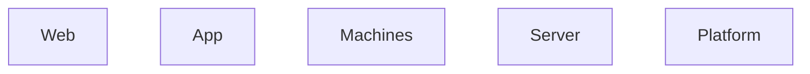

# Architecture

## Decided

### Server

A single-deployment, multi-tenant cloud SaaS.

- **Language and framework:** Python 3.12+, FastAPI, Pydantic v2, async throughout.
- **Shape:** one deployment for every tenant, run as two or more stateless processes behind a load balancer.

### Data

- **Database:** one Postgres for every tenant, without pgvector.
- **Tenant isolation:** row-level security keyed on the org, enforced by the database.
- **Access:** SQLAlchemy 2 (async) over asyncpg.
- **Schema:** one schema file until relaunch, then Alembic migrations.
- **Background jobs:** a Postgres-backed queue.
- **Files:** object storage (R2 or S3), with references in Postgres.

### Enterprise

- Single sign-on (OIDC and SAML), SCIM provisioning, roles per org, an audit log.
- OpenTelemetry tracing and metrics, logs tagged by tenant.
- Managed Postgres with point-in-time recovery, and connection pooling.

### Platform

The web console at platform.glyphh.ai, in the `glyphh-ai/platform` repo, talking to the server.

- **App:** React and TypeScript, a single-page app built with Vite. It sits behind a login, so it needs no server rendering; it builds to static files served by the server or a CDN.
- **API contract:** a typed client generated from the server's OpenAPI spec, so a server change that breaks the UI fails the build.
- **Data and routes:** TanStack Query and TanStack Router.
- **UI:** Tailwind with shadcn/ui components on the Glyphh tokens (Geist text, JetBrains Mono headings, High Vis dark, the purple accent).
- **Sign-in:** the server's own single sign-on (OIDC); server roles decide what each page shows.
- **Covers:** orgs, members and roles; single sign-on and SCIM setup; billing and usage; API keys; models; the audit log; a super-admin area.
