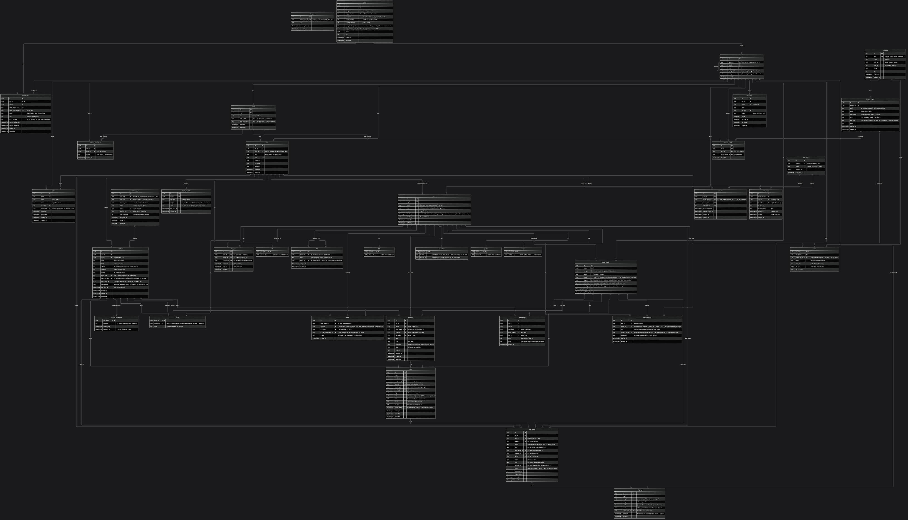

# Data model

The rule: the data model is drawn here first, then built. Database `glyphh`. Every table's id is a GUID (`uuid`).

```mermaid
erDiagram
    plans ||--o{ orgs : "limits"
    orgs ||--o{ orgs : "parent of"
    orgs ||--o{ users : "has"
    orgs ||--o{ teams : "has"
    teams ||--o{ users : "has"
    orgs ||--o{ allowed_models : "limits to"
    teams ||--o{ allowed_models : "limits further to"
    catalog_models ||--o{ allowed_models : "allowed as"
    orgs ||--o{ allowed_connections : "limits to"
    teams ||--o{ allowed_connections : "limits further to"
    powers ||--o{ tool_permissions : "sets"
    super_powers ||--o{ tool_permissions : "overrides"
    users ||--o{ tokens : "signs in with"
    users ||--o{ sign_in_identities : "signs in as"
    oauth_clients ||--o{ oauth_codes : "asks for"
    users ||--o{ oauth_codes : "approves"
    oauth_clients |o--o{ tokens : "issued to"
    users ||--o{ key_links : "gets"
    powers |o--o{ key_links : "sets the key of"
    machines ||--o| machine_connections : "connected through"
    machines ||--o{ folders : "holds"
    machines ||--o{ fence_events : "reports"
    super_powers ||--o{ fence_events : "tried"
    users ||--o{ tool_permissions : "sets"
    orgs ||--o{ powers : "holds"
    users ||--o{ powers : "installs for themselves"
    orgs ||--o{ super_powers : "has"
    super_powers ||--o{ grants : "is granted"
    powers ||--o{ grants : "granted as"
    machines ||--o{ grants : "granted as"
    powers ||--o{ super_powers : "is the loop of"
    powers ||--o{ slots : "declares"
    powers ||--o{ slots : "fills"
    super_powers ||--o{ schedules : "on a clock"
    powers ||--o{ schedules : "on a clock"
    machines ||--o{ schedules : "runs on"
    schedules ||--o{ runs : "fires"
    super_powers ||--o{ runs : "runs"
    machines ||--o{ runs : "ran on"
    runs ||--o{ usage_events : "spends"
    powers ||--o| models : "is a"
    providers ||--o{ catalog_models : "offers"
    providers ||--o{ models : "serves"
    catalog_models |o--o{ models : "picked from"
    powers ||--o| connections : "is a"
    powers ||--o| folders : "is a"
    powers ||--o| skills : "is a"
    powers ||--o| tasks : "is a"
    powers ||--o| plugins : "is a"
    powers ||--o| loops : "is a"
    orgs ||--o{ api_keys : "issues"
    orgs ||--o| subscriptions : "pays through"
    plans ||--o{ subscriptions : "sold as"
    orgs ||--o{ credit_ledger : "earns and spends"
    orgs ||--o{ usage_events : "uses"
    users ||--o{ usage_events : "makes"
    powers ||--o{ usage_events : "called through"
    super_powers ||--o{ usage_events : "called from"
    machines ||--o{ usage_events : "called on"
    usage_events ||--o| credit_ledger : "spends"
    users ||--o{ machines : "registers"
    machine_sign_ins |o--o| machines : "registers"
    orgs ||--o{ invites : "invites"
    users ||--o{ invites : "sends"

    plans {
        uuid id PK
        text name UK
        int price_cents "per seat, per month"
        text stripe_price_id UK "null for Free and Enterprise"
        int max_seats "the most seats an org may have; null = no limit"
        int monthly_credits "included each billing period"
        int included_machines "null = no limit"
        int extra_machine_cents "per extra machine per month; null = no extras on this plan"
        text stripe_machine_price_id UK "the Stripe price extras are billed on"
        bool active
        int sort
        timestamptz created_at
        timestamptz updated_at
    }

    orgs {
        uuid id PK
        uuid parent_id FK "null only for Glyphh, the parent org"
        uuid plan_id FK
        text name
        bool limit_models "true = only the org's allowed models"
        bool limit_connections "true = only the org's allowed connections"
        timestamptz created_at
    }

    teams {
        uuid id PK
        uuid org_id FK
        text name "unique in its org"
        bool limit_models "true = only the team's allowed models"
        bool limit_connections "true = only the team's allowed connections"
        timestamptz created_at
        timestamptz updated_at
    }

    allowed_models {
        uuid id PK
        uuid org_id FK
        uuid team_id FK "null = the org's list"
        uuid catalog_model_id FK "unique per list"
        timestamptz created_at
    }

    allowed_connections {
        uuid id PK
        uuid org_id FK
        uuid team_id FK "null = the org's list"
        text service "gmail, slack, ...; unique per list"
        timestamptz created_at
    }

    users {
        uuid id PK
        uuid org_id FK
        uuid team_id FK "null = in no team: only the org's limits apply"
        text role "super_admin | org_admin | user"
        text email UK
        text first_name
        text last_name
        text image_url
        timestamptz created_at
        timestamptz updated_at
    }

    powers {
        uuid id PK
        uuid org_id FK
        uuid user_id FK "whose it is: every power is one user's, for now"
        text kind "model, connection, folder, skill, task, plugin, loop"
        text name "unique for its owner"
        timestamptz disabled_at "set while a limit leaves it out: it stops working and can only be deleted; cleared when allowed again"
        text disabled_reason "which limit left it out"
        timestamptz created_at
        timestamptz updated_at
    }

    tool_permissions {
        uuid id PK
        uuid user_id FK "whose setting it is"
        uuid power_id FK "the power whose tool it is: a connection, a plugin, ...; null = one of rrotor's own built-in tools"
        text tool "the tool's name; unique per power and super power"
        uuid super_power_id FK "null = the user's own setting; set = that super power's override, for its autonomous runs"
        text permission "allow, ask, deny (an override is allow or deny)"
        timestamptz created_at
        timestamptz updated_at
    }

    models {
        uuid power_id PK, FK
        uuid provider_id FK
        uuid catalog_model_id FK "null = not in the catalog: a fine-tune, a private model"
        text model "the provider's own model id"
        text base_url "null = the provider's own"
        bytea api_key "encrypted; never returned"
        text api_key_last4
    }

    providers {
        uuid id PK
        text slug UK "anthropic, openai, google, fireworks, ..."
        text name "Anthropic"
        text logo_key "its logo, in object storage"
        text base_url "the provider's endpoint"
        bool active
        int sort
        timestamptz created_at
        timestamptz updated_at
    }

    catalog_models {
        uuid id PK
        uuid provider_id FK
        text model "the provider's own model id; unique per provider"
        text name "Claude Sonnet, GPT-5, ..."
        text description "one or two lines on what it is good for"
        text type "chat, embedding, image, audio, video"
        text logo_key "null = the provider's logo; set when the maker differs (Llama on Fireworks)"
        bool active
        timestamptz created_at
        timestamptz updated_at
    }

    connections {
        uuid power_id PK, FK
        text service "what it connects to: gmail, slack, ... (Pipedream calls it the app slug)"
        text account_id "the Pipedream account, once the user has connected it"
    }

    folders {
        uuid power_id PK, FK
        uuid machine_id FK "the machine the folder is on: the same path on two machines is two folders"
        text path "unique per machine for its owner"
    }

    skills {
        uuid power_id PK, FK
        text bundle_key "its files, in object storage"
    }

    tasks {
        uuid power_id PK, FK
        text bundle_key "its program, in object storage"
    }

    plugins {
        uuid power_id PK, FK
        text bundle_key "its files, in object storage"
    }

    loops {
        uuid power_id PK, FK
        text engine "claude, codex, gemini, ..., or rrotor's own"
    }

    super_powers {
        uuid id PK
        uuid org_id FK
        uuid user_id FK "whose it is: every super power is one user's"
        text name "unique for its owner"
        bool glyphh "true = the member's Glyphh, the super agent: one per member, granted everything"
        uuid loop_id FK "the loop that runs it: one of its owner's loops; every super power has one"
        jsonb definition "the rrotor definition, still to be drawn; its data lives in rrotor"
        text bundle_key "its files (workflows, pipelines, screens), in object storage"
        timestamptz created_at
        timestamptz updated_at
    }

    grants {
        uuid id PK
        uuid super_power_id FK "the super power granted it"
        uuid power_id FK "a power: folder, connection, model, skill, task, plugin (the loop is picked, not granted); or"
        uuid machine_id FK "a machine it may run on; or"
        uuid granted_super_power_id FK "a super power it may call (exactly one of the three)"
        text access "for a folder: read or write; null for anything else"
        timestamptz created_at
    }

    slots {
        uuid id PK
        uuid power_id FK "the task (or other power) that declares it"
        text name "what its program calls it: writer, reviewer, ..."
        uuid model_id FK "the model that fills it, one of the owner's; null = not filled yet"
        timestamptz created_at
        timestamptz updated_at
    }

    schedules {
        uuid id PK
        uuid org_id FK
        uuid user_id FK "whose schedule it is"
        uuid super_power_id FK "what it runs: a super power; or"
        uuid power_id FK "a task (exactly one of the two)"
        uuid machine_id FK "where it runs"
        text name
        text cron "five fields"
        text time_zone "the zone the cron reads in: America/New_York, ..."
        jsonb input "what each run is handed"
        bool enabled
        timestamptz next_run_at
        timestamptz created_at
        timestamptz updated_at
    }

    runs {
        uuid id PK
        uuid org_id FK
        uuid user_id FK "who it ran for"
        uuid super_power_id FK "what ran: a super power; or"
        uuid power_id FK "a task (exactly one of the two)"
        uuid schedule_id FK "null = started by hand, or by an agent"
        uuid machine_id FK "where it ran"
        text trigger "schedule, manual, agent"
        text status "queued, running, succeeded, failed, canceled, missed"
        text error "the reason, when it did not succeed"
        jsonb result "what it returned, kept small"
        text log_key "its full log, in object storage"
        timestamptz scheduled_for "the time the clock meant; null when not scheduled"
        timestamptz started_at
        timestamptz finished_at
        timestamptz created_at
    }

    subscriptions {
        uuid id PK
        uuid org_id FK, UK
        uuid plan_id FK
        text stripe_customer_id UK
        text stripe_subscription_id UK "null on Free"
        text status "trialing, active, past_due, canceled"
        int seats "the seats Stripe bills for"
        int extra_machines "bought on top of the plan's included machines"
        timestamptz current_period_start
        timestamptz current_period_end
        timestamptz created_at
        timestamptz updated_at
    }

    credit_ledger {
        uuid id PK
        uuid org_id FK
        uuid user_id FK "who spent it; null for allowances and purchases"
        text entry "allowance, purchase, usage"
        int credits "plus for allowance and purchase, minus for usage"
        text source "a Stripe payment id for a purchase; null otherwise"
        uuid usage_event_id FK, UK "the call a usage entry pays for"
        timestamptz expires_at "the period's end for an allowance; null for a purchase"
        timestamptz created_at
    }

    usage_events {
        uuid id PK
        uuid org_id FK
        uuid user_id FK "whose connection it was"
        uuid power_id FK "the connection power"
        text service "what the call reached: gmail, slack, ...; kept as called"
        text tool "the tool called: gmail-send-email, ..."
        uuid super_power_id FK "the super power that called it"
        uuid machine_id FK "the machine it ran on"
        uuid run_id FK "the run it was part of"
        text status "ok, error, refused"
        text error "the reason, for error and refused"
        int duration_ms "the time Pipedream took, timed by the server"
        int credits "max(1, ceil(seconds / 30)) for a call made; 0 when refused"
        int request_bytes
        int response_bytes
        timestamptz started_at
        timestamptz created_at
    }

    invites {
        uuid id PK
        uuid org_id FK
        text email "who is invited"
        text role "org_admin or user"
        uuid invited_by FK
        text token_hash UK "the invite link's token; only the hash is kept"
        timestamptz expires_at
        timestamptz accepted_at
        timestamptz revoked_at
        timestamptz created_at
    }

    machine_sign_ins {
        uuid id PK
        text code_hash UK "the code the machine holds; only the hash is kept"
        text user_code UK "the short code the member types or sees"
        text machine_name "what the machine calls itself"
        text status "pending, approved, denied"
        uuid user_id FK "who approved it"
        uuid machine_id FK "the machine it registered"
        int interval_seconds "how often the machine may ask"
        timestamptz last_polled_at
        timestamptz expires_at
        timestamptz created_at
    }

    machines {
        uuid id PK
        uuid org_id FK
        uuid user_id FK "whose machine it is"
        text name "unique for its owner"
        text kind "desktop or remote"
        text edition "lite (the desktop's: no pgvector, no Neo4j) or full"
        text platform "macos, windows, linux"
        text version "the rrotor build it runs"
        text token_hash UK "what it connects with; only the hash is kept"
        text ssh_public_key UK "the machine's SSH key; its private key never leaves the machine"
        text ssh_fingerprint "shown when the machine is registered, to check by eye"
        bool shell_enabled "false until the member turns it on: a shell on this machine over SSH"
        timestamptz last_seen_at "null = never connected"
        timestamptz revoked_at
        timestamptz created_at
        timestamptz updated_at
    }

    api_keys {
        uuid id PK
        uuid org_id FK
        uuid user_id FK "who made it"
        text name
        text key_hash UK
        text prefix "shown, to tell keys apart"
        timestamptz expires_at
        timestamptz last_used_at
        timestamptz revoked_at
        timestamptz created_at
    }

    sign_in_identities {
        uuid id PK
        uuid user_id FK
        text provider "google or github"
        text subject "the provider's own id for the person; unique per provider"
        text email "the email the provider gave, at the last sign-in"
        timestamptz last_used_at
        timestamptz created_at
    }

    oauth_clients {
        uuid id PK
        text client_id UK "what the agent host sends"
        text name "Claude Code, Cursor, ChatGPT, ..."
        text[] redirect_uris
        timestamptz created_at
    }

    oauth_codes {
        uuid id PK
        uuid oauth_client_id FK
        uuid user_id FK "who approved it"
        text code_hash UK "only the hash is kept"
        text redirect_uri
        text code_challenge "PKCE"
        timestamptz expires_at "a minute or so"
        timestamptz used_at "a code works once"
        timestamptz created_at
    }

    key_links {
        uuid id PK
        uuid user_id FK "the only person it works for"
        uuid power_id FK "the model whose key it sets"
        text token_hash UK "the link's token; only the hash is kept"
        timestamptz expires_at "minutes, not days"
        timestamptz used_at "a link works once"
        timestamptz created_at
    }

    machine_connections {
        uuid machine_id PK, FK
        text instance "the server process holding its connection"
        timestamptz connected_at
        timestamptz heartbeat_at "a row not heard from is gone"
    }

    fence_events {
        uuid id PK
        uuid org_id FK
        uuid user_id FK
        uuid machine_id FK "where it happened"
        uuid super_power_id FK "what tried"
        uuid run_id FK "in which run"
        text kind "path, network, channel"
        text detail "what it reached for: a path, a host, a channel"
        timestamptz created_at
    }

    stripe_events {
        uuid id PK
        text stripe_event_id UK "Stripe's own id: an event is handled once"
        text type
        timestamptz received_at
        timestamptz processed_at
    }

    tokens {
        uuid id PK
        uuid user_id FK
        uuid oauth_client_id FK "the agent host it was issued to; null = the app or the CLI"
        text access_hash UK
        text refresh_hash UK
        timestamptz access_expires_at
        timestamptz refresh_expires_at
        timestamptz revoked_at
        timestamptz created_at
    }
```



## plans

What an org pays per seat each month, and how many seats it may have (`max_seats`).

Seats are billed as the old server billed them (his rule, 2026-09-18):

- **A seat is an active user.** The subscription's `seats` is what Stripe bills for.
- **Adding a seat mid-cycle** raises `seats` at once, and the part-month is billed on the next invoice, never charged on the spot.
- **Removing a seat never lowers `seats` mid-cycle.** It drops only when the next invoice is created, with nothing refunded for a month already billed.
- **The billing date never moves:** it is set when the subscription starts.
- **At `max_seats`, an org upgrades to add more people.**

`stripe_price_id` is the Stripe price an org subscribes to; Free and Enterprise have none (Free needs no checkout, Enterprise is arranged with us). A plan that is no longer sold is set `active = false`, never deleted, so orgs on it keep working.

The plans carried over from the old server:

| Plan | Price per seat | Seats | Machines included | Extra machines |
|---|---|---|---|---|
| Free | $0 | 1 | 2 | none |
| Solo | $20 | 1 | to set | to set |
| Basic | $40 | 25 | to set | to set |
| Pro | $150 | 100 | to set | to set |
| Enterprise | arranged | no limit | no limit | n/a |

An org that already has its included machines plus its extras cannot register another: signing in from one more machine is refused with the reason (on Free: "Free includes 2 machines. Upgrade, or remove one."), and nothing is half registered.

Left behind from the old server: the margin and the dollar pool, the rate limits, the SSO and governance flags, the price history, and the machine terms. Glyphh governs nothing: limits and access belong to an AI gateway the customer puts in front of their models.

## orgs

Glyphh is the parent org: the one org with no parent. Every customer org's parent is Glyphh. Every org is on a plan: Glyphh itself is on Enterprise, and a new org starts on Free.

**For now an org is for billing and for limiting models and connections:** its plan, subscription, seats, machines and credits, who is in it (members and invites), and which models and connections its users may add (below). It owns no powers or super powers; those are each user's. Rows still carry `org_id` so the database keeps every org's data apart and counts its limits.

## Teams: limiting models and connections

The org's Models and Connections pages exist only to say which models and connections users may add. They hold no keys and no accounts: a user still adds their own model with their own key, and connects their own account.

- **Two settings, two lists, at the org and at every team, with the same behaviour:** `limit_models` with `allowed_models` (picked from the catalog), and `limit_connections` with `allowed_connections` (services: Gmail, Slack, ...).
- **Everything is allowed by default:** both settings start off, and a user may add any model in the catalog and connect any service.
- **Limiting at the org:** when the org turns a setting on, the org admin adds what is allowed, and only that is allowed, org wide.
- **Limiting at a team:** a team turns its own setting on and lists what its members may add. Under an org that limits, a team can only narrow it: its list is part of the org's list, never more.
- **A user adds only what applies to them:** their team's list if their team limits, otherwise the org's if the org limits, otherwise anything. A user is in at most one team; a user in none has only the org's limits.
- **The database enforces it:** a model or connection power outside the user's lists is refused with the reason, and taking an entry off the org's list takes it off every team's list too.

**A limit set later disables what it leaves out.** A model or connection a user already has stops working the moment a limit leaves it out: the database marks it disabled with the reason, rrotor is never handed it, and its calls are refused. A disabled power can only be deleted, never edited. When the limit no longer leaves it out (the item is allowed again, or the limit is turned off), it comes back on its own: the mark is cleared and everything hanging off it works as before (its grants, tool permissions, slots, schedules, key and account), with nothing for the user to redo.

## Tool permissions

Every tool a power brings (each tool of a connection, of a plugin's MCP server, ...) has a permission, set where the app shows that power (the powers window, Connections):

- **The user's own setting:** `allow` (runs without asking), `ask` (asks each time) or `deny` (never runs). A tool with no row is `ask`.
- **A super power's override:** for its autonomous runs, a super power can set a tool to `allow` or `deny`, whatever the user's own setting says. With no override, the user's own setting applies.
- **Autonomous means nobody to ask:** in a run nobody is watching, `ask` is refused, so an autonomous super power uses only tools that are allowed, by the user or by its override.
- **rrotor's own tools** (its ~250 built-in tools) have permissions too: a row with no power is a built-in tool's.
- **Where it is enforced:** a connection call at the server's relay, which every connection call passes through, so it holds even against a modified rrotor; every other tool in rrotor, which hands the loop only what is allowed.

## users

A user belongs to one org and has one role in it:

- `super_admin`: runs Glyphh. Only users of the parent org.
- `org_admin`: runs their org's billing and members, and sees its usage.
- `user`: works in their org.

The profile is the user's first name, last name, email and profile image. The email is how a Google or GitHub sign-in finds the user.

## Powers

Everything a super power uses is a power: a model, a connection, a folder, a skill, a task or a plugin. Who installed it is the control, with one more: the org and its teams may limit which models and connections can be added (above). Glyphh governs nothing else:

- **Models are a user's:** each person adds their own, with their own key. Nothing is shared or deduplicated: ten people adding the same model are ten rows, each with its own key, and one person may add the same model more than once (one per super power, say, to see each one's spend at the provider).
- **Connections are a user's:** always one person's own account (Pipedream accounts belong to a person; there are no shared or system accounts).
- **Folders, skills, tasks and plugins are a user's too:** for now every power is one person's own, built or installed for themselves. The org installs none.

The database enforces it: every power has a `user_id`.

Every power is a row in `powers` (who owns it, its kind and name), and one row in the table for its kind, holding that kind's own columns: `models`, `connections`, `folders`, `skills`, `tasks`, `plugins` or `loops` (which engine runs a super power: a CLI, or rrotor's own). A super power points at `powers`, whatever the kind. What skills, tasks and plugins hold beyond their files is drawn when they are built.

- **A model** is a provider, the provider's model id and the API key (an optional base URL for providers that need one). rrotor calls the provider directly with that key: Glyphh never sits in the call, never sees its rates or prices, and never counts its tokens. What a model costs is between the person and their provider. A customer who wants limits or access rules puts their own AI gateway in front, through the base URL.
- **A connection** is a user's own account at Pipedream: the service it connects to (Gmail, Slack, ...) and the account id. Pipedream calls a service an app; Glyphh says service, because an app is something else here. Glyphh stores no sign-in for it: Pipedream holds the account and its tokens, under the Glyphh user's id as Pipedream's external user id. Linking one: the server asks Pipedream for a connect token for that user, and Pipedream's own page does the sign-in. Using one: the loop reaches Pipedream's MCP server (`remote.mcp.pipedream.net/v3`) with the Pipedream project, environment, service (`x-pd-app-slug`) and the user's id as headers, and a short-lived Pipedream access token the server mints for the run (Glyphh's Pipedream client credentials never leave the server). Only Glyphh's connections are used: a super power's loop gets exactly its connections, nothing of the loop's own.
- **A secret** (a key, a sign-in) is encrypted at rest, never returned after it is saved, and handed only to the member's own runtime when a super power runs.
- **The catalog** is what the app and the platform show when someone picks a model, and where every model's logo comes from: `providers` (each with its name and logo) and `catalog_models` (each provider's models, with a name, a description and a type). Every entry shows the provider's logo, the provider, the model's name, its description and its type. It is Glyphh's reference data, the same for every org: anyone signed in reads it, only super admins change it. It starts from the old server's list (about 3,900 models across 130 providers) and its 143 provider logos, kept in object storage. It holds no prices, rates or limits.
- **A model power** points at its provider (always) and at the catalog entry it was picked from (when there is one), so it shows that logo and name wherever it appears. A model the catalog does not have (a fine-tune, a private model) is still added, by its provider and model id, and wears the provider's logo.

## Super powers

Each member has one Glyphh, the super agent (`glyphh` true): it has every power, every super power and every machine they have, and needs no grants. Every other super power sits under it and has only its **grants**: each grant gives it one power (a folder, a connection, a model, a skill, a task or a plugin), one machine it may run on, or one other super power it may call. Nothing ungranted is ever handed to it, whether or not anyone is watching. A super power is one user's own, like every power: the org installs none.

**A loop runs it; models are granted.** Every super power has one loop (`loop_id`): the CLI or rrotor's own engine that runs it. Its models are grants like any other power, as many as it needs: the super power uses them directly, and the powers it has use them too (a task's slots).

## Slots

A task declares **slots**: the steps its program calls by name (`research`, `write`), and each slot is filled with a model. A task on a clock can run Gemini for step one and Claude for step two. A run is refused, with the slot named, while a slot it calls is empty. The UI for filling slots is still to be designed.

## Schedules and runs

Anything that runs on its own can be put on a clock: a super power or a task.

- **schedules:** what runs, on which of the member's machines, a five-field cron read in its own time zone, and the input each run is handed. Switched off with `enabled`, never deleted to pause.
- **The clock is the server's.** When a schedule is due, the server sends the run to its machine over the machine's connection. A machine that is offline at that moment gets the run marked `missed`, with the reason: nothing piles up and fires later in a burst.
- **runs** is the history: every run, whether the clock, the member or an agent started it, with its status, its error, a small result and its full log (in object storage). A schedule's history is its runs. A run's connection calls are its usage events, so a run shows what it cost.
- **Who sees what:** as for usage. A user sees their own runs, an org admin the org's.

**api_keys** are the keys Glyphh issues, so a script or a runtime can call the Glyphh API; only a hash is stored, with a short prefix shown to tell keys apart.

Left behind from the old gateway: the router itself, LiteLLM's 80-odd tables, model access lists, the request log, budgets, margins and the dollar pool, spend roll-ups, auto-routers, and per-model flags nothing enforced.

## Billing and usage

An org pays a monthly fee for its plan, and the plan includes credits each billing period. Usage spends credits, and a Glyphh credit is a Pipedream credit: 30 seconds of a connection call. The server relays every connection call and times it, so a call costs `max(1, ceil(seconds / 30))` credits, exactly what Pipedream bills Glyphh for it. Model calls cost nothing here: they go straight to the provider on the member's own key.

What Pipedream charges Glyphh (Connect, Startup plan): $99 a month billed annually ($150 monthly) for 100 external users and 10,000 credits a month, then $2 per external user and $0.012 per credit. A connected user is a seat cost, so it belongs in the plan's price per seat; a call is a credit.

- **The cap is the tier.** When an org's credits run out, its connection calls stop until the next period, with a clear message; there is never a surprise bill. An org can upgrade, or buy a credit pack (a one-time purchase that does not expire with the period).
- **subscriptions** tie an org to its Stripe customer and subscription, its plan, its status and its current period. Stripe keeps the invoices and payment methods.
- **credit_ledger** is the whole story of an org's credits, append only: each period's allowance, each pack bought, and each use. The balance is the sum of what has not expired, so it is never stored twice. A usage entry points at the call it paid for (`usage_event_id`), one entry per call.

## Usage

Every usage event is logged in one place: the server's connection relay. A connection call is the only thing Glyphh pays for, and every one goes through the server (rrotor → connector → server → Pipedream), so the server sees each call whole: who, through which connection, from which super power, on which machine, how long, and what it cost. Nothing is reported by the runtime about itself, so a modified rrotor cannot under-report.

One call, as the relay handles it:

1. **Check:** lock the org's row and read the balance. At 0, the call is refused with the reason and logged as `refused` (0 credits). Nothing reaches Pipedream.
2. **Call:** relay it to Pipedream and time it.
3. **Record:** in one transaction, a `usage_events` row and its `credit_ledger` usage entry. A call that fails at Pipedream is still logged (`error`) and still costs what Pipedream bills for it.

The check runs before the cost is known, so calls already in flight when the balance reaches 0 finish and are counted: the balance can dip below 0 by at most those calls, and the next call is refused. It never turns into a bill.

- **usage_events** is append only: never updated, never deleted by a request. It holds what was called and how it went, **never what went through it**: no arguments, no results, no message bodies. Those are the member's own data, and they stay between the runtime and Pipedream.
- **Model calls are not usage.** They go straight to the provider on the member's key, and Glyphh never sees them.
- **Operational logs are separate:** request logs and traces go to OpenTelemetry, tagged by org; they are not billing and do not decide a charge.
- **Size:** the table is partitioned by month on `created_at`, indexed by org and time, and by org, user and time, so every page reads one org's range.

### Who sees what

The same rows serve every view, scoped by the principal:

- **A user** sees their own calls and their org's balance.
- **An org admin** sees every call in the org, by user, by connector, by super power, by machine and by day, and the ledger.
- **A super admin** sees every org, and what Glyphh owes Pipedream for it: the same credits, at Pipedream's price.

## Invites

An org admin invites someone by email, with the role they will have. The invite link carries a token (only its hash is kept) and expires; signing in with Google or GitHub from it, as that email, makes the user in the org, and the invite is accepted. An open invite holds a seat, so an org at `max_seats` cannot invite more; an accepted one becomes a billed seat, and a revoked or expired one frees its seat. Only one open invite per email per org.

## Machines

Signing in always happens from a machine, and signing in is how a machine is registered: rrotor (the CLI or the desktop) asks the server for a code, the member approves it in the browser, and the server registers the machine and issues its tokens (`machine_sign_ins` holds the code while it waits, only as a hash). Ported from the old server's device sign-in.

A machine is a registered rrotor: a member's desktop or a remote server they run, on any host. It connects out to the server with its own token (only the hash is kept) and reports what it is: a desktop or a remote server, its platform, and the rrotor version it runs (builds update themselves, so the server sees which version each machine is on). `last_seen_at` says when it was last online. Its edition says what it can host: a desktop's rrotor is lite (no pgvector, no Neo4j), a remote one is full, so a super power that needs vectors or a graph is never placed or scheduled on a lite machine. A folder is always on one machine (`folders.machine_id`): the same path on two machines is two folders, and a folder grant says whether the super power may only read it or also write it (`grants.access`). At sign-in a machine also makes its own SSH key pair: the private key stays on the machine, the public key is registered here with its fingerprint (see the architecture, Machine to machine). A plan includes a number of machines (`included_machines`). An org can add more for a monthly price per extra machine, set per plan (`extra_machine_cents`, billed on the plan's Stripe price for extras); the subscription carries how many it bought (`extra_machines`). An org can register up to its included plus its extra machines; revoking one stops it connecting and frees its place.

## Limits are enforced by the database

Every plan limit (seats, machines, credits) holds even when requests race or code has a bug:

- **The database enforces it.** A trigger refuses a write that would take an org over its limit: a machine past its included plus extra machines, a user or invite past its seats. A bug in a route cannot get around it.
- **No races.** The check locks the org's row before counting, so requests at the same moment are taken one after another; exactly one gets the last place, and the rest are refused with the reason.
- **Freed at once:** a revoked machine, a removed user, a revoked or expired invite stops counting immediately.
- **Downgrades never cut anyone off:** an org over its new plan's limit keeps what it has and cannot add more until it is back under.
- **Tested for each limit:** the limit, the refusal and its message, freeing a place, the downgrade rule, and concurrent requests racing for the last place.

**machine_connections** says which server process holds each connected machine's connection, so a request landing on another process is sent to the right one (Postgres notifications carry it across; no Redis). A row not heard from within its heartbeat is treated as gone.

**fence_events** are what rrotor reports when something inside a run reaches past its fence: a path that is not mounted, a host not on its network list, a channel it was not granted. The relay never reads the stream to find them; rrotor tells the server, and the platform shows them ("this super power tried to leave its folders").

## Scoping

Every API call and MCP tool runs as a principal: the user, their org and their role. The role decides what an operation allows and the org decides which rows it sees. Row level security in Postgres enforces the org under the code, so a bug in a query cannot reach another org's data.

## tokens

What the server hands out after a sign-in: a short-lived access token and a longer-lived refresh token. Only their hashes are stored, so a stolen database holds no usable token. A token is revoked by setting `revoked_at`.

## Signing in

- **sign_in_identities:** a person signs in with Google or GitHub, and the server finds them by the provider's own id for them (`subject`), never by email alone: an email that changes, or a GitHub account with a hidden email, still finds the same person, and an email can never be used to reach someone else's account. The first sign-in links by email, once, through an invite or a new org.
- **The plugin signs in with OAuth:** an agent host (Claude Code, Cursor, ChatGPT) is an `oauth_clients` row; the member approves it in the browser, the host gets a one-time code (`oauth_codes`, with PKCE, a minute to live), and trades it for tokens issued to that client, so the member can see and revoke each host on its own.
- **key_links:** the one-time link an agent hands the member to enter a model's key on the platform. It works once, for minutes, only for that member signed in, and only for that model.

## Stripe

**stripe_events** records every Stripe webhook by Stripe's own event id, so an event delivered twice is handled once: a credit pack is never added twice and a seat change never applied twice.
