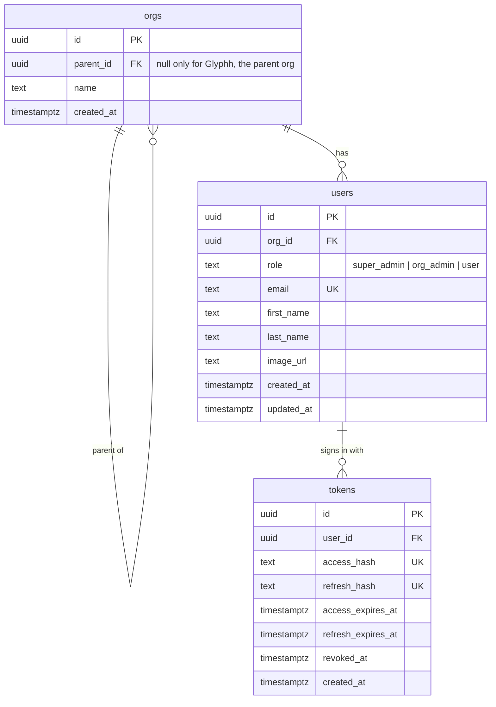

# Data model

The rule: the data model is drawn here first, then built. Database `glyphh`. Every table's id is a GUID (`uuid`).

## orgs

Glyphh is the parent org: the one org with no parent. Every customer org's parent is Glyphh.

## users

A user belongs to one org and has one role in it:

- `super_admin`: runs Glyphh. Only users of the parent org.
- `org_admin`: runs their org.
- `user`: works in their org.

The profile is the user's first name, last name, email and profile image. The email is how a Google or GitHub sign-in finds the user.

## tokens

What the server hands out after a sign-in: a short-lived access token and a longer-lived refresh token. Only their hashes are stored, so a stolen database holds no usable token. A token is revoked by setting `revoked_at`.
