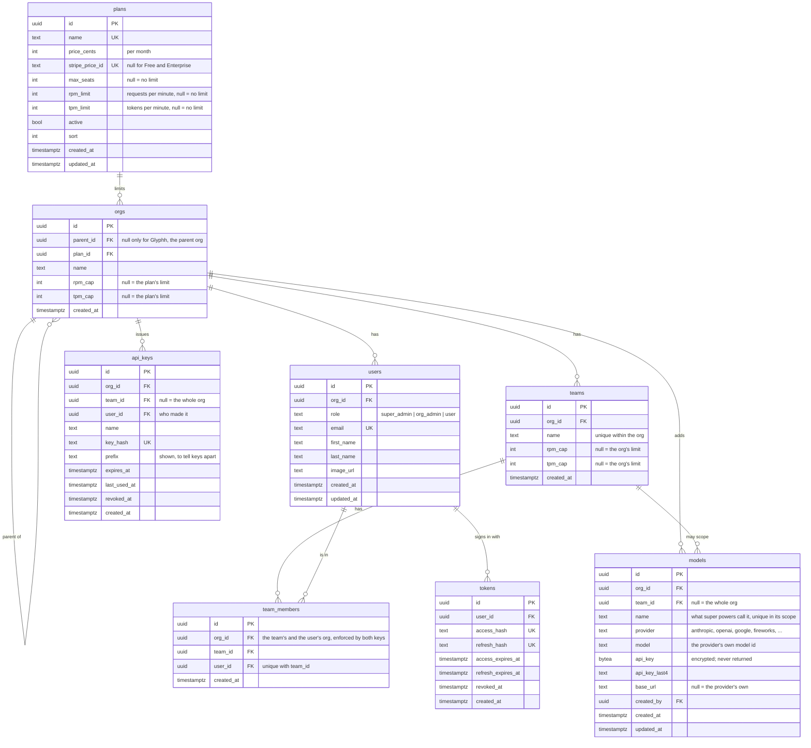

# Data model

The rule: the data model is drawn here first, then built. Database `glyphh`. Every table's id is a GUID (`uuid`).

## plans

What an org pays and what it may do. The limits on a plan are the limits on every org on it:

- `max_seats`: how many users the org may have.
- `rpm_limit` and `tpm_limit`: requests and tokens per minute. These were drawn for a router; with model calls going straight from the runtime to the provider, Glyphh never sees them, so what these limit (if anything) is still to be decided.

`stripe_price_id` is the Stripe price an org subscribes to; Free and Enterprise have none (Free needs no checkout, Enterprise is arranged with us). A plan that is no longer sold is set `active = false`, never deleted, so orgs on it keep working.

The plans carried over from the old server:

| Plan | Price | Seats | Requests/min | Tokens/min |
|---|---|---|---|---|
| Free | $0 | 1 | 60 | 50,000 |
| Solo | $20 | 1 | 200 | 200,000 |
| Basic | $40 | 25 | 600 | 500,000 |
| Pro | $150 | 100 | 2,000 | 2,000,000 |
| Enterprise | arranged | no limit | no limit | no limit |

Left behind from the old server: the margin and the dollar pool (with keys brought by the user, Glyphh resells no inference), the SSO and governance flags, the price history, and the machine terms.

## orgs

Glyphh is the parent org: the one org with no parent. Every customer org's parent is Glyphh. Every org is on a plan: Glyphh itself is on Enterprise, and a new org starts on Free.

## users

A user belongs to one org and has one role in it:

- `super_admin`: runs Glyphh. Only users of the parent org.
- `org_admin`: runs their org.
- `user`: works in their org.

The profile is the user's first name, last name, email and profile image. The email is how a Google or GitHub sign-in finds the user.

## teams

Teams are optional. An org with no teams is flat: everything in it is shared across the org. Once an org has teams, everything in it is team scoped: a user sees and works in the teams they are a member of.

- A user can be a member of several teams.
- Org admins create teams and manage their members, and see every team in their org; super admins see every team everywhere.
- A team belongs to one org, and its members are users of that org.

## Caps

The plan sets an org's limits. An org admin can cap the org lower, and cap each team lower still, never above what sits over it:

- **Plan:** the ceiling (`rpm_limit`, `tpm_limit`).
- **Org:** `rpm_cap`, `tpm_cap`, at or under the plan's. Null means the plan's limit.
- **Team:** `rpm_cap`, `tpm_cap`, at or under the org's. Null means the org's limit.

The limit a request runs under is the smallest that applies to it.

## Models

Glyphh is not a gateway: it stores how a model is reached and never sits in the call. A super power names one of its org's models; when it runs, rrotor calls the provider directly with that model's key. Glyphh does not route, meter, limit or pay for model calls.

- **models** are what an org admin (or a team) adds: a provider, the provider's model id, and the API key for it, plus a base URL for providers that need one. The key is encrypted at rest, never returned after it is saved (only the last four characters are shown), and handed only to a member's own runtime when a super power runs.
- The public list of models (about 3,900 across 130 providers, with each one's provider, kind, context size and prices) ships with the server to help pick one; it is reference data, not a table.
- **api_keys** are the keys Glyphh issues, so a script or a runtime can call the Glyphh API; only a hash is stored, with a short prefix shown to tell keys apart. A sign-in token works too.

Left behind from the old gateway: the router itself, LiteLLM's 80-odd tables, model access lists, the request log, budgets, margins and the dollar pool, spend roll-ups, auto-routers, and the per-model flags nothing enforced.

## Scoping

Every API call and MCP tool runs as a principal: the user, their org, their role, and their teams. The role decides what an operation allows, the org decides which rows it sees, and in an org with teams the user's teams narrow that further. Row level security in Postgres enforces the org (and teams) under the code, so a bug in a query cannot reach another org's data.

## tokens

What the server hands out after a sign-in: a short-lived access token and a longer-lived refresh token. Only their hashes are stored, so a stolen database holds no usable token. A token is revoked by setting `revoked_at`.
