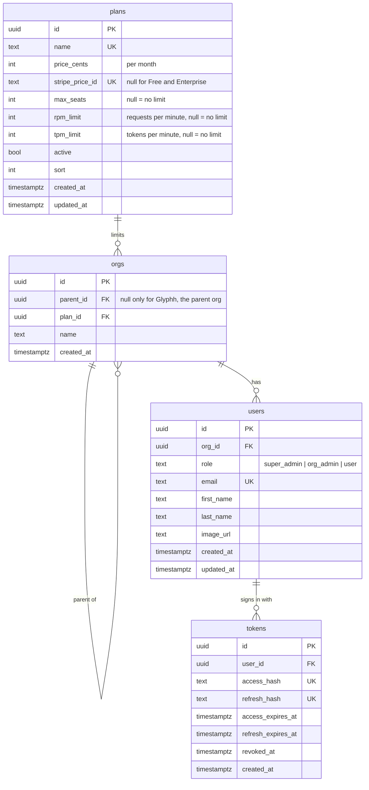

# Data model

The rule: the data model is drawn here first, then built. Database `glyphh`. Every table's id is a GUID (`uuid`).

## plans

What an org pays and what it may do. The limits on a plan are the limits on every org on it:

- `max_seats`: how many users the org may have.
- `rpm_limit` and `tpm_limit`: the org's requests and tokens per minute through the router.

`stripe_price_id` is the Stripe price an org subscribes to; Free and Enterprise have none (Free needs no checkout, Enterprise is arranged with us). A plan that is no longer sold is set `active = false`, never deleted, so orgs on it keep working.

The plans carried over from the old server:

| Plan | Price | Seats | Requests/min | Tokens/min |
|---|---|---|---|---|
| Free | $0 | 1 | 60 | 50,000 |
| Solo | $20 | 1 | 200 | 200,000 |
| Basic | $40 | 25 | 600 | 500,000 |
| Pro | $150 | 100 | 2,000 | 2,000,000 |
| Enterprise | arranged | no limit | no limit | no limit |

Left behind from the old server: the margin and the dollar pool (with keys brought by the user, Glyphh resells no inference), the SSO and governance flags, the price history, and the machine terms.

## orgs

Glyphh is the parent org: the one org with no parent. Every customer org's parent is Glyphh. Every org is on a plan; a new org starts on Free.

## users

A user belongs to one org and has one role in it:

- `super_admin`: runs Glyphh. Only users of the parent org.
- `org_admin`: runs their org.
- `user`: works in their org.

The profile is the user's first name, last name, email and profile image. The email is how a Google or GitHub sign-in finds the user.

## tokens

What the server hands out after a sign-in: a short-lived access token and a longer-lived refresh token. Only their hashes are stored, so a stolen database holds no usable token. A token is revoked by setting `revoked_at`.
