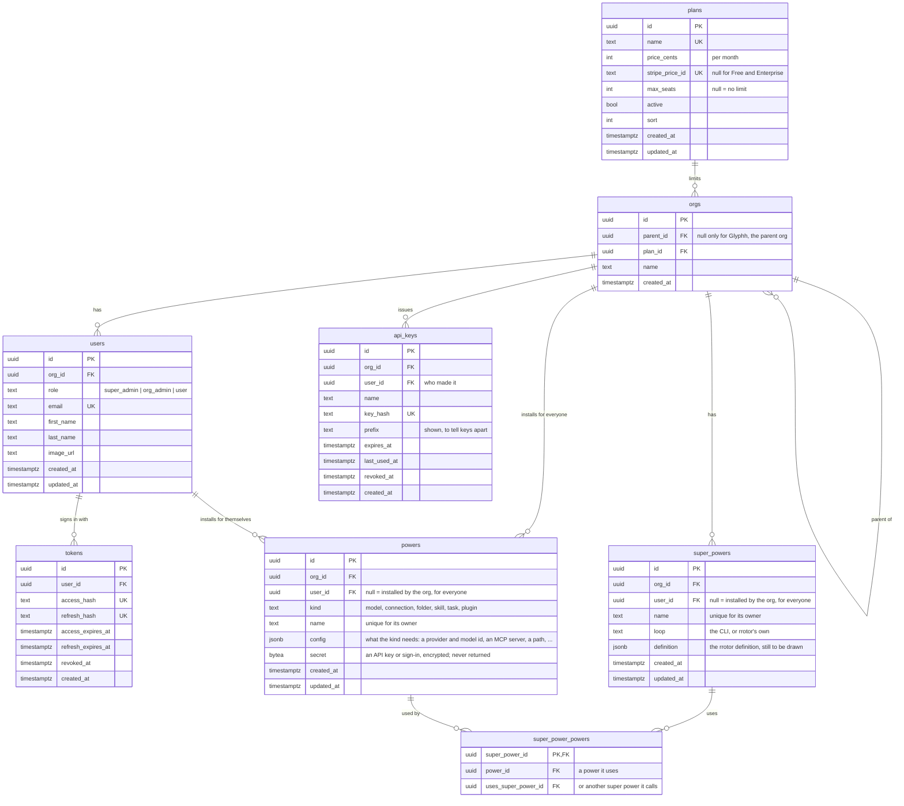

# Data model

The rule: the data model is drawn here first, then built. Database `glyphh`. Every table's id is a GUID (`uuid`).

## plans

What an org pays, and how many users it may have (`max_seats`).

`stripe_price_id` is the Stripe price an org subscribes to; Free and Enterprise have none (Free needs no checkout, Enterprise is arranged with us). A plan that is no longer sold is set `active = false`, never deleted, so orgs on it keep working.

The plans carried over from the old server:

| Plan | Price | Seats |
|---|---|---|
| Free | $0 | 1 |
| Solo | $20 | 1 |
| Basic | $40 | 25 |
| Pro | $150 | 100 |
| Enterprise | arranged | no limit |

Left behind from the old server: the margin and the dollar pool, the rate limits, the SSO and governance flags, the price history, and the machine terms. Glyphh governs nothing: limits and access belong to an AI gateway the customer puts in front of their models.

## orgs

Glyphh is the parent org: the one org with no parent. Every customer org's parent is Glyphh. Every org is on a plan: Glyphh itself is on Enterprise, and a new org starts on Free.

## users

A user belongs to one org and has one role in it:

- `super_admin`: runs Glyphh. Only users of the parent org.
- `org_admin`: runs their org.
- `user`: works in their org.

The profile is the user's first name, last name, email and profile image. The email is how a Google or GitHub sign-in finds the user.

## Powers

Everything a super power uses is a power: a model, a connection, a folder, a skill, a task or a plugin. A user installs a power for themselves, or the org installs it for everyone (`user_id` null). That is the only control: Glyphh governs nothing else.

- **A model** is a provider, the provider's model id and the API key (an optional base URL for providers that need one). rrotor calls the provider directly with that key: Glyphh never sits in the call. A customer who wants limits or access rules puts their own AI gateway in front, through the base URL.
- **A connection** is an account reached as an MCP server, with its sign-in. Only Glyphh's connections are used: a super power's loop gets exactly its connections, nothing of the loop's own.
- **A secret** (a key, a sign-in) is encrypted at rest, never returned after it is saved, and handed only to the member's own runtime when a super power runs.
- The public list of models (about 3,900 across 130 providers) ships with the server to help pick one; it is reference data, not a table.

## Super powers

A super power is a loop (a CLI, or rrotor's own), its rrotor definition, and the powers it uses, which can include other super powers. Like a power, it is installed by a user or by the org.

**api_keys** are the keys Glyphh issues, so a script or a runtime can call the Glyphh API; only a hash is stored, with a short prefix shown to tell keys apart.

Left behind from the old gateway: the router itself, LiteLLM's 80-odd tables, model access lists, the request log, budgets, margins and the dollar pool, spend roll-ups, auto-routers, and per-model flags nothing enforced.

## Scoping

Every API call and MCP tool runs as a principal: the user, their org and their role. The role decides what an operation allows and the org decides which rows it sees. Row level security in Postgres enforces the org under the code, so a bug in a query cannot reach another org's data.

## tokens

What the server hands out after a sign-in: a short-lived access token and a longer-lived refresh token. Only their hashes are stored, so a stolen database holds no usable token. A token is revoked by setting `revoked_at`.
