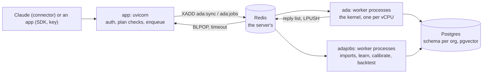

# Ada Cloud: the build plan

**Status:** a plan for Chris to decide on, not built. Written 2026-10-21 from `origin/main` of `ada-private` (kernel
3.11.0), `rrotor`, `server`, `glyphh`, `platform` and `web`; revised the same day to Chris's architecture (no new
app or infrastructure: Python worker processes on the server's Redis, Postgres with a schema per org and pgvector).
Every claim about today cites the file it comes from.

**The direction (Chris, 2026-10-21):** one multi-tenant, Glyphh-run Ada service behind one URL, so a customer needs
no runtime, no repo and no image. The model is TypeSafe AI's Jev: cloud only, one endpoint, typed answers with
probabilities, billed per request. Why: self-hosting rrotor is too hard to get running, and the public image
`ghcr.io/glyphh-ai/rrotor` carries the Ada kernel's source (the IP). Self-hosted rrotor stays, as the Enterprise
option. Glyphh-hosted per-org Fly machines (`GLYPHH_HOSTING`) stay off.

This reverses two standing rulings, and the plan says so where it matters: "nothing of Glyphh's is on the data path"
and "Glyphh's cloud never keeps a copy of the code or the precedents" (`docs/architecture.md`, Architecture and Ada
models), and "Free is a node you run yourself" (`docs/pricing.md`).

---

## 1. The product

**Ada Cloud is Ada as an API.** A customer signs in, makes a key, describes their cases once as a JSON spec, loads
their history, and asks: every answer is typed (the spec's outcomes), comes with calibrated probabilities, the
expected cost of each choice, whether a person should decide instead, and the precedents it stands on. No language
model is in the path, the same question gets the same answer, and the model learns one confirmed case at a time.
Glyphh runs it inside its own server (`glyphh-ai-server`), answered at `https://ada.glyphh.ai`; Claude reaches it
through the one Glyphh connector; software through the SDKs with only a key.

**End to end:**

| Step | On the platform | From Claude (the Glyphh connector + the Ada skill) | From code (SDK, key only) |
|---|---|---|---|
| Sign in | Google or GitHub (built: `api/auth.py`, `ops/auth/`) | Add the connector `https://api.glyphh.ai/mcp`, one Allow (built: `api/oauth.py`, `ops/connector/`) | — |
| Make a key | API Keys page: name, expiry, clearance; shown once | `create_api_key` | — |
| Define a model | Models, New: a spec editor with a template per use case, checked as you type | The skill agrees the case with the person and calls `ada_model_create {name, spec}` | `ada.create_model(name, spec)` |
| Load history | Models, Import: a CSV or JSONL file, mapped to the spec, run as a job with progress | The skill reads the person's file and sends `ada_record_many` in chunks, or starts an import | `model.record_many(cases)` or `model.import_file(path)` |
| Learn | Learn button; automatic after an import | `ada_learn` | `model.learn()` |
| Ask | Try it panel | `ada_decide`, `ada_query`, `ada_facts` | `model.decide(data)`: `{outcome, probabilities, expected_cost, ask, receipts}` |
| Tune | Settings with a backtest before going live, versions, rollback | `ada_backtest`, `ada_settings` (section 5) | `model.backtest(...)`, `model.settings(...)` |
| Keep learning | — | `ada_record` each confirmed outcome | `model.record(data, outcome)` |

The headline call, Jev-shaped: `POST https://ada.glyphh.ai/v1/decide {model, data}` with `Authorization: Bearer
glyphh_ak_…` answers `{outcome, probabilities, expected_cost, ask, receipts, model, version}`.

---

## 2. What a model is in the cloud

**A model is a spec Glyphh stores, plus its precedents. No customer code runs.**

Today an Ada model is a GitHub repo of `glyphh.json`, `spec.json` and `model.py`, deployed by commit and run in
rrotor's sandbox (rrotor `docs/architecture.md` section 8; `examples/ada_incidents/`, `examples/ada_tickets/`). But
the spec already carries almost everything: `glyphh_spec.py` parses layers, segments, roles (`similarity_weight`,
`security_weight`, `key_part`, `numeric_config`, `text_encoding`, `lexicons`), `interactions`, `temporal_source`,
`output` (`report`, `costs`, `ask`), named `outputs` (`values`, `costs`, `ask`) and `settings` (14 levers), and
`glyphh_spec.Model` does `record`, `grade`, `learn`, `refresh`, `calibrate`, `configure`, `query`, `facts`,
`probabilities`, `decide` and `decide_all`. The `model.py` files are thin wrappers.

What today's `model.py` files do that a spec cannot, and how the cloud covers each:

| In code today | Where | In the cloud |
|---|---|---|
| A confidence bar on `decide` (`CONFIDENT = 0.6`) and, below it, `ctx.needs_input` to ask a person, then record the answer | both examples' `decide` | Stateless. The kernel's own `decide` already answers `ask: true` with the best guess when the spec prices asking (`output.ask`) or nothing is known (`glyphh_spec.py` `Model.decide`). The caller asks the person and calls `record`. Add one spec field, `output.ask_below` (ask when the top probability is under it), for people who think in confidence, not costs: a small kernel change |
| The nearest precedent's cause, owner and runbook beside the fix (`_resolution`) | `ada_incidents/model.py` | `decide` takes `include: ["facts"]` and returns the top fact tree, cut by `output.report` and the caller's clearance, which is exactly what `_resolution` reads |
| Shaping `learn`'s answer (roles, word counts, pairs) | both | The service formats it, once, for every model |
| `probabilities` that bypass `Model.probabilities` (no word evidence) | both | Gone: the cloud calls the kernel's `Model` methods only. This is a quiet bug in the examples, not a feature |
| `needs_approval` steps, declared hosts, secrets, files (`daily_sales`) | rrotor base | Not Ada. Not in the cloud; rrotor keeps them |
| Learning weights up front with `Spec.learned(...)` in Python before the first commit | Ada skill, step 3 | Import, then `learn` (section 6) |
| Seeding by one `model_call record` per case, a sandboxed run each | Ada skill, step 5 | `record_many` and imports (section 6) |
| Deriving fields (a ratio, a weekday, a lookup) before recording | nowhere yet, but customers will want it | The caller sends derived fields. Not in the spec at launch (section 5, "What needs code") |

**So a cloud model is a pure spec.** Customers write JSON (or Claude writes it with them), never Python.

---

## 3. Architecture

**No new app and no new infrastructure.** Ada runs inside `glyphh-ai-server`: the API process takes the request and
enqueues it on the Redis the server already has (`GLYPHH_REDIS_URL`); Python worker processes, process groups of
the same Fly app, run the kernel; the precedents live in the server's Postgres (`fly mpg attach`), a schema per org,
the glyphs in pgvector.



### 3.1 Processes and queues

- **Three process groups in `glyphh-ai-server`'s own `fly.toml`** (`[processes]`), one image, each scaled on its own
  (`fly scale count ada=4 adajobs=2`, `fly scale vm performance-2x --process-group ada`):

| Group | Runs | Takes |
|---|---|---|
| `app` | `uvicorn glyphh_server.main:app` as today (`Dockerfile`, `runtime` target) | Every HTTP and MCP request |
| `ada` | `python -m glyphh_ada.worker --queue sync`, one process per vCPU | `decide`, `query`, `probabilities`, `facts`, `record`, `record_many`, `grade`, `forget`, settings reads |
| `adajobs` | `python -m glyphh_ada.worker --queue jobs`, one process per vCPU | Imports, exports, `learn`, `calibrate`, `refresh`, backtests, re-encodes, deletions |

- **Processes, not threads.** Each worker is a single-threaded Python process that takes one message at a time, so the
  GIL is no constraint and the kernel needs no thread safety. A `performance-2x` (2 vCPU, 4 GB) runs two workers;
  more throughput is more machines in the group (`fly scale count`), not more threads. At about 10 ms a read, one
  worker answers about 100 reads a second; launch with two `ada` machines (four workers) and one `adajobs` machine,
  and scale `adajobs` on queue depth. The sync and job groups are separate so a two-minute `learn` never queues in
  front of a 20 ms `decide`.
- **Redis Streams with consumer groups** (`ada:sync`, `ada:jobs`): every worker in a group reads the same stream,
  each message goes to one, and a message a dead worker took is claimed by another after 30 s (`XAUTOCLAIM`). Any
  worker serves any model; no affinity, no placement.
- **Synchronous calls:** the API writes `{request id, org, model, op, args, clearance, deadline}` to `ada:sync` and
  waits on `BLPOP ada:reply:<request id>` with the call's timeout (10 s for reads, 30 s for `record_many`); the worker
  `LPUSH`es the answer (expiring in 60 s). Past the timeout the API answers `504 E_TIMEOUT`, and a worker that picks up
  a message past its deadline drops it.
- **Async jobs:** a row in the org's `jobs` table (Postgres is the truth; Redis only carries the work), `202 {job}`,
  progress written by the worker (`{state, percent, done, total, refused}`) and read with `GET /v1/jobs/{id}`.
- **Redis stays a transport**, as the server already treats it ("Redis holds only live signals; Postgres holds
  everything kept", `docs/architecture.md`, The server): losing Redis loses requests in flight, never data.

### 3.2 Packaging the kernel privately

- **No public image.** The kernel is installed into the server's own image, which is pushed only to Fly's registry
  for `glyphh-ai-server`: a build step installs the signed Ada part that rrotor's CI already builds
  (`part-ada-<version>`, rrotor `parts/ada/`, `scripts/part.py`; releases on the private rrotor repo), or `pip install
  git+…/ada-private@v3.12.0` with a CI read token. `ada-private/pyproject.toml` lists `py-modules = ["glyphh_kernel",
  "glyphh_spec", "glyphh_nsm"]` and leaves out `glyphh_lexicon` and `lexicon/`; kernel step 0 fixes that.
- **The lexicon stays server-side.** `lexicon/words.jsonl.gz` (WordNet 3.0, 2.5 MB) and `grammar.jsonl.gz` (Moby,
  0.9 MB) ship in the image only, read once per worker process (`glyphh_lexicon.py`). Their licences
  (`lexicon/LICENSES.md`) allow this; the attribution goes in the service's legal notices.

### 3.3 Storage: Postgres, a schema per org, pgvector

**Each org gets a schema, `ada_<org id without dashes>`, made with its first model,** holding:

| Table | What |
|---|---|
| `models` | id, name, active version, precedent count, made, deleted |
| `spec_versions` | model, version, spec `jsonb`, note, made by, made at, encoding (`seed`, `dimension`), learned `jsonb`, taus `jsonb`, backtest job |
| `precedents` | model, id, situation `jsonb`, outcome, glyph `bit(dimension)`, author, ts; `PRIMARY KEY (model_id, id)`; **partitioned by `LIST (model_id)`**, a partition per model |
| `outcomes` | model, id, output, value, ts (the kernel's named outcomes, `_ensure_schema`) |
| `meta` | model, key, value `jsonb` (the kernel's `meta`: `learned`, `learned:<output>`, `tau`, `tau:<output>`, `encoding`) |
| `jobs`, `audit`, `idempotency` | Per org, so an org's whole footprint is its schema |

- **Glyphs as `bit(4096)`.** The kernel's glyphs are bipolar ±1 int8 vectors of `DIM = 4096` (`glyphh_kernel.py`
  `symbol`, `bundle`), and `sim(a, b)` is `dot(a, b) / dim`, cosine for bipolar vectors. Packed as bits (+1 as 1),
  `sim = 1 − 2·hamming/dim`, which pgvector computes with `<~>` on `bit` columns. A glyph is 512 bytes as `bit(4096)`
  against 4 KB as the kernel's int8 blob today. `bit` takes up to 64,000 dimensions with an HNSW index
  (`bit_hamming_ops`); the cloud caps `dimension` at 8,192 anyway (3.6).
- **An HNSW index per model partition** (`USING hnsw (glyph bit_hamming_ops)`), so a search never filters across
  models and recall does not suffer from a `WHERE model_id = …` filter.
- **Schema per org (Chris's default), against one set of tables with RLS:**

| | Schema per org (chosen) | Shared tables, `org_id` and RLS |
|---|---|---|
| Isolation | A query without the schema finds nothing; no policy to get wrong. Today's RLS policies let a connection with no org set see every row (`db/schema.sql`, `db/tenancy.py`), which is right for sign-in, wrong for customer data | Needs a stricter policy than today's, failing closed |
| Delete and export an org | `DROP SCHEMA … CASCADE`; `pg_dump -n` | `DELETE … WHERE org_id`, slower, leaves bloat |
| Indexes | Per org, per model: small, built fast | The same, with partitions per model |
| Migrations | Applied to every org schema: a loop over N schemas at start, with a version table per schema; slow past several thousand orgs | One `ALTER` |
| Catalog | Tables × orgs; Postgres is comfortable to some thousands of schemas | Flat |

  Schema per org is right at Glyphh's size. If orgs pass about 5,000, the free ones move to shared tables with RLS
  (the same table shapes, an `org_id` column); paid orgs keep their schemas.
- **Every statement names its schema** from the org's database id (`"ada_9f…".precedents`), never from a caller's
  input; the worker also sets `SET LOCAL search_path` to that schema alone. A test makes two orgs and proves neither's
  key, worker message or job can read the other's rows.
- **Size:** about 512 B of glyph, the situation's JSON (typically 0.3 to 2 KB) and about 1 KB of HNSW index per
  precedent: 2 to 4 KB on disk. Team's million is 2 to 4 GB in Postgres, and its HNSW index should fit in the
  database's RAM. The database plan is the cost to watch (section 10, risks).
- **Backups are the managed database's own;** no object storage, no volumes on workers.
- **pgvector is not installed today** (no `vector` in `db/schema.sql`); `CREATE EXTENSION vector` on the Fly Managed
  Postgres cluster is the first check of step 1.

### 3.4 How a read works: pgvector shortlists, the kernel re-ranks

A spec model never reads by raw glyph similarity: `Model.query` passes the spec's weights, which takes the kernel's
exact weighted path (`Space._scores` → `_fast_scores`: per leaf, the weighted mean of the leaves the query gives; a
role the query leaves out weighs 0; layers, segments, roles, learned value and word weights and the caller's
clearance all weigh in). So:

1. **Shortlist in Postgres.** The worker encodes the query with the spec's weights (`Space.encode(situation, None,
   weights)`, the weighted bundle), packs it to bits and asks the model's partition for the nearest `S` by Hamming
   (`ORDER BY glyph <~> $1 LIMIT S`, `S` = 1,000 by default, `hnsw.ef_search` ≥ `S`).
2. **Re-rank exactly in the kernel.** The shortlist's rows (situation, outcomes, ts, glyph) load into a small
   in-memory `Space`, which scores them with its own exact weighted path and votes as today (`k`, `min_sim`, `POOL`,
   the calibrated `tau`, the word-evidence bias). Answers, receipts and fact trees are the kernel's, unchanged.
3. **Small models skip the shortlist.** Below 20,000 precedents the whole partition is the shortlist (a sequential
   read, no index). The answer is then identical to rrotor's.

**What to measure (step 1):** recall of the exact top `k` within the top `S` on credit and Banking77, and on a
synthetic 1M store; `S` and the threshold come from those numbers. The risk is a query that gives few roles against
records that carry many: the weighted bundle of a partial query is still nearest the records sharing its roles, but
less sharply. A model can set `S` higher (a cloud setting, `shortlist`) or be read exactly (`shortlist: 0`) at the
cost of time.

**Caching in a worker:** each worker keeps, per model, the active spec, the learned `meta` and the taus (small),
checked against a version counter in Redis (`ada:ver:<model>`, bumped by every write that changes them). Precedents
are not cached: Postgres's own buffer cache holds the hot partitions and indexes. So a worker's memory is the lexicon,
the symbol cache and the request in hand, not the stores.

**Writes:** `record` encodes in the worker (the kernel's `Space.record` path, through the storage interface, 3.5)
and upserts the row (a `key_part` id replaces its row, as `Space.record` does). `refresh_every` no longer runs
inline: reaching it enqueues a `refresh` job. `learn` and `calibrate` read every graded row of the model in a job
worker, which loads them into an in-memory `Space` as today and writes the learned `meta` and taus back. When learned
word weights or interactions change, the kernel rewrites every glyph (`Model._learn` → `Space.rewrite`): the job does
that in batches into a new partition and swaps it in, so reads go on meanwhile.

### 3.5 The kernel's storage interface

Today `kernel.Space` talks to SQLite directly: 40 `execute`/`executemany` calls over 60 references to its connection
(`self._db`), plus `_ensure_schema`, `_reencode_rows`, `reencode_store` and `merge` (`glyphh_kernel.py`, one numpy
file). The cloud needs that behind an interface, with two implementations:

| Piece | What | Days |
|---|---|---|
| `Store` protocol | `load(since)` (rows and named outcomes, as `Space.refresh` reads them), `put(row, outcomes)` and `put_many`, `grade`, `forget`, `meta`/`set_meta`, `taus`/`set_tau`, `rewrite(rows)`, `encoding`, `close`; `Space(store=…)` beside `Space(path=…)` | 2 |
| `SqliteStore` | Today's code moved behind it, unchanged in behaviour: rrotor, the plugin and every benchmark keep working; `readonly` kept | 1 to 2 |
| `PostgresStore` | psycopg (sync, in workers), a schema and a model id, `bit` glyphs, batched upserts, `shortlist(query glyph, S)` | 2 to 3 |
| Shortlist reads | `Model.query/probabilities/facts/decide` take a candidate set from the store when it offers `shortlist`; exact otherwise | 1 to 2 |
| Tests | The kernel's suite run on both stores; a Postgres in CI; rrotor's suite against the new kernel | 1 to 2 |

**About 7 to 11 days.** It is the largest single piece of new work, and it stays in `ada-private`, so rrotor and the
cloud run one kernel.

### 3.6 Limits per request and per spec

| | Limit |
|---|---|
| Body | 1 MB (`record_many`: 5 MB) |
| `record_many` | 1,000 cases |
| `facts` `top` | 50 |
| A read (`query`, `probabilities`, `decide`, `facts`) | 10 s end to end, then `504 E_TIMEOUT` |
| `learn`, `calibrate`, `backtest`, imports, exports | Always jobs |
| Rate | Per org per plan (section 7), `429 E_RATE` with `Retry-After` |
| Imports | 200 MB a file, one running per model |
| Spec | `dimension` at most 8,192 (the kernel allows 65,536, `_parse_spec`), 64 roles, 20 named outputs, 200 values per output, `k` at most 200 |

### 3.7 What kernel 3.12 still has to fix

With single-threaded worker processes and Postgres, the threading and in-memory-store concerns of the first draft go.
What remains, because one worker serves many orgs' models one after another:

- **The lexicon switch is process-wide.** `glyphh_lexicon.LEXICON.enabled` is set by `Model._apply()` from the
  model's `lexicon` setting, and the lexicon's glyph cache is keyed `(word, seed, dim)` without it: a worker that
  served a model with `lexicon: false` reads the next model's text without its lexicon. It becomes a per-model
  argument.
- **The symbol cache never shrinks.** `glyphh_kernel._SYMBOLS` keeps every 4 KB glyph a process has made; a worker
  serving every org's values grows without limit. It becomes an LRU.
- **No public delete:** `Space.forget(rid)` and `Model.forget` (only the private `_drop` exists).
- **One case at a time:** `record_many` in one transaction, and an id index for the replace check (`rid in
  self._ids` is a list search).
- **`output.ask_below`** (section 2) and the packaging of `glyphh_lexicon` and `lexicon/` (3.2).

Memory per precedent (about 16 KB in rrotor, its `docs/architecture.md` section 8) no longer sizes the cloud: workers
hold no stores, and in Postgres a precedent is 2 to 4 KB on disk. It still matters to rrotor.

---

## 4. The API

### 4.1 Auth

- **API keys** (`glyphh_ak_…`), made on the API Keys page or the connector, shown once, kept as SHA-256: the
  `runtime_keys` table and `ops/runtime_keys.py` as they are, with a `scope` column (`cloud`, `runtime`) and a
  `clearance` column (0 to 1; default 1). A key belongs to its maker and acts in their org. Today's `glyphh_rk_` keys
  keep working on self-hosted rrotor only.
- **A Glyphh sign-in** (an OAuth access token from `/oauth/token`) works on the API too, for the platform.
- **Clearance** comes from the key (or, signed in, from the person's org role: admin 1, member the org's default),
  never from the body. A request may send `clearance` lower than that, never higher, which is rrotor's rule today
  (rrotor `docs/architecture.md` section 8).
- The `app` process resolves the key to `(org, user, clearance)`, checks the plan's limits, and only then enqueues;
  a worker trusts the message, never a caller.

### 4.2 Endpoints

`https://ada.glyphh.ai` is a second hostname of `glyphh-ai-server` (a Fly certificate; the app routes by `Host`), so
the Ada API keeps clean paths and SDK 3.0's routes, and the account API stays at `api.glyphh.ai`. Refusals are the
server's: `{"error": {"code", "message", "trace_id"}}`, `E_LIMIT` with `reason`, `used`, `max`, `plan`.

| Call | Does | How |
|---|---|---|
| `POST /v1/decide` `{model, data, output?, outputs?, clearance?, include?}` | The headline: the kernel's `decide` (or `decide_all` for `outputs`): `{outcome, expected_cost, probabilities, ask, receipts, model, version}`; `include: ["facts"]` adds the nearest fact tree | sync |
| `GET /v1/models`, `POST /v1/models` `{name, spec}`, `GET /v1/models/{name}`, `DELETE /v1/models/{name}?confirm=<name>` | The org's models; make one (version 1, its partition and index); one with its active version, size and settings; delete it | API (Postgres only); delete is a job |
| `PUT /v1/models/{name}/spec` `{spec, note?}` | A new spec version, made active (5.2) | API; a job if it re-encodes |
| `GET /v1/models/{name}/versions`, `POST …/versions/{n}/activate` | Every version, who made it and why; roll back | API |
| `GET`, `PATCH /v1/models/{name}/settings` `{changes, note?}` | Every lever as it stands; a change is a new version (section 5) | API; relearns as a job |
| `POST /v1/models/{name}/record` `{data, outcome?, outcomes?, ts?}` | One case: `{id, precedents}` | sync |
| `POST /v1/models/{name}/record_many` `{cases}`, `Idempotency-Key` | Up to 1,000, one transaction: `{ids, added, replaced, precedents}` | sync |
| `POST /v1/models/{name}/grade` `{id, output?, value}` | One output's outcome on a case already recorded | sync |
| `DELETE /v1/models/{name}/precedents/{id}` | Forget one case | sync |
| `POST /v1/models/{name}/query`, `/probabilities`, `/facts`, `/decide` | The kernel's own, `{data, output?, clearance?}` (`facts`: `top`, `min_score`): the `Answer` shape of `contract/contract.json` unchanged | sync |
| `POST /v1/models/{name}/learn`, `/calibrate`, `/refresh` | Weights and temperature from the store | job |
| `POST /v1/models/{name}/backtest` | Score candidates before they go live (5.3) | job |
| `POST /v1/models/{name}/imports`, `GET …/imports/{id}` | Bulk load (section 6) | job |
| `GET /v1/models/{name}/export` | Everything back out (section 6) | job |
| `GET /v1/jobs/{id}` | Any job's state and progress | API |
| `GET /v1/usage` | Precedents, requests this period, against the plan | API |
| `POST /v1/runs` `{model, function, inputs, clearance?}` | **Compatibility:** rrotor's call shape (`contract/contract.json` `result`), for `record`, `query`, `facts`, `probabilities`, `decide`, `learn`, `settings`, answered as a `done` Result (a fresh `run_id`, `seconds` the time taken; `learn` waits for its job up to 60 s). SDK 3.0 works against the cloud with only `GLYPHH_RUNTIME_URL` and the key changed | sync or job |

`decide` never answers `needs_input`: the cloud has no runs to continue. `ask: true` is the signal.

### 4.3 The connector: one URL

The Ada tools join the existing Glyphh connector at `https://api.glyphh.ai/mcp` (`mcp/tools/registry.py`), as a new
module `mcp/tools/ada.py`. They are the same app, so a tool enqueues exactly as a REST call does: no forwarding.

| Tool | Does |
|---|---|
| `ada_models`, `ada_model` | The org's models; one with its spec, active version, size, settings |
| `ada_model_create` `{name, spec}`, `ada_spec_update` `{name, spec, note}`, `ada_model_delete` `{name, confirm}` | Make, change, delete |
| `ada_versions`, `ada_activate` `{name, version}` | Versions; roll back |
| `ada_record` `{name, data, outcome?}`, `ada_record_many` `{name, cases}` | Record one, or up to 1,000 |
| `ada_import` `{name, format, mapping?}`, `ada_job` `{id}` | Start an import (answers a one-hour upload URL that Claude Code can `curl` the file to); a job's progress |
| `ada_decide`, `ada_query`, `ada_probabilities`, `ada_facts` | Ask |
| `ada_learn`, `ada_settings` `{name, changes?}`, `ada_backtest` | Learn and tune (section 5) |
| `ada_export` `{name}` | A one-hour download link |
| `ada_forget` `{name, id}` | Forget one case |
| `create_api_key` | As `create_runtime_key` today, `scope: cloud` |

Today's `runtime*` tools stay for Enterprise orgs with self-hosted runtimes and are hidden for the rest.

---

## 5. Tuning in the cloud

Every lever the kernel has becomes an API call and a connector tool, versioned per model, with a backtest before a
change goes live. Claude does the tuning conversationally through the connector and the Ada skill.

### 5.1 The levers

From `glyphh_spec.py` (`Settings.RANGES`, `Role`, `Output`, `_parse_spec`), plus one of the cloud's own:

| Lever | Where | Range or kind | What it changes | Relearns |
|---|---|---|---|---|
| `k` | `settings` | 1 to 1,000 (cloud: 200) | Nearest precedents a query votes over | No |
| `min_sim` | `settings` | 0 to 1 | The weighted similarity a precedent needs to vote: higher, "say nothing rather than guess" | No |
| `word_weights` | `settings` | bool | Learn a weight per word of a text role | Yes |
| `word_floor` | `settings` | 0 to 1 | The least a learned word weighs | Yes |
| `interactions`, `max_interactions` | `settings` | bool; 0 to 50 | Learn pairs of roles that tell more together | Yes |
| `rare` | `settings` | 1 to 100,000 | Values, words and pairs seen fewer times are not learned from | Yes |
| `word_pairs`, `max_word_pairs` | `settings` | bool; 0 to 200 | Learn pairs of words (phrase intents) | Yes |
| `word_evidence` | `settings` | 0 to 5 | How much a case's words, by what each says of each outcome, weigh on the vote | No |
| `lexicon` | `settings` | bool | Read words through WordNet and Moby | Re-encodes text roles |
| `calibrate_by`, `calibrate_sample` | `settings` | `loss` or `cost`; 10 to 1,000,000 | Probabilities that mean what they say, or that decide best by `costs` | Recalibrates |
| `refresh_every` | `settings` | 10 to 1,000,000, or none | Learn and calibrate again every so many graded records (a job, in the cloud) | — |
| `shortlist` (cloud) | `settings` | 0 (exact) or 100 to 10,000 | How many candidates pgvector hands the kernel (3.4) | No |
| Role `similarity_weight`, `security_weight` | spec | 0 to 1 | A role's voice; the clearance needed to see it | Yes (learned weights override similarity) |
| `numeric_config`, `text_encoding`, `lexicons`, `key_part` | spec | per role | How a value is read | Re-encodes |
| Declared `interactions` | spec | role pairs | Pairs always read together | Yes |
| `output.costs`, `output.ask`, `output.ask_below`; each named output's `values`, `costs`, `ask` | spec | numbers | What each mistake costs; when to ask a person | No (`calibrate_by: cost` recalibrates) |
| `output.report` | spec | paths | What a fact tree shows | No |
| Layer and segment weights, `seed`, `dimension` | spec | 0 to 1; ints | Voices; the encoding (`seed`, `dimension` re-encode every glyph and rebuild the index) | Re-encodes |
| `clearance` | per key and request | 0 to 1 | What a reader may see and what votes for them | — |
| Learned weights (`value_weights`, `~interactions`, `~evidence`) | the model's `meta` | learned, not set | What the precedents say each role, value, word and pair is worth | — |

### 5.2 Versions and rollback

- Today `Model.configure()` keeps changed levers in the store's `meta` (`settings`), over the spec's, unversioned
  (`glyphh_spec.py`); rrotor's `settings` function exposes that (`examples/*/model.py`). In the cloud **the spec is
  the only truth:** a settings change writes a new row in `spec_versions` with those `settings`; workers see the
  version counter move and reload; there are no `meta` overrides.
- Each version keeps the learned weights and taus it went live with, so a rollback restores them without relearning.
- A change of the encoding (`seed`, `dimension`, a role's reading) is a job that writes the new glyphs into a new
  partition beside the old and switches at the end; rollback switches back while the old partition is kept (7 days).

### 5.3 Backtest: before it goes live

`POST /v1/models/{name}/backtest`, a job:

```jsonc
{"candidates": [{"settings": {"word_evidence": 1.0}}, {"spec_version": 4}, {"spec": {…}}],
 "holdout": {"newest": 200},            // or {"fraction": 0.2, "seed": 7}
 "output": "default",
 "clearance": 1.0}
```

- For the active version and each candidate (up to 10): an in-memory `Model` in the job worker, built from the
  model's graded precedents minus the held-out ones, `learn` and `calibrate` on that training part only, then every
  held-out case scored, through the same shortlist-and-re-rank path the live model uses. The live model is never
  touched. This is what the benchmarks' `tune_*.py` scripts do by hand (rrotor `benchmarks/banking77/`), and what the
  Ada skill's Tuning section asks of Claude.
- Answers per candidate: accuracy, log-loss, total and mean cost by the output's `costs`, ask rate (and accuracy on
  the cases it did not ask about), coverage (`sufficient`), a confusion table, and the change against the active
  version.
- `PATCH settings` and `PUT spec` take `"backtest": <job id>`, kept on the version.

### 5.4 Claude, tuning

The rewritten Ada skill (section 9) tells Claude to: read `ada_model` and `ada_settings`; propose one change at a
time with the reason; run `ada_backtest` with the current and candidate; show the person the numbers in plain words
("asks 12% fewer times, costs 8% less on the last 200 cases"); apply with `ada_settings` and a note only when the
person agrees; and roll back with `ada_activate` if live results fall. It never scores on cases the model learned
from.

### 5.5 What tuning needs code, and so does not fit the cloud

| Needs code | Cloud answer |
|---|---|
| Derived features (a ratio of two numbers, a weekday from a date, a lookup in the customer's systems) | The caller computes them and sends them as roles. Later, a small declarative `derive` block (ratio, difference, date part) if customers ask |
| Business rules on top of the vote ("always refuse above $50,000") | The caller applies them. Not in the spec |
| A custom similarity or a custom scoring metric for backtests | Not offered; the built-in metrics are accuracy, log-loss, cost and ask rate |
| Sequences of events (`Space` `events`, `Strand`) | The spec path does not use them today; not offered |
| Anything with network, files or secrets (rrotor's base) | rrotor, Enterprise |

---

## 6. Getting history in, and out

### 6.1 Seeding today needs code

On rrotor, seeding is one `model_call record` per case, each a sandboxed run (Ada skill step 5), or Python run by
hand (`Spec.learned`, the benchmarks' `run.py`). There is no bulk route in rrotor (`src/rrotord/api/routes.py`); the
kernel's `Space.merge(path)` unions another SQLite store, which rrotor caps all or nothing (`rrotor/ada.py`
`_cap`). A pure-cloud model replaces all of this with three ways in, none of them code.

### 6.2 Three ways in

| Way | Shape | Good for |
|---|---|---|
| `record_many` | Up to 1,000 cases, 5 MB, one transaction; `Idempotency-Key` (kept 24 h in the org's `idempotency` table: the same key and body answer the first answer; another body, `409 E_IDEMPOTENCY`). A spec with `key_part` roles is idempotent by itself: the same case id replaces its row | Code and Claude, up to tens of thousands |
| An import | `POST /imports {format: jsonl \| csv \| ada_sqlite, mapping?}` answers an upload URL; the `app` process streams the file into a staging table in the org's schema; a job validates each row against the spec, records batches of 1,000, and reports `{state, rows, recorded, refused: [{row, path, message}] (first 100), percent}`; `learn` and `calibrate` run once at the end, then the partition's HNSW index is built once | The platform's Import page; Claude Code with a large file |
| From Claude | The skill reads the person's file, maps its columns to the spec with them, and sends `ada_record_many` in chunks of 1,000, or for big files `ada_import` and `curl` to the upload URL | Conversational onboarding |

- **CSV mapping:** a header names a role by path (`error.what.message`) or the mapping maps a header to one;
  `outcome` (or `outcome.<output>`) names the outcome columns; a cell is parsed by its role's kind (a number for
  `numeric_config`, text for `bag_of_words`, a list for `;`-separated values).
- **`ada_sqlite`:** a self-hosted rrotor's `precedents.sqlite`, read through the kernel's `SqliteStore` and written
  through `PostgresStore`, after a check of its encoding. This is how an Enterprise or former self-hosted customer
  moves to the cloud.
- **During an import `refresh_every` is off,** and the index is dropped and rebuilt at the end (building HNSW once
  is far faster than inserting into it row by row).
- **Cost at scale:** 10,003 Banking77 cases encode and record in about 4 s, 7 s with `learn` (rrotor
  `benchmarks/banking77/README.md`), in memory. In the cloud add the batched `COPY` into Postgres and the index build:
  target 10,000 cases in under 15 s end to end, 1M in under 30 minutes on two job workers; step 1 measures it.

### 6.3 The precedent cap

- An import or `record_many` counts the new ids it would add (ids the model holds replace their rows and add
  nothing), as rrotor's `_cap` does for `merge`, and is refused whole with `E_LIMIT` `precedents` if the org would
  pass its plan's cap, unless sent with `"partial": true`, which records up to the cap and reports the rest refused.
- The count is the org's total across its models (`models.precedent_count`, kept by each write in the same
  transaction), not per node.

### 6.4 Export: never locked in

`GET /v1/models/{name}/export?format=jsonl|ada_sqlite`, a job answering a one-hour download link:

- `jsonl`: one line per precedent `{id, data, outcome, outcomes, ts, author}`, plus `spec.json` (every version) and
  `learned.json` (the active learned weights and taus), zipped.
- `ada_sqlite`: a kernel store written through `SqliteStore`, which a self-hosted rrotor opens as
  `precedents.sqlite` unchanged.
- Org-wide export on the platform's Settings page: every model, one archive.

### 6.5 Deletion

- **One case:** `DELETE …/precedents/{id}` deletes its row and outcomes; learned weights still reflect it until the
  next `learn`, which the service schedules.
- **A model:** its partition, versions, meta and jobs (`DROP TABLE` of the partition).
- **An org:** `DROP SCHEMA ada_<org> CASCADE`, then the org as today.
- **Backups:** gone from the managed database's backups when they age out; the window is Fly Managed Postgres's (to
  confirm) and is stated in the privacy policy.

---

## 7. Plans and metering

**Nodes mean nothing in the cloud.** What costs Glyphh money is Postgres (precedents held and their indexes), worker
CPU (reads, learns) and Redis traffic. So a cloud plan sells **precedents per org** and **requests per month**; never
seats, models or installs (`docs/pricing.md`, the 2026-10-18 ruling).

**What counts:** a request is one read (`decide`, `query`, `probabilities`, `facts`; `POST /v1/decide`; `/v1/runs`
with a read function). Writes, learns, backtests, imports and exports are not counted as requests: they are bounded by
the precedent cap and the rate limit. A `decide` with `outputs` counts once per output.

| | Free | Pro | Team | Enterprise |
|---|---|---|---|---|
| Price | $0 | $99 a month | $299 a month | By contract, from $10k a year |
| Precedents, the org's total | 5,000 | 100,000 | 1,000,000 | By contract, or self-hosted rrotor |
| Requests a month | 10,000 | 1,000,000 | 5,000,000 | By contract |
| Over the requests | Refused until the month turns (`E_LIMIT` `requests`) | $1 per 10,000 more (metered) | $1 per 10,000 more | By contract |
| Rate | 5 a second | 50 a second | 200 a second | By contract |
| Models, members, keys | Unlimited | Unlimited | Unlimited | Unlimited |
| Backtests, versions, export, audit log | Yes | Yes | Yes | Yes, plus SSO when built |
| Self-hosted rrotor | No | No | No | Yes (registry credentials, licence key) |

Why these numbers: at 2 to 4 KB a precedent in Postgres, Team's million is 2 to 4 GB of database, which $299 covers.
A read is a few milliseconds of worker CPU (5.9 ms a message on Banking77, rrotor `benchmarks/banking77/README.md`,
plus the shortlist and the Redis round trip): the request caps bound abuse and make the step from Free to Pro
natural; they are not there to recover cost.

**What changes in the code:**

- `plan_versions` (`db/schema.sql`) gains `cloud_precedents`, `cloud_requests`, `cloud_rps`; `db/seed.py` seeds them.
  `max_machines`, `precedents` (per node) and `sync` stay for Enterprise's self-hosted licence keys.
- Usage: the `app` process counts each read in Redis (`INCR`, keyed by org and period) before it enqueues, and a
  minute tick flushes to `ada_usage(org_id, period, requests)` in `public`; the rate limit is a Redis token bucket.
- Stripe: the flat Pro and Team prices stay. One new Billing Meter, `ada_requests`, and a metered price ($1 per
  10,000) on Pro and Team subscriptions, reported daily by the pattern in `ops/billing/meter.py` (each report written
  before it is sent, its id the identifier Stripe counts once). `scripts/stripe-setup.py` makes them.
- The connector's `plan`, `plans` and `usage` show the cloud numbers; the licence key is shown only to Enterprise.

---

## 8. Security, data and terms

| | |
|---|---|
| Isolation | Org from the key, never the body; a schema per org named from its database id; workers trust only messages the `app` process wrote; no customer code; spec bounds (3.6) |
| In transit | TLS to `ada.glyphh.ai` and `api.glyphh.ai`; Redis and Postgres on Fly's private network |
| At rest | The managed database's encryption at rest and its backups; Redis holds requests for seconds and replies for at most 60 s |
| Logs | Never a request's data or answer: model, operation, org, status, latency, size. The rule the server keeps for runtimes (`docs/pricing.md`, Telemetry) |
| Audit | Every write that is not a record (spec, settings, activate, import, export, forget, delete, keys) and every refusal, in the org's `audit` table, kept a year, shown on the platform and by the connector's `logs` |
| Deletion | 6.5 |
| Export | 6.4, on every plan |
| Learning across customers | None: a model learns only from its own precedents. The lexicon is a fixed public resource, shared read-only |

**The privacy policy and terms change** (a list; the words are a lawyer's):

1. Glyphh now stores and processes customer data (cases, outcomes, specs) as a processor: say what, where (Fly
   `iad`), how long, and for what (only to answer that customer).
2. A Data Processing Agreement, offered on Pro and Team, signed on Enterprise; standard contractual clauses for EU
   customers while data is in the US.
3. Sub-processors: Fly.io (compute, Postgres, Redis), Stripe, the sign-in providers; a page that lists them and a
   notice period for changes.
4. Retention and deletion: live deletion, the backup window, org closure.
5. Security: encryption, access by Glyphh staff only for support and with the customer's consent, breach notice
   (72 hours).
6. No training on customer data; no use across customers.
7. Acceptable use: no special-category or regulated data (health, card numbers) without an agreement; no use for
   decisions with legal effect on people without a person able to review (the `ask` path), which the EU AI Act and
   GDPR article 22 care about.
8. Service levels: none on Free; Pro and Team best effort; Enterprise by contract.
9. Export and portability rights.
10. The lexicon's attribution (WordNet 3.0, Moby).

---

## 9. What happens to everything else

| Thing | What happens |
|---|---|
| **rrotor** | Stays, as Enterprise's self-hosted option: its licence keys, clusters and audit log. It takes kernel 3.12 with the `SqliteStore`, behaviour unchanged |
| **The public image** `ghcr.io/glyphh-ai/rrotor` | Made private now (GHCR package visibility). Enterprise pulls with per-customer credentials: a GHCR token per contract at first. Versions already pulled are out: say so honestly, and consider compiling the kernel (Cython) in the Enterprise image from now on. rrotor's repo and its `part-ada-*` releases are already private |
| **Free self-hosting** | Ends with the image going private: Free moves to the cloud. This reverses the 2026-10-18/19 "Free local unlimited" ruling (decision 6) |
| **The self-hosting docs** (rrotor `docs/self-hosting/`, the platform's Add a runtime dialog, `glyphh.ai/install.sh`) | Kept, marked Enterprise, reached from the Enterprise page and the contract; `install.sh` asks for registry credentials |
| **The platform** | Home becomes Ada: the org's models, usage and the connector URL. New Models pages (list; a model's spec editor, versions and rollback, settings, Import, Try it, Backtest, Export). API Keys makes `cloud` keys with a clearance. Runtimes and Add a runtime show only for orgs with an Enterprise grant |
| **The `glyphh` plugin's Ada skill** | Rewritten for the cloud: no repo, `model.py`, deploy or runtime; the connector's `ada_*` tools; agreeing the case and writing the spec, importing history, learning, backtesting and tuning (5.4), reading an answer. The rrotor way moves to a short "Enterprise: self-hosted" section |
| **The SDKs** (`glyphh` on PyPI, `@glyphh-ai/glyphh` on npm) | 3.0 works against the cloud through `POST /v1/runs` with `GLYPHH_RUNTIME_URL=https://ada.glyphh.ai`. 3.1: the URL defaults to `https://ada.glyphh.ai`; the key reads `GLYPHH_API_KEY` (and `GLYPHH_RUNTIME_KEY`); new `decide` shape, `record_many`, `import_file`, `backtest`, `settings`, `versions`, `export`, `create_model`, jobs. Cluster handling stays for rrotor. `contract/contract.json` goes to 4: adds `decision`, `usage`, `job`; keeps `answer`, `result`, `error` |
| **The server's docs** | `docs/architecture.md` and `docs/pricing.md` rewritten when this is built: Ada Cloud is the product; "nothing of Glyphh's on the data path" holds only for Enterprise's self-hosted rrotor |
| **The website** | One story: "Decisions from your own precedents, at one endpoint." The hero shows `POST /v1/decide` and its typed answer; the benchmarks stay; Pricing cards say precedents and requests, not nodes; Enterprise is "self-hosted" |
| **Glyphh-hosted machines** (`GLYPHH_HOSTING`) | Stay off. Once Ada Cloud ships, remove them (hosted mode, the doorman, `machine_months`, the Machines page): Ada Cloud replaces their purpose |

---

## 10. Build steps

In order; each ships behind `GLYPHH_ADA_CLOUD` (off) until step 9. Estimates are working days for one engineer with
Claude, honest rather than hopeful.

| # | Step | What ships | Tested by | Days |
|---|---|---|---|---|
| 0 | **Kernel 3.12 fixes** (`ada-private`) | Per-model `lexicon`; an LRU `_SYMBOLS`; `forget`; `record_many` with an id index; `output.ask_below`; packaging of `glyphh_lexicon` and `lexicon/` | The kernel's tests; Banking77 and credit results unchanged | 2 to 3 |
| 1 | **The kernel's storage interface** (3.5) | `Store`, `SqliteStore`, `PostgresStore` with `bit` glyphs and `shortlist`; shortlist-and-re-rank reads; `CREATE EXTENSION vector` checked on production; a recall and latency benchmark (credit, Banking77, synthetic 1M) choosing `S` and the exact threshold | The kernel's suite on both stores; rrotor's suite on the new kernel; recall of the exact top `k` within `S` at least 99% on the benchmarks | 7 to 11 |
| 2 | **Workers, queues and storage in the server** | `src/glyphh_ada/`: org schemas made and migrated at start; the `ada` and `adajobs` process groups in `fly.toml`; Redis Streams with consumer groups, reply lists, timeouts, claims; jobs with progress; the worker's model cache and version counter; `cloud` keys with clearance; models, spec, record, record_many, grade, forget, the reads, learn, calibrate; `ada.glyphh.ai` as a second host; the `/v1/runs` shim | 100% coverage as the server keeps; a two-org isolation test; SDK 3.0's suite against it; killing a worker mid-request loses nothing kept; load: 200 reads a second on 100 models, p99 under 150 ms | 8 to 11 |
| 3 | **In and out** | Imports (JSONL, CSV with mapping, `ada_sqlite`) as jobs; the cap at import; export (JSONL, SQLite); model and org deletion | A 1M-row import end to end; an export re-imported answers the same | 3 to 5 |
| 4 | **Tuning** | Settings as versions; activate and rollback; re-encode jobs into a new partition; backtest with candidates | Backtest on credit and Banking77 reproduces the benchmarks' held-out numbers | 4 to 5 |
| 5 | **The connector** | `mcp/tools/ada.py`; `create_api_key`; upload and download links | The MCP test suite; a Claude session that builds a model from a CSV, tunes one lever and decides | 2 |
| 6 | **Plans and metering** | Cloud caps in `plan_versions`; Redis counting and rate limits; `ada_requests` meter and price; `plan`, `plans`, `usage` updated | Stripe test mode: a Pro org over its requests is invoiced the overage; Free is refused at its cap | 3 to 4 |
| 7 | **SDKs, contract, skill** | SDK 3.1 (Python, TypeScript), contract 4 with fixtures, the rewritten Ada skill | The SDKs' suites against a local server; the skill tried end to end in Claude Code | 3 to 4 |
| 8 | **The platform** | Home, Models (spec editor, versions, settings, Import, Try it, Backtest, Export), API Keys with clearance, Usage; Runtimes behind Enterprise | The platform's tests; a person new to Glyphh gets from sign-in to a first decision in under ten minutes | 6 to 8 |
| 9 | **Launch** | Image private; self-hosting docs marked Enterprise; website and pricing; privacy policy and terms (with a lawyer); `docs/architecture.md` and `pricing.md` rewritten; a security review (keys, schemas, worker messages, upload links, spec bounds); a week's beta with three design partners; the flag on | The review's findings closed | 4 to 6 + legal |

**Total: about 42 to 59 working days: 9 to 12 weeks for one engineer, 6 to 8 with two** (steps 3, 5 and 8 run beside
4 and 6). A usable private beta (steps 0, 1, 2, the `record_many` part of 3, 5 and the skill from 7) is about 5 weeks.
Against the first draft: no new app, volumes, Litestream or placement (about 6 days saved), but the kernel's storage
interface and the pgvector read path are new (about 9 days): the total is about the same, and Glyphh runs one app,
one database and one Redis.

### Risks and unknowns

| Risk | What would show it | Answer |
|---|---|---|
| The shortlist misses precedents the exact weighted score would rank in the top `k` | Step 1's recall benchmark | Raise `S`; read small and medium models exactly; per-model `shortlist: 0` |
| `learn` on a big model is slow: it reads every graded row and, when word weights or pairs change, rewrites every glyph and rebuilds the index | Step 1 and 3's 1M runs | It is a job; batches; the index built once at the end; the old partition serves until the new one is ready |
| Postgres grows with every customer's precedents and indexes, and the HNSW indexes want RAM | Database size and cache hit rate | A bigger managed plan, priced into Team; free orgs' cold partitions without an index (exact reads, they are small) |
| Many org schemas slow migrations and the catalog | Org count past about 5,000 | Free orgs to shared tables with RLS (3.3) |
| Redis is on the request path now; an outage stops reads | Redis health | The server already depends on it; a managed Redis with failover; requests fail fast with `503 E_UNAVAILABLE` rather than hang |
| A slow job starves a group | Queue depth per stream | Separate `ada` and `adajobs` groups; scale `adajobs` on queue depth |
| Glyphh now holds customer data | — | Section 8's list, a DPA, and an honest privacy policy before launch, not after |
| Kernel versions already public in the image | — | Cannot be undone; the advantage moves to the service and the newer kernel |
| Ending Free self-hosting loses developers who want it local | Signups, feedback | A Free cloud with a card-free start; Enterprise trials of rrotor on request |
| Per-request billing through Vercel's AI Gateway (the Jev model) is unverified here | — | Decision 5 |

---

## 11. Open decisions for Chris

Decided by Chris on 2026-10-21 and so not open: Ada runs inside `glyphh-ai-server` as worker process groups on its
Redis; Postgres with a schema per org and pgvector; processes, not threads.

**Also decided by Chris, 2026-10-21 ("let's build it"): Ada Cloud is the whole product.** No machines, no runtimes, no
licence keys or licence files, no self-hosted rrotor offered to customers, Enterprise included. A customer has the
platform and the Glyphh sign-in (the plugin's OAuth to the server, the one connector) and API keys for their code.
This overrides section 9's Enterprise rows and decision 6: rrotor, its licence keys, the Runtimes pages, Add a runtime,
the self-hosting docs and `install.sh` leave the product (rrotor stays as an internal repo), and Glyphh-hosted
machines are removed rather than kept off (decision 11), in step 9. Decisions 1 to 5 and 7 to 10 are taken as
recommended; decision 12 does not arise (there are no paying self-hosted customers).

| # | Decision | Recommendation |
|---|---|---|
| 1 | The shortlist: its size and the size below which a model is read exactly | **`S` = 1,000 and exact below 20,000** to start; set from step 1's recall numbers |
| 2 | Free orgs in their own schemas, or in shared tables with RLS | **Their own schemas until about 5,000 orgs,** then shared tables for Free only |
| 3 | The cloud caps (section 7) | **Free 5k / 10k requests, Pro 100k / 1M, Team 1M / 5M** |
| 4 | What a billable request is | **Reads only;** writes bounded by the precedent cap |
| 5 | Bill through Stripe (built) or through Vercel's AI Gateway like Jev | **Stripe first** (the meter pattern exists, `ops/billing/meter.py`); list on Vercel's marketplace later if it brings customers |
| 6 | Make `ghcr.io/glyphh-ai/rrotor` private, ending Free self-hosting | **Yes, now;** Free moves to the cloud; this reverses the 2026-10-18/19 Free-local ruling |
| 7 | The API's address | **`https://ada.glyphh.ai`, a second hostname of `glyphh-ai-server`;** the connector stays at `api.glyphh.ai/mcp` |
| 8 | Region | **`iad` only at launch;** an EU database and workers when the first EU customer asks |
| 9 | The audit log on every plan (it is Enterprise-only on rrotor) | **Every plan:** in the cloud it costs almost nothing and buyers ask for it |
| 10 | A confidence bar (`output.ask_below`) beside cost-based `ask` | **Yes:** it is how people think before they think in costs (both examples use 0.6) |
| 11 | Retire Glyphh-hosted machines once Ada Cloud ships | **Yes:** remove the code, not just the flag, a month after launch |
| 12 | Existing paid self-hosted customers, if any | Keep their keys to the end of their period; offer `ada_sqlite` import to the cloud or an Enterprise contract |
