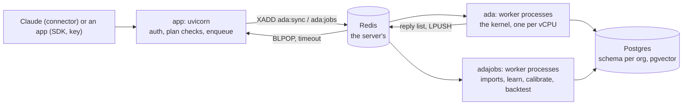

# Ada Cloud: the build plan

**Status:** decided; being built. Steps 0 and 1 are built (ada-private, kernel 3.12.0, now 3.12.2); **steps 2 to 6
are built behind `GLYPHH_ADA_CLOUD` (off)**, and what building them changed in this plan is in
[10.1](#101-steps-2-to-6-as-built) (the sections below are corrected where the build proved them wrong). Written
2026-10-21 from `origin/main` of
`ada-private` (kernel 3.11.0), `rrotor`, `server`, `glyphh`, `platform` and `web`; revised the same day to Chris's
architecture (no new app or infrastructure: Python worker processes on the server's Redis, Postgres with a schema per
org and pgvector). Every claim about today cites the file it comes from.

**The direction (Chris, 2026-10-21):** one multi-tenant, Glyphh-run Ada service behind one URL, so a customer needs
no runtime, no repo and no image. The model is TypeSafe AI's Jev: cloud only, one endpoint, typed answers with
probabilities, billed per request. Why: self-hosting rrotor is too hard to get running, and the public image
`ghcr.io/glyphh-ai/rrotor` carries the Ada kernel's source (the IP). Self-hosted rrotor stays, as the Enterprise
option. Glyphh hosts no per-org runtime: the server only licenses rrotor.

This reverses two standing rulings, and the plan says so where it matters: "nothing of Glyphh's is on the data path"
and "Glyphh's cloud never keeps a copy of the code or the precedents" (`docs/architecture.md`, Architecture and Ada
models), and "Free is a node you run yourself" (`docs/pricing.md`).

---

## 1. The product

**Ada Cloud is Ada as an API.** A customer signs in, makes a key, describes their cases once as a JSON spec, loads
their history, and asks: every answer is typed (the spec's outcomes), comes with calibrated probabilities, the
expected cost of each choice, whether a person should decide instead, and the precedents it stands on. No language
model is in the path, the same question gets the same answer, and the model learns one confirmed case at a time.
Glyphh runs it inside its own server (`glyphh-ai-server`), answered at `https://ada.glyphh.ai`; Claude reaches it
through the one Glyphh connector; software through the SDKs with only a key.

**End to end:**

| Step | On the platform | From Claude (the Glyphh connector + the Ada skill) | From code (SDK, key only) |
|---|---|---|---|
| Sign in | Google or GitHub (built: `api/auth.py`, `ops/auth/`) | Add the connector `https://api.glyphh.ai/mcp`, one Allow (built: `api/oauth.py`, `ops/connector/`) | — |
| Make a key | API Keys page: name, expiry, clearance; shown once | `create_api_key` | — |
| Define a model | Models, New: a spec editor with a template per use case, checked as you type | The skill agrees the case with the person and calls `ada_model_create {name, spec}` | `ada.create_model(name, spec)` |
| Load history | Models, Import: a CSV or JSONL file, mapped to the spec, run as a job with progress | The skill reads the person's file and sends `ada_record_many` in chunks, or starts an import | `model.record_many(cases)` or `model.import_file(path)` |
| Learn | Learn button; automatic after an import | `ada_learn` | `model.learn()` |
| Ask | Try it panel | `ada_decide`, `ada_query`, `ada_facts` | `model.decide(data)`: `{outcome, probabilities, expected_cost, ask, receipts}` |
| Tune | Settings with a backtest before going live, versions, rollback | `ada_backtest`, `ada_settings` (section 5) | `model.backtest(...)`, `model.settings(...)` |
| Keep learning | — | `ada_record` each confirmed outcome | `model.record(data, outcome)` |

The headline call, Jev-shaped: `POST https://ada.glyphh.ai/v1/decide {model, data}` with `Authorization: Bearer
glyphh_ak_…` answers `{outcome, probabilities, expected_cost, ask, receipts, model, version}`.

---

## 2. What a model is in the cloud

**A model is a spec Glyphh stores, plus its precedents. No customer code runs.**

Today an Ada model is a GitHub repo of `glyphh.json`, `spec.json` and `model.py`, deployed by commit and run in
rrotor's sandbox (rrotor `docs/architecture.md` section 8; `examples/ada_incidents/`, `examples/ada_tickets/`). But
the spec already carries almost everything: `glyphh_spec.py` parses layers, segments, roles (`similarity_weight`,
`security_weight`, `key_part`, `numeric_config`, `text_encoding`, `lexicons`), `interactions`, `temporal_source`,
`output` (`report`, `costs`, `ask`), named `outputs` (`values`, `costs`, `ask`; from kernel 3.15.0 a `kind`:
choice, score, noul, number or many, and `when`, a discriminated union) and `settings` (14 levers), and
`glyphh_spec.Model` does `record`, `grade`, `learn`, `refresh`, `calibrate`, `configure`, `query`, `facts`,
`probabilities`, `decide` and `decide_all`. The `model.py` files are thin wrappers.

What today's `model.py` files do that a spec cannot, and how the cloud covers each:

| In code today | Where | In the cloud |
|---|---|---|
| A confidence bar on `decide` (`CONFIDENT = 0.6`) and, below it, `ctx.needs_input` to ask a person, then record the answer | both examples' `decide` | Stateless. The kernel's own `decide` already answers `ask: true` with the best guess when the spec prices asking (`output.ask`) or nothing is known (`glyphh_spec.py` `Model.decide`). The caller asks the person and calls `record`. Add one spec field, `output.ask_below` (ask when the top probability is under it), for people who think in confidence, not costs: a small kernel change |
| The nearest precedent's cause, owner and runbook beside the fix (`_resolution`) | `ada_incidents/model.py` | `decide` takes `include: ["facts"]` and returns the top fact tree, cut by `output.report` and the caller's clearance, which is exactly what `_resolution` reads |
| Shaping `learn`'s answer (roles, word counts, pairs) | both | The service formats it, once, for every model |
| `probabilities` that bypass `Model.probabilities` (no word evidence) | both | Gone: the cloud calls the kernel's `Model` methods only. This is a quiet bug in the examples, not a feature |
| `needs_approval` steps, declared hosts, secrets, files (`daily_sales`) | rrotor base | Not Ada. Not in the cloud; rrotor keeps them |
| Learning weights up front with `Spec.learned(...)` in Python before the first commit | Ada skill, step 3 | Import, then `learn` (section 6) |
| Seeding by one `model_call record` per case, a sandboxed run each | Ada skill, step 5 | `record_many` and imports (section 6) |
| Deriving fields (a ratio, a weekday, a lookup) before recording | nowhere yet, but customers will want it | The caller sends derived fields. Not in the spec at launch (section 5, "What needs code") |

**So a cloud model is a pure spec.** Customers write JSON (or Claude writes it with them), never Python.

---

## 3. Architecture

**No new app and no new infrastructure.** Ada runs inside `glyphh-ai-server`: the API process takes the request and
enqueues it on the Redis the server already has (`GLYPHH_REDIS_URL`); Python worker processes, process groups of
the same Fly app, run the kernel; the precedents live in the server's Postgres (`fly mpg attach`), a schema per org,
the glyphs in pgvector.



### 3.1 Processes and queues

- **Three process groups in `glyphh-ai-server`'s own `fly.toml`** (`[processes]`), one image, each scaled on its own
  (`fly scale count ada=4 adajobs=2`, `fly scale vm performance-2x --process-group ada`):

| Group | Runs | Takes |
|---|---|---|
| `app` | `uvicorn glyphh_server.main:app` as today (`Dockerfile`, `runtime` target) | Every HTTP and MCP request |
| `ada` | `python -m glyphh_ada.worker --queue sync`, one process per vCPU | `decide`, `query`, `probabilities`, `facts`, `record`, `record_many`, `grade`, `forget`, settings reads |
| `adajobs` | `python -m glyphh_ada.worker --queue jobs`, one process per vCPU | Imports, exports, `learn`, `calibrate`, `refresh`, backtests, re-encodes, deletions |

- **Processes, not threads.** Each worker is a single-threaded Python process that takes one message at a time, so the
  GIL is no constraint and the kernel needs no thread safety. A `performance-2x` (2 vCPU, 4 GB) runs two workers;
  more throughput is more machines in the group (`fly scale count`), not more threads. ~~At about 10 ms a read, one
  worker answers about 100 reads a second~~ **Measured (10.1):** a read of a shortlisted model costs a worker 45 to 50
  ms (about 20 reads a second each), of a model under 1,000 precedents about 15 ms (about 65 a second); so 200 reads a
  second of 1,000-precedent models need about ten workers (five `performance-2x`), not four. The sync and job groups
  are separate so a two-minute `learn` never queues in front of a 50 ms `decide`. numpy's BLAS must be held to one
  thread per worker (`glyphh_ada/__init__.py`): left to start one per CPU, four workers answered a third as many reads.
- **Redis Streams with consumer groups** (`ada:sync`, `ada:jobs`): every worker in a group reads the same stream,
  each message goes to one, and a message a dead worker took is claimed by another ~~after 30 s~~ once it has stopped
  heartbeating for 5 s (sync) or 60 s (jobs): the worker in hand re-claims its message every second (every ten for
  jobs), so a long `record_many` is never taken over while its worker lives (`XAUTOCLAIM`). Any worker serves any
  model; no affinity, no placement.
- **Synchronous calls:** the API writes `{request id, org, model, op, args, clearance, deadline}` to `ada:sync` and
  waits on `BLPOP ada:reply:<request id>` with the call's timeout (10 s for reads, 30 s for `record_many`, making and
  deleting a model; the Ada app has its own Redis client with no socket timeout, since redis-py 8 times a read out at
  5 s, which a blocking pop outlasts); the worker
  `LPUSH`es the answer (expiring in 60 s). Past the timeout the API answers `504 E_TIMEOUT`, and a worker that picks up
  a message past its deadline drops it.
- **Async jobs:** a row in the org's `jobs` table (Postgres is the truth; Redis only carries the work), `202 {job}`,
  progress written by the worker (`{state, percent, done, total, refused}`) and read with `GET /v1/jobs/{id}`.
- **Redis stays a transport**, as the server already treats it ("Redis holds only live signals; Postgres holds
  everything kept", `docs/architecture.md`, The server): losing Redis loses requests in flight, never data.

### 3.2 Packaging the kernel privately

- **No public image.** The kernel is installed into the server's own image, which is pushed only to Fly's registry
  for `glyphh-ai-server` (and `ghcr.io/glyphh-ai/server`, private). **Chosen and built:** the server's
  `pyproject.toml` depends on `glyphh-kernel[postgres] @ git+https://github.com/glyphh-ai/ada-private@<commit>` (pinned
  in `uv.lock`, today f28212c, kernel 3.12.2); every build reads it over SSH with a read-only deploy key on
  ada-private, given to Docker as the build secret `ada_deploy_key` (never in a layer): CI writes it from the repo
  secret `ADA_DEPLOY_KEY`, and the deploy passes the same to Fly's builder (`flyctl deploy --build-secret`). Moving
  the kernel is a new commit in `pyproject.toml` and `uv lock`. Kernel step 0 packaged `glyphh_lexicon`,
  `glyphh_postgres` and the lexicon (`glyphh_lexicon_data`).
- **The lexicon stays server-side.** `lexicon/words.jsonl.gz` (WordNet 3.0, 2.5 MB) and `grammar.jsonl.gz` (Moby,
  0.9 MB) ship in the image only, read once per worker process (`glyphh_lexicon.py`). Their licences
  (`lexicon/LICENSES.md`) allow this; the attribution goes in the service's legal notices.

### 3.3 Storage: Postgres, a schema per org, pgvector

**Each org gets a schema, `ada_<org id without dashes>`, made with its first model,** holding:

| Table | What |
|---|---|
| `models` | id, name, active version, precedent count, made, deleted |
| `spec_versions` | model, version, spec `jsonb`, note, made by, made at, encoding (`seed`, `dimension`), learned `jsonb`, taus `jsonb`, backtest job |
| `precedents` | model, id, situation `jsonb`, outcome, glyph `bit(dimension)`, author, ts; `PRIMARY KEY (model_id, id)`; **partitioned by `LIST (model_id)`**, a partition per model |
| `outcomes` | model, id, output, value, ts (the kernel's named outcomes, `_ensure_schema`) |
| `meta` | model, key, value `jsonb` (the kernel's `meta`: `learned`, `learned:<output>`, `tau`, `tau:<output>`, `encoding`) |
| `jobs`, `audit`, `idempotency` | Per org, so an org's whole footprint is its schema |

- **Glyphs as `bit(4096)`.** The kernel's glyphs are bipolar ±1 int8 vectors of `DIM = 4096` (`glyphh_kernel.py`
  `symbol`, `bundle`), and `sim(a, b)` is `dot(a, b) / dim`, cosine for bipolar vectors. Packed as bits (+1 as 1),
  `sim = 1 − 2·hamming/dim`, which pgvector computes with `<~>` on `bit` columns. A glyph is 512 bytes as `bit(4096)`
  against 4 KB as the kernel's int8 blob today. `bit` takes up to 64,000 dimensions with an HNSW index
  (`bit_hamming_ops`); the cloud caps `dimension` at 8,192 anyway (3.6).
- **An HNSW index per model partition** (`USING hnsw (glyph bit_hamming_ops)`), so a search never filters across
  models and recall does not suffer from a `WHERE model_id = …` filter.
- **Schema per org (Chris's default), against one set of tables with RLS:**

| | Schema per org (chosen) | Shared tables, `org_id` and RLS |
|---|---|---|
| Isolation | A query without the schema finds nothing; no policy to get wrong. Today's RLS policies let a connection with no org set see every row (`db/schema.sql`, `db/tenancy.py`), which is right for sign-in, wrong for customer data | Needs a stricter policy than today's, failing closed |
| Delete and export an org | `DROP SCHEMA … CASCADE`; `pg_dump -n` | `DELETE … WHERE org_id`, slower, leaves bloat |
| Indexes | Per org, per model: small, built fast | The same, with partitions per model |
| Migrations | Applied to every org schema: a loop over N schemas at start, with a version table per schema; slow past several thousand orgs | One `ALTER` |
| Catalog | Tables × orgs; Postgres is comfortable to some thousands of schemas | Flat |

  Schema per org is right at Glyphh's size. If orgs pass about 5,000, the free ones move to shared tables with RLS
  (the same table shapes, an `org_id` column); paid orgs keep their schemas.
- **Every statement names its schema** from the org's database id (`"ada_9f…".precedents`), never from a caller's
  input; the worker also sets the session's `search_path` to that schema ~~alone~~ **then `public`** (pgvector's
  operators, `<~>` and `bit_hamming_ops`, live in `public`; `public` also has a `models` table of its own, which is
  why every statement names its schema). **Built:** on top of the schema, every table of an org's schema (the
  kernel's partitions too) has row-level security forced with a `tenant` policy that fails closed: rows are seen and
  written only by a session whose `glyphh.org_id` is that org, which the worker sets for every message. A test makes
  two orgs and proves neither's key, worker message or job can read the other's rows, and that a database session with
  no org, another org or an unknown org sees none and writes none.
- **Size:** about 512 B of glyph, the situation's JSON (typically 0.3 to 2 KB) and about 1 KB of HNSW index per
  precedent: 2 to 4 KB on disk. Team's million is 2 to 4 GB in Postgres, and its HNSW index should fit in the
  database's RAM. The database plan is the cost to watch (section 10, risks).
- **Backups are the managed database's own;** no object storage, no volumes on workers.
- **pgvector is not installed today** (no `vector` in `db/schema.sql`); on Fly Managed Postgres it is a toggle on
  the cluster's Extensions page (the server's role cannot `CREATE EXTENSION vector` itself), done before the flag goes
  on or the step-2 change is deployed with it on.

### 3.4 How a read works: pgvector shortlists, the kernel re-ranks

A spec model never reads by raw glyph similarity: `Model.query` passes the spec's weights, which takes the kernel's
exact weighted path (`Space._scores` → `_fast_scores`: per leaf, the weighted mean of the leaves the query gives; a
role the query leaves out weighs 0; layers, segments, roles, learned value and word weights and the caller's
clearance all weigh in). So:

1. **Shortlist in Postgres.** The worker encodes the query with the spec's weights (`Space.encode(situation, None,
   weights)`, the weighted bundle), packs it to bits and asks the model's partition for the nearest `S` by Hamming
   (`ORDER BY glyph <~> $1 LIMIT S`, `S` = 1,000 by default, `hnsw.ef_search` ≥ `S`).
2. **Re-rank exactly in the kernel.** The shortlist's rows (situation, outcomes, ts, glyph) load into a small
   in-memory `Space`, which scores them with its own exact weighted path and votes as today (`k`, `min_sim`, `POOL`,
   the calibrated `tau`, the word-evidence bias). Answers, receipts and fact trees are the kernel's, unchanged.
3. **Small models skip the shortlist.** Below ~~20,000~~ **1,000** precedents (the kernel's `exact_below`, set by
   step 1's numbers: an exact read loads the whole partition, 50 ms at 800 precedents, 3 s at 20,000) the whole
   partition is read and scored exactly. The answer is then identical to rrotor's. A worker drops such a model from its
   cache after the read (it now holds the precedents, which other workers' writes would leave stale) and opens it
   afresh on the next.
4. **Few roles on a big model are refused.** Kernel 3.12 measured what this section feared: a query giving 2 of 7
   roles found 33% of the exact top within a shortlist of 1,000 at 1M precedents (99.5% at 100k). Above 100,000
   precedents (`limits.FEW_ROLES_ABOVE`), a query giving under half the roles that vote (key parts and weightless
   roles aside) is answered `422 E_FEW_ROLES`, naming the roles it gave and those it could, rather than from a poor
   shortlist. An exact read in the jobs group was the other choice: at 1M it takes minutes and about 16 GB, so it is
   not offered.

**What to measure (step 1):** recall of the exact top `k` within the top `S` on credit and Banking77, and on a
synthetic 1M store; `S` and the threshold come from those numbers. The risk is a query that gives few roles against
records that carry many: the weighted bundle of a partial query is still nearest the records sharing its roles, but
less sharply. A model can set `S` higher (a cloud setting, `shortlist`) or be read exactly (`shortlist: 0`) at the
cost of time.

**Caching in a worker:** each worker keeps, per model, the active spec, the learned `meta` and the taus (small),
checked against a version counter in Redis (`ada:ver:<model>`, bumped by every write that changes them). Precedents
are not cached: Postgres's own buffer cache holds the hot partitions and indexes. So a worker's memory is the lexicon,
the symbol cache and the request in hand, not the stores.

**Writes:** `record` encodes in the worker (the kernel's `Space.record` path, through the storage interface, 3.5)
and upserts the row (a `key_part` id replaces its row, as `Space.record` does). `refresh_every` no longer runs
inline (**built:** workers turn it off, and a write that takes the model past a multiple of it starts a `learn` job,
unless one is open; counted in precedents held, not graded ones, which would cost a scan of the partition a write).
`learn` and
`calibrate` ~~read every graded row of the model~~ **read at most the newest 50,000 precedents** (`limits.JOB_SAMPLE`:
a fully loaded 1M model needs about 16 GB, 20 to 25 KB a precedent in a `Space`) in a job worker, which loads them
into an in-memory `Space` as today and writes the learned `meta` and taus back; a model of 50,000 or fewer learns
exactly as rrotor does. When learned word weights or interactions change, the kernel rewrites the sampled glyphs
(`Model._learn` → `Space.rewrite`) and the job restates every other precedent after it, in batches of 1,000
(**built** in place for `learn`: reads go on meanwhile, against a mix of old and new glyphs until it ends; a new
version that changes what a case carries is written into a store of its own and swapped in, 5.2). On Postgres a model
is never restated when it is opened, so whatever changes what a case carries must rewrite the store in its job.

### 3.5 The kernel's storage interface

Today `kernel.Space` talks to SQLite directly: 40 `execute`/`executemany` calls over 60 references to its connection
(`self._db`), plus `_ensure_schema`, `_reencode_rows`, `reencode_store` and `merge` (`glyphh_kernel.py`, one numpy
file). The cloud needs that behind an interface, with two implementations:

| Piece | What | Days |
|---|---|---|
| `Store` protocol | `load(since)` (rows and named outcomes, as `Space.refresh` reads them), `put(row, outcomes)` and `put_many`, `grade`, `forget`, `meta`/`set_meta`, `taus`/`set_tau`, `rewrite(rows)`, `encoding`, `close`; `Space(store=…)` beside `Space(path=…)` | 2 |
| `SqliteStore` | Today's code moved behind it, unchanged in behaviour: rrotor, the plugin and every benchmark keep working; `readonly` kept | 1 to 2 |
| `PostgresStore` | psycopg (sync, in workers), a schema and a model id, `bit` glyphs, batched upserts, `shortlist(query glyph, S)` | 2 to 3 |
| Shortlist reads | `Model.query/probabilities/facts/decide` take a candidate set from the store when it offers `shortlist`; exact otherwise | 1 to 2 |
| Tests | The kernel's suite run on both stores; a Postgres in CI; rrotor's suite against the new kernel | 1 to 2 |

**About 7 to 11 days.** It is the largest single piece of new work, and it stays in `ada-private`, so rrotor and the
cloud run one kernel.

### 3.6 Limits per request and per spec

| | Limit |
|---|---|
| Body | 1 MB (`record_many`: 5 MB) |
| `record_many` | 1,000 cases |
| `facts` `top` | 50 |
| A read (`query`, `probabilities`, `decide`, `facts`) | 10 s end to end, then `504 E_TIMEOUT` |
| `learn`, `calibrate`, `backtest`, imports, exports | Always jobs |
| Rate | Per org per plan (section 7), `429 E_RATE` with `Retry-After` |
| Imports | 200 MB a file, one running per model (**built:** `GLYPHH_ADA_IMPORT_BYTES`; one import or re-encode open per model, `409 E_BUSY`; a file in the request's body 5 MB) |
| Backtests | **Built:** 10 candidates; the held-out from the newest `limits.JOB_SAMPLE` |
| Spec | `dimension` at most 8,192 (the kernel allows 65,536, `_parse_spec`), 64 roles, 20 named outputs (a many output counts once and once per value: its members each learn), 200 values per output (a number's bins), `k` at most 200; **built:** 64 KB of JSON (`413 E_SPEC_LIMIT`), each bound `422 E_SPEC_LIMIT` with `limit` and `max` |
| Strings | **Built:** no string, key or value, may hold NUL (`\u0000`): Postgres's `jsonb` refuses it, so the API answers `400 E_INVALID` `nul` before a worker sees it |
| A query's roles | **Built:** over 100,000 precedents, at least half the roles that vote (3.4), else `422 E_FEW_ROLES` |
| Making, deleting a model; `record_many` | **Built:** 30 s, then `504 E_TIMEOUT` (the write is made once even if it lands after: send it again with the same `Idempotency-Key`) |

### 3.7 What kernel 3.12 still has to fix

With single-threaded worker processes and Postgres, the threading and in-memory-store concerns of the first draft go.
What remains, because one worker serves many orgs' models one after another:

- **The lexicon switch is process-wide.** `glyphh_lexicon.LEXICON.enabled` is set by `Model._apply()` from the
  model's `lexicon` setting, and the lexicon's glyph cache is keyed `(word, seed, dim)` without it: a worker that
  served a model with `lexicon: false` reads the next model's text without its lexicon. It becomes a per-model
  argument.
- **The symbol cache never shrinks.** `glyphh_kernel._SYMBOLS` keeps every 4 KB glyph a process has made; a worker
  serving every org's values grows without limit. It becomes an LRU.
- **No public delete:** `Space.forget(rid)` and `Model.forget` (only the private `_drop` exists).
- **One case at a time:** `record_many` in one transaction, and an id index for the replace check (`rid in
  self._ids` is a list search).
- **`output.ask_below`** (section 2) and the packaging of `glyphh_lexicon` and `lexicon/` (3.2).

Memory per precedent (about 16 KB in rrotor, its `docs/architecture.md` section 8) no longer sizes the cloud: workers
hold no stores, and in Postgres a precedent is 2 to 4 KB on disk. It still matters to rrotor.

---

## 4. The API

### 4.1 Auth

- **API keys** (`glyphh_ak_…`), made on the API Keys page or the connector, shown once, kept as SHA-256: the
  `runtime_keys` table and `ops/runtime_keys.py` as they are, with a `scope` column (`cloud`, `runtime`) and a
  `clearance` column (0 to 1; default 1). A key belongs to its maker and acts in their org. Today's `glyphh_rk_` keys
  keep working on self-hosted rrotor only.
- **A Glyphh sign-in** (an OAuth access token from `/oauth/token`) works on the API too, for the platform.
- **Clearance** comes from the key (or, signed in, from the person's org role: admin 1, member the org's default),
  never from the body. A request may send `clearance` lower than that, never higher, which is rrotor's rule today
  (rrotor `docs/architecture.md` section 8).
- The `app` process resolves the key to `(org, user, clearance)`, checks the plan's limits, and only then enqueues;
  a worker trusts the message, never a caller.

### 4.2 Endpoints

`https://ada.glyphh.ai` is a second hostname of `glyphh-ai-server` (a Fly certificate; the app routes by `Host`), so
the Ada API keeps clean paths and SDK 3.0's routes, and the account API stays at `api.glyphh.ai`. Refusals are the
server's: `{"error": {"code", "message", "trace_id"}}`, `E_LIMIT` with `reason`, `used`, `max`, `plan`.

| Call | Does | How |
|---|---|---|
| `POST /v1/decide` `{model, data, output?, outputs?, clearance?, include?}` | The headline: the kernel's `decide` (or `decide_all` for `outputs`): `{outcome, expected_cost, probabilities, ask, receipts, model, version}`; `include: ["facts"]` adds the nearest fact tree | sync |
| `GET /v1/models`, `POST /v1/models` `{name, spec}`, `GET /v1/models/{name}`, `DELETE /v1/models/{name}?confirm=<name>` | The org's models; make one (version 1, its partition and index); one with its active version, size and settings; delete it | API (Postgres only); ~~delete is a job~~ **built:** delete is sync (dropping partitions is quick) |
| `PUT /v1/models/{name}/spec` `{spec, note?, backtest?}` | A new spec version (5.2): **built,** `{version, active, job}` | sync; a job if it re-encodes |
| `GET /v1/models/{name}/versions`, `POST …/versions/{n}/activate` | Every version, who made it and why; roll back. **Built** also: each version's changes against the one before (`{path, from, to, restates}`), the precedents when it was made (`precedents_at`, unknown before 2026-10-22), what it had learned, its newest backtest scores, its store (`active`, `kept` with `drop_after`, `making`, `dropped`); `GET …/versions/{n}` (with its spec and every lever), `GET …/versions/{n}/diff?against=`, `PATCH …/versions/{n}` `{note}` | sync; a job when the version reads another store |
| `GET`, `PATCH /v1/models/{name}/settings` `{changes, note?, backtest?}` | Every lever as it stands; a change is a new version (section 5) | sync; ~~relearns as a job~~ a job when it re-encodes or recalibrates |
| `POST /v1/models/{name}/record` `{data, outcome?, outcomes?, ts?}` | One case: `{id, precedents}` | sync |
| `POST /v1/models/{name}/record_many` `{cases}`, `Idempotency-Key` | Up to 1,000, one transaction: `{ids, added, replaced, precedents}` | sync |
| `POST /v1/models/{name}/grade` `{id, output?, value}` | One output's outcome on a case already recorded | sync |
| `DELETE /v1/models/{name}/precedents/{id}` | Forget one case | sync |
| `POST /v1/models/{name}/query`, `/probabilities`, `/facts`, `/decide` | The kernel's own, `{data, output?, clearance?}` (`facts`: `top`, `min_score`): the `Answer` shape of `contract/contract.json` unchanged | sync |
| `POST /v1/models/{name}/learn`, `/calibrate`, `/refresh` | Weights and temperature from the store | job |
| `POST /v1/models/{name}/backtest` | Score candidates before they go live (5.3) | job |
| `POST /v1/models/{name}/imports`, `GET …/imports/{id}`; **built:** `PUT /v1/uploads/{link}` | Bulk load (section 6): the job and its upload link, or the file in the body (5 MB) | job |
| ~~`GET /v1/models/{name}/export`~~ **built:** `POST /v1/models/{name}/export` `{format}`; `GET /v1/downloads/{link}` | Everything back out (section 6): a job (so not a GET), whose done state carries the download link | job |
| `GET /v1/jobs/{id}` | Any job's state and progress | API |
| `GET /v1/usage` | Precedents, requests this period, against the plan. **Built:** `{plan, month, resets_at, models, precedents: {used, max}, requests: {used, max, over, overage}, requests_per_second}` (`max` null: by contract), the one shape the platform, SDK 3.2 and the connector's `usage` read | API |
| `POST /v1/runs` `{model, function, inputs, clearance?}` | **Compatibility:** rrotor's call shape (`contract/contract.json` `result`), for `record`, `query`, `facts`, `probabilities`, `decide`, `learn`, `settings`, answered as a `done` Result (a fresh `run_id`, `seconds` the time taken; `learn` waits for its job up to 60 s). SDK 3.0 works against the cloud with only `GLYPHH_RUNTIME_URL` and the key changed | sync or job |

`decide` never answers `needs_input`: the cloud has no runs to continue. `ask: true` is the signal.

### 4.3 The connector: one URL

The Ada tools join the existing Glyphh connector at `https://api.glyphh.ai/mcp` (`mcp/tools/registry.py`), as a new
module `mcp/tools/ada.py`. They are the same app, so a tool enqueues exactly as a REST call does: no forwarding.

**Built** (step 5): four modules, `mcp/tools/ada_models.py`, `ada_cases.py`, `ada_jobs.py`, `ada_keys.py` (the
server's 200-line files), listed and callable only with the flag on. Every tool calls the workers through the API's
own `send` (`glyphh_ada/api/call.py`: the plan's checks, the message, the reply), as the person signed in with full
clearance (a tool may ask for less). Beyond the table: `ada_grade`, `ada_calibrate`, `api_keys` and `revoke_api_key`;
`ada_settings` with no changes reads every lever; `ada_activate` is the rollback (`ada_versions` lists what to roll
back to); `ada_import` also takes the file's text (`content`) or its cases (`rows`) inline up to 5 MB, its upload
link at `GLYPHH_ADA_URL`; `ada_export` is a job whose download link `ada_job` answers once done; `ada_job` waits up to
50 s (`wait_seconds`); `ada_record`, `ada_record_many` take an `idempotency_key`. **A tool that waits on a worker runs
after the request's transaction has ended** (`registry.DETACHED`; 10.1): the connector's one-transaction-per-request
held a snapshot through the wait, and an import's `CREATE INDEX CONCURRENTLY` waits out every such transaction.

| Tool | Does |
|---|---|
| `ada_models`, `ada_model` | The org's models; one with its spec, active version, size, settings |
| `ada_model_create` `{name, spec}`, `ada_spec_update` `{name, spec, note}`, `ada_model_delete` `{name, confirm}` | Make, change, delete |
| `ada_versions`, `ada_activate` `{name, version}` | Versions; roll back |
| `ada_record` `{name, data, outcome?}`, `ada_record_many` `{name, cases}` | Record one, or up to 1,000 |
| `ada_import` `{name, format, mapping?}`, `ada_job` `{id}` | Start an import (answers a one-hour upload URL that Claude Code can `curl` the file to); a job's progress |
| `ada_decide`, `ada_query`, `ada_probabilities`, `ada_facts` | Ask |
| `ada_learn`, `ada_settings` `{name, changes?}`, `ada_backtest` | Learn and tune (section 5) |
| `ada_export` `{name}` | A one-hour download link |
| `ada_forget` `{name, id}` | Forget one case |
| `create_api_key` | As `create_runtime_key` today, `scope: cloud` |

Today's `runtime*` tools stay for Enterprise orgs with self-hosted runtimes and are hidden for the rest.

---

## 5. Tuning in the cloud

Every lever the kernel has becomes an API call and a connector tool, versioned per model, with a backtest before a
change goes live. Claude does the tuning conversationally through the connector and the Ada skill.

### 5.1 The levers

From `glyphh_spec.py` (`Settings.RANGES`, `Role`, `Output`, `_parse_spec`), plus one of the cloud's own:

**Built** (step 4): the last column is what a change does to the stored cases, as built (`situations.py`): "live" is
a new version active at once on the same store; "re-encodes" a job writing a new store, which then learns (5.2).

| Lever | Where | Range or kind | What it changes | Relearns |
|---|---|---|---|---|
| `k` | `settings` | 1 to 1,000 (cloud: 200) | Nearest precedents a query votes over | No (live) |
| `min_sim` | `settings` | 0 to 1 | The weighted similarity a precedent needs to vote: higher, "say nothing rather than guess" | No (live) |
| `word_weights` | `settings` | bool | Learn a weight per word of a text role | Yes (re-encodes) |
| `word_floor` | `settings` | 0 to 1 | The least a learned word weighs | Yes (re-encodes) |
| `interactions`, `max_interactions` | `settings` | bool; 0 to 50 | Learn pairs of roles that tell more together | Yes (re-encodes) |
| `rare` | `settings` | 1 to 100,000 | Values, words and pairs seen fewer times are not learned from | Yes (re-encodes) |
| `word_pairs`, `max_word_pairs` | `settings` | bool; 0 to 200 | Learn pairs of words (phrase intents) | Yes (re-encodes) |
| `word_evidence` | `settings` | 0 to 5 | How much a case's words, by what each says of each outcome, weigh on the vote | No (live) |
| `lexicon` | `settings` | bool | Read words through WordNet and Moby | Re-encodes text roles (the whole store) |
| `calibrate_by`, `calibrate_sample` | `settings` | `loss` or `cost`; 10 to 1,000,000 | Probabilities that mean what they say, or that decide best by `costs` | Recalibrates (live, then a `calibrate` job) |
| `refresh_every` | `settings` | 10 to 1,000,000, or none | Learn and calibrate again every so many graded records (a job, in the cloud: **built,** counted in precedents held) | — (live) |
| `shortlist` (cloud) | `settings` | 0 (exact) or 100 to 10,000 | How many candidates pgvector hands the kernel (3.4) | No (live) |
| Role `similarity_weight`, `security_weight` | spec | 0 to 1 | A role's voice; the clearance needed to see it | ~~Yes (learned weights override similarity)~~ No (live): a glyph is the unweighted bundle, so the store reads as it is; learned weights override similarity until the next `learn` |
| ~~`numeric_config`, `text_encoding`, `lexicons`, `key_part`~~ `numeric_config`, `text_encoding`, `key_part` | spec | per role | How a value is read | ~~Re-encodes~~ **Refused** (`422 E_SPEC_READING`): the store keeps each case's situation in the kernel's terms (a number's bins, a text's words, the id its key parts made), never the data sent, so it cannot be read again another way; a new model and an import. (`lexicons`, a role's other names in data, changes nothing stored: live) |
| Declared `interactions` | spec | role pairs | Pairs always read together | Yes (re-encodes) |
| `output.costs`, `output.ask`, `output.ask_below`; each named output's `values`, `costs`, `ask` | spec | numbers | What each mistake costs; when to ask a person | No (live; `calibrate_by: cost` recalibrates) |
| `output.report` | spec | paths | What a fact tree shows | No (live) |
| Layer and segment weights, `seed`, `dimension` | spec | 0 to 1; ints | Voices; the encoding (`seed`, `dimension` re-encode every glyph and rebuild the index) | Re-encodes (`seed`, `dimension`, roles added or taken away); weights live |
| `clearance` | per key and request | 0 to 1 | What a reader may see and what votes for them | — |
| Learned weights (`value_weights`, `~interactions`, `~evidence`) | the model's `meta` | learned, not set | What the precedents say each role, value, word and pair is worth | — |

### 5.2 Versions and rollback

- Today `Model.configure()` keeps changed levers in the store's `meta` (`settings`), over the spec's, unversioned
  (`glyphh_spec.py`); rrotor's `settings` function exposes that (`examples/*/model.py`). In the cloud **the spec is
  the only truth:** a settings change writes a new row in `spec_versions` with those `settings`; workers see the
  version counter move and reload; there are no `meta` overrides.
- Each version keeps the learned weights and taus it went live with, so a rollback restores them without relearning.
  **Built:** a version keeps the learned weights and taus its store had when it stopped being active (`spec_versions.
  learned`), and gets them back when made active again.
- A change of the encoding (`seed`, `dimension`, ~~a role's reading~~ roles, declared pairs, learning levers, the
  lexicon) is a job that writes the new glyphs into a new partition beside the old and switches at the end; rollback
  switches back while the old partition is kept (7 days). **Built** (`reencode.py`): the job restates each stored
  situation for the new spec (cut to its roles, its words and pairs weighed again), encodes and writes it, a batch at a
  time; the new store learns and its index is built; then what was written meanwhile is copied, first freely, then
  under the model's write lock (every write to its cases takes it shared) together with forgets, grades and the switch,
  so no write is lost; the version counter moves before the lock is let go. A rollback to a version on the active
  store is at once; to one on another store, a job that brings that store up to date (the store left behind keeps how
  far it was copied, `synced_seq`) and then switches. A store no version has read for 7 days is dropped at the next
  re-encode (`410 E_VERSION_GONE`). A change of how a role reads its values is refused (5.1). One import or
  re-encode at a time per model (`409 E_BUSY`); a version still being made cannot be made active (`409 E_NOT_READY`).

### 5.3 Backtest: before it goes live

`POST /v1/models/{name}/backtest`, a job:

```jsonc
{"candidates": [{"settings": {"word_evidence": 1.0}}, {"spec_version": 4}, {"spec": {…}}],
 "holdout": {"newest": 200},            // or {"fraction": 0.2, "seed": 7}
 "output": "default",
 "clearance": 1.0}
```

- For the active version and each candidate (up to 10): an in-memory `Model` in the job worker, built from the
  model's graded precedents minus the held-out ones, `learn` and `calibrate` on that training part only, then every
  held-out case scored, ~~through the same shortlist-and-re-rank path the live model uses~~ **as built,** exactly,
  over the in-memory model (it holds at most `limits.JOB_SAMPLE` precedents). So a backtest scores the exact read: the
  same as the live one below 1,000 precedents, and, above, as the shortlist recalls it (step 1: 100% at Banking77's
  10,003 for `S` ≥ 250; less for queries that give few roles, 3.4). The live model is never touched. This is what the benchmarks' `tune_*.py`
  scripts do by hand (rrotor `benchmarks/banking77/`), and what the Ada skill's Tuning section asks of Claude.
- Answers per candidate: accuracy, log-loss, total and mean cost by the output's `costs`, ask rate (and accuracy on
  the cases it did not ask about), coverage (`sufficient`), a confusion table, and the change against the active
  version. **Built,** with two more: the vote's own accuracy (`top_accuracy`, what the benchmarks' plain `query`
  scores) beside decide's, and the expected calibration error over ten bins of confidence; the confusion table is the
  mistakes only (`{truth: {decided: count}}`: 77 outcomes make a full one 5,929 cells). A candidate whose spec reads a
  role differently is answered with its refusal; one with too few cases to learn from is scored unlearned, and says so.
- `PATCH settings` and `PUT spec` take `"backtest": <job id>`, kept on the version.
- **Measured** (`scripts/ada-backtest-bench.py`, 10.1): the backtest reproduces both benchmarks' held-out numbers for
  the live settings, to the digit.

### 5.4 Claude, tuning

The rewritten Ada skill (section 9) tells Claude to: read `ada_model` and `ada_settings`; propose one change at a
time with the reason; run `ada_backtest` with the current and candidate; show the person the numbers in plain words
("asks 12% fewer times, costs 8% less on the last 200 cases"); apply with `ada_settings` and a note only when the
person agrees; and roll back with `ada_activate` if live results fall. It never scores on cases the model learned
from.

### 5.5 What tuning needs code, and so does not fit the cloud

| Needs code | Cloud answer |
|---|---|
| Derived features (a ratio of two numbers, a weekday from a date, a lookup in the customer's systems) | The caller computes them and sends them as roles. Later, a small declarative `derive` block (ratio, difference, date part) if customers ask |
| Business rules on top of the vote ("always refuse above $50,000") | The caller applies them. Not in the spec |
| A custom similarity or a custom scoring metric for backtests | Not offered; the built-in metrics are accuracy, log-loss, cost and ask rate |
| Sequences of events (`Space` `events`, `Strand`) | The spec path does not use them today; not offered |
| Anything with network, files or secrets (rrotor's base) | rrotor, Enterprise |

---

## 6. Getting history in, and out

### 6.1 Seeding today needs code

On rrotor, seeding is one `model_call record` per case, each a sandboxed run (Ada skill step 5), or Python run by
hand (`Spec.learned`, the benchmarks' `run.py`). There is no bulk route in rrotor (`src/rrotord/api/routes.py`); the
kernel's `Space.merge(path)` unions another SQLite store, which rrotor caps all or nothing (`rrotor/ada.py`
`_cap`). A pure-cloud model replaces all of this with three ways in, none of them code.

### 6.2 Three ways in

| Way | Shape | Good for |
|---|---|---|
| `record_many` | Up to 1,000 cases, 5 MB, one transaction; `Idempotency-Key` (kept 24 h in the org's `idempotency` table: the same key and body answer the first answer; another body, `409 E_IDEMPOTENCY`). A spec with `key_part` roles is idempotent by itself: the same case id replaces its row | Code and Claude, up to tens of thousands |
| An import | `POST /imports {format: jsonl \| csv \| ada_sqlite, mapping?}` answers an upload URL; the `app` process streams the file into a staging table in the org's schema; a job validates each row against the spec, records batches of 1,000, and reports `{state, rows, recorded, refused: [{row, path, message}] (first 100), percent}`; `learn` and `calibrate` run once at the end, then the partition's HNSW index is built once | The platform's Import page; Claude Code with a large file |
| From Claude | The skill reads the person's file, maps its columns to the spec with them, and sends `ada_record_many` in chunks of 1,000, or for big files `ada_import` and `curl` to the upload URL | Conversational onboarding |

- **CSV mapping:** a header names a role by path (`error.what.message`) or the mapping maps a header to one;
  `outcome` (or `outcome.<output>`) names the outcome columns; a cell is parsed by its role's kind (a number for
  `numeric_config`, text for `bag_of_words`, a list for `;`-separated values).
- **`ada_sqlite`:** a self-hosted rrotor's `precedents.sqlite`, read through the kernel's `SqliteStore` and written
  through `PostgresStore`, after a check of its encoding. This is how an Enterprise or former self-hosted customer
  moves to the cloud.
- **During an import `refresh_every` is off,** and the index is dropped and rebuilt at the end (building HNSW once
  is far faster than inserting into it row by row).
- **Built** (step 3, `importer.py`, `sqlite_import.py`): ~~a staging table~~ the file itself is kept in the org's
  `files` table in 1 MB chunks (streamed in by the upload, `PUT /v1/uploads/{link}`, a one-hour HMAC-signed link that
  is its own credential; or sent in the body of `POST …/imports`, up to 5 MB), and the job reads it twice: once to
  check every row and count the ids it would add (6.3), then to record, a batch of 1,000 a transaction, with how far
  it got kept on the job, so a worker that dies leaves the rest to another (rows without key parts get ids made from
  the job and the row, so a row written twice is one row). Refused rows are named and the rest go in. Then `learn`
  and `calibrate` once, then the index, built `CONCURRENTLY` so writes to the model go on meanwhile (a plain build
  holds them for minutes at a million). JSON Lines takes `{data, outcome?, outcomes?, ts?, id?}`; CSV as above, a
  `null` target skipping a column, an empty cell nothing, a bad number refusing its row, a header the spec cannot
  take refusing the import (`E_MAPPING`). A model's own export (a zip) is a JSON Lines import whose cases are stored
  situations. `ada_sqlite`: when a sample of the file's cases encodes, by this model's seed, dimension and lexicon,
  to the glyphs the file holds (and names only its roles), the kernel's `Space.merge` unions it a batch at a time,
  glyphs copied, an id the model holds keeping its row as merge does; else each case is restated, as an export's.
  What the file's (or the export's) model learned is kept when the model reads its cases the same way and held
  nothing before; otherwise the model learns. One import or re-encode at a time per model (`409 E_BUSY`).
- **Cost at scale:** 10,003 Banking77 cases encode and record in about 4 s, 7 s with `learn` (rrotor
  `benchmarks/banking77/README.md`), in memory. In the cloud add the batched `COPY` into Postgres and the index build:
  target 10,000 cases in under 15 s end to end, 1M in under 30 minutes on two job workers; step 1 measures it.

### 6.3 The precedent cap

- An import or `record_many` counts the new ids it would add (ids the model holds replace their rows and add
  nothing), as rrotor's `_cap` does for `merge`, and is refused whole with `E_LIMIT` `precedents` if the org would
  pass its plan's cap, unless sent with `"partial": true`, which records up to the cap and reports the rest refused.
- The count is the org's total across its models (`models.precedent_count`, kept by each write in the same
  transaction), not per node.
- **Built:** the count is the kernel's own `counts` of each live model's active store (an old version's store kept
  for a rollback does not count), summed when a write asks. The cap is the org's plan version's `cloud_precedents`
  (step 6; it was the setting `GLYPHH_ADA_PRECEDENT_CAPS` until then, now gone; Free 1,000 since 2026-10-22, Pro 100,000, Team
  1,000,000, Enterprise none), resolved with the caller and carried in the worker's message. `record` and `record_many`
  are held to the cap too (no `partial`: refused whole). An `ada_sqlite` file is merged whole: no `partial`.

### 6.4 Export: never locked in

~~`GET /v1/models/{name}/export?format=jsonl|ada_sqlite`~~ **Built:** `POST /v1/models/{name}/export {format:
jsonl|ada_sqlite}`, a job whose done state carries a one-hour download link (`GET /v1/downloads/{link}`); the file is
kept in the org's `files` while the link works:

- `jsonl`: one line per precedent ~~`{id, data, outcome, outcomes, ts, author}`~~ `{id, situation, outcome, outcomes,
  ts, author}`, plus `spec.json` (every version) and `learned.json` (the active learned weights and taus), zipped.
  **As built, `situation` not `data`:** the store never kept the data a case was sent as, only its situation in the
  kernel's terms (5.1), so that is what an export can give. Imported into a model of the same spec it answers exactly
  as the exported one does (receipts, hashes and authors included).
- `ada_sqlite`: a kernel store written through `SqliteStore`, which a self-hosted rrotor opens as
  `precedents.sqlite` unchanged. **Built,** glyphs, named outcomes, learned weights and taus included; the kernel's
  `Model(path=…)` over it answers as the cloud model does.
- Org-wide export on the platform's Settings page: every model, one archive. (Not built.)

### 6.5 Deletion

- **One case:** `DELETE …/precedents/{id}` deletes its row and outcomes; learned weights still reflect it until the
  next `learn`, which the service schedules.
- **A model:** its partition, versions, meta and jobs (`DROP TABLE` of the partition). **Built:** every store its
  versions read (a re-encode leaves more than one), its outcomes, meta and counts, its versions, jobs and files, in
  one transaction; its `models` row is kept, marked deleted.
- **An org:** `DROP SCHEMA ada_<org> CASCADE`, then the org as today. **Built** in the transaction that removes the
  org (`ops/joining.py`, the only place an org is removed today: its last person joins another org). A worker holding
  one of its models finds the tables gone and answers `E_MODEL_MISSING`.
- **Backups:** gone from the managed database's backups when they age out; the window is Fly Managed Postgres's (to
  confirm) and is stated in the privacy policy.

---

## 7. Plans and metering

**Nodes mean nothing in the cloud.** What costs Glyphh money is Postgres (precedents held and their indexes), worker
CPU (reads, learns) and Redis traffic. So a cloud plan sells **precedents per org** and **requests per month**; never
seats, models or installs (`docs/pricing.md`, the 2026-10-18 ruling).

**What counts:** a request is one read (`decide`, `query`, `probabilities`, `facts`; `POST /v1/decide`; `/v1/runs`
with a read function). Writes, learns, backtests, imports and exports are not counted as requests: they are bounded by
the precedent cap and the rate limit. A `decide` with `outputs` counts once per output.

| | Free | Basic | Pro | Team | Enterprise |
|---|---|---|---|---|---|
| Price | $0 | $20 a month | $99 a month | $299 a month | By contract, from $10k a year |
| Precedents, the org's total | 1,000 | 10,000 | 100,000 | 1,000,000 | By contract, or self-hosted rrotor |
| Requests a month | 5,000 | 50,000 | 1,000,000 | 5,000,000 | By contract |
| Over the requests | Refused until the month turns (`E_LIMIT` `requests`) | $1 per 10,000 more (metered) | $1 per 10,000 more (metered) | $1 per 10,000 more | By contract |
| Rate | 5 a second | 10 a second | 50 a second | 200 a second | By contract |
| Models, members, keys | Unlimited | Unlimited | Unlimited | Unlimited | Unlimited |
| Backtests, versions, export, audit log | Yes | Yes | Yes | Yes | Yes, plus SSO when built |
| Self-hosted rrotor | No | No | No | No | Yes (registry credentials, licence key) |

**Basic** (Chris, 2026-10-22) sits between Free and Pro: self-serve, never per seat, no sync, HA, offline or SSO. It
has no licence key (rrotor's tiers are free, pro, team and enterprise), so a self-hosted node on Basic runs as Free's,
and no hosting. Its flat price is `GLYPHH_STRIPE_PRICE_BASIC`, beside `_PRO` and `_TEAM`. A Free org past its month
is now told to upgrade to Basic (the first self-serve plan that reads more). Plans are ordered Free, Basic, Pro,
Team, Enterprise (`plans.sort`, set from `db/seed.py`'s order at every boot).

**Free lowered** (Chris, 2026-10-22): 1,000 precedents and 5,000 reads a month, from 5,000 and 10,000; still 5 a
second and refused at its caps. A change of only the cloud limits is a new plan version at the next boot, which every
Free org moves to (`db/seed.py`). An org already past 1,000 keeps every precedent: the cap counts only the new ids a
write would add, so new records are refused (`E_LIMIT` `precedents`) while replacing a held one still goes through.

Why these numbers: at 2 to 4 KB a precedent in Postgres, Team's million is 2 to 4 GB of database, which $299 covers.
A read is a few milliseconds of worker CPU (5.9 ms a message on Banking77, rrotor `benchmarks/banking77/README.md`,
plus the shortlist and the Redis round trip): the request caps bound abuse and make the step from Free to Pro
natural; they are not there to recover cost.

**What changes in the code:**

- `plan_versions` (`db/schema.sql`) gains `cloud_precedents`, `cloud_requests`, `cloud_rps`; `db/seed.py` seeds them.
  `max_machines`, `precedents` (per node) and `sync` stay for Enterprise's self-hosted licence keys.
- Usage: the `app` process counts each read in Redis (`INCR`, keyed by org and period) before it enqueues, and a
  minute tick flushes to `ada_usage(org_id, period, requests)` in `public`; the rate limit is a Redis token bucket.
- Stripe: the flat Pro and Team prices stay. One new Billing Meter, `ada_requests`, and a metered price ($1 per
  10,000) on Pro and Team subscriptions, reported daily by the pattern in `ops/billing/meter.py` (each report written
  before it is sent, its id the identifier Stripe counts once). `scripts/stripe-setup.py` makes them.
- The connector's `plan`, `plans` and `usage` show the cloud numbers; the licence key is shown only to Enterprise.

**Built** (step 6), and what building it changed:

- `plan_versions` gains a fourth column, **`cloud_overage`**: whether reads past the month are metered (Basic, Pro, Team) or
  refused (Free). It cannot be read off the price. Each is null for unlimited (Enterprise, by contract). Migration
  `0002_ada_cloud_plans.sql`. **A version that changes only the cloud limits takes over the Stripe price and the orgs
  of the one before** (`db/seed.py` `_carry`): `stripe_price_id` is unique (a price sells one version), and an org
  left on a version without cloud limits would read without any. Production's first boot with this makes Free 2,
  Pro and Team their next versions, Enterprise unchanged (its limits are none, as before). An org pinned to an older,
  differently priced version than its plan's newest keeps it, and with it no cloud limits: there is none in
  production today (no paying customer), and there must be none when the flag goes on.
- Counting: before a call is enqueued, by the API and the connector alike (`glyphh_ada/api/meter.py`), the org's
  token bucket (`cloud_rps` a second, burst the same; every call, a job poll included, `429 E_RATE` with
  `Retry-After`), then a read is counted (`INCRBY` the month's total and its pending count; a month's total Redis
  does not have starts from `ada_usage`, so losing Redis loses at most a minute). Past the month a refused read is
  not counted, and the refusal is `403 E_LIMIT` `{reason: requests, used, max, plan, upgrade, resets_at}`, naming the
  first self-serve plan that reads more. A read of a model that is not there still counts (it is counted before it
  is asked). The month is the calendar month, UTC.
- The minute tick adds what is pending to `ada_usage` (an org removed since leaves its count behind), and with
  Stripe reports each subscribed metered org's reads past its plan's month to the meter `ada_requests` (one unit a
  read; the price `unit_amount_decimal` 0.01 cents, $1 per 10,000), by calendar month, once a day and at once when a
  month has ended, and when the org goes down to Free (`ops/billing/ada_meter.py`, `ada_meter_events`). **Stripe's
  billing period is not the calendar month:** a report is stamped when it is sent, so the last day's reads of a month
  land on the invoice whose period holds the day after. **A subscription made before Ada Cloud has no metered item:**
  the first report gives it one. Checkout sells the metered price beside the plan's with the flag on
  (`GLYPHH_STRIPE_PRICE_ADA`; unset, Checkout of Basic, Pro or Team is `503 E_UNAVAILABLE` `billing_off`).
- `GET /v1/plans`, `/v1/billing`, `/v1/me`, the Ada host's `GET /v1/usage` and the connector's `plan`, `plans` and
  `usage` show the cloud numbers (`cloud` on a plan; `cloud` usage: the shape in 4.2) with the flag on, and `null`
  with it off.
- **Team's 1,000,000 precedents are not to be sold until the HNSW build memory is decided** (10.1: a million's index
  took 76 minutes at 512 MB of `maintenance_work_mem`; about 3 GB of build memory on a database with the RAM, or a
  cheaper graph with its recall measured, or the import answered before its index). The cap is in `plan_versions`
  as decided; selling it is the gate.

---

## 8. Security, data and terms

| | |
|---|---|
| Isolation | Org from the key, never the body; a schema per org named from its database id; workers trust only messages the `app` process wrote; no customer code; spec bounds (3.6) |
| In transit | TLS to `ada.glyphh.ai` and `api.glyphh.ai`; Redis and Postgres on Fly's private network |
| At rest | The managed database's encryption at rest and its backups; Redis holds requests for seconds and replies for at most 60 s |
| Logs | Never a request's data or answer: model, operation, org, status, latency, size. The rule the server keeps for runtimes (`docs/pricing.md`, Telemetry) |
| Audit | Every write that is not a record (spec, settings, activate, import, export, forget, delete, keys) and every refusal, in the org's `audit` table, kept a year, shown on the platform and by the connector's `logs` |
| Deletion | 6.5 |
| Export | 6.4, on every plan |
| Learning across customers | None: a model learns only from its own precedents. The lexicon is a fixed public resource, shared read-only |

**The privacy policy and terms change** (a list; the words are a lawyer's):

1. Glyphh now stores and processes customer data (cases, outcomes, specs) as a processor: say what, where (Fly
   `iad`), how long, and for what (only to answer that customer).
2. A Data Processing Agreement, offered on Pro and Team, signed on Enterprise; standard contractual clauses for EU
   customers while data is in the US.
3. Sub-processors: Fly.io (compute, Postgres, Redis), Stripe, the sign-in providers; a page that lists them and a
   notice period for changes.
4. Retention and deletion: live deletion, the backup window, org closure.
5. Security: encryption, access by Glyphh staff only for support and with the customer's consent, breach notice
   (72 hours).
6. No training on customer data; no use across customers.
7. Acceptable use: no special-category or regulated data (health, card numbers) without an agreement; no use for
   decisions with legal effect on people without a person able to review (the `ask` path), which the EU AI Act and
   GDPR article 22 care about.
8. Service levels: none on Free; Pro and Team best effort; Enterprise by contract.
9. Export and portability rights.
10. The lexicon's attribution (WordNet 3.0, Moby).

---

## 9. What happens to everything else

| Thing | What happens |
|---|---|
| **rrotor** | Stays, as Enterprise's self-hosted option: its licence keys, clusters and audit log. It takes kernel 3.12 with the `SqliteStore`, behaviour unchanged |
| **The public image** `ghcr.io/glyphh-ai/rrotor` | Made private now (GHCR package visibility). Enterprise pulls with per-customer credentials: a GHCR token per contract at first. Versions already pulled are out: say so honestly, and consider compiling the kernel (Cython) in the Enterprise image from now on. rrotor's repo and its `part-ada-*` releases are already private |
| **Free self-hosting** | Ends with the image going private: Free moves to the cloud. This reverses the 2026-10-18/19 "Free local unlimited" ruling (decision 6) |
| **The self-hosting docs** (rrotor `docs/self-hosting/`, the platform's Add a runtime dialog, `glyphh.ai/install.sh`) | Kept, marked Enterprise, reached from the Enterprise page and the contract; `install.sh` asks for registry credentials |
| **The platform** | Home becomes Ada: the org's models, usage and the connector URL. New Models pages (list; a model's spec editor, versions and rollback, settings, Import, Try it, Backtest, Export). API Keys makes `cloud` keys with a clearance. Runtimes and Add a runtime show only for orgs with an Enterprise grant |
| **The `glyphh` plugin's Ada skill** | Rewritten for the cloud: no repo, `model.py`, deploy or runtime; the connector's `ada_*` tools; agreeing the case and writing the spec, importing history, learning, backtesting and tuning (5.4), reading an answer. The rrotor way moves to a short "Enterprise: self-hosted" section |
| **The SDKs** (`glyphh` on PyPI, `@glyphh-ai/glyphh` on npm) | 3.0 works against the cloud through `POST /v1/runs` with `GLYPHH_RUNTIME_URL=https://ada.glyphh.ai`. 3.1: the URL defaults to `https://ada.glyphh.ai`; the key reads `GLYPHH_API_KEY` (and `GLYPHH_RUNTIME_KEY`); new `decide` shape, `record_many`, `import_file`, `backtest`, `settings`, `versions`, `export`, `create_model`, jobs. Cluster handling stays for rrotor. `contract/contract.json` goes to 4: adds `decision`, `usage`, `job`; keeps `answer`, `result`, `error` |
| **The server's docs** | `docs/architecture.md` and `docs/pricing.md` rewritten when this is built: Ada Cloud is the product; "nothing of Glyphh's on the data path" holds only for Enterprise's self-hosted rrotor |
| **The website** | One story: "Decisions from your own precedents, at one endpoint." The hero shows `POST /v1/decide` and its typed answer; the benchmarks stay; Pricing cards say precedents and requests, not nodes; Enterprise is "self-hosted" |
| **Glyphh-hosted machines** (`GLYPHH_HOSTING`) | Stay off. Once Ada Cloud ships, remove them (hosted mode, the doorman, `machine_months`, the Machines page): Ada Cloud replaces their purpose |

---

## 10. Build steps

In order; each ships behind `GLYPHH_ADA_CLOUD` (off) until step 9. Estimates are working days for one engineer with
Claude, honest rather than hopeful.

| # | Step | What ships | Tested by | Days |
|---|---|---|---|---|
| 0 | **Kernel 3.12 fixes** (`ada-private`) | Per-model `lexicon`; an LRU `_SYMBOLS`; `forget`; `record_many` with an id index; `output.ask_below`; packaging of `glyphh_lexicon` and `lexicon/` | The kernel's tests; Banking77 and credit results unchanged | 2 to 3 |
| 1 | **The kernel's storage interface** (3.5) | `Store`, `SqliteStore`, `PostgresStore` with `bit` glyphs and `shortlist`; shortlist-and-re-rank reads; `CREATE EXTENSION vector` checked on production; a recall and latency benchmark (credit, Banking77, synthetic 1M) choosing `S` and the exact threshold | The kernel's suite on both stores; rrotor's suite on the new kernel; recall of the exact top `k` within `S` at least 99% on the benchmarks | 7 to 11 |
| 2 | **Workers, queues and storage in the server** | `src/glyphh_ada/`: org schemas made and migrated at start; the `ada` and `adajobs` process groups in `fly.toml`; Redis Streams with consumer groups, reply lists, timeouts, claims; jobs with progress; the worker's model cache and version counter; `cloud` keys with clearance; models, spec, record, record_many, grade, forget, the reads, learn, calibrate; `ada.glyphh.ai` as a second host; the `/v1/runs` shim | 100% coverage as the server keeps; a two-org isolation test; SDK 3.0's suite against it; killing a worker mid-request loses nothing kept; load: 200 reads a second on 100 models, p99 under 150 ms (**built; measured in 10.1:** 155 a second on eight workers at 1,000 precedents a model, p99 71 ms) | 8 to 11 |
| 3 | **In and out** | Imports (JSONL, CSV with mapping, `ada_sqlite`) as jobs; the cap at import; export (JSONL, SQLite); model and org deletion | A 1M-row import end to end; an export re-imported answers the same (**built; measured in 10.1:** a million checked, recorded and learned in 17 minutes, 93 with its HNSW index; an export re-imported answers identically, tested) | 3 to 5 |
| 4 | **Tuning** | Settings as versions; activate and rollback; re-encode jobs into a new partition; backtest with candidates | Backtest on credit and Banking77 reproduces the benchmarks' held-out numbers (**built; measured in 10.1:** every number reproduced) | 4 to 5 |
| 5 | **The connector** | `mcp/tools/ada.py`; `create_api_key`; upload and download links | The MCP test suite; a Claude session that builds a model from a CSV, tunes one lever and decides (**built; tested in 10.1:** the scripted session as a test, `tests/ada/test_connector.py`) | 2 |
| 6 | **Plans and metering** | Cloud caps in `plan_versions`; Redis counting and rate limits; `ada_requests` meter and price; `plan`, `plans`, `usage` updated | Stripe test mode: a Pro org over its requests is invoiced the overage; Free is refused at its cap (**built; tested in 10.1** with Stripe faked at the HTTP layer, as the suite does: the meter event of the reads over, the metered price added; Free refused) | 3 to 4 |
| 7 | **SDKs, contract, skill** | SDK 3.1 (Python, TypeScript), contract 4 with fixtures, the rewritten Ada skill | The SDKs' suites against a local server; the skill tried end to end in Claude Code | 3 to 4 |
| 8 | **The platform** | Home, Models (spec editor, versions, settings, Import, Try it, Backtest, Export), API Keys with clearance, Usage; Runtimes behind Enterprise | The platform's tests; a person new to Glyphh gets from sign-in to a first decision in under ten minutes | 6 to 8 |
| 9 | **Launch** | Image private; self-hosting docs marked Enterprise; website and pricing; privacy policy and terms (with a lawyer); `docs/architecture.md` and `pricing.md` rewritten; a security review (keys, schemas, worker messages, upload links, spec bounds); a week's beta with three design partners; the flag on | The review's findings closed | 4 to 6 + legal |

**Total: about 42 to 59 working days: 9 to 12 weeks for one engineer, 6 to 8 with two** (steps 3, 5 and 8 run beside
4 and 6). A usable private beta (steps 0, 1, 2, the `record_many` part of 3, 5 and the skill from 7) is about 5 weeks.
Against the first draft: no new app, volumes, Litestream or placement (about 6 days saved), but the kernel's storage
interface and the pgvector read path are new (about 9 days): the total is about the same, and Glyphh runs one app,
one database and one Redis.

### 10.1 Steps 2 to 6, as built

Built on 2026-10-21 and 22 in `server` (`src/glyphh_ada/`, `tests/ada/`), steps 2 to 4 against kernel 3.12.0
(ada-private 334a605), 5 and 6 against 3.12.2 (f28212c), behind `GLYPHH_ADA_CLOUD` (off). `docs/architecture.md`
(Ada Cloud) describes what is there; this is what building them changed in the plan, and what they measured. Step 2
first; steps 3 and 4 [after it](#steps-3-and-4); steps 5 and 6 [last](#steps-5-and-6).

#### Step 2

**What the build changed**

| Plan | As built, and why |
|---|---|
| Exact reads below 20,000 precedents | Below **1,000** (kernel 3.12's `exact_below`): an exact read loads and scores the whole partition, 3 s at 20,000 |
| A read is about 10 ms; four workers for 200 reads a second | A shortlisted read (`S` = 1,000) costs a worker **45 to 50 ms**, nearly all of it the kernel building and re-ranking the 1,000 candidates in Python; under 1,000 precedents, **about 15 ms**. 200 a second at 1,000 precedents a model is about ten workers. The read timeout stays 10 s (a queue's wait, not a read's) |
| Few-role queries "less sharply" recalled | Refused: over 100,000 precedents and under half the voting roles, `422 E_FEW_ROLES` (3.4). Not an exact read in the jobs group: minutes and 16 GB at 1M |
| `learn` and `calibrate` load every graded row | The newest 50,000 (`limits.JOB_SAMPLE`); the rest restated in batches when learning changes what a case carries. A 1,000-precedent model learns and calibrates in 8.9 s |
| `SET LOCAL search_path` to the org's schema alone | The schema then `public` (pgvector's operators), per message; every statement names its schema; and row-level security on every table of the schema that **fails closed** (a session without the org sees nothing) |
| Claimed after 30 s | Claimed once a worker has stopped heartbeating 5 s (sync) or 60 s (jobs); a write is made once (the `requests` table: the caller's `Idempotency-Key` or the message's id, in the write's transaction), so a write taken over after its worker died after committing answers and writes nothing |
| `cloud` keys in `runtime_keys` | As planned (`scope`, `clearance`), filtered out of everything a runtime holds; made at the Ada host, `POST /v1/keys`, by a signed-in person (the connector's `create_api_key` is step 5); a resolved key is kept 10 s in the process, so revoking takes up to 10 s |
| Models, spec versions, settings | Make, read, list, delete; a spec version is 1 until step 4 (no `PUT …/spec`, no settings changes): on Postgres a model is never restated when opened, so a spec or settings change must be a job that rewrites the store, which is step 4's re-encode (**step 4: built**) |
| `refresh_every` enqueues a `refresh` job | Off in workers; not enqueued yet (step 4) (**step 4: built,** a `learn` job, counted in precedents held) |
| The worker's model cache | As planned, plus: at most 256 models, a minute old at most (a lost bump costs a minute), and a model read whole (under 1,000) is dropped after the read |
| `ada.glyphh.ai` routes by Host | As planned (`GLYPHH_ADA_HOSTS`); its paths are the Ada API's own (`/v1/models` there is not the account API's) |
| Bulk imports drop and rebuild the HNSW index | Step 3 (imports) (**step 3: built**); `record_many` inserts into the index (m 64, about seven times slower to write than m 16: 100,000 precedents loaded in 157 s through the API) |
| `jsonb` and NUL | `400 E_INVALID` `nul` at the API |

**Found while building** (each fixed, each with a test): numpy's OpenBLAS started a thread per CPU in every worker
(48 threads for four workers), which cut throughput to a third (`glyphh_ada/__init__.py` holds it to one); redis-py
8's default 5 s socket timeout broke every wait on a reply longer than 5 s (the Ada app has its own client); and an
org's first models made at once by several workers raced: a backend waiting on the schema's advisory lock kept a
catalog cache from before, so `CREATE SCHEMA IF NOT EXISTS` failed on the schema another worker had just made
(`orgschema.lock` reads `pg_namespace` after the lock, which makes Postgres read the changes).

**Measured** (`scripts/ada-load.py`; Docker on an M2 Max, 12 CPUs: Postgres 17 with pgvector 0.8, Redis 7, the app
as one uvicorn process on one CPU, the sync workers on as many CPUs as processes; `POST /v1/decide` on a random model
of 100 and a random case, ticket-shaped spec of six voting roles and a text role, nothing learned):

| Models × precedents | Workers | Callers at once | Reads a second | p50 | p95 | p99 |
|---|---|---|---|---|---|---|
| 100 × 1,000 (shortlisted) | 4 | 4 | 85.6 | 46 ms | 50 ms | 64 ms |
| 100 × 1,000 | 4 | 32 | 87.6 | 360 ms | 376 ms | 402 ms |
| 100 × 1,000 | 8 | 8 | 153.5 | 50 ms | 64 ms | 71 ms |
| 100 × 1,000 | 8 | 16 | 159.1 | 99 ms | 114 ms | 123 ms |
| 100 × 200 (read whole) | 4 | 4 | 258.5 | 15 ms | 17 ms | 25 ms |
| 100 × 200 | 4 | 16 | 281.3 | 56 ms | 61 ms | 69 ms |

So throughput is the workers' CPU (Postgres stayed under 10% of a CPU, the app process under a third): reads a second
grow with workers, and latency past saturation is queueing. The spec's 200 a second with p99 under 150 ms holds for
small models on four workers and needs about ten workers at 1,000 precedents a model; bigger models cost more per read
(bench/results.txt: 150 to 300 ms at 100k to 1M precedents). The kill test: a worker stopped mid-`record_many` of
1,000 cases, another claimed the message after 5 s, the call answered 200 with all 1,000 added and no duplicate.

**Before the flag goes on in production:** pgvector enabled on the cluster (Fly Managed Postgres: the Extensions
page); `ada.glyphh.ai` a certificate on `glyphh-ai-server` (`fly certs add ada.glyphh.ai`) and its DNS record;
`GLYPHH_ADA_CLOUD=on` (`fly secrets set`); the `ada` and `adajobs` groups on performance VMs and counted for the load
(`fly scale vm performance-2x --process-group ada`, `fly scale count ada=5 adajobs=1`).

#### Steps 3 and 4

**What the build changed** (sections 4.2, 5 and 6 carry each in place)

| Plan | As built, and why |
|---|---|
| A spec role's reading (`numeric_config`, `text_encoding`, `key_part`) changed by a re-encode | **Refused** (`E_SPEC_READING`): the store keeps each case as the kernel holds it (a number's bins, a text's words, the id its key parts made), never the data it was sent as, so nothing can be read again another way. A new model and an import |
| Export lines `{id, data, …}` | `{id, situation, …}`, for the same reason: the data is not kept. A model's export imported into a model of the same spec answers exactly as it did |
| Only an encoding change writes a new partition; settings changes relearn in place | Every change of what a stored case carries (the seed, the dimension, roles added or taken away, declared pairs, the learning levers, the lexicon) writes a store of its own, learned before it goes live, so a rollback finds the old store as it was; every other change (read levers, outputs and costs, weights, security) is live at once on the same store. Role weights are live because a glyph is the unweighted bundle |
| Rollback restores the learned weights "it went live with" | What its store had when it stopped being active; a rollback to a version on another store brings that store up to date first (a job), so no write made since is lost |
| A staging table for uploads | The file itself, in the org's `files`, 1 MB a row, by a one-hour HMAC-signed upload link (its own credential, no key) or in the request's body (5 MB); read twice by the job, never held whole |
| The precedent cap at import and `record_many` | Also at `record`. The caps are a setting by plan name until step 6 (`GLYPHH_ADA_PRECEDENT_CAPS`); the count is the kernel's `counts` of each live model's active store |
| The index built once at the end | `CREATE INDEX CONCURRENTLY` (a plain build holds the model's writes for the whole build: tens of minutes at a million), with `maintenance_work_mem` 512 MB; a failed concurrent build's invalid index dropped |
| `GET …/export` | `POST …/export`, a job; the done job carries the download link |
| A model's deletion is a job | Sync, as step 2 built it, now every store its versions read, its versions, jobs and files |
| Backtests through the live shortlist path | Exactly, in memory (5.3); two more numbers (the vote's accuracy, the calibration error), and the confusion table cut to the mistakes |

**Found while building** (each fixed, each with a test):

- **The kernel looked precedents up by id with no index for it.** `PostgresStore` finds a precedent by `id` alone
  (`grade`, `forget`, `has`, `rewrite`), but its partition's only index is the primary key `(model, id)`, whose
  leading column such a lookup does not give: every lookup scanned the whole index (Postgres's plan: 51,000 cost
  units at a million precedents, against 8 with an index). Step 2's load test, at 1,000 precedents a model, never saw
  it; the first 1M import stalled on it for minutes in its `learn`, which rewrites 50,000 glyphs by id (it would have
  run for over an hour). The server gave every partition an index on its ids (`catalog.BY_ID`; migration 2 adds it
  to the partitions step 2 made). **Since kernel 3.12.1 `PostgresStore._setup` makes it itself** (the same name,
  `<partition>_id`), and the server no longer does.
- **A `learn` that died midway left the store stated by the old tables under the new.** The kernel keeps what it
  learned (`meta.learned`) before it rewrites the precedents, so a job killed between, and run again by another
  worker, learned the same tables, found nothing changed and restated nothing. The store is now marked `restating`
  until the restatement ends, and a learn that finds the mark restates every precedent.
- **A `calibrate` of fewer than ten graded precedents was `E_INTERNAL`.** The kernel raises a plain `ValueError` there,
  not its `SpecError`; it is `E_SPEC` now (and a backtest candidate with too few to learn from is scored unlearned).
- **An import's own `Idempotency-Key` refused its second write.** The upload's queueing is a second write of the same
  request: it now goes unkeyed (it is once by itself), so the same request sent twice answers the import as it stands.
- **A resumed import that had nothing left to record reset how far it had got** to the start; it keeps it now.

**Measured** (Docker on an M2 Max, 12 CPUs, 8 GB for all containers: Postgres 17 with pgvector 0.8 at its defaults,
`/dev/shm` 1 GB; the app, one sync worker process and one jobs worker process):

*The backtest against the benchmarks* (`scripts/ada-backtest-bench.py`: each benchmark's own data, from its
`fetch.sh`, and split, imported as one model with the held-out cases the newest, then `POST …/backtest` holding out
the newest; the live settings are the benchmark's): every number reproduces.

| | Benchmark (README) | Backtest, live settings |
|---|---|---|
| Credit, learned spec with interactions, calibrated, `decide` | 70.0%, the bank's cost 100 | **70.0%, cost 100** |
| the same, asking where every answer costs over 0.5 | 111 of 200 decided, 81.1% right | **ask rate 44.5% (111 decided), 81.1%** |
| the same, the plain vote | 77.5% | **77.5%** (`top_accuracy`) |
| without the pairs (candidate `interactions: false`) | 66.0%, cost 108 | **66.0%, cost 108** (vote 78.5%, as the README's) |
| Banking77, learned from its own store, word evidence 2 | 88.2% of the 3,080 | **88.2%** (`top_accuracy` 0.8818; `decide`, calibrated, 88.7%) |
| word evidence 0 (candidate) | 83.3% | **83.3%** (0.8328) |

Credit's backtest (800 recorded and learned and calibrated twice, 200 scored twice) took 16 s; Banking77's (10,003
and 3,080, two candidates) 112 s.

*The 1M import* (`scripts/ada-import.py`: a 1,000,000-line JSON Lines file, 101 MB, of a five-role spec with a key part
and two outcomes, sent to its upload link; the org on Team, so exactly at its cap):

| Phase | Time | Rate |
|---|---|---|
| The file to its upload link (101 MB, streamed into `files`) | 0.6 s | |
| Every row checked, the new ids counted against the cap (Team: a million, so exactly at it) | 18 s | 55,000 rows a second |
| Recorded, the index dropped, 1,000 a transaction | 4 min 35 s | 3,600 a second |
| `learn` on the newest 50,000 (it learned a pair, product × size), the other 950,000 restated, `calibrate` | 11 min 45 s | restating about 1,450 a second |
| The HNSW index (`m` 64, `ef_construction` 400), `CONCURRENTLY`, `maintenance_work_mem` 512 MB, two parallel workers | 76 min | 1,300 a second until the graph outgrew its memory (about 320,000 in), then about 190 |
| **End to end** | **93 min** | |
| Then `POST /v1/decide` on it (one sync worker) | p50 109 ms, p95 231 ms | |

So the import itself (check, record, learn) takes 17 minutes for a million on one job worker, inside the plan's 30;
the index is the rest, and it is the HNSW parameters step 1 chose for recall. The same build with the whole graph in
memory (3 GB, serial: this host's 1 GB `/dev/shm` forbids a parallel build that large) ran at about 485 a second, about
35 minutes for a million (extrapolated from its first 150,000). Before Team's million is sold: `maintenance_work_mem`
sized to the graph (about 3 GB at a million with `m` 64) on a database with the RAM, building in parallel; or a
cheaper graph (`ef_construction` 200, `m` 32), its recall measured first with ada-private's `bench/shortlist.py`; or
the import answered done before its index, reads scanning meanwhile (about 0.7 s a read at a million, step 1).

The first 1M run found the two learn faults above: it stalled in `learn` on the unindexed lookups, and its worker,
stopped there and started again, went on from where it was (pass 1 again in 15 s, then nothing left to record) but
restated nothing. The run in the table is a fresh one with both fixed.

#### Steps 5 and 6

**What the build changed** (sections 4.2, 4.3, 6.3 and 7 carry each in place)

| Plan | As built, and why |
|---|---|
| "The same app, so a tool enqueues exactly as a REST call does" | It does (the API's own `send`), but the connector ran each request in one transaction, and a tool waits on a worker for up to 30 s (a job up to 50). Postgres kept that idle transaction's snapshot, and an import's `CREATE INDEX CONCURRENTLY` waits out every older snapshot: the first scripted session's import never finished while Claude polled it. A tool that waits on a worker now runs after the request's transaction has ended, on short ones of its own |
| `mcp/tools/ada.py` | Four modules (the server keeps files under 200 lines); also `ada_grade`, `ada_calibrate`, `api_keys`, `revoke_api_key`; `ada_import` takes `content` or `rows` inline; `ada_job` waits |
| `plan_versions` gains `cloud_precedents`, `cloud_requests`, `cloud_rps` | And `cloud_overage` (metered or refused past the month: not derivable). New versions cannot sell on the same Stripe price (it is unique), so a cloud-limits-only version takes over the price and the orgs of the one before |
| `GET /v1/usage`: precedents, requests | One nested shape for the API, the platform (PR platform#19), SDK 3.2 and the connector: `{plan, month, resets_at, models, precedents: {used, max}, requests: {used, max, over, overage}, requests_per_second}`, extending step 4's `{plan, models, precedents, requests: null}` (server #18) |
| Reported daily by the hosting meter's pattern | And as soon as a month ends; by calendar month, stamped when sent, so a month's last day lands on the next Stripe period's invoice. A subscription made before Ada Cloud is given the metered price at its first report |
| The rate limit for reads | For every call (writes and job polls too), as 3.6 says; a Free org polling a job twice a second spends two of its five |
| (not in the plan) | Workers start one process per CPU they may use (affinity and the container's `cpu.max` quota), not the host's count |

**Found while building** (each fixed, each with a test):

- **Opening a store waited out every write to it, and made the whole org wait** (kernel 3.12.2). `PostgresStore._setup`
  ran its `CREATE … IF NOT EXISTS` statements on every open, under the schema's advisory lock; a `CREATE INDEX IF NOT
  EXISTS` takes a ShareLock on the partition even when the index is there (checked: it waited 3 s behind an
  uncommitted insert), so a worker opening a model (a cache miss, a version bump after every learn, a small model
  after every read) waited for every write open on it while holding the lock every other store of the org needs to
  open; inside a write's transaction, to its commit. Under load that convoyed reads and writes for tens of seconds:
  the SDK integration run's 100-case `record_many` at 28.7 s and its reads past 10 s at about 1,200 precedents. A
  store already made now opens with no DDL and no lock.
- **The integration run's "three deliveries".** A message is taken over only when its worker stops heartbeating for
  5 s: the heartbeat thread runs while its worker waits on Postgres (checked: psycopg lets go of the GIL), so the
  convoy alone does not cause it. Each worker container there started one process per *host* CPU (`os.cpu_count()`:
  three containers, 36 kernel processes on a 12-CPU laptop's Docker VM, which other stacks shared; this build's own
  suite was killed for memory in the same hour), so processes were killed or stalled past 5 s, three times, and the
  fourth delivery answered `E_INTERNAL`. Fixed in part (the count now honours a container's `--cpus`); the run
  should start its workers with `--processes 2` (or `GLYPHH_ADA_WORKERS`). Not reproduced here: the cause is
  inferred.
- **The minute tick's flush failed on an org removed mid-month** (its `ada_usage` row's foreign key); its count goes
  with it now.

**Before the flag goes on in production**, beyond step 2's list: `scripts/stripe-setup.py` against the live account
and `GLYPHH_STRIPE_PRICE_ADA`, `GLYPHH_STRIPE_METER_ADA` set; no org pinned to a plan version without cloud limits
but Enterprise's; Team's million not sold before its index build memory is decided (above).

### Risks and unknowns

| Risk | What would show it | Answer |
|---|---|---|
| The shortlist misses precedents the exact weighted score would rank in the top `k` | Step 1's recall benchmark | Raise `S`; read small and medium models exactly; per-model `shortlist: 0` |
| `learn` on a big model is slow: it reads every graded row and, when word weights or pairs change, rewrites every glyph and rebuilds the index | Step 1 and 3's 1M runs (**measured, 10.1:** learning a million's newest 50,000 and restating the rest, 12 minutes; its HNSW index, 76 minutes at 512 MB of build memory) | It is a job; batches; the index built once at the end; the old partition serves until the new one is ready. The index build needs memory sized to its graph (about 3 GB a million) or a cheaper graph |
| Postgres grows with every customer's precedents and indexes, and the HNSW indexes want RAM | Database size and cache hit rate | A bigger managed plan, priced into Team; free orgs' cold partitions without an index (exact reads, they are small) |
| Many org schemas slow migrations and the catalog | Org count past about 5,000 | Free orgs to shared tables with RLS (3.3) |
| Redis is on the request path now; an outage stops reads | Redis health | The server already depends on it; a managed Redis with failover; requests fail fast with `503 E_UNAVAILABLE` rather than hang |
| A slow job starves a group | Queue depth per stream | Separate `ada` and `adajobs` groups; scale `adajobs` on queue depth |
| Glyphh now holds customer data | — | Section 8's list, a DPA, and an honest privacy policy before launch, not after |
| Kernel versions already public in the image | `ghcr.io/glyphh-ai/rrotor` still pulls without credentials (checked 2026-10-21) | Cannot be undone; make it private now (step 9 says now); the advantage moves to the service and the newer kernel |
| Reads are CPU-bound in Python: the kernel builds a `Space` of the 1,000 candidates for every shortlisted read | 10.1: 45 to 50 ms a read, about 20 a second a worker | More workers; a smaller `S` where recall allows (bench/results.txt: `S` = 250 holds 100% at 20k full queries); in the kernel, re-ranking without building a whole `Space` |
| Ending Free self-hosting loses developers who want it local | Signups, feedback | A Free cloud with a card-free start; Enterprise trials of rrotor on request |
| Per-request billing through Vercel's AI Gateway (the Jev model) is unverified here | — | Decision 5 |

---

## 11. Open decisions for Chris

Decided by Chris on 2026-10-21 and so not open: Ada runs inside `glyphh-ai-server` as worker process groups on its
Redis; Postgres with a schema per org and pgvector; processes, not threads.

**Also decided by Chris, 2026-10-21 ("let's build it"): Ada Cloud is the whole product.** No machines, no runtimes, no
licence keys or licence files, no self-hosted rrotor offered to customers, Enterprise included. A customer has the
platform and the Glyphh sign-in (the plugin's OAuth to the server, the one connector) and API keys for their code.
This overrides section 9's Enterprise rows and decision 6: rrotor, its licence keys, the Runtimes pages, Add a runtime,
the self-hosting docs and `install.sh` leave the product (rrotor stays as an internal repo), and Glyphh-hosted
machines are removed rather than kept off (decision 11), in step 9. Decisions 1 to 5 and 7 to 10 are taken as
recommended; decision 12 does not arise (there are no paying self-hosted customers).

| # | Decision | Recommendation |
|---|---|---|
| 1 | The shortlist: its size and the size below which a model is read exactly | ~~`S` = 1,000 and exact below 20,000~~ **`S` = 1,000 and exact below 1,000**, as step 1's numbers set them (10.1) |
| 2 | Free orgs in their own schemas, or in shared tables with RLS | **Their own schemas until about 5,000 orgs,** then shared tables for Free only |
| 3 | The cloud caps (section 7) | ~~Free 5k / 10k requests~~ **Free 1k / 5k requests (2026-10-22), Pro 100k / 1M, Team 1M / 5M**; Basic ($20) 10k / 50k added 2026-10-22 |
| 4 | What a billable request is | **Reads only;** writes bounded by the precedent cap |
| 5 | Bill through Stripe (built) or through Vercel's AI Gateway like Jev | **Stripe first** (the meter pattern exists, `ops/billing/meter.py`); list on Vercel's marketplace later if it brings customers |
| 6 | Make `ghcr.io/glyphh-ai/rrotor` private, ending Free self-hosting | **Yes, now;** Free moves to the cloud; this reverses the 2026-10-18/19 Free-local ruling |
| 7 | The API's address | **`https://ada.glyphh.ai`, a second hostname of `glyphh-ai-server`;** the connector stays at `api.glyphh.ai/mcp` |
| 8 | Region | **`iad` only at launch;** an EU database and workers when the first EU customer asks |
| 9 | The audit log on every plan (it is Enterprise-only on rrotor) | **Every plan:** in the cloud it costs almost nothing and buyers ask for it |
| 10 | A confidence bar (`output.ask_below`) beside cost-based `ask` | **Yes:** it is how people think before they think in costs (both examples use 0.6) |
| 11 | Retire Glyphh-hosted machines once Ada Cloud ships | **Yes:** remove the code, not just the flag, a month after launch |
| 12 | Existing paid self-hosted customers, if any | Keep their keys to the end of their period; offer `ada_sqlite` import to the cloud or an Enterprise contract |

---

## 12. Ada versions

**Status:** decided 2026-10-23 (Chris: "each model needs to carry the version, with an option to change the version
or upgrade"; names, betas, the Ada page and the latest-stable fallback the same day); built as described here
([12.10](#1210-as-built-and-measured) says what building changed and what it measured).

A change to Ada's maths changes what models already built answer. So every model version carries the Ada version
it was made and learned with, its answers are always computed by that version, and moving to another is a choice the
customer makes with a backtest in front of them, or, when a version reaches its end, a move Glyphh makes for them
and tells them about.

### 12.1 Releases of the kernel

- **Semver, tagged, with a CHANGELOG** (ada-private `CHANGELOG.md`, tags `v3.11.0` to `v3.13.0`). Each release says
  whether it is **answer-changing** (the same spec, precedents and learned state can answer differently: the maths,
  the encoding, learning, calibration, bug fixes that move an answer) or **compatible** (speed, memory, storage,
  packaging, a crash fixed, things a spec must ask for). **A patch is never answer-changing; an answer-changing
  release is at least a minor; a change of the store's layout (`glyphh_postgres.STORE_FORMAT`) is a major,** which
  reads the layout before it. `glyphh_kernel.__version__`, `pyproject.toml` and the CHANGELOG's top agree, by test.
- **Customers see names, not semver** (Chris): `ada-<major>-<minor>`, lower case, hyphenated, `-beta` for a beta:
  `ada-1-0` is kernel 3.12.2 (the cloud's launch), `ada-1-1-beta` is 3.13.0. Each name maps to one kernel release.
  The kernel's semver is shown only in a release's details. A new name for every answer-changing release; a
  compatible fix of a release may replace its kernel under the same name (3.12.2 to 3.12.3 would stay `ada-1-0`),
  because by the rule it answers the same.

### 12.2 The registry

`src/glyphh_ada/ada_versions.json` is the one list, in the server's repo, changed by a PR with the deploy that ships
the kernel:

| Field | |
|---|---|
| `name` | `ada-1-0`; `aliases`: other names that resolve to it (a promoted beta's) |
| `kernel`, `commit` | The release, and the ada-private commit it is installed from |
| `status` | `stable` or `beta`; `open: false` closes a beta to new models (one found wrong) while its models run |
| `released`, `deprecated`, `ends` | Dates; deprecated from `deprecated`, **retired** from `ends` |
| `changes_answers` | Against the version before it in the list |
| `store_format` | The kernel's `STORE_FORMAT` |
| `summary`, `notes` | One line, and the release notes in prose (from the CHANGELOG entry, written for customers) |

A version's status is computed from the dates: `stable` / `beta`, then `deprecated` (still answering, with its end
date), then `retired`. **The latest stable** is the newest stable that is neither deprecated nor retired. The
registry is checked when it is loaded (and by a test): names unique and well formed, every beta named `-beta`, one
latest stable, at most three versions installed, one store format among them, every deprecated version with an end.

### 12.3 Each model version carries its Ada

`spec_versions` gains `ada` (the name chosen) and `kernel` (the exact release it was made and learned with);
migration 4 gives every existing version `ada-1-0`, `3.12.2`. A new version (a spec or settings change) keeps its
model's Ada; only an upgrade (12.6) changes it. Answers, learning, calibration, imports, exports and re-encodes of a
version are computed by its Ada's kernel (its name resolved through the registry, aliases included), never another.

Shown: `GET /v1/models` (`ada` per model), `GET /v1/models/{name}` (`ada`, `ada_status`, `ada_notice`: null or
`{kind: upgrade | beta | deprecated | moved | retired, message, to?, ends?}`), each version in `…/versions` (`ada`,
`kernel`), `POST /v1/decide` and every read (`ada` beside `model` and `version` in `/v1/decide`; the header
`Glyphh-Ada` on every answer about one model, and `Glyphh-Ada-Notice` when it runs a deprecated version or was just
moved). Every answer of the Ada host carries `Glyphh-Contract: 5`.

### 12.4 Several kernels at once: an install and workers per kernel

**Chosen:** each kernel release the registry lists is installed in the image on its own (the latest stable in the
venv from `uv.lock`, as today; each other one with `pip install --no-deps --target /opt/ada/<kernel>` at its commit,
over the same deploy key), and the worker groups run processes per kernel: a process puts `/opt/ada/<kernel>` first
on its path (`PYTHONPATH`) and imports only that copy, and checks at start that the kernel it imported is the one it
was started for.

- **Streams per kernel:** `ada:sync:<kernel>` and `ada:jobs:<kernel>` beside today's `ada:sync` and `ada:jobs`, which
  stay the front door and are read by the latest stable's workers. A front worker finds the model's Ada (its active
  version's, cached with the model's version counter) and, when it is another kernel's, puts the message unchanged
  (same id, reply list and deadline) on that kernel's stream; the API is unchanged and the caller's reply comes from
  the worker that answered. Jobs go straight to their kernel's stream (the worker that makes a job knows it). A
  message for a kernel no longer installed is answered `503 E_ADA_UNAVAILABLE`.
- **How many processes:** the latest stable gets one per vCPU as today; every other installed kernel gets
  `GLYPHH_ADA_KERNEL_WORKERS` (default 1) per machine of each group. A worker holds the lexicon and its caches, not
  stores, so a kernel's process costs about what one worker costs today; three kernels at most (12.5) bound it.
- **Image:** a kernel is about 0.5 MB of Python plus its 3.4 MB lexicon; three are under 12 MB on a 200 MB image.
- **Stores:** every installed kernel must read the same store format (`STORE_FORMAT` 1 for all of 3.x), checked by the
  registry. A move between Ada versions reads the old store with the new kernel, and a rollback reads the new store
  with the old; a future major with a new layout reads the one before it, and the move to it is a one-way upgrade.
- **Rejected: one kernel keeping old behaviour behind a per-model flag.** Every answer-changing change would live on
  as a branch, forever, in one file, and "computed by that version" would be a promise that a refactor elsewhere
  could quietly break. Separate installs answer with the exact code the model was made with, and the kernel stays one
  clean file. The cost (a process and a few MB per kept version) is bounded by the support policy.

### 12.5 Support policy

| | |
|---|---|
| Kept at once | **At most three versions:** the latest stable, the stable before it while it is deprecated, and one beta |
| A new stable ships | It becomes the default. The stable before it is **deprecated** the same day and **ends 180 days later** |
| A beta | Never the default; chosen only by name (a new model, an upgrade, a backtest), labelled Beta everywhere. Promoted, it gets the stable name (same kernel, or a compatible fix) and its beta name stays an alias while models are pinned to it; superseded by another beta, it is deprecated and ends 30 days later. `open: false` closes it to new models |
| Deprecated | Answers, learns and can be backtested and moved from as ever; cannot be chosen for a new model or as an upgrade target (`422 E_ADA_DEPRECATED`); every answer carries `Glyphh-Ada-Notice`; the platform, SDKs and plugin warn |
| Retired (from `ends`) | **No model is ever left unanswerable.** The job workers move every model whose active version runs it to the latest stable: an upgrade (12.6) made by `ada-retirement`, noted "Moved from ada-1-0 (retired) to ada-1-1"; until its job ends the model answers on its old kernel. A retired kernel leaves the image only in a later release, once no model is active on it (its entry `installed: false`). Versions on it stay listed, and their stores kept as any (5.2), but cannot be made live again (`410 E_ADA_RETIRED`) |
| No `ada` given | The latest stable: a new model, an upgrade, a backtest's target |
| An unknown or retired name given | Refused, never substituted: `422 E_ADA_UNKNOWN` or `410 E_ADA_RETIRED`, each naming the latest stable as the fix (`latest`) |

### 12.6 Upgrade, change, downgrade

`POST /v1/models/{name}/upgrade {ada?, note?, backtest?}` (no `ada`: the latest stable) makes a new version of the
active spec on that Ada: **always a re-encode** into a store of its own, by a job on the target kernel (it restates
every stored case, encodes it with the target kernel, learns and calibrates with it, builds the index, copies what was
written meanwhile and switches, 5.2), so the old version serves untouched until the switch and a rollback finds its
store exactly as it was. Answers `{version, active: false, job, ada, from}`. Any supported version may be chosen,
older ones included (a downgrade); the same version is `409 E_NO_CHANGE`. Rollback is as today:
`POST …/versions/{n}/activate` (a job that brings the old store up to date, on the old version's kernel).

**Backtest first.** A backtest candidate may name an Ada: `{"ada": "ada-1-1-beta"}` alone (the active spec on that
Ada) or with `settings`, `spec_version` or `spec`; a backtest body's `ada` is shorthand for that candidate. Each
candidate is learned, calibrated and scored by its own Ada's kernel: a backtest across kernels is relayed, each
kernel's job worker scoring its candidates and handing the job to the next, the last one comparing them all against
the active version (12.4).

### 12.7 What each place shows

- **API:** `GET /v1/ada`: `{latest_stable, contract, versions: [{name, kernel, status, beta, open, released,
  deprecated, ends, changes_answers, aliases, summary, notes, models}]}` (`models`: how many of the org's models run
  it); `ada` on `POST /v1/models`; upgrade and backtest above.
- **Connector:** `ada_releases` (the Ada versions; `ada_versions` is a model's own), `ada_upgrade {name, ada?,
  note?}`, `ada` on `ada_model_create` and `ada_backtest`;
  `ada_model` shows the Ada and its notice.
- **Platform:** an **Ada** page in the sidebar after Models: every version with its status (Stable, Beta, Deprecated
  with its end, Retired), release date, whether it changes answers, its notes, the org's models on it and a link to
  each one's upgrade. A model's header shows its Ada ("ada-1-0") with a notice when a newer stable exists ("ada-1-1 is
  available: see what changes") and a quieter one for a beta; its Versions tab an Ada column and an "Upgrade Ada"
  flow: choose a version, backtest against it, see the score change, upgrade.
- **SDKs (contract 5):** `create_model(…, ada=)`, `model.ada`, each version's `ada`, `ada.versions()`,
  `model.backtest(ada=…)`, `model.upgrade(ada=…, wait=)`; typed errors for unknown, retired, deprecated and closed
  betas; a warning when a model runs a deprecated version or was moved; each SDK states the contract it speaks and
  fails clearly, asking to be upgraded, when the server's is newer.
- **Plugin:** the Ada skill tells the person which Ada a model runs, offers an upgrade when a newer stable exists
  (backtest, then upgrade, then how to roll back), explains betas, and uses the latest stable for new models unless
  asked; the account panel shows the org's models by Ada and any deprecations.
- **Docs:** glyphh.ai/docs, "Ada versions".

### 12.8 Proving it: a second version

`ada-1-1-beta` is kernel 3.13.0, the experiment's cheapest improvement (research/compile REPORT.md): once a model
has learned pairs, a query's pair value it never learned weighs the pair 0, so the roles' own weights decide. On
German Credit it is within noise of 3.12.2 (decide 70.5%, cost 99 against 70.0%, 100), so it ships as a beta and
**`ada-1-0` stays the default** until it is shown better on customers' own backtests.

### 12.9 Errors

| Code | Status | When |
|---|---|---|
| `E_ADA_UNKNOWN` | 422 | A name the registry does not know (`latest` names the fix) |
| `E_ADA_RETIRED` | 410 | A retired version chosen, or a version on one made live again |
| `E_ADA_DEPRECATED` | 422 | A deprecated version chosen for a new model or as an upgrade target |
| `E_ADA_BETA` | 422 | A beta closed to new models (`open: false`) chosen |
| `E_ADA_UNAVAILABLE` | 503 | A message for a kernel this deploy does not have |

### 12.10 As built, and measured

Built 2026-10-23: ada-private PR #12 (kernel 3.13.0, the CHANGELOG, tags `v3.11.0` to `v3.13.0`); the server
(`registry.py`, `routing.py`, `retirement.py`, `api/adaversions.py`, the worker's slots, migration 4); the platform's
Ada page and upgrade flow; contract 5, SDKs 3.3 and the plugin; the docs page.

| Plan | As built |
|---|---|
| The API needs no change to route | It needs none: the front workers pass messages on. The worker answering also returns the model's Ada version, which the API turns into the headers |
| A worker per kernel per machine | A process group's supervisor starts slots per kernel: the latest stable's `GLYPHH_ADA_WORKERS` (or a vCPU each), every other kernel `GLYPHH_ADA_KERNEL_WORKERS`; a spawned process gets the kernel's folder first on its `sys.path`, and one that imported another kernel than it was started for idles rather than answer |
| `GET /v1/ada` | Also as `ada` on the Ada host's `GET /v1/usage` and the account API's `/v1/me` `cloud` (the plugin's panel) |
| A backtest across kernels | The job is relayed: each kernel's job worker scores its candidates and puts the job, with its split (the ids it trained on and held out), on the next kernel's stream; the last compares |
| The connector's `ada_versions` lists the Ada versions | That name was a model's versions already: the Ada versions are `ada_releases` |
| The move off a retired version | A re-encode like any upgrade; a model with an import or a re-encode open is moved by a later sweep |

**Measured, end to end in Docker** (`scripts/ada-versions-e2e.py`: the app and both worker groups as processes, each
group running two 3.12.2 processes and one 3.13.0 process, the 3.13.0 one importing only `/opt/ada/3.13.0`; Postgres
17 with pgvector, Redis 8; German Credit, 800 cases recorded and learned, the benchmark's 200 held out):

| | |
|---|---|
| The same 800 cases as two models, one on each version, side by side | Every answer about the ada-1-0 model came from ada-1-0, every one about the beta's from ada-1-1-beta (`Glyphh-Ada`); 48 of the 200 held-out answers' probabilities differ, 1 decision |
| Backtest, the active version against ada-1-1-beta (the model's newest 200 held out, 600 learned) | 13 s. Accuracy 64.5% both, the vote 72.0% both, mean cost 0.475 both; log-loss 0.533 to 0.524; ask rate 42.5% to 44.5% |
| Upgrade to ada-1-1-beta (re-encode, learn and calibrate on 3.13.0) | 8 s; version 2 on ada-1-1-beta, kernel 3.13.0, active; 1 of the 200 decisions changed |
| Rollback to version 1 (a job on 3.12.2 bringing its store up to date) | 14 s; all 200 decisions and all 200 sets of probabilities exactly as before the upgrade |

A worker process holds 150 to 195 MB (the lexicon, numpy and its caches) whatever its kernel; a kernel's install is
3.9 MB. So a second kernel costs one process a machine of each group, about 190 MB: on today's `shared-cpu-2x`
machines (2 GB `ada`, 4 GB `adajobs`) it fits beside the two latest-stable processes.

**Built without the deploy key:** this machine has no read key for ada-private, so the Dockerfile's new step
(`scripts/ada-kernels.py`, installing 3.13.0 into `/opt/ada/3.13.0` over the same key) runs first in CI and Fly's
builder; the local proof used an image built from an earlier local server image with 3.13.0 installed from the
`v3.13.0` tag by the same command.
