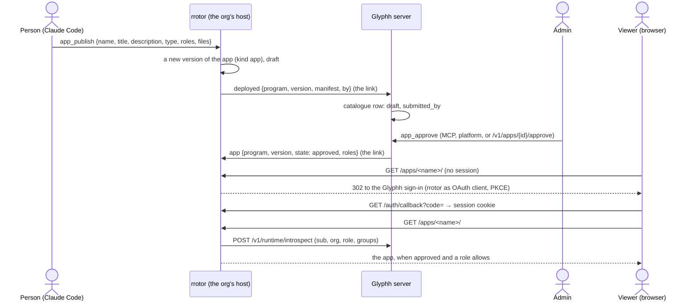

# Org apps: what Claude made, published to the org's own rrotor, reviewed and listed by Glyphh

**Status: approved (2026-11-02); the build is on branch `apps` in each repo.** The founder's rulings: a company makes
something with Claude (a page, a dashboard, a document, a diagram, a deck, a design) and publishes it to *its own*
rrotor as an **app**; an admin (or a reviewer group) reviews it; the org's people find the approved ones in one
searchable list of cards, in Claude and on the platform, and open them at the rrotor; some are restricted to roles;
roles are the identity provider's groups, not a new system; the Glyphh server keeps only the catalogue, never the
files; rrotor runs at the org's own host, no Glyphh name. **One word everywhere: app** (the platform's Apps page,
`/glyphh apps`, the connector's `apps` tools and panel, the API's `/v1/apps`, the link's `app` message): "artifact"
is Claude's word for the file in the session, and it is gone from everything a person reads or calls (2026-11-02:
this rename replaced the first cut's "artifacts"). No skills, no plugins, no SAML, no SCIM. Built across
`glyphh-ai/server` (this spec), `glyphh-ai/rrotor` (`docs/specs/apps.md` points here), `glyphh-ai/platform` and
`glyphh-ai/glyphh` (the plugin).

## 1. The parts

| Part | Does |
|---|---|
| **The file** | What Claude made in the session: a Claude Code artifact (one self-contained `.html` or `.md`, [Claude Code docs, artifacts](https://code.claude.com/docs/en/artifacts)), a React page (`.jsx`/`.tsx`), a Markdown document (a Claude Doc exported), a diagram (`.mmd` Mermaid, `.svg`), a deck or a design exported as `.pdf` or an image, a dashboard (a page plus a function per chart, 4.5). Claude Code's own publish goes to claude.ai; *this* publish goes to the org's rrotor instead, as an **app** |
| **rrotor** (`glyphh-ai/rrotor`) | Holds the app as a program of `"kind": "app"`: the files, the manifest (title, description, type, roles), optionally `program.py` functions the page calls. Serves it to a browser at `https://<host>/apps/<name>/` to people signed in to Glyphh for that rrotor, whose roles allow it, once the catalogue says it is approved. The viewer's calls into the app's functions run as the viewer (their HOME, their CLIs) |
| **The Glyphh server** (`glyphh-ai/server`) | The **catalogue**: one row per app on an org's rrotor (title, description, type, version, roles, who published it, its review state, who reviewed it), filled from the rrotor's own `deployed` message up the link and told back down the link when the state changes. The reviewers. The `apps` API, the MCP tools and the MCP app (the list of cards in Claude). The files never pass through the server |
| **The platform** (`glyphh-ai/platform`) | The Apps page: the same cards, searchable, paged, filtered by type, with Open; for admins and reviewers, the ones awaiting review with Approve and Reject. Settings → Auth: the reviewer groups |
| **The plugin** (`glyphh-ai/glyphh`) | The `publish` skill: "publish this to my org" takes the session's file (any type above) and calls the rrotor's `app_publish`; the panel's Apps section (`/glyphh apps`) and `/glyphh publish <file>` |



## 2. Roles

- **A role is a group name from the identity provider**, or one of Glyphh's two: `admin`, `member`. With single
  sign-on (`ops/sso.py`), the OIDC `groups` claim (Okta: a groups claim on the client; Entra ID: the `groups`
  claim) is read at every sign-in from the userinfo endpoint and kept on the person: `users.groups TEXT[]`
  (lower-cased, deduplicated, at most 200, each at most 120 characters; a sign-in that names no groups keeps `[]`).
  Google and GitHub sign-ins have no groups.
- **Where roles are checked:** the server lists a person only the apps whose `roles` are empty (everyone in the
  org) or intersect `{role} ∪ groups`; the rrotor serves an app only to such a viewer. Both read the same data: the
  server's introspection answer carries `role` and `groups`.
- **Reviewers:** the org's admin always; and the members whose groups intersect `org_sso.reviewers TEXT[]`
  (Settings → Auth, "Reviewer groups"). Orgs without single sign-on: the admin only.
- **Introspection** (`POST /v1/runtime/introspect`, `ops/connector/tokens.py`): `{active, sub, org, scope, exp,
  role, groups}`; `role` `admin` or `member`, `groups` the list above. A runtime key has no person: no roles, and an
  app is never served to a key (keys call programs, not pages).

## 3. The catalogue (server)

### 3.1 Table

`apps` (migration `0011_apps.sql` renames `artifacts` to `apps`, its constraint, indexes and policy with it, and adds
`type`): `id` UUID PK; `org_id` → `orgs` (cascade); `runtime_id` → `rrotors` (cascade); `name` TEXT (the program's
name on that rrotor); `title` TEXT; `description` TEXT; `type` TEXT NOT NULL DEFAULT `'page'` in (`page`,
`dashboard`, `doc`, `diagram`, `deck`, `design`), constraint `apps_type`; `version` INT (the rrotor's version
number, the one reviewed); `commit_sha` TEXT; `roles` TEXT[] NOT NULL DEFAULT '{}'; `state` TEXT in (`draft`,
`approved`, `rejected`, `retired`), constraint `apps_state`; `submitted_by` UUID → `users` (set null);
`submitted_at`; `reviewed_by` UUID → `users` (set null); `reviewed_at`; `reason` TEXT (a rejection's);
`created_at`; `updated_at`. Unique (`runtime_id`, `name`) as `apps_one_per_app`; `ix_apps_org_id`. Row-level
security by `org_id`, as every org table. Model `models/app.py` (`App`, `STATES`, `TYPES`); `ops/apps.py`,
`ops/app_views.py` (`AppView`), `ops/catalogue.py`; `api/apps.py`.

One row per app per rrotor: a new version published replaces the row's `version`, `commit_sha`, `title`,
`description`, `type`, `roles`, `submitted_by`, `submitted_at`, and sets `state` back to `draft` (an approved app's
new version is reviewed again; until then the rrotor keeps serving the approved version, 3.4).

### 3.2 Filled from the link

The rrotor's `deployed` message (rrotor `docs/architecture.md`, 6) carries the manifest. One whose manifest has
`"kind": "app"` makes or updates the row (`ops/catalogue.py`, `catalogue_deployed`): `title` from `app.title` (else
the name), `description` from the manifest's `description`, `type` from `app.type` (else `page`; a value outside
the six is kept as `page`), `roles` from `app.roles`, `submitted_by` from the message's `by` (the Glyphh subject who
called `app_publish`; null for a deploy from a repo), state `draft`. A `deployed` whose manifest is not an app
touches nothing. A `removed` program's row is deleted (its cascade), so a retired and removed app leaves no trace.

### 3.3 API

| Method and path | Who | What |
|---|---|---|
| `GET /v1/apps?q=&page=&per_page=&state=&type=` | anyone in the org | `{apps: [...], page, per_page, total}`; `state` defaults to `approved`; a member sees approved ones their roles allow; `draft`, `rejected` and `retired` are reviewers' (a member asking is `E_FORBIDDEN`). `q` matches title, description and name (case-insensitive substring); `type` one of the six keeps only that type (absent: every type); `per_page` 1–100, default 24; newest `updated_at` first |
| `GET /v1/apps/{id}` | anyone it is listed to | one |
| `POST /v1/apps/{id}/approve` | a reviewer | state `approved`, `reviewed_by`, `reviewed_at`; told down the link; `E_CONFLICT` unless `draft` or `rejected` |
| `POST /v1/apps/{id}/reject` `{reason}` | a reviewer | state `rejected` with the reason (1–500 characters); told down the link |
| `POST /v1/apps/{id}/retire` | a reviewer | state `retired`: no longer served or listed; told down the link |

Each app: `{id, runtime_id, runtime_name, runtime_url, name, title, description, type, version, commit_sha, roles,
state, submitted_by: {id, name, email} | null, submitted_at, reviewed_by, reviewed_at, reason, url}` where `url` is
`{runtime_url}/apps/{name}/`. `GET /v1/me` carries `groups` and `reviewer: bool`. The operation ids are `listApps`,
`getApp`, `approveApp`, `rejectApp`, `retireApp`. Nothing answers at `/v1/artifacts` any more (404, as any unknown
path): the first cut shipped on 2026-11-01 to nobody but the founder.

### 3.4 Told down the link: protocol 3

The link speaks **protocol 3** (`ops/link/protocol.py` `PROTOCOL = 3`): the same messages as protocol 2 with the
catalogue's names changed, `app` for `artifact` and `apps` for `artifacts`. The server accepts a `hello` of protocol
2 or 3 (`ACCEPTED = (2, 3)`; anything else is closed 4426 `upgrade_needed`) and remembers which the runtime said:
to a protocol 2 rrotor (0.2.0, the founder's own at the time) it sends `artifact` and a welcome with `artifacts`; to
a protocol 3 rrotor `app` and `apps`. One place builds the message (`AppState.for_protocol(n)`), nothing else
branches on it, and the protocol 2 names leave when no rrotor of 0.2.0 is heard any more.

`app` message (server → rrotor): `{type: "app", program, version, state, roles}` after every approve, reject and
retire, acknowledged like any message; the welcome carries `apps: [{program, version, state, roles}]` for every row
of that runtime, so a rrotor that was away catches up. The rrotor keeps what it heard in `/data/apps.json` (read
once from `/data/artifacts.json` when that is what a 0.2.0 left) and serves an app only while its active version is
the catalogue's `version` with state `approved` (a newer version deployed but not yet approved: the approved version
stays active and served; the draft is a version on the rrotor, not activated — `app_publish` deploys without
activating when an approved version is active, and the `approved` message activates the version it names). A rrotor
with the link off (air-gapped, `RROTOR_LINK=off`) has no catalogue: the deploy is the approval, and the manifest's
`roles` decide.

### 3.5 MCP (the connector, `mcp/tools/apps.py`)

| Tool | Does |
|---|---|
| `apps` `{q?, page?, state?, type?}` | The list as `GET /v1/apps`; its result is shown by the **apps panel**, an MCP App resource `ui://glyphh/apps/1` (`mcp/panel/apps.html`): cards with title, description, a type chip (Page, Dashboard, Doc, Diagram, Deck, Design), the rrotor's name, version, who published it and when, a search box, a type filter (All types and the six), Previous/Next, and **Open** (the app's `url`, a new tab); for a reviewer the views Published, Awaiting review and Rejected, with Approve and Reject (a reason) on each draft and Retire on a published one, acting by calling the tools below through the host |
| `app_approve` `{app_id}` | approve |
| `app_reject` `{app_id, reason}` | reject |
| `app_retire` `{app_id}` | retire |

`ui://glyphh/artifacts/1` and the `artifact*` tools are gone, not aliased.

## 4. The app on rrotor (`glyphh-ai/rrotor`, 0.3.0)

### 4.1 Manifest

```json
{
  "name": "deploy-failures",
  "kind": "app",
  "description": "Last week's deploy failures by service.",
  "app": {
    "entry": "index.html",
    "type": "dashboard",
    "title": "Deploy failures",
    "roles": ["sre", "admin"],
    "functions": ["failures"]
  },
  "functions": { "failures": { "description": "The failures by service", "inputs": {"type": "object"} } },
  "hosts": ["api.github.com"],
  "clis": ["gh"],
  "limits": { "seconds": 60, "memory_mb": 512 }
}
```

- `app.entry`: the file opened at `/apps/<name>/`, in the version's `src/`. Its extension, lower-cased, is one of:

  | Entry | Served as | Default `type` |
  |---|---|---|
  | `.html`, `.htm` | as it is | `page` |
  | `.md` | rrotor's document shell: `marked` from cdnjs renders it; the source as text when the library does not load | `doc` |
  | `.jsx`, `.tsx` | rrotor's React shell (4.4) | `page` |
  | `.mmd`, `.mermaid` | rrotor's diagram shell: `mermaid` from jsdelivr renders it, the source below it as text when the library does not load | `diagram` |
  | `.svg` | as it is (`image/svg+xml`) | `diagram` |
  | `.pdf` | as it is (`application/pdf`, inline; the browser's own viewer) | `doc` |
  | `.png`, `.jpg`, `.jpeg`, `.webp`, `.gif` | rrotor's image shell: the image centred on a page, at its size, with the title | `design` |

  Any other entry is refused at publish (`E_INPUTS`: "entry is a page (.html, .jsx, .tsx), a document (.md, .pdf),
  a diagram (.mmd, .svg) or an image"). `app.type`: one of `page`, `dashboard`, `doc`, `diagram`, `deck`, `design`;
  absent, the entry's default; `dashboard` and `deck` are never inferred, the publisher says them. `app.title` 1–120
  characters; `app.roles` the roles that may open it (empty: everyone in the org); `app.functions` the functions the
  page may call (each a function of the manifest; empty: the app is static and needs no `program.py`). Every file
  under `src/` beside the entry is served (up to 16 MiB in all, no file outside `src/`), with `Content-Type` by
  extension (`.css`, `.js`, `.mjs`, `.json`, `.svg`, `.txt`, `.map`, `.wasm`, `.pdf`, `.png`, `.jpg`, `.jpeg`,
  `.webp`, `.gif`, `.ico`, `.woff`, `.woff2`, `.csv`; anything else `application/octet-stream`), `Cache-Control:
  no-store`, and a Content-Security-Policy that lets a page load scripts and styles only from itself and the five
  CDN hosts Claude Code's artifacts use (`cdnjs.cloudflare.com`, `cdn.jsdelivr.net`, `cdn.tailwindcss.com`,
  `code.jquery.com`, `unpkg.com`), fonts from Google Fonts, images from itself and `data:`, and `fetch` only its own
  origin.
- An app keeps everything a program may (`secrets`, `hosts`, `clis`, `data`, `databases`, `schedules`, `limits`);
  `program.py` is required when `app.functions` names any.

### 4.2 Publishing

`POST /v1/apps` (MCP `app_publish`): `{name, title, description, type?, roles?, files: {"index.html": "<text>",
...}, entry?, functions?, program?, schedules?, secrets?, hosts?, clis?, limits?}`, `files` text (or `{"base64":
…}` for a binary: a PDF, an image), 64 files and 16 MiB at most, `entry` default `index.html` (when `files` holds
exactly one file, that file), `type` as 4.1, `program` the text of `program.py` when functions are named. rrotor
writes the manifest and the files to a scratch git repo, commits them (the commit is the version's `commit_sha`),
deploys it through the usual path (`from_files`), **without activating it when an approved version of the app is
active** (3.4; a first version is activated: there is nothing approved to keep serving), and answers `{program,
version, commit_sha, deployed_at, type, url}`. The `deployed` message up the link carries the manifest and `by`,
the caller's Glyphh subject (the actor's `sub`; null for a key or the local token). `app_publish` needs a Glyphh
sign-in on a self-hosted rrotor (a key is refused `E_FORBIDDEN`: publishing is a person's act); on a local rrotor
the local token publishes with `by` null. Audit: `program.deploy` as any deploy.

`GET /v1/apps` (MCP `apps_list`): each app: `{name, title, description, type, version, active, roles, state, url}`,
state from `apps.json` (`unknown` with the link off, where `approved` is implied).

### 4.3 Serving, and the browser sign-in

- `GET /apps/{name}/` and `GET /apps/{name}/{path}` serve the active version's `src/{path}` (`/` → the entry, in its
  shell when it has one). On a self-hosted rrotor a request with no session is answered `302` to
  `/auth/start?next=/apps/{name}/`.
- **rrotor as an OAuth client of the Glyphh server** (`rrotord/browser.py`): on first use it registers itself at the
  server's `POST /oauth/register` (`client_name` the runtime's name, `redirect_uris` `[{public_url}/auth/callback]`,
  `token_endpoint_auth_method: none`) and keeps the client id in `/data/oauth-client.json`; `/auth/start` makes a
  PKCE verifier and a state, keeps them in a short-lived cookie (`rrotor_signin`, ten minutes, HttpOnly, SameSite
  Lax, Secure), and sends the browser to the server's `/oauth/authorize` with `resource` = `{public_url}/mcp` (the
  resource introspection is bound to); `/auth/callback` exchanges the code at `/oauth/token`, keeps the tokens in a
  **session** (`/data/sessions/<id>.json`: the access token, the refresh token, `sub`, when it expires; the id is
  256 random bits) and sets `rrotor_session` (HttpOnly, SameSite Lax, Secure, path `/`, 30 days), then sends the
  browser to `next` (a path on this host only). `/auth/logout` (POST) ends the session. An access token past its hour
  is refreshed with the refresh token on the next request; a session that cannot be refreshed is dropped and the
  browser sent to sign in again.
- **The gate** takes the session cookie on `/apps/*`, `/auth/*` and `/v1/apps/*` only (never on `/v1/*` or `/mcp`,
  which take bearers as before), introspects the session's access token exactly as a bearer (`Introspector`, a minute
  kept), and admits the request as `{"type": "sign-in", "sub", "role", "groups"}`. A browser's `fetch` from the page
  to `/apps/{name}/call/{function}` carries the cookie; CSRF is held off by `SameSite=Lax` plus the Origin check
  (the Origin must be this host). The per-person HOME (`clis.subject_of`) is the session's `sub`.
- **What is served:** the active version when `apps.json` says `approved` for that version (or the link is off),
  and the viewer's `{role} ∪ groups` intersects `app.roles` or `app.roles` is empty; a reviewer (role `admin`, or a
  group in the welcome's `reviewers` list, which the welcome also carries) may open a `draft` version at
  `/apps/{name}/?version=N` to review it. Otherwise `403 E_APP_FORBIDDEN` (a page, not JSON: "This app is not
  yours to open" with a sign-out link), `404 E_APP_MISSING` for no such app, `409 E_APP_UNREVIEWED` while nothing is
  approved yet.
- **Calls:** `POST /apps/{name}/call/{function}` with a JSON body (the inputs) runs the function as a run of the
  program (caller `app`, origin `app`, the viewer's subject), waits for its first Result (a `needs_input` or
  `needs_approval` answers as such, with the run id, and the page may `POST /apps/{name}/runs/{run_id}/continue`),
  and answers the Result as JSON. A function `app.functions` does not name is `403 E_APP_FUNCTION`.
- **Local mode** (`127.0.0.1`): no Glyphh sign-in exists; `/apps/*` is served to the browser on this machine without
  a session, roles ignored, calls run with the local token's standing (subject null). It is the person's own
  machine.

### 4.4 The React shell

A `.jsx` or `.tsx` entry is what claude.ai's React artifacts are: one file with ES imports of `react`, `react-dom`,
`recharts`, `lucide-react`, `d3`, `three`, `framer-motion`, `date-fns`, `lodash`, `papaparse`, `mathjs` or
`@radix-ui/*`, Tailwind classes, a default export that is the component. rrotor serves it inside its React shell
and builds nothing: an HTML page with an **import map** sending the React family (`react`, `react-dom`,
`react-dom/client`, `react/jsx-runtime`, `recharts`, `lucide-react`, `framer-motion`, `@radix-ui/*`) to
`https://esm.sh/<package>@<pinned major>?external=react,react-dom`, so the page holds **one** React (jsDelivr's
`+esm` bundles each pin their own React, and hooks in a second copy fail), and the rest (`d3`, `three`, `date-fns`,
`lodash`, `papaparse`, `mathjs`) to `https://cdn.jsdelivr.net/npm/<package>@<pinned major>/+esm`; the Tailwind CDN;
and `@babel/standalone` from cdnjs transforming the entry in the browser. Babel's script tags have no module
registry, so the entry's source is inlined in one `<script type="text/babel" data-type="module">` (presets the
shell registers: the React preset with the automatic runtime, plus TypeScript for `.tsx`) with its `export default`
rewritten to a binding and a trailer that mounts it into `#root` with `createRoot`; `</script` in the source is
escaped. A package the import map does not name fails in the browser as it would on claude.ai; the pinned versions
are one table in `rrotord/apps.py` (`REACT_PACKAGES`). The CSP's script and style hosts gain `esm.sh` for this.

### 4.5 Dashboards

A dashboard is `type: dashboard`: a page (any page entry, 4.1) whose numbers come from the app's own functions, one
per chart or table, called at `/apps/<name>/call/<function>` **as the viewer**: their sign-in, their HOME on the
rrotor, their CLIs (`bq`, `snowsql`, `databricks`, `psql`, `clickhouse-client`, `gh`, any CLI the manifest's `clis`
names, each signed in once per person with `cli_login`), their secrets, the hosts the manifest declares. Two people
opening the same dashboard see what their own accounts allow, as a Claude Dashboard does on claude.ai. A function
may cache into `ctx.db` and a `schedules` entry may refresh the cache (a schedule runs as the program, not as a
person: its own secrets, not a viewer's); the page shows each chart's refreshed time from the function's answer.
Nothing of this is new machinery: it is the app kind with functions, named and documented so the plugin's publish
skill rewrites a Claude Dashboard or a connector-backed Claude Code dashboard into it (6).

### 4.6 MCP tools on the rrotor

`app_publish` and `apps_list` (above); `program_deploy` is unchanged. The rrotor's `hello` says protocol 3 and lists
apps among `deployed` with their manifests, as any program; it takes `app` and `apps` from the server, and still
`artifact` and `artifacts` (a server of protocol 2 is not expected, but the handler costs nothing). The catalogue
module is `rrotord/catalogue.py` (`Catalogue`, `/data/apps.json`); `rrotord/artifacts.py` is gone.

## 5. The platform (`glyphh-ai/platform`)

- **`/apps`** (main sidebar, under Runtimes & licences: "Apps"; `/artifacts` redirects to it): the cards from
  `GET /v1/apps`, a search field (`q`, debounced, in the URL as `?q=`), a **type** filter (a select: All types,
  Pages, Dashboards, Docs, Diagrams, Decks, Designs; in the URL as `?type=`), 24 a page with Previous/Next
  (`?page=`), each card: title, a type chip, description (three lines at most), the runtime's name, `v{version}`,
  the roles as chips (none: "Everyone"), "Published by {name} · {date}", **Open** (the app's `url`, a new tab). For
  a reviewer (`me.reviewer`), tabs **Published** / **Awaiting review** / **Rejected**; on Awaiting review each card
  has **Approve** and **Reject** (a dialog asking the reason); on Published, **Retire** (confirm). Empty states say
  so ("Nothing published yet. Ask Claude to publish what it made to your org."). Refusals as the server's words.
  Types, queries, fixtures, the fake server and the tests all say app (`App`, `AppPage`, `useApps`, `AppsPage`).
- **Settings → Auth**: "Reviewer groups" (comma-separated, saved with the rest of single sign-on; shown only with
  single sign-on on): `reviewers` in `PUT /v1/org/sso`'s body and view.
- The fake server (`dev/fake-server.ts`) answers all of it with fixtures of every type.

## 6. The plugin (`glyphh-ai/glyphh`, 1.7.0)

- **The `publish` skill** (`plugins/glyphh/skills/publish/SKILL.md`): triggered by "publish this to my org", "put
  this on our rrotor", "share this dashboard with the team through Glyphh", "/glyphh:publish". It tells Claude to:
  find the file (the session's latest artifact, which Claude wrote to a temporary directory; the path the person
  names; a Claude Doc, exported to Markdown with the Claude Docs connector's `export`; a Claude Slides deck or a
  Claude Design, exported to PDF or PNG by the person from claude.ai and given as a path; a Claude Dashboard on
  claude.ai, which has no export: each chart shows its SQL, so Claude asks for the charts' queries and the data
  source and rebuilds it as a dashboard app); choose a name (kebab-case from the title, confirmed with the person),
  a title and a one-line description; the type by the table in 4.1, `dashboard` when the page's data comes from
  functions, `deck` for a presentation; ask which roles may open it (default everyone); for a dashboard or any
  connector-backed page, replace each connector call, which cannot run on rrotor, with a function (one per chart or
  data need, in `program.py`, through `ctx.cli` with the viewer's own CLI sign-in or the declared hosts, caching in
  `ctx.db` with a `schedules` refresh when the source is slow) and a `fetch` to `/apps/<name>/call/<function>` in
  the page, or leave the section out with a note; a binary file as `{"base64": …}`; call the rrotor's `app_publish`;
  tell the person the app is awaiting review, who the reviewers are (`whoami`), and the Open link. A reviewer who is
  the person: offer `app_approve` right away.
- **The panel's Apps section** (`/glyphh apps`; `hooks/glyphh/apps.ts`, `sections/apps.tsx`): the cards as the
  platform's, a type chip in each card's first line, a search, the view (Published, Awaiting review, Rejected for a
  reviewer), a type filter cycled by a button (All types → Pages → … ), Previous/Next, Open, Approve, Reject, Retire.
  `/glyphh publish <file> [--name n] [--title t] [--description d] [--type t] [--roles a,b]`: the type by the file's
  extension unless given; a binary file sent as base64. `/glyphh artifacts` is not a command.
- The **rrotor skill** names the tools as `apps`, `app_approve`, `app_reject`, `app_retire`, `app_publish`,
  `apps_list`; the sign-in skill's `whoami` answer (`groups`, `reviewer`) is unchanged.
- `programs/app_dashboard` says `"type": "dashboard"`; a `programs/app_react` example (one `.tsx`, recharts) and a
  `programs/app_diagram` example (one `.mmd`) join it.

## 7. Build order and what each repo tests

1. **Server** (branch `apps`): migration 0011, the rename everywhere (models, ops, api, mcp tools and panel, tests,
   `docs/architecture.md`), `type` in the row, the API, the filter and the views, protocol 3 with the protocol 2
   names kept for a 0.2.0 rrotor. Tests: the rename's tests renamed and passing, a hello of protocol 2 and of 3 each
   answered in its own names, `type` from the manifest and in the filter, 100% coverage as before.
2. **rrotor** (branch `apps-types`, 0.3.0): `type`, the entries and shells, the MIME table, protocol 3, `catalogue.py`
   and `apps.json`, `app_publish`'s `type` and binary entries, `apps_list`'s `type`, `docs/architecture.md` 5.8 and
   `docs/specs/apps.md`. Tests: each entry type served in its shell, the refusals, protocol 3 and the old names,
   `apps.json` taken over from `artifacts.json`.
3. **Platform** (branch `apps`): the page at `/apps` with the redirect, the type filter and chip, the rename through
   types, queries, fixtures, fake server, nav, README, tests.
4. **Plugin** (branch `apps`, 1.7.0): the skill, the section, the command, the rrotor skill's tool list, the
   examples, README, CHANGELOG, tests.

Each repo documents what it built in its `docs/architecture.md` (and this spec's status line is updated as parts
land); nothing here is in "Not built yet" once built.
