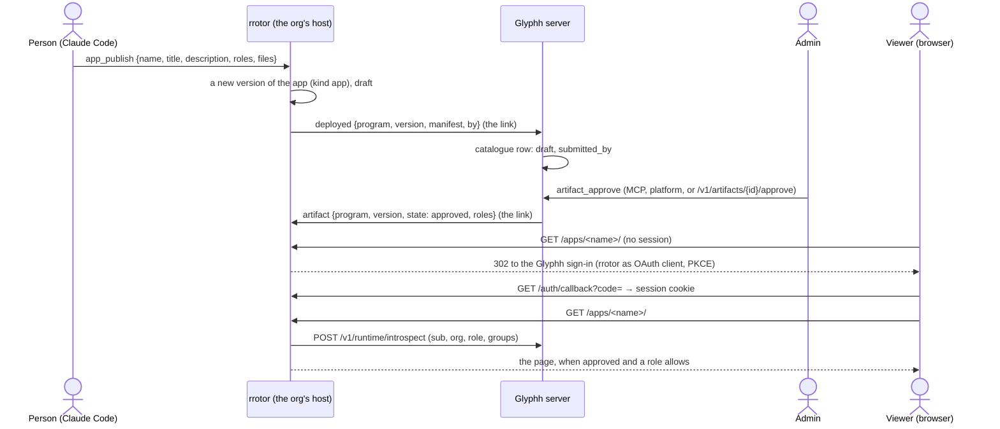

# Org artifacts: Claude's pages published to the org's own rrotor, reviewed and listed by Glyphh

**Status: approved (2026-11-01); the server's part (sections 2, 3 and 7.1) is built; rrotor, the platform and
the plugin in progress.** The founder's rulings: a company builds a page with Claude
(a Claude Code artifact, a dashboard) and publishes it to *its own* rrotor; an admin (or a reviewer group) reviews
it; the org's people find the approved ones in one searchable list of cards, in Claude and on the platform, and
open them at the rrotor; some are restricted to roles; roles are the identity provider's groups, not a new system;
the Glyphh server keeps only the catalogue, never the page; rrotor runs at the org's own host, no Glyphh name.
No skills, no plugins, no SAML, no SCIM. Built across `glyphh-ai/server` (this spec), `glyphh-ai/rrotor`
(`docs/specs/apps.md` points here), `glyphh-ai/platform` and `glyphh-ai/glyphh` (the plugin).

## 1. The parts

| Part | Does |
|---|---|
| **The page** | A Claude Code artifact: one self-contained `.html` (or `.md`) file Claude wrote in the session ([Claude Code docs, artifacts](https://code.claude.com/docs/en/artifacts)). Claude Code's own publish goes to claude.ai; *this* publish goes to the org's rrotor instead, as an **app** |
| **rrotor** (`glyphh-ai/rrotor`) | Holds the app as a program of `"kind": "app"`: the page's files, its manifest (title, description, roles), optionally `program.py` functions the page calls. Serves it to a browser at `https://<host>/apps/<name>/` to people signed in to Glyphh for that rrotor, whose roles allow it, once the catalogue says it is approved. The viewer's calls into the page's functions run as the viewer (their HOME, their CLIs) |
| **The Glyphh server** (`glyphh-ai/server`) | The **catalogue**: one row per app on an org's rrotor (title, description, version, roles, who published it, its review state, who reviewed it), filled from the rrotor's own `deployed` message up the link and told back down the link when the state changes. The reviewers. The `artifacts` API, the MCP tools and the MCP app (the list of cards in Claude). The page itself never passes through the server |
| **The platform** (`glyphh-ai/platform`) | The Artifacts page: the same cards, searchable, paged, with Open; for admins and reviewers, the ones awaiting review with Approve and Reject. Settings → Auth: the reviewer groups |
| **The plugin** (`glyphh-ai/glyphh`) | The `publish` skill: "publish this to my org" takes the session's artifact file and calls the rrotor's `app_publish`. No mod of Claude's interface is needed: Claude in the session does it with the rrotor's and the connector's tools |



## 2. Roles

- **A role is a group name from the identity provider**, or one of Glyphh's two: `admin`, `member`. With single
  sign-on (`ops/sso.py`), the OIDC `groups` claim (Okta: a groups claim on the client; Entra ID: the `groups`
  claim) is read at every sign-in from the userinfo endpoint and kept on the person: `users.groups TEXT[]`
  (lower-cased, deduplicated, at most 200, each at most 120 characters; a sign-in that names no groups keeps `[]`).
  Google and GitHub sign-ins have no groups.
- **Where roles are checked:** the server lists a person only the artifacts whose `roles` are empty (everyone in the
  org) or intersect `{role} ∪ groups`; the rrotor serves a page only to such a viewer. Both read the same data: the
  server's introspection answer now carries `role` and `groups`.
- **Reviewers:** the org's admin always; and the members whose groups intersect `org_sso.reviewers TEXT[]`
  (Settings → Auth, "Reviewer groups"). Orgs without single sign-on: the admin only.
- **Introspection** (`POST /v1/runtime/introspect`, `ops/connector/tokens.py`): `{active, sub, org, scope, exp,
  role, groups}`; `role` `admin` or `member`, `groups` the list above. A runtime key has no person: no roles, and an
  app is never served to a key (keys call programs, not pages).

## 3. The catalogue (server)

### 3.1 Table

`artifacts`: `id` UUID PK; `org_id` → `orgs` (cascade); `runtime_id` → `rrotors` (cascade); `name` TEXT (the
program's name on that rrotor); `title` TEXT; `description` TEXT; `version` INT (the rrotor's version number, the one
reviewed); `commit_sha` TEXT; `roles` TEXT[] NOT NULL DEFAULT '{}'; `state` TEXT in (`draft`, `approved`,
`rejected`, `retired`); `submitted_by` UUID → `users` (set null); `submitted_at`; `reviewed_by` UUID → `users` (set
null); `reviewed_at`; `reason` TEXT (a rejection's); `created_at`; `updated_at`. Unique (`runtime_id`, `name`).
Row-level security by `org_id`, as every org table. Migration `0010_artifacts.sql`, plus `users.groups` and
`org_sso.reviewers` in it.

One row per app per rrotor: a new version published replaces the row's `version`, `commit_sha`, `title`,
`description`, `roles`, `submitted_by`, `submitted_at`, and sets `state` back to `draft` (an approved app's new
version is reviewed again; until then the rrotor keeps serving the approved version, 3.4).

### 3.2 Filled from the link

The rrotor's `deployed` message (rrotor `docs/architecture.md`, 6) carries the manifest. One whose manifest has
`"kind": "app"` makes or updates the row (`ops/artifacts.py`, `catalogue_deployed`): `title` from `app.title` (else
the name), `description` from the manifest's `description`, `roles` from `app.roles`, `submitted_by` from the
message's new `by` (the Glyphh subject who called `app_publish`; null for a deploy from a repo), state `draft`. A
`deployed` of a program that is not an app changes nothing. A runtime removed takes its rows with it (cascade).

A rrotor in `local` mode publishes too (a person's own machine); its rows are the org's as any other, and Open
points at `http://127.0.0.1:7777/apps/<name>/`, which only that machine's browser reaches.

### 3.3 API

| Method and path | Who | What |
|---|---|---|
| `GET /v1/artifacts?q=&page=&per_page=&state=` | anyone in the org | `{artifacts: [...], page, per_page, total}`; `state` defaults to `approved`; a member sees approved ones their roles allow; `draft`, `rejected` and `retired` are reviewers' (a member asking is `E_FORBIDDEN`). `q` matches title, description and name (case-insensitive substring); `per_page` 1–100, default 24; newest `updated_at` first |
| `GET /v1/artifacts/{id}` | anyone it is listed to | one |
| `POST /v1/artifacts/{id}/approve` | a reviewer | state `approved`, `reviewed_by`, `reviewed_at`; told down the link; `E_CONFLICT` unless `draft` or `rejected` |
| `POST /v1/artifacts/{id}/reject` `{reason}` | a reviewer | state `rejected` with the reason (1–500 characters); told down the link |
| `POST /v1/artifacts/{id}/retire` | a reviewer | state `retired`: no longer served or listed; told down the link |

Each artifact: `{id, runtime_id, runtime_name, runtime_url, name, title, description, version, commit_sha, roles,
state, submitted_by: {id, name, email} | null, submitted_at, reviewed_by, reviewed_at, reason, url}` where `url` is
`{runtime_url}/apps/{name}/`. `GET /v1/me` gains `groups` and `reviewer: bool`.

### 3.4 Told down the link

`artifact` message (server → rrotor): `{type: "artifact", program, version, state, roles}` after every approve,
reject and retire, acknowledged like any message; the welcome carries `artifacts: [{program, version, state,
roles}]` for every row of that runtime, so a rrotor that was away catches up. The rrotor keeps what it heard in
`/data/artifacts.json` and serves an app only while its active version is the catalogue's `version` with state
`approved` (a newer version deployed but not yet approved: the approved version stays active and served; the draft
is a version on the rrotor, not activated — `app_publish` deploys without activating when an approved version is
active, and the `approved` message activates the version it names). A rrotor with the link off (air-gapped,
`RROTOR_LINK=off`) has no catalogue: the deploy is the approval, and the manifest's `roles` decide.

### 3.5 MCP (the connector, `mcp/tools/artifacts.py`)

| Tool | Does |
|---|---|
| `artifacts` `{q?, page?, state?}` | The list as `GET /v1/artifacts`; its result is shown by the **artifacts panel**, an MCP App resource `ui://glyphh/artifacts/1` (`mcp/panel/artifacts.html`): cards with title, description, the rrotor's name, version, who published it and when, a search box, Previous/Next, and **Open** (the app's `url`, a new tab); for a reviewer a second view, Awaiting review, with Approve and Reject (a reason) on each card, acting by calling the tools below through the host |
| `artifact_approve` `{artifact_id}` | approve |
| `artifact_reject` `{artifact_id, reason}` | reject |
| `artifact_retire` `{artifact_id}` | retire |

## 4. The app on rrotor (`glyphh-ai/rrotor`)

### 4.1 Manifest

```json
{
  "name": "deploy-failures",
  "kind": "app",
  "description": "Last week's deploy failures by service.",
  "app": {
    "entry": "index.html",
    "title": "Deploy failures",
    "roles": ["sre", "admin"],
    "functions": ["failures"]
  },
  "functions": { "failures": { "description": "The failures by service", "inputs": {"type": "object"} } },
  "hosts": ["api.github.com"],
  "clis": ["gh"],
  "limits": { "seconds": 60, "memory_mb": 512 }
}
```

- `app.entry`: the page, a file in the version's `src/` (`.html` or `.md`; a Markdown page is served inside rrotor's
  own document shell); `app.title` 1–120 characters; `app.roles` the roles that may open it (empty: everyone in the
  org); `app.functions` the functions the page may call (each a function of the manifest; empty: the page is static
  and needs no `program.py`). `files` is not a field: every file under `src/` beside the entry is served (up to
  16 MiB in all, no file outside `src/`), with `Content-Type` by extension, `Cache-Control: no-store`, and a
  Content-Security-Policy that lets the page load scripts and styles only from itself and the five CDN hosts
  Claude Code's artifacts use (`cdnjs.cloudflare.com`, `cdn.jsdelivr.net`, `cdn.tailwindcss.com`, `code.jquery.com`,
  `unpkg.com`), fonts from Google Fonts, and `fetch` only its own origin.
- An app keeps everything a program may (`secrets`, `hosts`, `clis`, `data`, `schedules`, `limits`); `program.py` is
  required when `app.functions` names any.

### 4.2 Publishing

`POST /v1/apps` (MCP `app_publish`): `{name, title, description, roles?, files: {"index.html": "<text>", ...},
entry?, functions?, program?}`, `files` text (or `{"base64": …}`), 64 files and 16 MiB at most, `entry` default
`index.html`, `program` the text of `program.py` when functions are named. rrotor writes the manifest and the files
to a scratch git repo, commits them (the commit is the version's `commit_sha`), deploys it through the usual path
(`Deployer.from_bundle`-alike, `from_files`), **without activating it when an approved version of the app is active**
(3.4; a first version is activated: there is nothing approved to keep serving), and answers `{program, version,
commit_sha, deployed_at, url}`. The `deployed` message up the link carries the manifest and `by`, the caller's
Glyphh subject (the actor's `sub`; null for a key or the local token). `app_publish` needs a Glyphh sign-in on a
self-hosted rrotor (a key is refused `E_FORBIDDEN`: publishing is a person's act); on a local rrotor the local token
publishes with `by` null. Audit: `program.deploy` as any deploy.

`GET /v1/apps` (MCP `apps_list`): each app: `{name, title, description, version, active, roles, state, url}`, state
from `artifacts.json` (`unknown` with the link off, where `approved` is implied).

### 4.3 Serving, and the browser sign-in

- `GET /apps/{name}/` and `GET /apps/{name}/{path}` serve the active version's `src/{path}` (`/` → the entry). On a
  self-hosted rrotor a request with no session is answered `302` to `/auth/start?next=/apps/{name}/`.
- **rrotor as an OAuth client of the Glyphh server** (`rrotord/browser.py`): on first use it registers itself at the
  server's `POST /oauth/register` (`client_name` the runtime's name, `redirect_uris` `[{public_url}/auth/callback]`,
  `token_endpoint_auth_method: none`) and keeps the client id in `/data/oauth-client.json`; `/auth/start` makes a
  PKCE verifier and a state, keeps them in a short-lived cookie (`rrotor_signin`, ten minutes, HttpOnly, SameSite
  Lax, Secure), and sends the browser to the server's `/oauth/authorize` with `resource` = `{public_url}/mcp` (the
  resource introspection is bound to); `/auth/callback` exchanges the code at `/oauth/token`, keeps the tokens in a
  **session** (`/data/sessions/<id>.json`: the access token, the refresh token, `sub`, when it expires; the id is
  256 random bits) and sets `rrotor_session` (HttpOnly, SameSite Lax, Secure, path `/`, 30 days), then sends the
  browser to `next` (a path on this host only). `/auth/logout` (POST) ends the session. An access token past its hour
  is refreshed with the refresh token on the next request; a session that cannot be refreshed is dropped and the
  browser sent to sign in again.
- **The gate** takes the session cookie on `/apps/*`, `/auth/*` and `/v1/apps/*` only (never on `/v1/*` or `/mcp`,
  which take bearers as before), introspects the session's access token exactly as a bearer (`Introspector`, a minute
  kept), and admits the request as `{"type": "sign-in", "sub", "role", "groups"}`. A browser's `fetch` from the page
  to `/apps/{name}/call/{function}` carries the cookie; CSRF is held off by `SameSite=Lax` plus the Origin check
  (the Origin must be this host). The per-person HOME (`clis.subject_of`) is the session's `sub`.
- **What is served:** the active version when `artifacts.json` says `approved` for that version (or the link is
  off), and the viewer's `{role} ∪ groups` intersects `app.roles` or `app.roles` is empty; a reviewer (role `admin`,
  or a group in the welcome's `reviewers` list, which the welcome also carries) may open a `draft` version at
  `/apps/{name}/?version=N` to review it. Otherwise `403 E_APP_FORBIDDEN` (a page, not JSON: "This app is not
  yours to open" with a sign-out link), `404 E_APP_MISSING` for no such app, `409 E_APP_UNREVIEWED` while nothing is
  approved yet.
- **Calls:** `POST /apps/{name}/call/{function}` with a JSON body (the inputs) runs the function as a run of the
  program (caller `app`, origin `app`, the viewer's subject), waits for its first Result (a `needs_input` or
  `needs_approval` answers as such, with the run id, and the page may `POST /apps/{name}/runs/{run_id}/continue`),
  and answers the Result as JSON. A function `app.functions` does not name is `403 E_APP_FUNCTION`.
- **Local mode** (`127.0.0.1`): no Glyphh sign-in exists; `/apps/*` is served to the browser on this machine without
  a session, roles ignored, calls run with the local token's standing (subject null). It is the person's own
  machine.

### 4.4 MCP tools on the rrotor

`app_publish` and `apps_list` (above); `program_deploy` is unchanged. The rrotor's `hello` lists apps among
`deployed` with their manifests, as any program.

## 5. The platform (`glyphh-ai/platform`)

- **`/artifacts`** (main sidebar, under Runtimes & licences: "Artifacts"): the cards from `GET /v1/artifacts`, a
  search field (`q`, debounced, in the URL as `?q=`), 24 a page with Previous/Next (`?page=`), each card: title,
  description (three lines at most), the runtime's name, `v{version}`, the roles as chips (none: "Everyone"),
  "Published by {name} · {date}", **Open** (the app's `url`, a new tab). For a reviewer (`me.reviewer`), tabs
  **Published** / **Awaiting review** / **Rejected**; on Awaiting review each card has **Approve** and **Reject**
  (a dialog asking the reason); on Published, **Retire** (confirm). Empty states say so ("Nothing published yet.
  Ask Claude to publish an artifact to your org."). Refusals as the server's words.
- **Settings → Auth**: "Reviewer groups" (comma-separated, saved with the rest of single sign-on; shown only with
  single sign-on on): `reviewers` in `PUT /v1/org/sso`'s body and view.
- The fake server (`dev/fake-server.ts`) answers all of it with fixtures.

## 6. The plugin (`glyphh-ai/glyphh`)

- **The `publish` skill** (`plugins/glyphh/skills/publish/SKILL.md`): triggered by "publish this to my org", "put
  this artifact on our rrotor", "/glyphh:publish". It tells Claude to: find the artifact's file (the session's
  latest artifact, which Claude wrote to a temporary directory, or the path the person names; a `.html` or `.md`);
  choose a name (kebab-case from the title, confirmed with the person), a title and a one-line description; ask
  which roles may open it (default everyone); replace connector-backed sections, which cannot run on rrotor, with
  functions (one per data need, written as `program.py` with `ctx.cli` or the declared hosts) and a `fetch` to
  `/apps/<name>/call/<function>` in the page, or leave them out with a note; call the rrotor's `app_publish`; tell
  the person the app is awaiting review, who the reviewers are (`whoami`), and the Open link. A reviewer who is the
  person: offer `artifact_approve` right away.
- The **rrotor skill** names the new tools; the `whoami` tool's answer (`groups`, `reviewer`) is in the sign-in skill.

## 7. Build order and what each repo tests

1. **Server** (`sso-oidc` continues, branch `artifacts`): `users.groups` at sign-in (OIDC `groups` claim), `org_sso.
   reviewers`, introspection `role`/`groups`, the `artifacts` table, `ops/artifacts.py`, the API, `deployed` →
   catalogue, the `artifact` message and the welcome's `artifacts` and `reviewers`, the MCP tools and panel, `/v1/me`
   `groups` and `reviewer`. Tests: all of it against the fake rrotor link, 100% coverage.
2. **rrotor** (branch `apps`): the `app` kind, `app_publish`/`apps_list`, `/apps/*` serving and the browser sign-in,
   `artifacts.json` from the link, roles, calls, local mode. Tests: the manifest, publishing, serving (an aiohttp
   test client), the sign-in with a fake Glyphh server, 100% coverage; the image's sandbox tests unchanged.
3. **Platform** (branch `artifacts`): the page, the tabs, Settings → Auth reviewers, fake server, tests.
4. **Plugin** (branch `publish-skill`): the skill, the rrotor skill's tool list, a test that the skill's frontmatter
   is well formed as the others are.

Each repo documents what it built in its `docs/architecture.md` (and this spec's status line is updated as parts
land); nothing here is in "Not built yet" once built.
